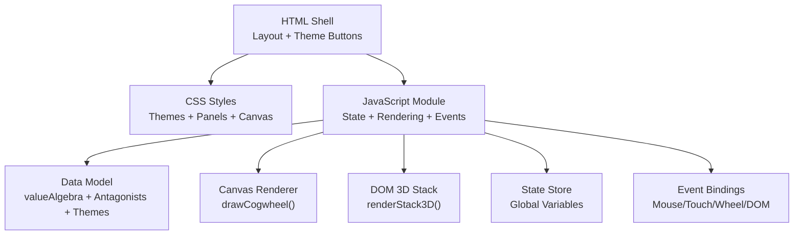
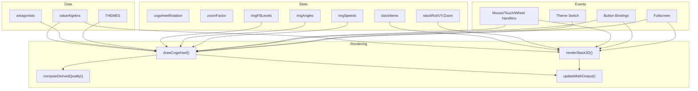
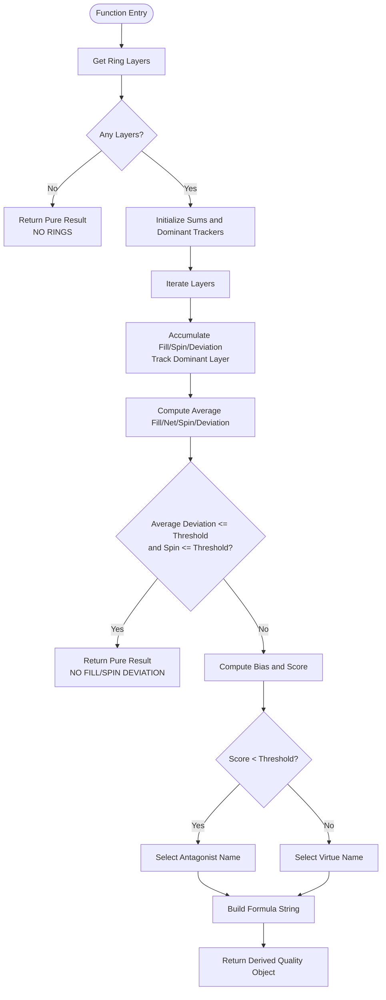
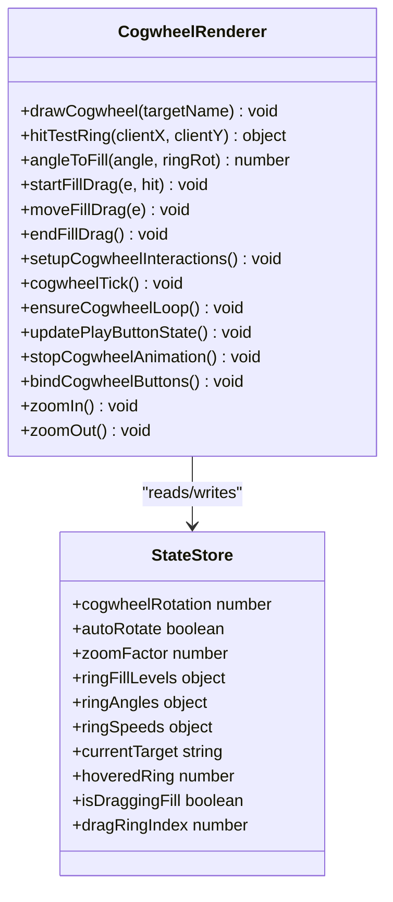
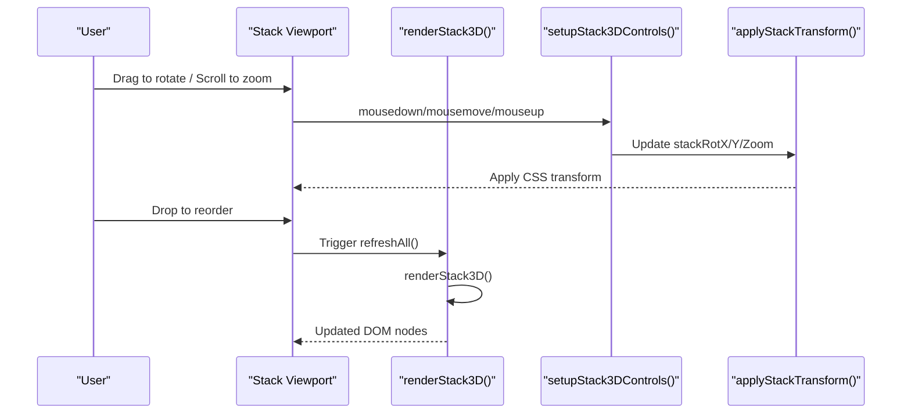
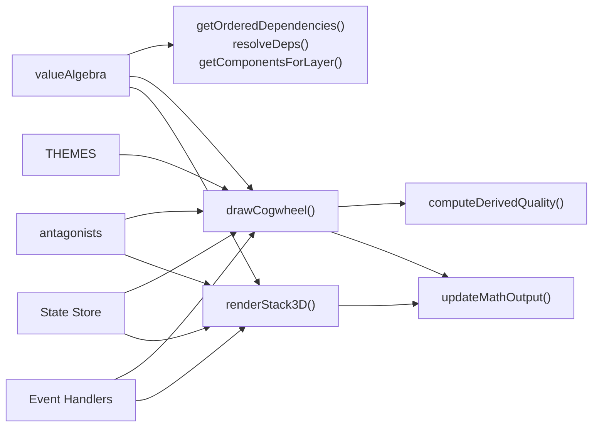

# API Reference

<cite>
**Referenced Files in This Document**
- [Alg_Virt_WhLL.html](file://Alg_Virt_WhLL.html)
</cite>

## Table of Contents
1. [Introduction](#introduction)
2. [Project Structure](#project-structure)
3. [Core Components](#core-components)
4. [Architecture Overview](#architecture-overview)
5. [Detailed Component Analysis](#detailed-component-analysis)
6. [Dependency Analysis](#dependency-analysis)
7. [Performance Considerations](#performance-considerations)
8. [Troubleshooting Guide](#troubleshooting-guide)
9. [Conclusion](#conclusion)
10. [Appendices](#appendices)

## Introduction
This document provides a comprehensive API reference for the Algebraic Virtue Wheel application contained in a single HTML file. It documents:
- Public JavaScript functions and their parameters, return values, and usage patterns
- Configuration objects such as valueAlgebra and theme definitions
- Rendering options and UI state management
- Event handling patterns for canvas interactions, DOM manipulation, and fullscreen behavior
- State access and modification APIs
- Type-like definitions, parameter validation rules, and browser compatibility notes
- Code examples expressed as references to source locations rather than inline code snippets

The goal is to make the system understandable for both technical and non-technical users while preserving precise implementation details.

## Project Structure
The project consists of one self-contained HTML file that includes:
- CSS styles defining themes, layout, and visual components
- A data model describing virtues, dependencies, colors, layers, and antagonists
- JavaScript logic for rendering, interaction, animation, telemetry, and state management

**Diagram sources**
- [Alg_Virt_WhLL.html:1-800](file://Alg_Virt_WhLL.html#L1-L800)
- [Alg_Virt_WhLL.html:827-2033](file://Alg_Virt_WhLL.html#L827-L2033)

**Section sources**
- [Alg_Virt_WhLL.html:1-800](file://Alg_Virt_WhLL.html#L1-L800)
- [Alg_Virt_WhLL.html:827-2033](file://Alg_Virt_WhLL.html#L827-L2033)

## Core Components
This section summarizes the main public interfaces exposed by the script module.

- computeDerivedQuality(): Computes an emergent or negative quality based on ring fills and spin speeds. Returns a structured object with fields like pure, negative, score, name, base, layer, and formula.
- drawCogwheel(targetName): Renders concentric rings representing layered components onto the canvas. Accepts a target quality name and uses current zoom, rotation, fill levels, and ring angles.
- renderStack3D(): Builds and renders the 3D stack visualization using DOM elements. Uses current stackItems, fill levels, and view transforms.
- refreshAll(): Orchestrates full redraw and telemetry updates by calling drawCogwheel(), renderStack3D(), updateDerivedQuality(), and updateMathOutput().

Additional supporting functions include:
- buildStack(componentName): Constructs ordered stack items from dependencies and target.
- getOrderedDependencies(name), resolveDeps(name, visited): Resolve dependency graph and deduplicate order.
- getComponentsForLayer(targetName), getLayerComponentsOrdered(targetName, layer): Map components to layers and retrieve ordered lists.
- getFillForLayer(layer, targetName): Retrieve normalized fill level per layer.
- adjustRingSpeed(layer, delta): Modify ring spin speed with bounds and persistence.
- ensureCogwheelLoop(): Start/stop animation loop based on autoRotate and ring spins.
- setupThemeSwitch(), applyTheme(themeId): Manage theme switching and persistence.
- setupFullscreen(): Handle fullscreen toggling and re-rendering.

**Section sources**
- [Alg_Virt_WhLL.html:941-1126](file://Alg_Virt_WhLL.html#L941-L1126)
- [Alg_Virt_WhLL.html:1139-1351](file://Alg_Virt_WhLL.html#L1139-L1351)
- [Alg_Virt_WhLL.html:1617-1760](file://Alg_Virt_WhLL.html#L1617-L1760)
- [Alg_Virt_WhLL.html:1985-2002](file://Alg_Virt_WhLL.html#L1985-L2002)

## Architecture Overview
The application follows a modular architecture within a single script:
- Data Model: valueAlgebra defines virtues, components, colors, descriptions, and layers; antagonists map virtues to opposites; THEMES define color palettes and fonts.
- State Store: Global variables hold rotation, zoom, fill levels, ring angles/speeds, stack items, and view states.
- Rendering Layer: Canvas-based cogwheel renderer and DOM-based 3D stack renderer.
- Interaction Layer: Mouse/touch/wheel event handlers for dragging fills, adjusting ring speeds, zooming, rotating the stack, and fullscreen toggling.
- Telemetry Layer: Textual output summarizing formulas, ring telemetry, derived quality, and runtime stats.

**Diagram sources**
- [Alg_Virt_WhLL.html:829-887](file://Alg_Virt_WhLL.html#L829-L887)
- [Alg_Virt_WhLL.html:917-939](file://Alg_Virt_WhLL.html#L917-L939)
- [Alg_Virt_WhLL.html:1139-1351](file://Alg_Virt_WhLL.html#L1139-L1351)
- [Alg_Virt_WhLL.html:1617-1760](file://Alg_Virt_WhLL.html#L1617-L1760)
- [Alg_Virt_WhLL.html:1985-2002](file://Alg_Virt_WhLL.html#L1985-L2002)

## Detailed Component Analysis

### computeDerivedQuality()
Purpose:
- Calculates an emergent or negative quality based on ring fills and spin speeds across layers.
- Determines purity when deviations are minimal and returns a descriptive formula.

Parameters:
- None (uses currentTarget, ringFillLevels, ringSpeeds, and helper functions).

Return Value:
- Object with fields:
  - pure: boolean indicating no deviation
  - negative: boolean indicating negative emergent quality
  - score: numeric bias combining fill and spin effects
  - name: resulting quality name (target or antagonist)
  - base: selected component used for naming
  - layer: dominant layer index
  - formula: human-readable derivation string

Usage Patterns:
- Called internally by updateDerivedQuality() and updateMathOutput() to reflect combined state.
- Used during drag operations and ring speed adjustments to keep UI consistent.

Validation Rules:
- If no rings exist, returns a pure result with NO RINGS formula.
- Purity threshold checks average deviation and spin magnitude.
- Negative determination uses a threshold on computed score.

Complexity:
- Linear in number of layers; constant-time math per layer.

Error Handling:
- Gracefully handles missing rings and defaults to pure state.

Performance:
- Lightweight computation suitable for frequent calls during interactions.

**Section sources**
- [Alg_Virt_WhLL.html:1016-1078](file://Alg_Virt_WhLL.html#L1016-L1078)
- [Alg_Virt_WhLL.html:1080-1090](file://Alg_Virt_WhLL.html#L1080-L1090)
- [Alg_Virt_WhLL.html:1883-1942](file://Alg_Virt_WhLL.html#L1883-L1942)

#### Flowchart: Derived Quality Computation

**Diagram sources**
- [Alg_Virt_WhLL.html:1016-1078](file://Alg_Virt_WhLL.html#L1016-L1078)

### drawCogwheel(targetName)
Purpose:
- Renders the concentric cogwheel visualization onto the canvas.
- Draws background gradients, rings, teeth, fill arcs, labels, and hub indicators.

Parameters:
- targetName: string representing the selected virtue or quality.

Behavior:
- Resizes canvas according to container dimensions and device pixel ratio.
- Computes layer radii and draws each ring with fill levels, rotation, and speed tags.
- Updates rotation info and zoom percentage in the DOM.

Return Value:
- None (side-effect rendering function).

Usage Patterns:
- Invoked by refreshAll(), theme switching, zoom controls, and fullscreen changes.
- Called after user interactions to reflect updated state.

Validation Rules:
- Skips rendering if no layers are found for the target.
- Clamps zoom factor via external helpers.

Error Handling:
- Assumes DOM elements exist; safe-guarded by initialization flow.

Performance:
- Uses efficient canvas drawing primitives; avoids unnecessary redraws by controlling call sites.

**Section sources**
- [Alg_Virt_WhLL.html:1139-1351](file://Alg_Virt_WhLL.html#L1139-L1351)
- [Alg_Virt_WhLL.html:1538-1612](file://Alg_Virt_WhLL.html#L1538-L1612)
- [Alg_Virt_WhLL.html:1947-1980](file://Alg_Virt_WhLL.html#L1947-L1980)

#### Class Diagram: Cogwheel Rendering Components

**Diagram sources**
- [Alg_Virt_WhLL.html:1139-1612](file://Alg_Virt_WhLL.html#L1139-L1612)
- [Alg_Virt_WhLL.html:917-939](file://Alg_Virt_WhLL.html#L917-L939)

### renderStack3D()
Purpose:
- Builds and renders the 3D stratified stack visualization using DOM elements.
- Displays front faces with fill overlays, back faces with antagonists, and side/top/bottom faces with metadata.

Parameters:
- None (uses global stackItems, currentTarget, and view state).

Behavior:
- Clears scene and constructs floor element.
- Iterates stackItems to create box elements with faces and labels.
- Applies drag-and-drop reorder events and updates transform.

Return Value:
- None (side-effect rendering function).

Usage Patterns:
- Called by refreshAll() and fullscreen change handler.
- Rebuilt after stack reorder or antagonist visibility toggle.

Validation Rules:
- Relies on valid stackItems structure produced by buildStack().

Error Handling:
- Safe against empty stacks; still renders floor and applies transform.

Performance:
- DOM-heavy but optimized by reusing classes and minimizing reflows.

**Section sources**
- [Alg_Virt_WhLL.html:1617-1760](file://Alg_Virt_WhLL.html#L1617-L1760)
- [Alg_Virt_WhLL.html:1769-1878](file://Alg_Virt_WhLL.html#L1769-L1878)
- [Alg_Virt_WhLL.html:1947-1980](file://Alg_Virt_WhLL.html#L1947-L1980)

#### Sequence Diagram: Stack Render and Interact

**Diagram sources**
- [Alg_Virt_WhLL.html:1617-1760](file://Alg_Virt_WhLL.html#L1617-L1760)
- [Alg_Virt_WhLL.html:1769-1878](file://Alg_Virt_WhLL.html#L1769-L1878)

### refreshAll()
Purpose:
- Central orchestrator to redraw all visuals and update telemetry.

Parameters:
- None.

Behavior:
- Calls drawCogwheel(currentTarget), renderStack3D(), updateDerivedQuality(), and updateMathOutput(currentTarget).

Return Value:
- None.

Usage Patterns:
- Invoked after any state mutation affecting visuals or telemetry.
- Used during initialization, resize debouncing, and control actions.

**Section sources**
- [Alg_Virt_WhLL.html:1985-1990](file://Alg_Virt_WhLL.html#L1985-L1990)
- [Alg_Virt_WhLL.html:2007-2029](file://Alg_Virt_WhLL.html#L2007-L2029)

### Configuration Objects

#### valueAlgebra
Structure:
- Keys: virtue names (strings)
- Values: objects with:
  - components: array of prerequisite virtue names
  - color: hex color string
  - desc: description text
  - layer: integer layer index

Usage:
- Defines the algebraic structure of virtues and their derivations.
- Used by dependency resolution, rendering colors, and telemetry.

Validation:
- All referenced components should exist; missing entries yield fallback behaviors.

**Section sources**
- [Alg_Virt_WhLL.html:829-853](file://Alg_Virt_WhLL.html#L829-L853)

#### antagonists
Structure:
- Keys: virtue names
- Values: antagonist names

Usage:
- Maps virtues to their antagonistic counterparts for negative labeling and display.

**Section sources**
- [Alg_Virt_WhLL.html:855-862](file://Alg_Virt_WhLL.html#L855-L862)

#### THEMES
Structure:
- Keys: theme identifiers (e.g., spaceship, vintage, toth-egyptian)
- Values: objects with:
  - accent: hex color
  - accentRgb: RGB tuple string
  - bright: bright color for highlights
  - neutralRgb: RGB tuple string for neutral elements
  - canvasFont: font family string for canvas text

Usage:
- Provides palette and typography for rendering and UI styling.

**Section sources**
- [Alg_Virt_WhLL.html:865-887](file://Alg_Virt_WhLL.html#L865-L887)

### Event Handling Patterns

#### Canvas Interactions
- Mouse down: Hit-test rings and start fill drag.
- Mouse move: Update hover state or drag fill level.
- Mouse up: End fill drag.
- Wheel: Shift+Wheel adjusts ring speed; normal wheel zooms.
- Touch: Single-finger drag to adjust fill; two-finger pinch to zoom.

Implementation Highlights:
- hitTestRing() computes ring index and angle.
- angleToFill() maps pointer angle to normalized fill.
- startFillDrag()/moveFillDrag()/endFillDrag() manage drag state and trigger refreshAll().

**Section sources**
- [Alg_Virt_WhLL.html:1353-1492](file://Alg_Virt_WhLL.html#L1353-L1492)

#### DOM Button Bindings
- Reset: Stops animation, clears rotations/spins/fills, refreshes.
- Play/Pause: Toggles autoRotate and ensures animation loop.
- Zoom In/Out/Reset: Adjusts zoomFactor and redraws.
- Ring Speed Controls: Increment/decrement/clear speeds for selected layer.

**Section sources**
- [Alg_Virt_WhLL.html:1538-1609](file://Alg_Virt_WhLL.html#L1538-L1609)

#### Stack Controls
- Reset View: Resets rotation and zoom.
- Toggle Labels: Shows/hides antagonists and re-renders.
- Auto Spin: Toggles interval-based rotation.

**Section sources**
- [Alg_Virt_WhLL.html:1769-1878](file://Alg_Virt_WhLL.html#L1769-L1878)

#### Fullscreen
- Toggles fullscreen mode for panels.
- Re-renders canvas and stack after transition.

**Section sources**
- [Alg_Virt_WhLL.html:1947-1980](file://Alg_Virt_WhLL.html#L1947-L1980)

### State Management API

#### Accessors and Mutators
- getRingLayers(): Returns sorted layer indices for currentTarget.
- getRingAngle(layer): Returns cumulative angle for a ring layer.
- getRingSpeed(layer): Returns spin speed for a ring layer.
- getFillForLayer(layer, targetName): Returns normalized fill level.
- adjustRingSpeed(layer, delta): Modifies ring speed with bounds and triggers refresh.

#### Global State Variables
- cogwheelRotation: Current wheel rotation angle.
- autoRotate: Boolean flag for continuous rotation.
- zoomFactor: Numeric zoom multiplier.
- ringFillLevels: Map of layer keys to fill levels.
- ringAngles: Map of layer keys to cumulative angles.
- ringSpeeds: Map of layer keys to spin speeds.
- currentTarget: Selected virtue name.
- hoveredRing: Index of hovered ring.
- isDraggingFill/dragRingIndex: Drag state flags.
- stackItems: Array of stack item objects.
- stackRotX/stackRotY/stackZoom: View transform state.
- stackDragging: Dragging flag for stack rotation.
- stackLastX/stackLastY: Last pointer coordinates.
- stackSpin: Boolean for auto-spinning stack.
- stackSpinInterval: Interval ID for stack spin.
- stackShowAntagonists: Boolean for antagonist visibility.

#### Usage Patterns
- Initialization sets currentTarget and builds stackItems.
- Control actions mutate state and call refreshAll().
- Animation loops update rotation and ring angles periodically.

**Section sources**
- [Alg_Virt_WhLL.html:917-939](file://Alg_Virt_WhLL.html#L917-L939)
- [Alg_Virt_WhLL.html:992-1005](file://Alg_Virt_WhLL.html#L992-L1005)
- [Alg_Virt_WhLL.html:1117-1126](file://Alg_Virt_WhLL.html#L1117-L1126)
- [Alg_Virt_WhLL.html:1992-2002](file://Alg_Virt_WhLL.html#L1992-L2002)

### Type Definitions and Validation Rules

#### Types
- TargetName: string representing a virtue key in valueAlgebra.
- LayerIndex: integer representing a layer number.
- FillLevel: number between 0 and 1 inclusive.
- RingSpeed: number bounded by RING_SPEED_MAX.
- ThemeId: string matching keys in THEMES.

#### Validation Rules
- computeDerivedQuality(): Handles absence of rings; thresholds for purity and negativity.
- adjustRingSpeed(): Clamps speed within [-RING_SPEED_MAX, RING_SPEED_MAX]; deletes near-zero speeds.
- hitTestRing(): Returns null if pointer not over any ring.
- angleToFill(): Normalizes angle to [0,1].
- buildStack(): Returns empty array if component not found.

**Section sources**
- [Alg_Virt_WhLL.html:992-1005](file://Alg_Virt_WhLL.html#L992-L1005)
- [Alg_Virt_WhLL.html:1016-1078](file://Alg_Virt_WhLL.html#L1016-L1078)
- [Alg_Virt_WhLL.html:1117-1126](file://Alg_Virt_WhLL.html#L1117-L1126)
- [Alg_Virt_WhLL.html:1353-1385](file://Alg_Virt_WhLL.html#L1353-L1385)
- [Alg_Virt_WhLL.html:1617-1642](file://Alg_Virt_WhLL.html#L1617-L1642)

### Compatibility Notes
- Canvas API: Requires modern browsers supporting getContext('2d'), devicePixelRatio, and high-DPI scaling.
- Fullscreen API: Uses standard requestFullscreen() with webkit prefix fallback.
- Touch Events: Supports touchstart/move/end with passive/non-passive options.
- LocalStorage: Wrapped in try/catch to handle unavailable storage environments.
- Resize Handling: Debounced to avoid excessive redraws.

**Section sources**
- [Alg_Virt_WhLL.html:1947-1980](file://Alg_Virt_WhLL.html#L1947-L1980)
- [Alg_Virt_WhLL.html:2007-2029](file://Alg_Virt_WhLL.html#L2007-L2029)

## Dependency Analysis
The following diagram shows how core modules depend on each other:

**Diagram sources**
- [Alg_Virt_WhLL.html:829-887](file://Alg_Virt_WhLL.html#L829-L887)
- [Alg_Virt_WhLL.html:941-1005](file://Alg_Virt_WhLL.html#L941-L1005)
- [Alg_Virt_WhLL.html:1139-1351](file://Alg_Virt_WhLL.html#L1139-L1351)
- [Alg_Virt_WhLL.html:1617-1760](file://Alg_Virt_WhLL.html#L1617-L1760)
- [Alg_Virt_WhLL.html:1985-2002](file://Alg_Virt_WhLL.html#L1985-L2002)

**Section sources**
- [Alg_Virt_WhLL.html:829-887](file://Alg_Virt_WhLL.html#L829-L887)
- [Alg_Virt_WhLL.html:941-1005](file://Alg_Virt_WhLL.html#L941-L1005)
- [Alg_Virt_WhLL.html:1139-1351](file://Alg_Virt_WhLL.html#L1139-L1351)
- [Alg_Virt_WhLL.html:1617-1760](file://Alg_Virt_WhLL.html#L1617-L1760)
- [Alg_Virt_WhLL.html:1985-2002](file://Alg_Virt_WhLL.html#L1985-L2002)

## Performance Considerations
- Debounced resize handler reduces redundant redraws.
- Animation loop runs only when necessary (autoRotate or ring spins).
- Canvas drawing uses efficient paths and gradients; avoid excessive shadowBlur during interactions.
- DOM stack rendering minimizes reflows by batching updates and using CSS transforms.
- LocalStorage access is wrapped in try/catch to prevent blocking errors.

[No sources needed since this section provides general guidance]

## Troubleshooting Guide
Common issues and resolutions:
- Canvas not updating: Ensure refreshAll() is called after state changes; check initialization sequence.
- Ring speed not changing: Verify adjustRingSpeed() is invoked with valid layer and delta; confirm ensureCogwheelLoop() starts the animation.
- Stack not responding to drag: Confirm setupStack3DControls() is executed and viewport events are attached.
- Fullscreen not working: Check browser support for requestFullscreen() and webkit prefix; verify panel IDs match data-fs attributes.
- Theme not applied: Validate themeId exists in THEMES; ensure body dataset attribute is set.

**Section sources**
- [Alg_Virt_WhLL.html:1511-1520](file://Alg_Virt_WhLL.html#L1511-L1520)
- [Alg_Virt_WhLL.html:1947-1980](file://Alg_Virt_WhLL.html#L1947-L1980)
- [Alg_Virt_WhLL.html:2007-2029](file://Alg_Virt_WhLL.html#L2007-L2029)

## Conclusion
The Algebraic Virtue Wheel provides a cohesive API for computing emergent qualities, rendering interactive cogwheels, and visualizing layered stacks. Its modular design within a single HTML file makes it easy to integrate and extend. By following the documented functions, configuration objects, and event patterns, developers can reliably manipulate state, customize themes, and optimize performance across environments.

[No sources needed since this section summarizes without analyzing specific files]

## Appendices

### Integration Examples (by reference)
- Initialize and render on load: See initialization block wiring select, interactions, buttons, fullscreen, theme switch, and initial refreshAll().
- Change target quality programmatically: Use updateSystem() indirectly by setting currentTarget and rebuilding stackItems, then call refreshAll().
- Adjust ring speed programmatically: Call adjustRingSpeed(layer, delta) and ensure ensureCogwheelLoop() is active.
- Toggle fullscreen: Click button with data-fs attribute or call setupFullscreen() once during init.

**Section sources**
- [Alg_Virt_WhLL.html:2007-2029](file://Alg_Virt_WhLL.html#L2007-L2029)
- [Alg_Virt_WhLL.html:1992-2002](file://Alg_Virt_WhLL.html#L1992-L2002)
- [Alg_Virt_WhLL.html:1117-1126](file://Alg_Virt_WhLL.html#L1117-L1126)
- [Alg_Virt_WhLL.html:1947-1980](file://Alg_Virt_WhLL.html#L1947-L1980)