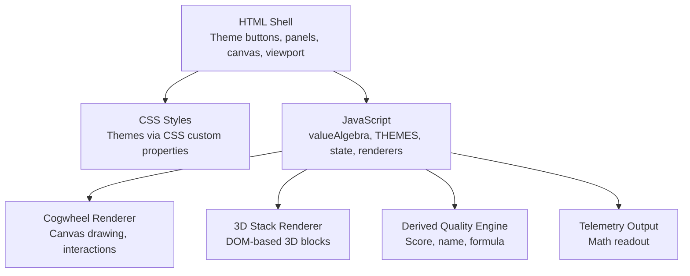
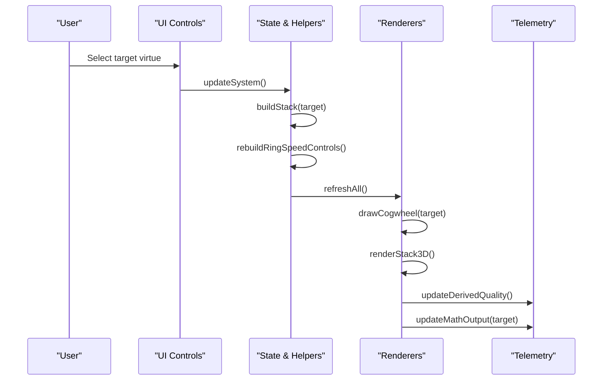
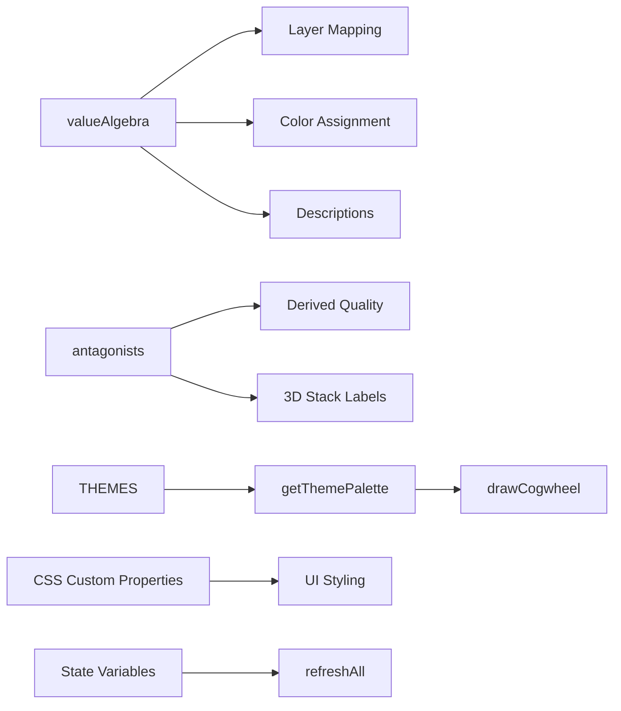

# Configuration Objects

<cite>
**Referenced Files in This Document**
- [Alg_Virt_WhLL.html](file://Alg_Virt_WhLL.html)
</cite>

## Table of Contents
1. [Introduction](#introduction)
2. [Project Structure](#project-structure)
3. [Core Components](#core-components)
4. [Architecture Overview](#architecture-overview)
5. [Detailed Component Analysis](#detailed-component-analysis)
6. [Dependency Analysis](#dependency-analysis)
7. [Performance Considerations](#performance-considerations)
8. [Troubleshooting Guide](#troubleshooting-guide)
9. [Conclusion](#conclusion)
10. [Appendices](#appendices)

## Introduction
This document describes all configuration objects and data structures that drive the application’s behavior, visuals, and user interface. It focuses on:
- The value algebra object defining virtues, dependencies, colors, descriptions, and layers.
- Theme configuration for Spaceship, Vintage, and Toth Egyptian themes, including CSS custom properties and runtime palette values.
- Rendering configuration options, animation settings, and UI customization parameters.
- Examples for extending the value algebra with new virtues, creating custom themes, and overriding defaults.
- Validation rules and type constraints for each configuration object.

## Project Structure
The project is a single-page HTML application containing:
- CSS styles defining theme-specific CSS custom properties and layout.
- A JavaScript section defining configuration objects, state, rendering logic, and event handlers.
- DOM elements for theme switching, cogwheel canvas, 3D stack viewport, controls, and telemetry output.

**Diagram sources**
- [Alg_Virt_WhLL.html:1-708](file://Alg_Virt_WhLL.html#L1-L708)
- [Alg_Virt_WhLL.html:709-830](file://Alg_Virt_WhLL.html#L709-L830)
- [Alg_Virt_WhLL.html:831-1612](file://Alg_Virt_WhLL.html#L831-L1612)
- [Alg_Virt_WhLL.html:1613-2036](file://Alg_Virt_WhLL.html#L1613-L2036)

**Section sources**
- [Alg_Virt_WhLL.html:1-708](file://Alg_Virt_WhLL.html#L1-L708)
- [Alg_Virt_WhLL.html:709-830](file://Alg_Virt_WhLL.html#L709-L830)

## Core Components
This section documents the primary configuration objects and their roles:
- valueAlgebra: Defines virtues, dependencies, colors, descriptions, and layers.
- antagonists: Maps each virtue to its antagonist counterpart.
- THEMES: Runtime theme palettes used by the renderer.
- CSS custom properties: Theme-driven visual parameters applied via body[data-theme].

Key responsibilities:
- valueAlgebra drives ring composition, layering, and color assignment.
- antagonists influence negative quality derivation and back-face labels.
- THEMES provide accent colors, RGB triplets, bright text, neutral RGB, and canvas fonts.
- CSS custom properties control background, panel, border, text, glow, overlay, and typography.

**Section sources**
- [Alg_Virt_WhLL.html:831-865](file://Alg_Virt_WhLL.html#L831-L865)
- [Alg_Virt_WhLL.html:867-890](file://Alg_Virt_WhLL.html#L867-L890)
- [Alg_Virt_WhLL.html:8-83](file://Alg_Virt_WhLL.html#L8-L83)

## Architecture Overview
The application composes configuration into interactive visuals:
- Selecting a target virtue triggers dependency resolution and layer mapping.
- Rings represent layers; fill levels and spin speeds affect derived quality.
- Themes switch both CSS variables and runtime palette values.
- The 3D stack shows layered components with fill overlays and antagonist faces.

**Diagram sources**
- [Alg_Virt_WhLL.html:1995-2005](file://Alg_Virt_WhLL.html#L1995-L2005)
- [Alg_Virt_WhLL.html:1988-1993](file://Alg_Virt_WhLL.html#L1988-L1993)
- [Alg_Virt_WhLL.html:1142-1354](file://Alg_Virt_WhLL.html#L1142-L1354)
- [Alg_Virt_WhLL.html:1620-1763](file://Alg_Virt_WhLL.html#L1620-L1763)
- [Alg_Virt_WhLL.html:1886-1945](file://Alg_Virt_WhLL.html#L1886-L1945)

## Detailed Component Analysis

### Value Algebra Object (valueAlgebra)
Purpose:
- Declares each virtue with its components (dependencies), color, description, and layer index.
- Drives ring composition, gradient fills, label placement, and antagonist mapping.

Structure:
- Key: Virtue name (string).
- Value: Object with fields:
  - components: Array of strings representing dependent virtues.
  - color: Hex color string used for gradients and block backgrounds.
  - desc: Human-readable description shown in telemetry.
  - layer: Integer indicating hierarchical depth (0–4).

Validation rules and type constraints:
- Key must be a non-empty string matching a virtue identifier.
- components must be an array of strings where each entry references another virtue key defined in valueAlgebra.
- color must be a valid hex color string.
- desc must be a non-empty string.
- layer must be a finite integer within the expected range (0–4).

Complexity considerations:
- Dependency resolution uses recursive traversal with visited set to avoid cycles; time complexity depends on graph size but remains linear relative to edges due to visited tracking.

Usage examples:
- Extending with a new virtue: Add a new key with components referencing existing virtues, assign a unique color, provide a description, and set an appropriate layer.
- Modifying dependencies: Update components arrays to change ring composition and derived quality influences.

**Section sources**
- [Alg_Virt_WhLL.html:831-856](file://Alg_Virt_WhLL.html#L831-L856)
- [Alg_Virt_WhLL.html:945-976](file://Alg_Virt_WhLL.html#L945-L976)

### Antagonists Map (antagonists)
Purpose:
- Maps each virtue to its antagonist counterpart used in negative quality derivation and UI labels.

Structure:
- Key: Virtue name (string).
- Value: String antagonist name.

Validation rules and type constraints:
- Keys must match virtue identifiers present in valueAlgebra.
- Values must be non-empty strings.

Behavioral notes:
- If a virtue lacks an antagonist mapping, the system falls back to a default placeholder during rendering and derived quality computation.

**Section sources**
- [Alg_Virt_WhLL.html:858-865](file://Alg_Virt_WhLL.html#L858-L865)
- [Alg_Virt_WhLL.html:1074-1074](file://Alg_Virt_WhLL.html#L1074-L1074)

### Theme Configuration (THEMES)
Purpose:
- Provides runtime palette values for the canvas renderer and UI theming.

Structure:
- Keys: Theme identifiers ("spaceship", "vintage", "toth-egyptian").
- Values: Objects with fields:
  - accent: Hex color string for accents.
  - accentRgb: Comma-separated RGB triplet string for shadows/glows.
  - bright: Hex color for bright text and highlights.
  - neutralRgb: Comma-separated RGB triplet for neutral backgrounds.
  - canvasFont: Font family string for canvas text.

Validation rules and type constraints:
- Keys must be one of the supported theme identifiers.
- accent and bright must be valid hex color strings.
- accentRgb and neutralRgb must be comma-separated numeric triplets.
- canvasFont must be a valid font-family string.

Theming workflow:
- applyTheme sets body[data-theme] and updates active button states.
- getThemePalette returns the current palette used by the renderer.

Custom theme creation:
- Add a new key to THEMES with required fields.
- Define corresponding CSS custom properties under body[data-theme="your-theme"].
- Ensure UI buttons include a selector for the new theme.

**Section sources**
- [Alg_Virt_WhLL.html:867-890](file://Alg_Virt_WhLL.html#L867-L890)
- [Alg_Virt_WhLL.html:893-918](file://Alg_Virt_WhLL.html#L893-L918)

### CSS Custom Properties and Visual Parameters
Purpose:
- Control global appearance through CSS variables scoped to body[data-theme].

Key variables:
- --bg-color: Background color.
- --panel-bg: Panel background.
- --border-color: Border color.
- --text-color: Default text color.
- --accent-glow: Accent glow color.
- --accent-rgb: RGB triplet for glows/shadows.
- --negative-color: Negative state color.
- --negative-rgb: RGB triplet for negative states.
- --heading-color: Heading text color.
- --muted-color: Muted text color.
- --readout-bg: Readout background opacity.
- --overlay-bg: Overlay background opacity.
- --back-face-bg: Back face background.
- --canvas-center / --canvas-edge: Canvas radial gradient center/edge.
- --scene-center / --scene-edge: Scene radial gradient center/edge.
- --ui-font: UI font family.
- --panel-radius: Panel border radius.
- --body-backdrop: Complex backdrop gradient.

Validation rules and type constraints:
- Colors must be valid CSS color values.
- RGB triplets must be numeric and comma-separated.
- Opacity values should be between 0 and 1.
- Fonts must be valid font-family strings.

Theme-specific overrides:
- Each theme defines a complete set of variables to ensure consistent visuals across components.

**Section sources**
- [Alg_Virt_WhLL.html:8-83](file://Alg_Virt_WhLL.html#L8-L83)
- [Alg_Virt_WhLL.html:637-696](file://Alg_Virt_WhLL.html#L637-L696)

### Rendering Configuration Options
Purpose:
- Configure how the cogwheel and 3D stack are rendered and interacted with.

Cogwheel rendering:
- Zoom factor: Numeric multiplier clamped between minimum and maximum bounds.
- Auto rotation: Boolean flag enabling continuous wheel rotation.
- Ring angles and speeds: Per-layer rotational offsets and velocities.
- Fill levels: Per-layer fill percentages mapped from user interaction.

3D stack rendering:
- View rotations: X and Y rotation angles for perspective.
- Zoom: Numeric scale factor for scene scaling.
- Antagonist visibility: Boolean toggle for showing/hiding back faces.
- Auto spin: Boolean flag enabling continuous Y-axis rotation.

Interaction modes:
- Mouse drag to adjust ring fill.
- Shift+Wheel to adjust per-ring spin speed.
- Wheel to zoom.
- Touch gestures for mobile interactions.

Validation rules and type constraints:
- Zoom factors must be finite numbers within allowed ranges.
- Rotation angles must be finite numbers.
- Fill levels must be normalized between 0 and 1.
- Spin speeds must be finite numbers within maximum bounds.

**Section sources**
- [Alg_Virt_WhLL.html:1142-1354](file://Alg_Virt_WhLL.html#L1142-L1354)
- [Alg_Virt_WhLL.html:1617-1881](file://Alg_Virt_WhLL.html#L1617-L1881)
- [Alg_Virt_WhLL.html:1426-1495](file://Alg_Virt_WhLL.html#L1426-L1495)

### Animation Settings
Purpose:
- Control timing and intervals for animations.

Settings:
- Cogwheel tick interval: Fixed interval for updating rotation and ring angles.
- Auto rotation speed: Constant increment per tick.
- Ring speed step: Increment/decrement step for per-ring spin adjustments.
- Ring speed maximum: Absolute bound for spin velocity.
- Stack auto spin interval: Fixed interval for continuous rotation.

Validation rules and type constraints:
- Intervals must be positive finite numbers.
- Speeds must be finite numbers within bounds.
- Steps must be positive finite numbers.

**Section sources**
- [Alg_Virt_WhLL.html:996-998](file://Alg_Virt_WhLL.html#L996-L998)
- [Alg_Virt_WhLL.html:1498-1523](file://Alg_Virt_WhLL.html#L1498-L1523)
- [Alg_Virt_WhLL.html:1860-1880](file://Alg_Virt_WhLL.html#L1860-L1880)

### UI Customization Parameters
Purpose:
- Provide user-facing controls for theme selection, fullscreen mode, and view management.

Parameters:
- Theme buttons: Data attributes map to theme identifiers.
- Fullscreen toggles: Buttons trigger panel fullscreen transitions.
- Stack controls: Reset view, toggle antagonist labels, auto spin.
- Ring speed controls: Dropdown for layer selection, increment/decrement/clear.

Validation rules and type constraints:
- Theme IDs must exist in THEMES.
- Fullscreen targets must reference valid panel IDs.
- Layer selectors must correspond to computed ring layers.

**Section sources**
- [Alg_Virt_WhLL.html:712-723](file://Alg_Virt_WhLL.html#L712-L723)
- [Alg_Virt_WhLL.html:1541-1612](file://Alg_Virt_WhLL.html#L1541-L1612)
- [Alg_Virt_WhLL.html:1843-1880](file://Alg_Virt_WhLL.html#L1843-L1880)

## Dependency Analysis
The following diagram maps core configuration relationships and their usage across renderers and UI logic.

**Diagram sources**
- [Alg_Virt_WhLL.html:831-865](file://Alg_Virt_WhLL.html#L831-L865)
- [Alg_Virt_WhLL.html:867-890](file://Alg_Virt_WhLL.html#L867-L890)
- [Alg_Virt_WhLL.html:893-918](file://Alg_Virt_WhLL.html#L893-L918)
- [Alg_Virt_WhLL.html:966-976](file://Alg_Virt_WhLL.html#L966-L976)
- [Alg_Virt_WhLL.html:1142-1354](file://Alg_Virt_WhLL.html#L1142-L1354)
- [Alg_Virt_WhLL.html:1988-1993](file://Alg_Virt_WhLL.html#L1988-L1993)

**Section sources**
- [Alg_Virt_WhLL.html:831-865](file://Alg_Virt_WhLL.html#L831-L865)
- [Alg_Virt_WhLL.html:867-890](file://Alg_Virt_WhLL.html#L867-L890)
- [Alg_Virt_WhLL.html:1142-1354](file://Alg_Virt_WhLL.html#L1142-L1354)
- [Alg_Virt_WhLL.html:1988-1993](file://Alg_Virt_WhLL.html#L1988-L1993)

## Performance Considerations
- Canvas redraws occur on every tick when auto rotation or any ring spins; consider throttling updates if performance degrades.
- Dependency resolution avoids cycles using a visited set; keep the virtue graph acyclic to maintain predictable behavior.
- Heavy use of shadow effects and gradients can impact rendering performance on low-end devices; reduce shadow blur or disable animations when necessary.
- Resize events debounce refresh calls to prevent excessive re-renders.

[No sources needed since this section provides general guidance]

## Troubleshooting Guide
Common issues and resolutions:
- Invalid target selected: Ensure the selected virtue exists in valueAlgebra; otherwise, telemetry will report an error.
- Missing antagonist mapping: If a virtue lacks an antagonist, the system uses a fallback placeholder; add mappings for completeness.
- Theme not applied: Verify the theme ID exists in THEMES and that corresponding CSS custom properties are defined.
- Ring speed out of bounds: Adjustments clamp to maximum bounds; reset speeds to zero if unexpected behavior occurs.
- Fullscreen failures: Browser policy may block fullscreen requests; check console warnings and ensure user gesture initiates the action.

**Section sources**
- [Alg_Virt_WhLL.html:1886-1891](file://Alg_Virt_WhLL.html#L1886-L1891)
- [Alg_Virt_WhLL.html:1950-1983](file://Alg_Virt_WhLL.html#L1950-L1983)

## Conclusion
The configuration model centers around a well-defined value algebra, antagonist mappings, and theme palettes, combined with CSS custom properties for visual consistency. Rendering and animation settings expose rich interactivity while maintaining clear validation boundaries. Extensibility is straightforward: add new virtues to the algebra, define corresponding antagonists, create theme entries, and wire UI controls accordingly.

[No sources needed since this section summarizes without analyzing specific files]

## Appendices

### Example: Extending the Value Algebra with a New Virtue
Steps:
- Add a new key to valueAlgebra with components referencing existing virtues.
- Assign a unique color and descriptive text.
- Set an appropriate layer index reflecting its position in the hierarchy.
- Optionally add an antagonist mapping.

Validation checklist:
- All referenced components exist in valueAlgebra.
- Color is a valid hex string.
- Description is non-empty.
- Layer is within the expected range.

**Section sources**
- [Alg_Virt_WhLL.html:831-856](file://Alg_Virt_WhLL.html#L831-L856)
- [Alg_Virt_WhLL.html:858-865](file://Alg_Virt_WhLL.html#L858-L865)

### Example: Creating a Custom Theme
Steps:
- Add a new key to THEMES with accent, accentRgb, bright, neutralRgb, and canvasFont.
- Define body[data-theme="your-theme"] CSS block setting all required CSS custom properties.
- Add a theme button with data-theme-id matching the new key.
- Initialize or persist the theme via localStorage if desired.

Validation checklist:
- Theme ID matches the button attribute.
- All CSS variables are defined and valid.
- Palette values conform to expected formats.

**Section sources**
- [Alg_Virt_WhLL.html:867-890](file://Alg_Virt_WhLL.html#L867-L890)
- [Alg_Virt_WhLL.html:8-83](file://Alg_Virt_WhLL.html#L8-L83)
- [Alg_Virt_WhLL.html:712-723](file://Alg_Virt_WhLL.html#L712-L723)

### Example: Overriding Default Configurations
Approaches:
- Override CSS custom properties at runtime by modifying document.body.style or adding inline styles.
- Replace THEMES entries programmatically before initialization.
- Adjust state variables such as zoomFactor, autoRotate, or ringSpeeds to customize initial conditions.

Constraints:
- Overrides must respect type constraints and bounds enforced by the application logic.
- Changes should be applied before rendering to avoid flicker.

**Section sources**
- [Alg_Virt_WhLL.html:893-918](file://Alg_Virt_WhLL.html#L893-L918)
- [Alg_Virt_WhLL.html:920-943](file://Alg_Virt_WhLL.html#L920-L943)
- [Alg_Virt_WhLL.html:1142-1354](file://Alg_Virt_WhLL.html#L1142-L1354)