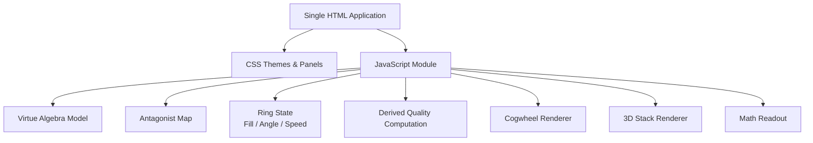
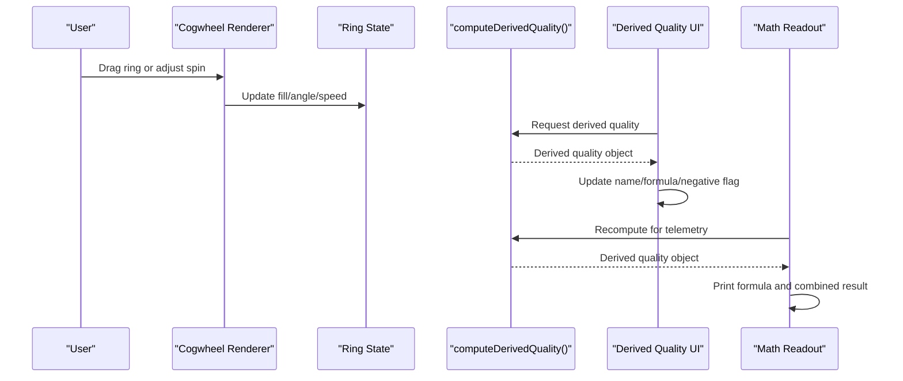
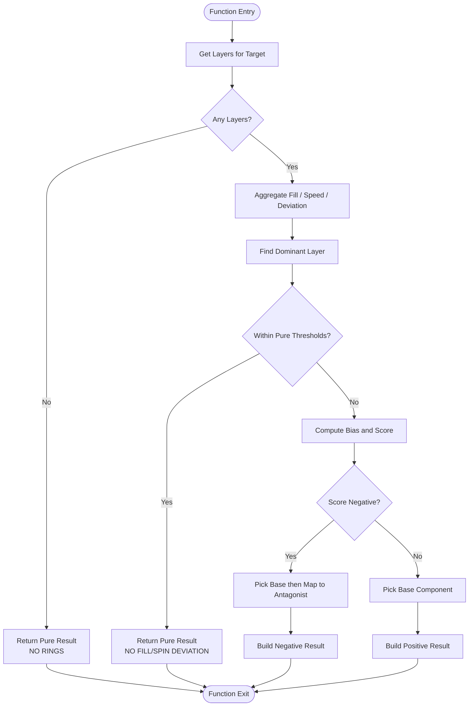
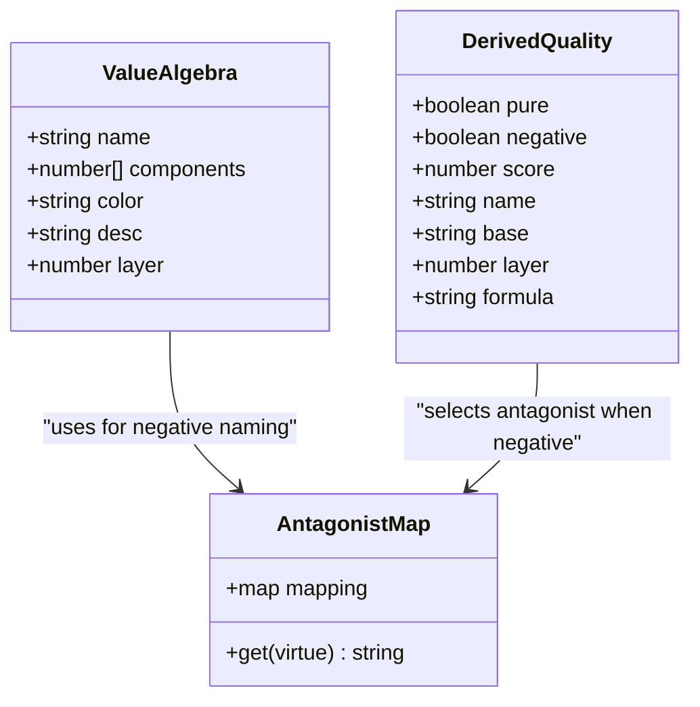
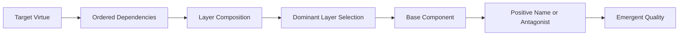
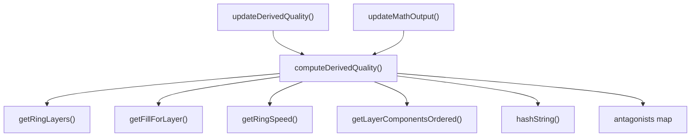

# Core Functions

<cite>
**Referenced Files in This Document**
- [Alg_Virt_WhLL.html](file://Alg_Virt_WhLL.html)
</cite>

## Table of Contents
1. [Introduction](#introduction)
2. [Project Structure](#project-structure)
3. [Core Components](#core-components)
4. [Architecture Overview](#architecture-overview)
5. [Detailed Component Analysis](#detailed-component-analysis)
6. [Dependency Analysis](#dependency-analysis)
7. [Performance Considerations](#performance-considerations)
8. [Troubleshooting Guide](#troubleshooting-guide)
9. [Conclusion](#conclusion)

## Introduction
This document explains the core mathematical and computational functions behind the Algebraic Virtue Wheel, focusing on:
- The emergent quality computation function that derives a new quality from ring states.
- The antagonist mapping system that determines opposing virtues for each virtue.
- How these functions integrate with the overall virtue algebra model used by the application.

The goal is to make the underlying algorithms accessible while preserving precise technical detail about inputs, outputs, validation, error handling, and performance characteristics.

## Project Structure
The project is a single-page application implemented in one HTML file containing:
- CSS styles for themes and UI panels.
- A JavaScript module defining:
  - The virtue algebra data model.
  - Antagonist mappings.
  - Ring state management (fill levels, angles, speeds).
  - Rendering logic for the concentric cogwheel and 3D stack.
  - Derived quality computation and telemetry output.

**Diagram sources**
- [Alg_Virt_WhLL.html:830-943](file://Alg_Virt_WhLL.html#L830-L943)
- [Alg_Virt_WhLL.html:1019-1081](file://Alg_Virt_WhLL.html#L1019-L1081)
- [Alg_Virt_WhLL.html:1142-1354](file://Alg_Virt_WhLL.html#L1142-L1354)
- [Alg_Virt_WhLL.html:1620-1763](file://Alg_Virt_WhLL.html#L1620-L1763)
- [Alg_Virt_WhLL.html:1886-1945](file://Alg_Virt_WhLL.html#L1886-L1945)

**Section sources**
- [Alg_Virt_WhLL.html:1-10](file://Alg_Virt_WhLL.html#L1-L10)
- [Alg_Virt_WhLL.html:830-943](file://Alg_Virt_WhLL.html#L830-L943)

## Core Components
This section documents the primary components relevant to the documentation objective:
- Value algebra model: defines virtues, their layers, colors, descriptions, and component dependencies.
- Antagonist map: maps each virtue to its opposing concept.
- Ring state: per-layer fill level, angle, and spin speed.
- Derived quality computation: calculates an emergent quality based on ring states.
- UI integration: updates derived quality display and telemetry readout.

Key responsibilities:
- Data model provides structure and relationships between virtues.
- Antagonist map supplies opposition semantics.
- Ring state captures user interactions and animation effects.
- Derived quality computation synthesizes ring state into a meaningful emergent result.
- UI functions render and communicate results visually and textually.

**Section sources**
- [Alg_Virt_WhLL.html:832-865](file://Alg_Virt_WhLL.html#L832-L865)
- [Alg_Virt_WhLL.html:920-943](file://Alg_Virt_WhLL.html#L920-L943)
- [Alg_Virt_WhLL.html:1019-1081](file://Alg_Virt_WhLL.html#L1019-L1081)
- [Alg_Virt_WhLL.html:1083-1093](file://Alg_Virt_WhLL.html#L1083-L1093)
- [Alg_Virt_WhLL.html:1886-1945](file://Alg_Virt_WhLL.html#L1886-L1945)

## Architecture Overview
The system composes several interacting parts:
- User interaction modifies ring fill levels and spin speeds.
- Derived quality computation reads current target virtue and ring state to produce an emergent quality object.
- The antagonist map influences negative emergent qualities.
- Rendering functions visualize both the cogwheel rings and the 3D stack.
- Telemetry prints formulas, layer fills, and combined emergent results.

**Diagram sources**
- [Alg_Virt_WhLL.html:1390-1419](file://Alg_Virt_WhLL.html#L1390-L1419)
- [Alg_Virt_WhLL.html:1451-1462](file://Alg_Virt_WhLL.html#L1451-L1462)
- [Alg_Virt_WhLL.html:1019-1081](file://Alg_Virt_WhLL.html#L1019-L1081)
- [Alg_Virt_WhLL.html:1083-1093](file://Alg_Virt_WhLL.html#L1083-L1093)
- [Alg_Virt_WhLL.html:1886-1945](file://Alg_Virt_WhLL.html#L1886-L1945)

## Detailed Component Analysis

### computeDerivedQuality()
Purpose:
- Computes an emergent quality based on the current target virtue and the ring state across all layers associated with that target.
- Returns a structured object describing whether the result is pure, negative, its score, selected name, base source, dominant layer, and a human-readable formula.

Parameters:
- Implicitly depends on:
  - Current target virtue name.
  - Ring fill levels per layer.
  - Ring spin speeds per layer.
  - Ring angles per layer (affects visual rotation but not the computed score directly).
  - The value algebra model (for layer composition and ordering).

Return values:
- Object fields:
  - pure: boolean indicating no significant deviation.
  - negative: boolean indicating a negative emergent quality.
  - score: numeric bias combining fill and spin contributions.
  - name: emergent quality name (positive or antagonist-derived).
  - base: source component used to select the name.
  - layer: dominant layer index.
  - formula: string summarizing the derivation path.

Algorithm overview:
- Collects all layers associated with the current target.
- If no layers exist, returns a pure result with a placeholder formula.
- Aggregates per-layer fill, net speed, absolute speed, and deviation from neutral fill.
- Determines the dominant layer using a weighted combination of deviation and normalized speed.
- Computes average metrics across layers.
- Applies thresholds for “pure” state when deviations are minimal.
- Calculates a composite score from fill bias and spin bias.
- Selects a base component from the dominant layer’s ordered pool.
- If negative, maps the base component to its antagonist; otherwise uses the base component itself.
- Produces a deterministic selection via a hash over signature parts and target name.

Parameter validation rules:
- Layer keys are constructed from the current target and layer index.
- Fill levels are clamped to [0, 1] during interaction.
- Spin speeds are bounded within a maximum magnitude.
- Missing layers default to neutral fill and zero speed.

Error handling patterns:
- Early return for empty layer sets.
- Safe defaults for missing antagonists.
- Defensive checks for non-finite layer indices.

Performance considerations:
- Linear scan over layers.
- Minimal allocations inside the hot path.
- Deterministic hashing avoids expensive operations.

Code example usage:
- Call the function after updating ring state to obtain the emergent quality.
- Use the returned object to update UI labels and telemetry.

**Diagram sources**
- [Alg_Virt_WhLL.html:1019-1081](file://Alg_Virt_WhLL.html#L1019-L1081)

**Section sources**
- [Alg_Virt_WhLL.html:1019-1081](file://Alg_Virt_WhLL.html#L1019-L1081)

### Antagonist Mapping System
Purpose:
- Provides a direct mapping from each virtue to its opposing concept.
- Used both in rendering (showing antagonists on unfilled portions of rings and back faces of stack boxes) and in computing negative emergent qualities.

Data structure:
- A simple key-value map where keys are virtue names and values are antagonist names.

Behavior:
- When selecting a base component for a negative emergent quality, the system looks up the antagonist by the base component name.
- If no antagonist exists, it falls back to a generic negative term.

Integration points:
- Derived quality computation uses the antagonist map to convert positive base components into negative emergent names.
- Rendering functions use the antagonist map to label unfilled ring segments and stack box backs.

Code example usage:
- Retrieve antagonist for a given virtue by key lookup.
- Use antagonist color derived from the base virtue’s color.

**Diagram sources**
- [Alg_Virt_WhLL.html:832-856](file://Alg_Virt_WhLL.html#L832-L856)
- [Alg_Virt_WhLL.html:858-865](file://Alg_Virt_WhLL.html#L858-L865)
- [Alg_Virt_WhLL.html:1019-1081](file://Alg_Virt_WhLL.html#L1019-L1081)

**Section sources**
- [Alg_Virt_WhLL.html:858-865](file://Alg_Virt_WhLL.html#L858-L865)
- [Alg_Virt_WhLL.html:1019-1081](file://Alg_Virt_WhLL.html#L1019-L1081)
- [Alg_Virt_WhLL.html:1267-1293](file://Alg_Virt_WhLL.html#L1267-L1293)
- [Alg_Virt_WhLL.html:1635-1642](file://Alg_Virt_WhLL.html#L1635-L1642)

### Relationship to the Overall Virtue Algebra System
The derived quality computation and antagonist mapping are tightly coupled with the virtue algebra model:
- Layers and component dependencies determine which virtues contribute to a target.
- Ordered dependency resolution ensures consistent layer composition.
- The dominant layer drives the selection of the base component for emergent naming.
- The antagonist map extends the algebra with semantic opposition, enabling negative emergent qualities.

**Diagram sources**
- [Alg_Virt_WhLL.html:945-988](file://Alg_Virt_WhLL.html#L945-L988)
- [Alg_Virt_WhLL.html:1019-1081](file://Alg_Virt_WhLL.html#L1019-L1081)
- [Alg_Virt_WhLL.html:832-856](file://Alg_Virt_WhLL.html#L832-L856)
- [Alg_Virt_WhLL.html:858-865](file://Alg_Virt_WhLL.html#L858-L865)

**Section sources**
- [Alg_Virt_WhLL.html:945-988](file://Alg_Virt_WhLL.html#L945-L988)
- [Alg_Virt_WhLL.html:1019-1081](file://Alg_Virt_WhLL.html#L1019-L1081)

## Dependency Analysis
Key dependencies:
- computeDerivedQuality() depends on:
  - getRingLayers()
  - getFillForLayer()
  - getRingSpeed()
  - getLayerComponentsOrdered()
  - hashString()
  - antagonists map
- UI integration depends on:
  - updateDerivedQuality()
  - updateMathOutput()

Coupling and cohesion:
- Derived quality computation is cohesive around ring state synthesis.
- Antagonist mapping is decoupled from computation but referenced by both rendering and computation.
- UI functions depend on computed results but do not alter ring state directly.

Potential circular dependencies:
- None observed; computation functions are leaf utilities relative to UI.

External dependencies:
- DOM APIs for canvas and element manipulation.
- Browser event handling for mouse/touch interactions.

**Diagram sources**
- [Alg_Virt_WhLL.html:1019-1081](file://Alg_Virt_WhLL.html#L1019-L1081)
- [Alg_Virt_WhLL.html:1001-1008](file://Alg_Virt_WhLL.html#L1001-L1008)
- [Alg_Virt_WhLL.html:990-993](file://Alg_Virt_WhLL.html#L990-L993)
- [Alg_Virt_WhLL.html:978-988](file://Alg_Virt_WhLL.html#L978-L988)
- [Alg_Virt_WhLL.html:1010-1014](file://Alg_Virt_WhLL.html#L1010-L1014)
- [Alg_Virt_WhLL.html:1083-1093](file://Alg_Virt_WhLL.html#L1083-L1093)
- [Alg_Virt_WhLL.html:1886-1945](file://Alg_Virt_WhLL.html#L1886-L1945)

**Section sources**
- [Alg_Virt_WhLL.html:1019-1081](file://Alg_Virt_WhLL.html#L1019-L1081)
- [Alg_Virt_WhLL.html:1083-1093](file://Alg_Virt_WhLL.html#L1083-L1093)
- [Alg_Virt_WhLL.html:1886-1945](file://Alg_Virt_WhLL.html#L1886-L1945)

## Performance Considerations
- Derived quality computation runs in O(L) time where L is the number of layers; typically small.
- Hashing is O(K) where K is the length of the signature string; negligible overhead.
- Avoid repeated DOM queries inside tight loops; cache references where possible.
- Animation loop throttling via setInterval minimizes unnecessary recalculations.
- Clamping and threshold checks prevent excessive branching and maintain stable outputs.

[No sources needed since this section provides general guidance]

## Troubleshooting Guide
Common issues and resolutions:
- No rings displayed:
  - Ensure the target virtue has defined layers and components.
  - Check getRingLayers() returns non-empty.
- Derived quality remains pure unexpectedly:
  - Verify fill levels deviate from neutral and spin speeds exceed thresholds.
  - Inspect thresholds used in the pure-state check.
- Negative emergent quality shows fallback antagonist:
  - Confirm antagonist mapping includes the base component.
  - Validate antagonist lookup logic.
- UI not updating:
  - Ensure refreshAll() is called after state changes.
  - Check updateDerivedQuality() and updateMathOutput() execution paths.

**Section sources**
- [Alg_Virt_WhLL.html:1019-1081](file://Alg_Virt_WhLL.html#L1019-L1081)
- [Alg_Virt_WhLL.html:1083-1093](file://Alg_Virt_WhLL.html#L1083-L1093)
- [Alg_Virt_WhLL.html:1886-1945](file://Alg_Virt_WhLL.html#L1886-L1945)

## Conclusion
The Algebraic Virtue Wheel’s core mathematical functions center on deriving emergent qualities from ring states and mapping virtues to antagonists. The computeDerivedQuality() function synthesizes fill levels and spin speeds into a structured result, while the antagonist map provides semantic opposition. Together, they extend the virtue algebra model to support dynamic, interactive exploration of emergent virtues and their opposites. Proper parameter validation, robust error handling, and efficient computation ensure reliable behavior across user interactions and animations.

[No sources needed since this section summarizes without analyzing specific files]