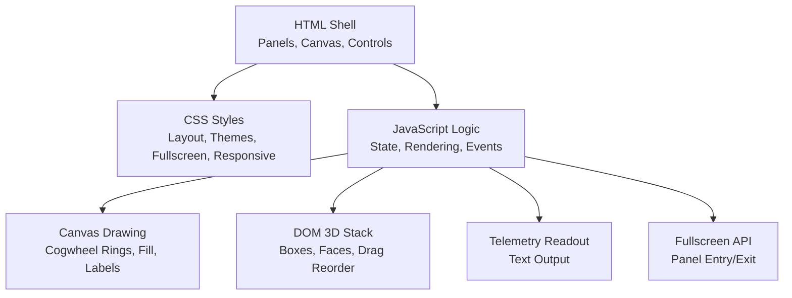
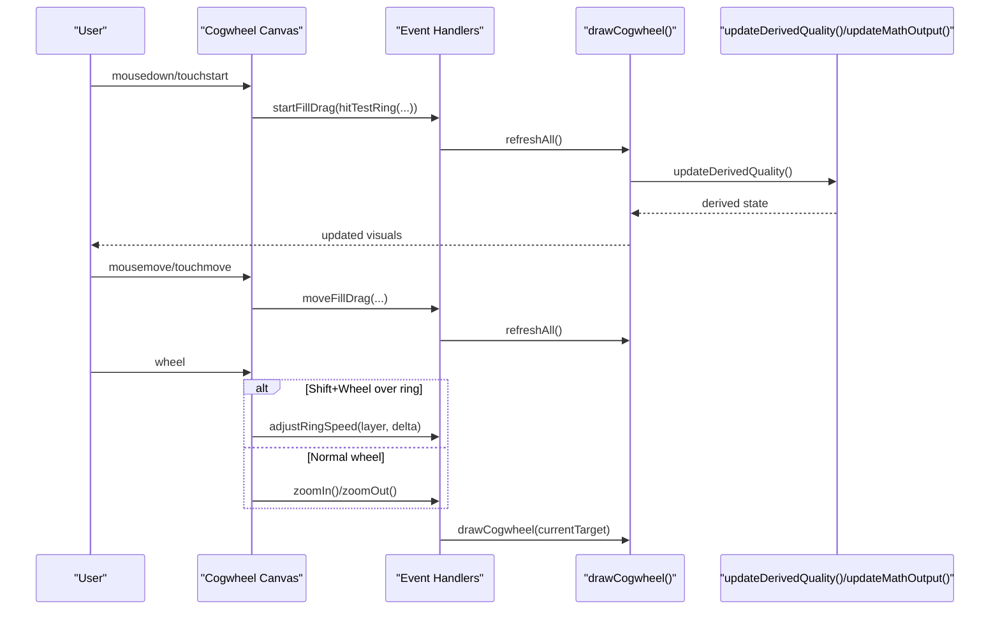
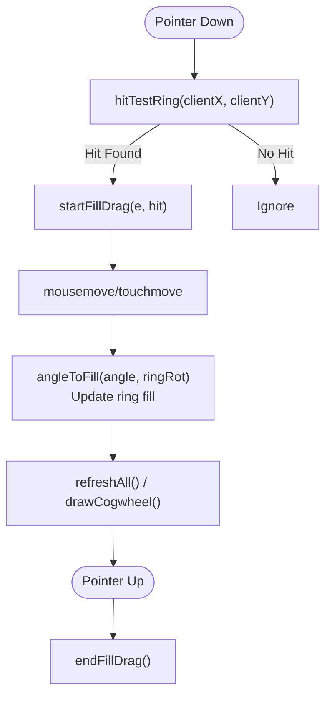
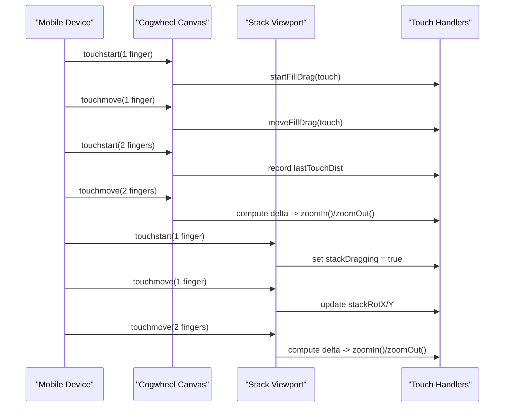
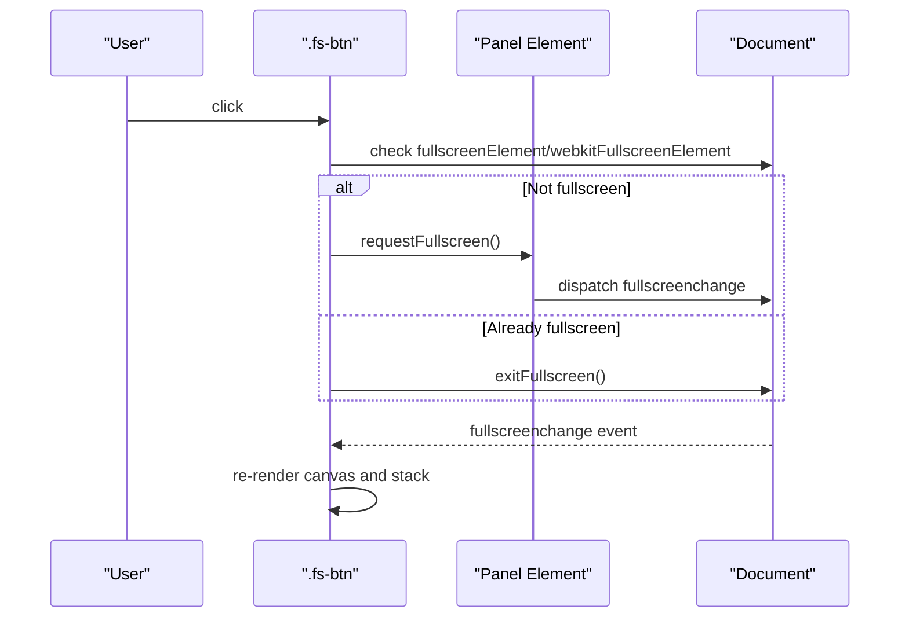
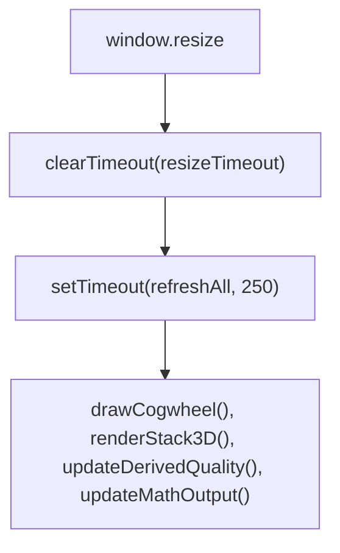
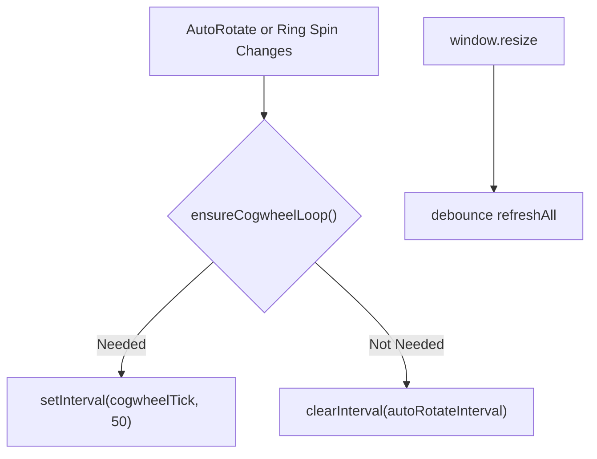
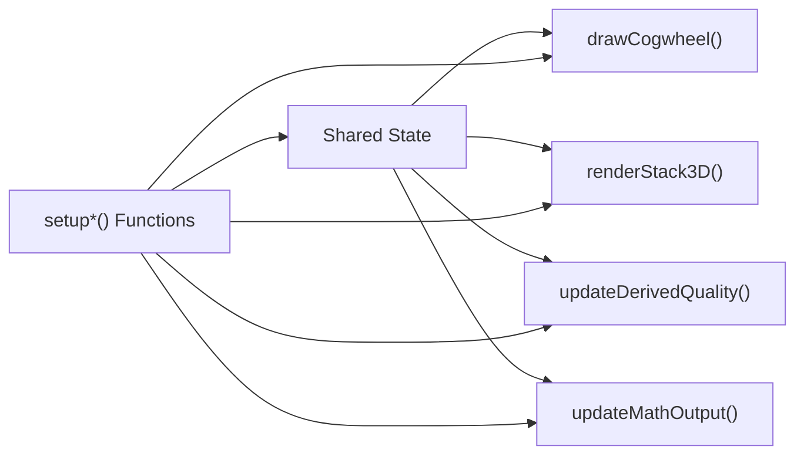

# Event Handling

<cite>
**Referenced Files in This Document**
- [Alg_Virt_WhLL.html](file://Alg_Virt_WhLL.html)
</cite>

## Table of Contents
1. [Introduction](#introduction)
2. [Project Structure](#project-structure)
3. [Core Components](#core-components)
4. [Architecture Overview](#architecture-overview)
5. [Detailed Component Analysis](#detailed-component-analysis)
6. [Dependency Analysis](#dependency-analysis)
7. [Performance Considerations](#performance-considerations)
8. [Troubleshooting Guide](#troubleshooting-guide)
9. [Conclusion](#conclusion)

## Introduction
This document explains the event handling system for a single-page interactive application that combines:
- A canvas-based concentric cogwheel visualization
- A DOM-based 3D stack visualization
- Theme switching, fullscreen panel control, and telemetry readouts

The focus is on how user interactions are captured and processed across mouse, touch, wheel, keyboard (via UI hints), and DOM events, including drag-to-fill, click detection, hover effects, gesture recognition, multi-touch zoom, fullscreen API integration, responsive design listeners, and performance considerations for high-frequency updates.

## Project Structure
The project is a single HTML file containing:
- CSS styles for layout, themes, panels, canvas container, 3D stack, and responsive breakpoints
- A script block with state management, rendering logic, event setup, and initialization

**Diagram sources**
- [Alg_Virt_WhLL.html:710-828](file://Alg_Virt_WhLL.html#L710-L828)
- [Alg_Virt_WhLL.html:830-2032](file://Alg_Virt_WhLL.html#L830-L2032)

**Section sources**
- [Alg_Virt_WhLL.html:710-828](file://Alg_Virt_WhLL.html#L710-L828)
- [Alg_Virt_WhLL.html:830-2032](file://Alg_Virt_WhLL.html#L830-L2032)

## Core Components
- Cogwheel Canvas Interaction
  - Mouse drag to adjust ring fill levels
  - Hover highlighting of rings
  - Wheel zoom; Shift+Wheel over a ring adjusts per-ring spin speed
  - Touch drag to adjust ring fill; two-finger pinch to zoom
- 3D Stack Interaction
  - Mouse drag to rotate view
  - Wheel to zoom
  - Touch drag to rotate; two-finger pinch to zoom
  - Native drag-and-drop reorder of stack items
- UI Controls
  - Theme buttons
  - Play/Pause auto rotation
  - Zoom controls
  - Ring speed controls
  - Fullscreen toggle for panels
- System State and Rendering
  - Target quality selection drives layers and stack composition
  - Derived quality computation based on ring fills and spins
  - Telemetry text output updates on changes

**Section sources**
- [Alg_Virt_WhLL.html:920-1137](file://Alg_Virt_WhLL.html#L920-L1137)
- [Alg_Virt_WhLL.html:1142-1354](file://Alg_Virt_WhLL.html#L1142-L1354)
- [Alg_Virt_WhLL.html:1356-1495](file://Alg_Virt_WhLL.html#L1356-L1495)
- [Alg_Virt_WhLL.html:1620-1763](file://Alg_Virt_WhLL.html#L1620-L1763)
- [Alg_Virt_WhLL.html:1772-1881](file://Alg_Virt_WhLL.html#L1772-L1881)
- [Alg_Virt_WhLL.html:1948-1983](file://Alg_Virt_WhLL.html#L1948-L1983)
- [Alg_Virt_WhLL.html:1988-2032](file://Alg_Virt_WhLL.html#L1988-L2032)

## Architecture Overview
The event system is centered around three main areas:
- Canvas event handlers for hit testing, dragging, and wheel interactions
- DOM event handlers for UI controls and 3D viewport interactions
- Global listeners for fullscreen changes and window resize

**Diagram sources**
- [Alg_Virt_WhLL.html:1356-1495](file://Alg_Virt_WhLL.html#L1356-L1495)
- [Alg_Virt_WhLL.html:1142-1354](file://Alg_Virt_WhLL.html#L1142-L1354)
- [Alg_Virt_WhLL.html:1083-1093](file://Alg_Virt_WhLL.html#L1083-L1093)
- [Alg_Virt_WhLL.html:1886-1945](file://Alg_Virt_WhLL.html#L1886-L1945)

## Detailed Component Analysis

### Mouse Event Handlers: Drag-to-Fill, Click Detection, Hover Effects
- Hit Testing
  - Converts client coordinates to canvas space using device pixel ratio scaling
  - Determines which ring layer is under the pointer by comparing radial distances
- Drag-to-Fill
  - On mousedown or touchstart within a ring, sets drag state and initial fill based on pointer angle relative to ring rotation
  - On mousemove or touchmove while dragging, recalculates fill from pointer angle and updates visuals
  - On mouseup or touchend, clears drag state
- Hover Effects
  - On mousemove when not dragging, computes hovered ring index and redraws to highlight the ring
- Wheel Interactions
  - If Shift key is pressed and pointer is over a ring, adjusts per-ring spin speed
  - Otherwise, performs zoom in/out

**Diagram sources**
- [Alg_Virt_WhLL.html:1356-1388](file://Alg_Virt_WhLL.html#L1356-L1388)
- [Alg_Virt_WhLL.html:1390-1424](file://Alg_Virt_WhLL.html#L1390-L1424)
- [Alg_Virt_WhLL.html:1426-1495](file://Alg_Virt_WhLL.html#L1426-L1495)

**Section sources**
- [Alg_Virt_WhLL.html:1356-1495](file://Alg_Virt_WhLL.html#L1356-L1495)

### Touch Event Support: Gesture Recognition and Multi-Touch Handling
- Single-Finger Touch
  - Treated like mouse drag for adjusting ring fill on the cogwheel
  - Used for rotating the 3D stack viewport
- Two-Finger Touch
  - Computes distance between fingers to implement pinch-to-zoom on both cogwheel and 3D stack
- Passive vs Non-Passive Listeners
  - Cogwheel uses passive:false to allow preventDefault for wheel and touch behaviors
  - 3D stack viewport uses passive:true for smoother scrolling behavior on mobile

**Diagram sources**
- [Alg_Virt_WhLL.html:1464-1495](file://Alg_Virt_WhLL.html#L1464-L1495)
- [Alg_Virt_WhLL.html:1804-1841](file://Alg_Virt_WhLL.html#L1804-L1841)

**Section sources**
- [Alg_Virt_WhLL.html:1464-1495](file://Alg_Virt_WhLL.html#L1464-L1495)
- [Alg_Virt_WhLL.html:1804-1841](file://Alg_Virt_WhLL.html#L1804-L1841)

### Keyboard Shortcuts
- The application does not define global keyboard shortcuts.
- It provides an inline hint indicating that Shift+Wheel over a ring adjusts spin speed.
- No additional keydown listeners are present in the codebase.

**Section sources**
- [Alg_Virt_WhLL.html:802](file://Alg_Virt_WhLL.html#L802)
- [Alg_Virt_WhLL.html:1451-1462](file://Alg_Virt_WhLL.html#L1451-L1462)

### Fullscreen API Integration
- Each panel has a fullscreen button that toggles fullscreen mode for that panel
- Uses standard requestFullscreen and vendor-prefixed webkitRequestFullscreen
- Handles exitFullscreen and webkitExitFullscreen
- Re-renders canvas and 3D stack after fullscreen change to adapt to new dimensions

**Diagram sources**
- [Alg_Virt_WhLL.html:1948-1983](file://Alg_Virt_WhLL.html#L1948-L1983)

**Section sources**
- [Alg_Virt_WhLL.html:1948-1983](file://Alg_Virt_WhLL.html#L1948-L1983)

### Responsive Design Event Listeners
- CSS media queries adjust grid layout, canvas max height, and 3D stack viewport size at smaller widths
- JavaScript listens to window resize and debounces refreshAll to avoid excessive redraws during resizing

**Diagram sources**
- [Alg_Virt_WhLL.html:698-707](file://Alg_Virt_WhLL.html#L698-L707)
- [Alg_Virt_WhLL.html:2027-2031](file://Alg_Virt_WhLL.html#L2027-L2031)

**Section sources**
- [Alg_Virt_WhLL.html:698-707](file://Alg_Virt_WhLL.html#L698-L707)
- [Alg_Virt_WhLL.html:2027-2031](file://Alg_Virt_WhLL.html#L2027-L2031)

### Custom Event Creation and Event Delegation Patterns
- Custom Events
  - The codebase does not create custom events via CustomEvent or dispatchEvent
- Event Delegation
  - No global delegation patterns are used; event listeners are attached directly to specific elements (canvas, viewport, buttons)
- Best Practice Note
  - For large numbers of dynamic elements, consider delegating to parent containers to reduce listener overhead

[No sources needed since this section discusses general patterns without analyzing specific files]

### Performance Optimization for High-Frequency Events
- Animation Loop Control
  - Cogwheel animation runs only when autoRotate is enabled or any ring has non-zero spin speed
  - Interval is cleared when no longer needed to avoid unnecessary draws
- Debounced Resize Handling
  - Window resize triggers a delayed refresh to minimize redundant work
- Passive Touch Listeners
  - 3D viewport touch handlers use passive:true to improve scroll responsiveness on mobile
- Device Pixel Ratio Scaling
  - Canvas dimensions are scaled by devicePixelRatio to ensure crisp rendering on high-DPI displays

**Diagram sources**
- [Alg_Virt_WhLL.html:1498-1523](file://Alg_Virt_WhLL.html#L1498-L1523)
- [Alg_Virt_WhLL.html:2027-2031](file://Alg_Virt_WhLL.html#L2027-L2031)
- [Alg_Virt_WhLL.html:1804-1841](file://Alg_Virt_WhLL.html#L1804-L1841)
- [Alg_Virt_WhLL.html:1142-1158](file://Alg_Virt_WhLL.html#L1142-L1158)

**Section sources**
- [Alg_Virt_WhLL.html:1498-1523](file://Alg_Virt_WhLL.html#L1498-L1523)
- [Alg_Virt_WhLL.html:2027-2031](file://Alg_Virt_WhLL.html#L2027-L2031)
- [Alg_Virt_WhLL.html:1804-1841](file://Alg_Virt_WhLL.html#L1804-L1841)
- [Alg_Virt_WhLL.html:1142-1158](file://Alg_Virt_WhLL.html#L1142-L1158)

### Browser Compatibility Considerations and Fallback Strategies
- Fullscreen API
  - Uses standard requestFullscreen and webkit-prefixed variants
  - Checks for fullscreenElement and webkitFullscreenElement before toggling
  - Catches errors from requestFullscreen and logs warnings
- Canvas DPI Scaling
  - Uses window.devicePixelRatio to scale canvas width/height for sharp rendering
- Touch Behavior
  - Uses passive:false where default behavior must be prevented (e.g., wheel on canvas)
  - Uses passive:true for smooth touch interactions on the 3D viewport
- CSS Fullscreen Selectors
  - Applies :fullscreen and :-webkit-full-screen selectors to adjust layout in fullscreen mode

**Section sources**
- [Alg_Virt_WhLL.html:1948-1983](file://Alg_Virt_WhLL.html#L1948-L1983)
- [Alg_Virt_WhLL.html:1142-1158](file://Alg_Virt_WhLL.html#L1142-L1158)
- [Alg_Virt_WhLL.html:1451-1495](file://Alg_Virt_WhLL.html#L1451-L1495)
- [Alg_Virt_WhLL.html:1804-1841](file://Alg_Virt_WhLL.html#L1804-L1841)
- [Alg_Virt_WhLL.html:193-225](file://Alg_Virt_WhLL.html#L193-L225)

## Dependency Analysis
The event system depends on shared state and rendering functions:
- Shared State
  - cogwheelRotation, autoRotate, zoomFactor, ringFillLevels, ringAngles, ringSpeeds, currentTarget, hoveredRing
  - stackItems, stackRotX, stackRotY, stackZoom, stackDragging, stackSpin, stackShowAntagonists
- Rendering Functions
  - drawCogwheel(targetName)
  - renderStack3D()
  - updateDerivedQuality()
  - updateMathOutput(componentName)
- Event Setup Functions
  - setupCogwheelInteractions()
  - bindCogwheelButtons()
  - setupStack3DControls()
  - setupFullscreen()
  - setupThemeSwitch()

**Diagram sources**
- [Alg_Virt_WhLL.html:920-1137](file://Alg_Virt_WhLL.html#L920-L1137)
- [Alg_Virt_WhLL.html:1142-1354](file://Alg_Virt_WhLL.html#L1142-L1354)
- [Alg_Virt_WhLL.html:1620-1763](file://Alg_Virt_WhLL.html#L1620-L1763)
- [Alg_Virt_WhLL.html:1886-1945](file://Alg_Virt_WhLL.html#L1886-L1945)
- [Alg_Virt_WhLL.html:1426-1612](file://Alg_Virt_WhLL.html#L1426-L1612)
- [Alg_Virt_WhLL.html:1772-1881](file://Alg_Virt_WhLL.html#L1772-L1881)
- [Alg_Virt_WhLL.html:1948-1983](file://Alg_Virt_WhLL.html#L1948-L1983)
- [Alg_Virt_WhLL.html:905-918](file://Alg_Virt_WhLL.html#L905-L918)

**Section sources**
- [Alg_Virt_WhLL.html:920-1137](file://Alg_Virt_WhLL.html#L920-L1137)
- [Alg_Virt_WhLL.html:1142-1354](file://Alg_Virt_WhLL.html#L1142-L1354)
- [Alg_Virt_WhLL.html:1620-1763](file://Alg_Virt_WhLL.html#L1620-L1763)
- [Alg_Virt_WhLL.html:1886-1945](file://Alg_Virt_WhLL.html#L1886-L1945)
- [Alg_Virt_WhLL.html:1426-1612](file://Alg_Virt_WhLL.html#L1426-L1612)
- [Alg_Virt_WhLL.html:1772-1881](file://Alg_Virt_WhLL.html#L1772-L1881)
- [Alg_Virt_WhLL.html:1948-1983](file://Alg_Virt_WhLL.html#L1948-L1983)
- [Alg_Virt_WhLL.html:905-918](file://Alg_Virt_WhLL.html#L905-L918)

## Performance Considerations
- Avoid unnecessary redraws by gating animation loops
- Use debouncing for expensive operations like resize handling
- Prefer passive event listeners where possible to improve input responsiveness
- Scale canvas dimensions appropriately for device pixel ratio to balance clarity and performance
- Minimize DOM manipulation frequency by batching updates where feasible

[No sources needed since this section provides general guidance]

## Troubleshooting Guide
- Canvas Not Updating After Fullscreen
  - Ensure fullscreenchange listeners trigger re-rendering of canvas and 3D stack
  - Verify that panel.requestFullscreen succeeds and error handling logs issues
- Touch Gestures Not Working
  - Confirm passive:false is used for canvas wheel and touch handlers where preventDefault is required
  - Check that touchstart/touchmove/touchend are properly bound to both canvas and viewport
- Zoom Not Responding
  - Verify wheel listeners are attached and e.preventDefault is called when necessary
  - Ensure zoom bounds are respected (min/max values)
- Ring Speed Adjustment Not Taking Effect
  - Confirm Shift+Wheel hit test returns a valid ring
  - Check that adjustRingSpeed updates ringSpeeds and ensures the animation loop is running

**Section sources**
- [Alg_Virt_WhLL.html:1948-1983](file://Alg_Virt_WhLL.html#L1948-L1983)
- [Alg_Virt_WhLL.html:1451-1495](file://Alg_Virt_WhLL.html#L1451-L1495)
- [Alg_Virt_WhLL.html:1120-1129](file://Alg_Virt_WhLL.html#L1120-L1129)
- [Alg_Virt_WhLL.html:1514-1523](file://Alg_Virt_WhLL.html#L1514-L1523)

## Conclusion
The event handling system integrates mouse, touch, wheel, and DOM interactions to drive a rich, interactive visualization. It emphasizes:
- Accurate hit testing and responsive drag-to-fill mechanics
- Robust multi-touch support for mobile devices
- Controlled animation loops to optimize performance
- Fullscreen API usage with fallbacks for broader browser compatibility
- Responsive design adjustments with debounced refreshes

Future enhancements could include:
- Adding keyboard shortcuts for common actions
- Implementing custom events for decoupled communication between modules
- Adopting event delegation for dynamically generated elements to reduce listener overhead

[No sources needed since this section summarizes without analyzing specific files]