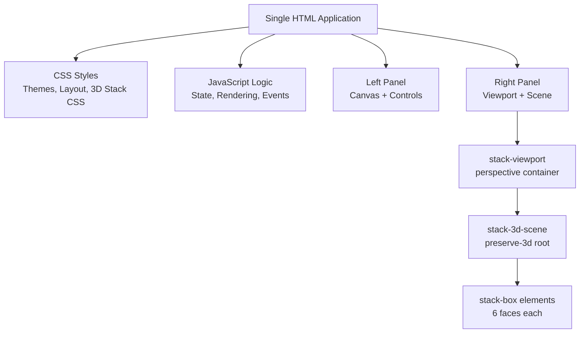
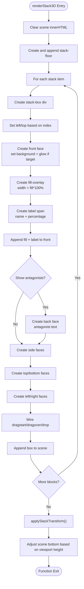
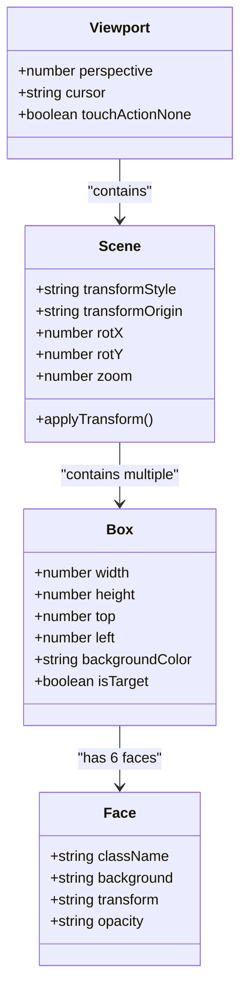
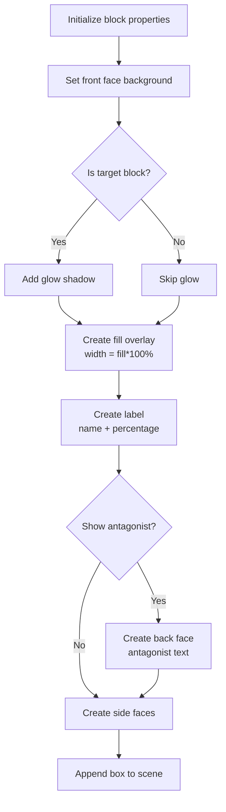
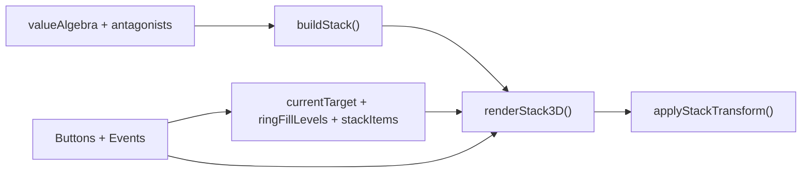

# 3D Stack Renderer

<cite>
**Referenced Files in This Document**
- [Alg_Virt_WhLL.html](file://Alg_Virt_WhLL.html)
</cite>

## Table of Contents
1. [Introduction](#introduction)
2. [Project Structure](#project-structure)
3. [Core Components](#core-components)
4. [Architecture Overview](#architecture-overview)
5. [Detailed Component Analysis](#detailed-component-analysis)
6. [Dependency Analysis](#dependency-analysis)
7. [Performance Considerations](#performance-considerations)
8. [Troubleshooting Guide](#troubleshooting-guide)
9. [Conclusion](#conclusion)
10. [Appendices](#appendices)

## Introduction
This document explains the DOM-based 3D stack rendering system implemented in a single-page application. It focuses on how blocks are created as HTML elements, positioned with CSS 3D transforms, and interacted with via mouse and touch events. The documentation covers:

- The `renderStack3D()` function and its role in building the scene
- Block positioning, face styling, and fill overlays
- Interaction handlers for drag-to-reorder and viewport rotation/zoom
- The 3D coordinate system, transform matrices, and perspective settings
- Performance considerations for DOM-based 3D rendering
- Examples for customizing block appearance, adding transitions, and implementing drag-and-drop behavior

The system is part of a larger interface that also includes a 2D concentric cogwheel visualization. The 3D stack visualizes layered components and their fill levels, while the cogwheel controls drive those fill levels.

## Project Structure
The entire application lives in one HTML file containing:

- A `<style>` section defining themes, layout, and all CSS for the 3D stack
- A `<script>` section defining data models, state, rendering logic, interactions, and initialization
- Two main panels:
  - Left panel: 2D concentric cogwheel canvas
  - Right panel: 3D stack viewport with a scene container



**Diagram sources**
- [Alg_Virt_WhLL.html:453-625](file://Alg_Virt_WhLL.html#L453-L625)
- [Alg_Virt_WhLL.html:805-827](file://Alg_Virt_WhLL.html#L805-L827)
- [Alg_Virt_WhLL.html:1617-1763](file://Alg_Virt_WhLL.html#L1617-L1763)

**Section sources**
- [Alg_Virt_WhLL.html:1-100](file://Alg_Virt_WhLL.html#L1-L100)
- [Alg_Virt_WhLL.html:453-625](file://Alg_Virt_WhLL.html#L453-L625)
- [Alg_Virt_WhLL.html:805-827](file://Alg_Virt_WhLL.html#L805-L827)

## Core Components
- Data model:
  - Value algebra defines components, colors, layers, and descriptions
  - Antagonists map each component to an opposing concept
- State:
  - Current target quality
  - Ring fill levels per layer
  - Stack items (ordered list of blocks)
  - View state: rotation angles and zoom
- Rendering:
  - 2D cogwheel drawing on canvas
  - 3D stack DOM construction and transformation
- Interactions:
  - Mouse/touch drag to adjust ring fills
  - Mouse/touch drag to rotate the 3D stack
  - Wheel/pinch to zoom both views
  - Buttons for reset, play, spin, zoom, and toggling antagonist labels

Key responsibilities:
- `buildStack()`: builds ordered stack items from dependencies
- `renderStack3D()`: creates DOM nodes for the scene, floor, and blocks; wires drag-and-drop
- `applyStackTransform()`: applies combined translate/scale/rotate transforms to the scene
- `setupStack3DControls()`: binds mouse/touch events and buttons for interaction

**Section sources**
- [Alg_Virt_WhLL.html:831-865](file://Alg_Virt_WhLL.html#L831-L865)
- [Alg_Virt_WhLL.html:920-943](file://Alg_Virt_WhLL.html#L920-L943)
- [Alg_Virt_WhLL.html:1620-1645](file://Alg_Virt_WhLL.html#L1620-L1645)
- [Alg_Virt_WhLL.html:1647-1763](file://Alg_Virt_WhLL.html#L1647-L1763)
- [Alg_Virt_WhLL.html:1765-1881](file://Alg_Virt_WhLL.html#L1765-L1881)

## Architecture Overview
The 3D stack is rendered using CSS 3D transforms inside a perspective-enabled viewport. Each block is a cube made of six faces. The scene root uses `transform-style: preserve-3d`, enabling nested transforms to compose into a 3D space.

```mermaid
sequenceDiagram
participant User as "User"
participant Viewport as "stack-viewport"
participant Scene as "stack-3d-scene"
participant Box as "stack-box"
participant Faces as "face elements"
User->>Viewport : Mouse down / touch start
Viewport->>Scene : Update rotation/zoom state
Scene->>Scene : applyStackTransform()
Note over Scene : translateZ(-200*(z-1)) scale(z) rotateX(deg) rotateY(deg)
User->>Box : Drag start/move/drop
Box->>Box : Update stackItems order
Box->>Scene : renderStack3D() rebuilds DOM
Scene->>Faces : Create/update 6 faces per block
Faces-->>User : Visual feedback (fill overlay, labels)
```

**Diagram sources**
- [Alg_Virt_WhLL.html:1765-1770](file://Alg_Virt_WhLL.html#L1765-L1770)
- [Alg_Virt_WhLL.html:1647-1763](file://Alg_Virt_WhLL.html#L1647-L1763)
- [Alg_Virt_WhLL.html:1772-1881](file://Alg_Virt_WhLL.html#L1772-L1881)

## Detailed Component Analysis

### The `renderStack3D()` Function
`renderStack3D()` constructs the 3D scene by creating DOM elements for the floor and each block. For every block:

- Creates a box element with class `stack-box`
- Positions it absolutely within the scene using calculated top/left coordinates
- Creates six face elements: front, back, top, bottom, left, right
- Applies background colors derived from the block’s color and antagonists
- Adds a fill overlay on the front face proportional to the block’s layer fill
- Wires native HTML drag-and-drop events to reorder blocks
- Appends the box to the scene and finally calls `applyStackTransform()`

Positioning details:
- Box width and height are fixed at 160x40 pixels
- Vertical stacking uses a gap between blocks
- Front face has a fill overlay whose width equals the computed fill percentage
- Labels include the block name and percentage; target blocks get a special glow

Face styling:
- Front face shows the primary color and a semi-transparent fill overlay
- Back face displays the antagonist label and uses a darker theme
- Top/bottom/left/right faces use darker shades of the base color and show layer or percentage text

Interaction wiring:
- Each box is marked draggable
- Dragstart sets effect and stores the original index
- Dragover highlights the drop target
- Drop reorders the underlying `stackItems` array and triggers a full refresh



**Diagram sources**
- [Alg_Virt_WhLL.html:1647-1763](file://Alg_Virt_WhLL.html#L1647-L1763)

**Section sources**
- [Alg_Virt_WhLL.html:1647-1763](file://Alg_Virt_WhLL.html#L1647-L1763)

### 3D Coordinate System and Transform Matrices
The 3D stack uses a standard CSS 3D coordinate system:

- X axis increases to the right
- Y axis increases downward
- Z axis increases toward the viewer
- Perspective is defined on the viewport container
- The scene root preserves 3D transforms and rotates around its center-bottom origin

Perspective and camera:
- The viewport sets a perspective value, simulating a camera distance
- The scene root uses `transform-origin: center bottom` so rotations pivot near the base of the stack

Transform composition:
- The scene transform combines:
  - Translate along Z to simulate camera movement
  - Scale to zoom in/out
  - RotateX to tilt the view up/down
  - RotateY to orbit left/right



**Diagram sources**
- [Alg_Virt_WhLL.html:453-475](file://Alg_Virt_WhLL.html#L453-L475)
- [Alg_Virt_WhLL.html:477-585](file://Alg_Virt_WhLL.html#L477-L585)
- [Alg_Virt_WhLL.html:1765-1770](file://Alg_Virt_WhLL.html#L1765-L1770)

**Section sources**
- [Alg_Virt_WhLL.html:453-475](file://Alg_Virt_WhLL.html#L453-L475)
- [Alg_Virt_WhLL.html:477-585](file://Alg_Virt_WhLL.html#L477-L585)
- [Alg_Virt_WhLL.html:1765-1770](file://Alg_Virt_WhLL.html#L1765-L1770)

### Block Positioning and Face Styling
Block positioning:
- Boxes are absolutely positioned within the scene
- Vertical spacing uses a fixed gap between blocks
- Horizontal centering is achieved by setting left to negative half the box width

Face styling:
- Front face:
  - Uses the block’s color
  - Includes a fill overlay whose width reflects the current fill level
  - Target blocks receive a glow shadow
- Back face:
  - Shows the antagonist label
  - Uses a dark background and dashed border
- Top/bottom/left/right faces:
  - Use darker shades of the base color
  - Display layer numbers or percentages

Fill overlays:
- The fill overlay is a child of the front face
- Its width is set to the computed fill percentage
- It uses a semi-transparent accent color and a glowing right edge



**Diagram sources**
- [Alg_Virt_WhLL.html:1670-1721](file://Alg_Virt_WhLL.html#L1670-L1721)
- [Alg_Virt_WhLL.html:502-585](file://Alg_Virt_WhLL.html#L502-L585)

**Section sources**
- [Alg_Virt_WhLL.html:1670-1721](file://Alg_Virt_WhLL.html#L1670-L1721)
- [Alg_Virt_WhLL.html:502-585](file://Alg_Virt_WhLL.html#L502-L585)

### Interaction Handlers
Mouse and touch interactions:
- Dragging the viewport rotates the stack:
  - Mouse move updates rotation angles
  - Touch move supports single-finger rotation
- Pinch gestures adjust zoom:
  - Two-finger pinch scales the scene
- Wheel events zoom the stack:
  - Scroll up zooms in
  - Scroll down zooms out
- Native drag-and-drop reorders blocks:
  - Dragstart marks the source block
  - Dragover highlights the drop target
  - Drop swaps entries in `stackItems` and triggers a refresh

Buttons:
- Reset view restores default rotation and zoom
- Toggle labels hides/shows antagonist faces
- Auto spin continuously rotates the stack

```mermaid
sequenceDiagram
participant VP as "Viewport"
participant Mouse as "Mouse/Touch"
participant Scene as "Scene"
participant Box as "Box"
Mouse->>VP : mousedown/touchstart
VP->>VP : set dragging flag
Mouse->>VP : mousemove/touchmove
VP->>Scene : update rotX/rotY
Scene->>Scene : applyStackTransform()
Mouse->>Box : dragstart
Box->>Box : store index, set opacity
Mouse->>Box : dragover
Box->>Box : highlight drop target
Mouse->>Box : drop
Box->>Box : reorder stackItems
Box->>Scene : renderStack3D()
```

**Diagram sources**
- [Alg_Virt_WhLL.html:1772-1881](file://Alg_Virt_WhLL.html#L1772-L1881)
- [Alg_Virt_WhLL.html:1723-1754](file://Alg_Virt_WhLL.html#L1723-L1754)

**Section sources**
- [Alg_Virt_WhLL.html:1772-1881](file://Alg_Virt_WhLL.html#L1772-L1881)
- [Alg_Virt_WhLL.html:1723-1754](file://Alg_Virt_WhLL.html#L1723-L1754)

### Customizing Block Appearance
To customize block appearance:

- Change base dimensions:
  - Modify box width and height variables used during rendering
- Adjust colors:
  - Update block colors in the data model
  - Tweak antagonist colors by adjusting the darken logic
- Modify fill overlay:
  - Change overlay background and border styles in CSS
  - Adjust transition timing for smoother fill changes
- Enhance target block glow:
  - Increase box-shadow intensity or add animations

Examples:
- To make blocks taller, increase the box height variable and adjust vertical spacing
- To change the fill overlay color, modify the CSS rule for the overlay background
- To animate fill transitions, add a CSS transition property to the overlay width

**Section sources**
- [Alg_Virt_WhLL.html:1655-1657](file://Alg_Virt_WhLL.html#L1655-L1657)
- [Alg_Virt_WhLL.html:1672-1685](file://Alg_Virt_WhLL.html#L1672-L1685)
- [Alg_Virt_WhLL.html:512-522](file://Alg_Virt_WhLL.html#L512-L522)

### Adding Transitions
To add smooth transitions:

- CSS transitions:
  - Add transition properties to the fill overlay width
  - Animate box hover states or glow effects
- JS-driven animations:
  - Use requestAnimationFrame for smooth rotation or zoom
  - Interpolate transform values instead of jumping between states

Recommendations:
- Keep transitions short to maintain responsiveness
- Avoid animating heavy properties like width/height when possible; prefer transform and opacity
- Use will-change sparingly for elements that will be frequently animated

**Section sources**
- [Alg_Virt_WhLL.html:512-522](file://Alg_Virt_WhLL.html#L512-L522)
- [Alg_Virt_WhLL.html:468-475](file://Alg_Virt_WhLL.html#L468-L475)

### Implementing Drag-and-Drop Functionality
The system uses native HTML drag-and-drop:

- Enable draggable on each box
- Handle dragstart to capture the source index
- Handle dragover to prevent default and highlight the target
- Handle drop to reorder the underlying array and refresh the scene

Enhancements:
- Add visual feedback during drag (e.g., scaling or shadow)
- Support keyboard navigation for accessibility
- Integrate with a library for advanced drag behaviors (e.g., sorting lists)

**Section sources**
- [Alg_Virt_WhLL.html:1723-1754](file://Alg_Virt_WhLL.html#L1723-L1754)

## Dependency Analysis
The 3D stack depends on shared state and utilities:

- Data model:
  - `valueAlgebra` provides component metadata
  - `antagonists` maps components to opposites
- State:
  - `currentTarget` determines which stack to build
  - `ringFillLevels` drives fill percentages per layer
  - `stackItems` holds the ordered blocks
- Rendering pipeline:
  - `buildStack()` computes the stack from dependencies
  - `renderStack3D()` builds DOM elements
  - `applyStackTransform()` applies transforms
- UI controls:
  - Buttons and event listeners update state and trigger refreshes



**Diagram sources**
- [Alg_Virt_WhLL.html:831-865](file://Alg_Virt_WhLL.html#L831-L865)
- [Alg_Virt_WhLL.html:920-943](file://Alg_Virt_WhLL.html#L920-L943)
- [Alg_Virt_WhLL.html:1620-1645](file://Alg_Virt_WhLL.html#L1620-L1645)
- [Alg_Virt_WhLL.html:1647-1763](file://Alg_Virt_WhLL.html#L1647-L1763)
- [Alg_Virt_WhLL.html:1765-1881](file://Alg_Virt_WhLL.html#L1765-L1881)

**Section sources**
- [Alg_Virt_WhLL.html:831-865](file://Alg_Virt_WhLL.html#L831-L865)
- [Alg_Virt_WhLL.html:920-943](file://Alg_Virt_WhLL.html#L920-L943)
- [Alg_Virt_WhLL.html:1620-1645](file://Alg_Virt_WhLL.html#L1620-L1645)
- [Alg_Virt_WhLL.html:1647-1763](file://Alg_Virt_WhLL.html#L1647-L1763)
- [Alg_Virt_WhLL.html:1765-1881](file://Alg_Virt_WhLL.html#L1765-L1881)

## Performance Considerations
DOM-based 3D rendering can be expensive due to layout and paint costs. Key considerations:

- Minimize DOM churn:
  - Reuse existing elements where possible
  - Avoid rebuilding the entire scene on small updates
- Batch updates:
  - Group style changes and DOM mutations
  - Use requestAnimationFrame for animation loops
- Optimize transforms:
  - Prefer transform and opacity for animations
  - Use will-change for frequently animated elements
- Reduce repaint areas:
  - Keep content static when not interacting
  - Avoid animating layout-triggering properties
- Perspective tuning:
  - Excessive perspective values can cause clipping or performance issues
  - Test on low-power devices

Recommendations:
- Debounce resize events and fullscreen changes
- Limit the number of blocks in the stack
- Use CSS containment for stable regions
- Profile with browser dev tools to identify bottlenecks

[No sources needed since this section provides general guidance]

## Troubleshooting Guide
Common issues and resolutions:

- Blocks not visible:
  - Verify viewport perspective is set correctly
  - Ensure scene transform is applied
- Fill overlay not updating:
  - Confirm fill percentage calculation
  - Check CSS transition rules
- Drag-and-drop not working:
  - Ensure draggable attribute is set
  - Verify event listeners are attached
- Rotation/zoom unresponsive:
  - Check event listener registration
  - Validate transform application

Debugging steps:
- Inspect DOM structure in developer tools
- Check computed styles for transforms
- Log state changes during interactions
- Test on different devices and browsers

**Section sources**
- [Alg_Virt_WhLL.html:453-475](file://Alg_Virt_WhLL.html#L453-L475)
- [Alg_Virt_WhLL.html:1647-1763](file://Alg_Virt_WhLL.html#L1647-L1763)
- [Alg_Virt_WhLL.html:1772-1881](file://Alg_Virt_WhLL.html#L1772-L1881)

## Conclusion
The 3D stack renderer demonstrates how to build interactive 3D visuals using DOM elements and CSS transforms. By combining a perspective-enabled viewport, preserved 3D transforms, and carefully composed transforms, the system renders a stack of blocks that users can rotate, zoom, and reorder. The design emphasizes clarity, performance, and extensibility, allowing customization of appearance, transitions, and interactions.

[No sources needed since this section summarizes without analyzing specific files]

## Appendices

### CSS Transform Properties and Perspective Settings
- Perspective:
  - Defined on the viewport to simulate camera distance
- Transform-style:
  - Preserves 3D transforms on the scene root
- Transform-origin:
  - Sets the pivot point for rotations
- Composed transforms:
  - TranslateZ for camera movement
  - Scale for zoom
  - RotateX and RotateY for orientation

**Section sources**
- [Alg_Virt_WhLL.html:453-475](file://Alg_Virt_WhLL.html#L453-L475)
- [Alg_Virt_WhLL.html:1765-1770](file://Alg_Virt_WhLL.html#L1765-L1770)

### Event Handling for 3D Interactions
- Mouse events:
  - mousedown/mousemove/mouseup for rotation
  - wheel for zoom
- Touch events:
  - touchstart/touchmove/touchend for rotation and pinch-zoom
- Drag-and-drop:
  - dragstart/dragover/drop for reordering blocks

**Section sources**
- [Alg_Virt_WhLL.html:1772-1881](file://Alg_Virt_WhLL.html#L1772-L1881)
- [Alg_Virt_WhLL.html:1723-1754](file://Alg_Virt_WhLL.html#L1723-L1754)