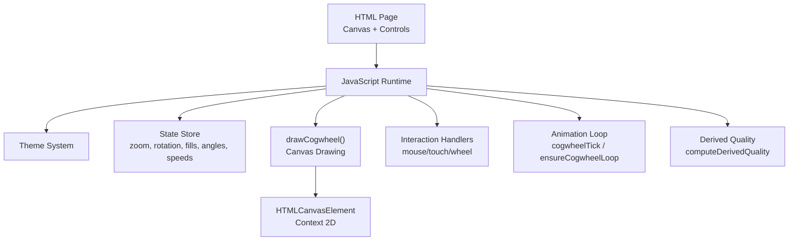
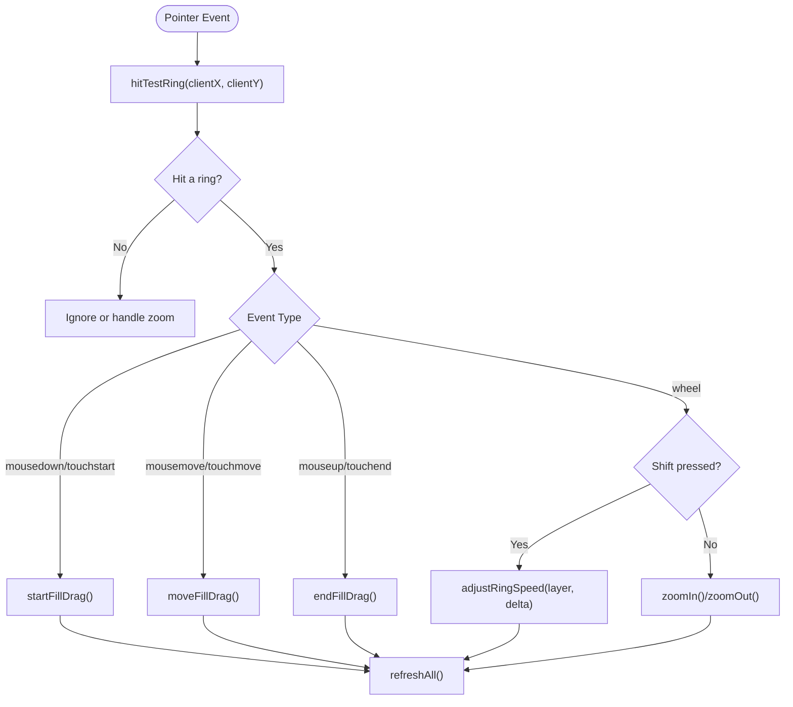
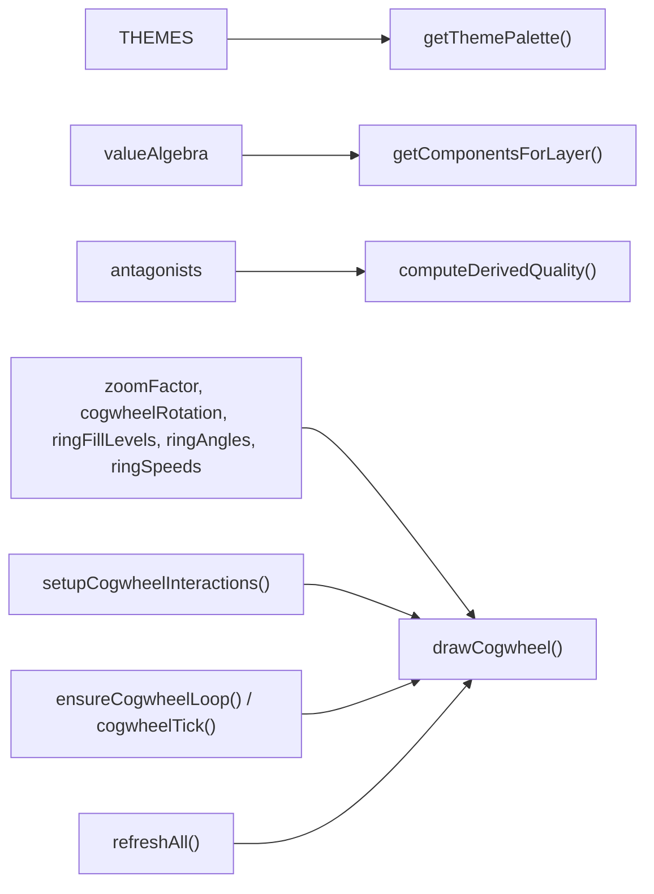

# Cogwheel Renderer

<cite>
**Referenced Files in This Document**
- [Alg_Virt_WhLL.html](file://Alg_Virt_WhLL.html)
</cite>

## Table of Contents
1. [Introduction](#introduction)
2. [Project Structure](#project-structure)
3. [Core Components](#core-components)
4. [Architecture Overview](#architecture-overview)
5. [Detailed Component Analysis](#detailed-component-analysis)
6. [Dependency Analysis](#dependency-analysis)
7. [Performance Considerations](#performance-considerations)
8. [Troubleshooting Guide](#troubleshooting-guide)
9. [Conclusion](#conclusion)
10. [Appendices](#appendices)

## Introduction
This document explains the cogwheel rendering system implemented in a single-page application. The renderer draws concentric rings on an HTML Canvas, visualizes fill levels and component labels, supports per-ring rotation speeds, zoom, drag-to-fill interaction, and integrates with a theme system. It also computes a derived quality value based on ring fills and spins, and updates UI overlays accordingly.

The focus is on:
- The drawCogwheel() function and its Canvas API usage
- Concentric ring geometry and trigonometric positioning
- Fill level visualization and negative antagonist labeling
- Rotation animation loop and per-ring spin control
- Theme integration for colors and fonts
- Zoom handling and coordinate transforms
- Interaction handlers for mouse, wheel, and touch events

## Project Structure
The project is a self-contained HTML file that includes CSS styles, DOM structure, and JavaScript logic. The cogwheel canvas is embedded inside a container panel, with controls for play/pause, zoom, reset, and per-ring speed adjustment. A 3D stack panel and telemetry readout are present but outside the scope of this document.



**Diagram sources**
- [Alg_Virt_WhLL.html:830-943](file://Alg_Virt_WhLL.html#L830-L943)
- [Alg_Virt_WhLL.html:1142-1354](file://Alg_Virt_WhLL.html#L1142-L1354)
- [Alg_Virt_WhLL.html:1426-1495](file://Alg_Virt_WhLL.html#L1426-L1495)
- [Alg_Virt_WhLL.html:1498-1523](file://Alg_Virt_WhLL.html#L1498-L1523)
- [Alg_Virt_WhLL.html:1019-1093](file://Alg_Virt_WhLL.html#L1019-L1093)

**Section sources**
- [Alg_Virt_WhLL.html:710-828](file://Alg_Virt_WhLL.html#L710-L828)
- [Alg_Virt_WhLL.html:830-943](file://Alg_Virt_WhLL.html#L830-L943)

## Core Components
- Theme system: Provides accent colors, RGB values, bright text color, neutral RGB, and font families.
- State store: Holds global state such as current target quality, zoom factor, rotation angle, per-ring fill levels, per-ring angles, and per-ring speeds.
- Ring layer computation: Resolves dependencies of the selected target to determine layers and components per layer.
- Derived quality calculation: Aggregates fill levels and spin speeds to compute emergent or antagonistic qualities.
- Cogwheel renderer: Draws background gradient, rings, teeth, fill arcs, labels, and hub dot using Canvas 2D.
- Interaction handlers: Map mouse/touch events to fill dragging, per-ring spin via Shift+Wheel, and zoom via Wheel or pinch.
- Animation loop: Drives global rotation and per-ring spin when needed.

Key responsibilities and entry points:
- Theme switching triggers redraw by calling drawCogwheel(currentTarget).
- User interactions update state and call refreshAll(), which redraws the cogwheel and other panels.
- Animation loop calls cogwheelTick() at intervals to update rotation and redraw.

**Section sources**
- [Alg_Virt_WhLL.html:867-903](file://Alg_Virt_WhLL.html#L867-L903)
- [Alg_Virt_WhLL.html:920-993](file://Alg_Virt_WhLL.html#L920-L993)
- [Alg_Virt_WhLL.html:1019-1093](file://Alg_Virt_WhLL.html#L1019-L1093)
- [Alg_Virt_WhLL.html:1142-1354](file://Alg_Virt_WhLL.html#L1142-L1354)
- [Alg_Virt_WhLL.html:1426-1495](file://Alg_Virt_WhLL.html#L1426-L1495)
- [Alg_Virt_WhLL.html:1498-1523](file://Alg_Virt_WhLL.html#L1498-L1523)

## Architecture Overview
The cogwheel renderer is driven by user input and time-based updates. The flow is:

```mermaid
sequenceDiagram
participant User as "User"
participant UI as "DOM Controls"
participant State as "State Store"
participant Render as "drawCogwheel()"
participant Loop as "Animation Loop"
participant Derived as "computeDerivedQuality()"
User->>UI : Click Play / Zoom / Reset / Speed
UI->>State : Update zoom/rotation/fills/spins
State->>Render : Trigger redraw
Render->>Derived : Compute derived quality (optional)
Render-->>UI : Update overlay text and visuals
Loop->>State : Advance rotation and per-ring angles
Loop->>Render : Redraw frame
```

**Diagram sources**
- [Alg_Virt_WhLL.html:1498-1523](file://Alg_Virt_WhLL.html#L1498-L1523)
- [Alg_Virt_WhLL.html:1142-1354](file://Alg_Virt_WhLL.html#L1142-L1354)
- [Alg_Virt_WhLL.html:1019-1093](file://Alg_Virt_WhLL.html#L1019-L1093)

## Detailed Component Analysis

### Coordinate System and Geometry
- Canvas sizing: The renderer sets canvas.width and canvas.height to devicePixelRatio-scaled dimensions, then applies CSS width/height to match the container size. This ensures crisp rendering on high-DPI displays.
- Center and radius: The center point is at (canvas.width / 2, canvas.height / 2). The maximum radius is computed from the smaller dimension multiplied by a scaling factor and the current zoomFactor.
- Layer radii: Layers are evenly spaced by dividing maxRadius by (numLayers + 0.5). Each ring’s inner and outer radii are computed per layer index.
- Trigonometry: Positions along arcs use cos(angle) and sin(angle), where angles are measured in radians starting from -π/2 (top) and increasing clockwise. Labels and antagonist names are rotated to align tangentially with the arc.

Relevant implementation details:
- Canvas setup and DPR scaling
- Max radius and layer spacing
- Arc start/end angles for fill visualization
- Label rotation logic to keep text upright relative to the arc

**Section sources**
- [Alg_Virt_WhLL.html:1142-1158](file://Alg_Virt_WhLL.html#L1142-L1158)
- [Alg_Virt_WhLL.html:1162-1184](file://Alg_Virt_WhLL.html#L1162-L1184)
- [Alg_Virt_WhLL.html:1218-1235](file://Alg_Virt_WhLL.html#L1218-L1235)
- [Alg_Virt_WhLL.html:1296-1322](file://Alg_Virt_WhLL.html#L1296-L1322)

### Concentric Ring Calculations
- Number of layers: Determined by resolving dependencies of the current target quality and grouping components by layer.
- Radii: Inner and outer radii are calculated per layer to create concentric bands.
- Teeth: Cog teeth are drawn around the outer edge of each ring to make rotation visible even when the ring is fully filled or empty.
- Hover and drag states: Visual feedback changes stroke and fill opacity when a ring is hovered or being dragged.

Implementation highlights:
- Layer resolution and ordering
- Per-layer inner/outer radius calculations
- Tooth path generation using angular steps
- Stroke and fill styling based on hover/drag state

**Section sources**
- [Alg_Virt_WhLL.html:1162-1184](file://Alg_Virt_WhLL.html#L1162-L1184)
- [Alg_Virt_WhLL.html:1200-1216](file://Alg_Virt_WhLL.html#L1200-L1216)
- [Alg_Virt_WhLL.html:1186-1198](file://Alg_Virt_WhLL.html#L1186-L1198)

### Fill Level Visualization
- Fill range: Each ring has a fill level between 0 and 1. The fill starts at the top (-π/2) and extends clockwise by fillLevel * 2π.
- Gradient fill: A radial gradient is created from inner to outer radius, with color stops derived from the components’ colors in the layer. Alpha is modulated by fill level.
- Edge line and knob: A glowing edge line marks the end of the fill arc; a circular knob sits at the midpoint radius of the arc.
- Negative antagonist labels: When fill < 1, antagonist names are placed along the unfilled portion, rotated to align with the arc.

Implementation highlights:
- Start/end angle computation
- Radial gradient creation and color stop assignment
- Shadow effects for glow
- Antagonist label placement and rotation

**Section sources**
- [Alg_Virt_WhLL.html:1218-1261](file://Alg_Virt_WhLL.html#L1218-L1261)
- [Alg_Virt_WhLL.html:1263-1294](file://Alg_Virt_WhLL.html#L1263-L1294)

### Rotation Animations
- Global rotation: cogwheelRotation advances when autoRotate is enabled.
- Per-ring rotation: Each layer has an independent angle stored in ringAngles, updated by its speed.
- Animation loop: cogwheelTick runs at fixed intervals, advancing global and per-ring rotations, then redrawing.
- Loop lifecycle: ensureCogwheelLoop starts or stops setInterval based on whether autoRotate is active or any ring has non-zero speed.

Implementation highlights:
- Time step and rotation increments
- Per-ring speed clamping and storage
- Interval management for performance

**Section sources**
- [Alg_Virt_WhLL.html:1498-1523](file://Alg_Virt_WhLL.html#L1498-L1523)
- [Alg_Virt_WhLL.html:995-1008](file://Alg_Virt_WhLL.html#L995-L1008)

### Parameters and Configuration
- Ring configuration:
  - numLayers: Derived from dependency resolution for the current target.
  - radiusStep: Spacing between rings.
  - teeth count: Increases with layer index to differentiate rings visually.
- Color themes:
  - Accent color and RGB triplet for glows and borders.
  - Bright text color for labels and knobs.
  - Neutral RGB for subtle backgrounds and strokes.
  - Font family for canvas text.
- Zoom levels:
  - zoomFactor scales the effective radius and is bounded between minimum and maximum values.
- Interaction handlers:
  - Mouse down/move/up for drag-to-fill.
  - Wheel for zoom and per-ring spin (Shift+Wheel).
  - Touchstart/move/end for mobile drag and pinch-zoom.

Configuration references:
- Theme palette retrieval and application
- Zoom bounds and increments
- Interaction event bindings

**Section sources**
- [Alg_Virt_WhLL.html:867-903](file://Alg_Virt_WhLL.html#L867-L903)
- [Alg_Virt_WhLL.html:1541-1612](file://Alg_Virt_WhLL.html#L1541-L1612)
- [Alg_Virt_WhLL.html:1426-1495](file://Alg_Virt_WhLL.html#L1426-L1495)

### Canvas API Usage Patterns
- Context manipulation:
  - clearRect to reset the drawing surface.
  - save/restore for transformations like translate and rotate.
  - shadowColor/shadowBlur for glow effects.
- Path drawing:
  - arc for circles and arcs.
  - moveTo/lineTo for tooth paths and edge lines.
  - beginPath/closePath for compound shapes.
- Gradient fills:
  - createRadialGradient for background, hub, and ring fills.
  - addColorStop for multi-stop gradients.
- Text rendering:
  - font, textAlign, textBaseline for consistent text layout.
  - rotate for label orientation along arcs.

Usage references:
- Background and hub gradients
- Ring arcs and tooth paths
- Glow effects and text alignment

**Section sources**
- [Alg_Virt_WhLL.html:1169-1175](file://Alg_Virt_WhLL.html#L1169-L1175)
- [Alg_Virt_WhLL.html:1200-1216](file://Alg_Virt_WhLL.html#L1200-L1216)
- [Alg_Virt_WhLL.html:1222-1235](file://Alg_Virt_WhLL.html#L1222-L1235)
- [Alg_Virt_WhLL.html:1279-1291](file://Alg_Virt_WhLL.html#L1279-L1291)
- [Alg_Virt_WhLL.html:1296-1322](file://Alg_Virt_WhLL.html#L1296-L1322)

### Interaction Flow


**Diagram sources**
- [Alg_Virt_WhLL.html:1356-1388](file://Alg_Virt_WhLL.html#L1356-L1388)
- [Alg_Virt_WhLL.html:1390-1424](file://Alg_Virt_WhLL.html#L1390-L1424)
- [Alg_Virt_WhLL.html:1426-1495](file://Alg_Virt_WhLL.html#L1426-L1495)
- [Alg_Virt_WhLL.html:1614-1615](file://Alg_Virt_WhLL.html#L1614-L1615)

## Dependency Analysis
The cogwheel renderer depends on several subsystems:



**Diagram sources**
- [Alg_Virt_WhLL.html:830-903](file://Alg_Virt_WhLL.html#L830-L903)
- [Alg_Virt_WhLL.html:944-993](file://Alg_Virt_WhLL.html#L944-L993)
- [Alg_Virt_WhLL.html:1019-1093](file://Alg_Virt_WhLL.html#L1019-L1093)
- [Alg_Virt_WhLL.html:1142-1354](file://Alg_Virt_WhLL.html#L1142-L1354)
- [Alg_Virt_WhLL.html:1426-1495](file://Alg_Virt_WhLL.html#L1426-L1495)
- [Alg_Virt_WhLL.html:1498-1523](file://Alg_Virt_WhLL.html#L1498-L1523)
- [Alg_Virt_WhLL.html:1988-1993](file://Alg_Virt_WhLL.html#L1988-L1993)

**Section sources**
- [Alg_Virt_WhLL.html:830-903](file://Alg_Virt_WhLL.html#L830-L903)
- [Alg_Virt_WhLL.html:944-993](file://Alg_Virt_WhLL.html#L944-L993)
- [Alg_Virt_WhLL.html:1019-1093](file://Alg_Virt_WhLL.html#L1019-L1093)
- [Alg_Virt_WhLL.html:1142-1354](file://Alg_Virt_WhLL.html#L1142-L1354)
- [Alg_Virt_WhLL.html:1426-1495](file://Alg_Virt_WhLL.html#L1426-L1495)
- [Alg_Virt_WhLL.html:1498-1523](file://Alg_Virt_WhLL.html#L1498-L1523)
- [Alg_Virt_WhLL.html:1988-1993](file://Alg_Virt_WhLL.html#L1988-L1993)

## Performance Considerations
- High-DPI rendering: Using devicePixelRatio prevents blurriness on Retina displays while keeping CSS dimensions stable.
- Conditional animation: The loop only runs when autoRotate is enabled or any ring has non-zero speed, minimizing unnecessary redraws.
- Bounded zoom: ZoomFactor is clamped to prevent extreme scaling that could degrade performance or readability.
- Efficient hit testing: hitTestRing computes distances and angles once per pointer event and returns early upon finding a matching ring.
- Minimal context state changes: save/restore blocks are used sparingly and only around transformations to reduce overhead.
- Text rendering optimization: Font and shadow settings are applied near text drawing operations to avoid repeated recalculations.

[No sources needed since this section provides general guidance]

## Troubleshooting Guide
Common issues and resolutions:
- Canvas appears blurry: Ensure devicePixelRatio is applied to canvas dimensions and CSS sizes match the container.
- Rings not responding to drag: Verify hitTestRing returns a valid ring and that startFillDrag/moveFillDrag update ringFillLevels correctly.
- Spin not updating: Confirm adjustRingSpeed modifies ringSpeeds and calls ensureCogwheelLoop to restart the animation if needed.
- Zoom not working: Check wheel event handler and zoomIn/zoomOut functions; ensure zoomFactor bounds are respected.
- Theme colors not applied: Validate applyTheme sets body data attribute and calls drawCogwheel(currentTarget) after changing theme.

**Section sources**
- [Alg_Virt_WhLL.html:1142-1158](file://Alg_Virt_WhLL.html#L1142-L1158)
- [Alg_Virt_WhLL.html:1356-1388](file://Alg_Virt_WhLL.html#L1356-L1388)
- [Alg_Virt_WhLL.html:1120-1129](file://Alg_Virt_WhLL.html#L1120-L1129)
- [Alg_Virt_WhLL.html:1614-1615](file://Alg_Virt_WhLL.html#L1614-L1615)
- [Alg_Virt_WhLL.html:895-903](file://Alg_Virt_WhLL.html#L895-L903)

## Conclusion
The cogwheel renderer provides a rich, interactive visualization of layered virtues and their relationships. It combines precise Canvas drawing techniques with robust interaction handling and a flexible theme system. By understanding the coordinate system, trigonometric calculations, and animation loop, developers can customize ring appearance, integrate new visual effects, and extend the system while maintaining performance and clarity.

[No sources needed since this section summarizes without analyzing specific files]

## Appendices

### Customizing Ring Appearance
- Change ring colors: Modify the component colors in the value algebra to affect gradient stops and label colors.
- Adjust ring thickness: Alter radiusStep and inner/outer radius calculations to widen or narrow rings.
- Add visual effects: Extend shadowBlur and shadowColor usage for additional glow or outline effects.

References:
- Component color mapping and gradient stops
- Radius calculations and layer spacing
- Shadow and glow usage

**Section sources**
- [Alg_Virt_WhLL.html:1222-1235](file://Alg_Virt_WhLL.html#L1222-L1235)
- [Alg_Virt_WhLL.html:1162-1184](file://Alg_Virt_WhLL.html#L1162-L1184)
- [Alg_Virt_WhLL.html:1242-1260](file://Alg_Virt_WhLL.html#L1242-L1260)

### Integrating With the Theme System
- Define new themes: Add entries to the THEMES object with accent, accentRgb, bright, neutralRgb, and canvasFont.
- Apply theme dynamically: Use applyTheme(themeId) to switch themes and trigger redraw.
- Persist theme preference: Save and load theme from localStorage to remember user choice.

References:
- Theme object structure
- Theme application and redraw
- LocalStorage persistence

**Section sources**
- [Alg_Virt_WhLL.html:867-903](file://Alg_Virt_WhLL.html#L867-L903)
- [Alg_Virt_WhLL.html:895-918](file://Alg_Virt_WhLL.html#L895-L918)