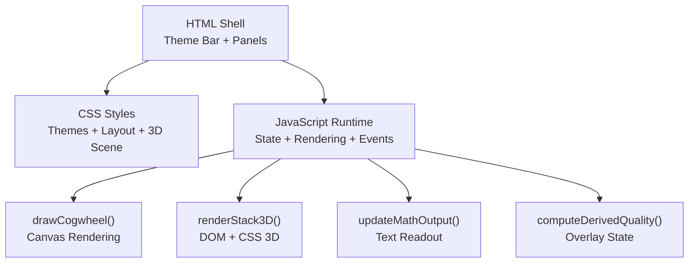
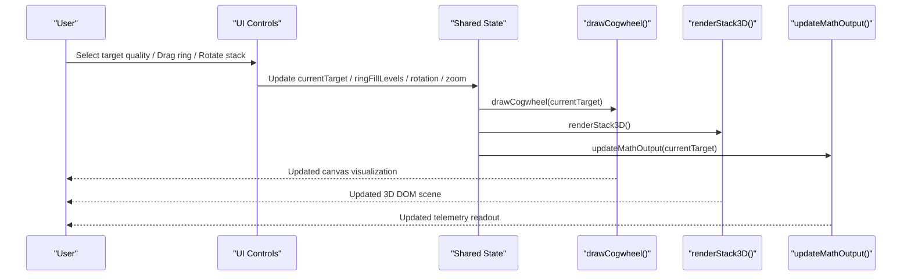
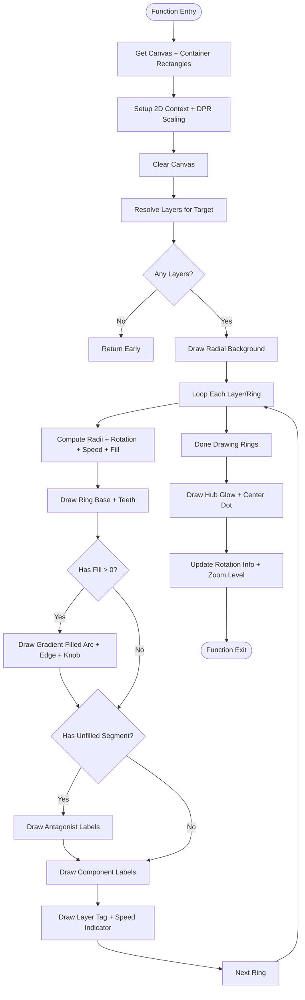
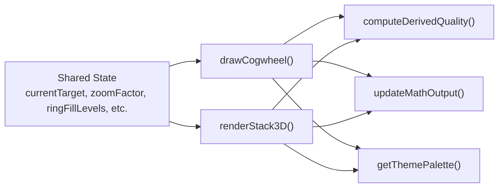

# Rendering APIs

<cite>
**Referenced Files in This Document**
- [Alg_Virt_WhLL.html](file://Alg_Virt_WhLL.html)
</cite>

## Table of Contents
1. [Introduction](#introduction)
2. [Project Structure](#project-structure)
3. [Core Components](#core-components)
4. [Architecture Overview](#architecture-overview)
5. [Detailed Component Analysis](#detailed-component-analysis)
6. [Dependency Analysis](#dependency-analysis)
7. [Performance Considerations](#performance-considerations)
8. [Troubleshooting Guide](#troubleshooting-guide)
9. [Conclusion](#conclusion)

## Introduction
This document provides detailed API documentation for the rendering functions that visualize:
- The concentric virtue wheel (Canvas-based cogwheel).
- The 3D stratified stack (DOM/CSS 3D transforms).

It covers function contracts, parameters, data structures, event handling, and customization strategies. It also documents Canvas API usage patterns and DOM manipulation techniques used by the application.

## Project Structure
The project is a single-page HTML file containing:
- CSS styles defining themes, layout, and 3D scene visuals.
- A script section implementing state, rendering, interactions, and telemetry.



**Diagram sources**
- [Alg_Virt_WhLL.html:710-828](file://Alg_Virt_WhLL.html#L710-L828)
- [Alg_Virt_WhLL.html:830-943](file://Alg_Virt_WhLL.html#L830-L943)
- [Alg_Virt_WhLL.html:1142-1354](file://Alg_Virt_WhLL.html#L1142-L1354)
- [Alg_Virt_WhLL.html:1647-1769](file://Alg_Virt_WhLL.html#L1647-L1769)
- [Alg_Virt_WhLL.html:1886-1945](file://Alg_Virt_WhLL.html#L1886-L1945)

**Section sources**
- [Alg_Virt_WhLL.html:710-828](file://Alg_Virt_WhLL.html#L710-L828)
- [Alg_Virt_WhLL.html:830-943](file://Alg_Virt_WhLL.html#L830-L943)

## Core Components
- drawCogwheel(targetName): Renders the concentric virtue wheel on a canvas with rings, fill arcs, labels, teeth, hub, and overlay text.
- renderStack3D(): Builds and renders the 3D stack using DOM nodes and CSS transforms, including drag-to-reorder and view controls.
- Supporting functions:
  - computeDerivedQuality(): Computes emergent/negative quality based on ring fills and spin speeds.
  - updateMathOutput(): Writes telemetry to a text readout panel.
  - Theme helpers: getThemePalette(), applyTheme().

Key responsibilities:
- Canvas drawing operations for the cogwheel.
- DOM creation and manipulation for the 3D stack.
- Event binding for mouse/touch interactions.
- Animation loop management for auto-rotation and per-ring spin.

**Section sources**
- [Alg_Virt_WhLL.html:1142-1354](file://Alg_Virt_WhLL.html#L1142-L1354)
- [Alg_Virt_WhLL.html:1647-1769](file://Alg_Virt_WhLL.html#L1647-L1769)
- [Alg_Virt_WhLL.html:1019-1093](file://Alg_Virt_WhLL.html#L1019-L1093)
- [Alg_Virt_WhLL.html:1886-1945](file://Alg_Virt_WhLL.html#L1886-L1945)

## Architecture Overview
The rendering system is driven by user interactions and selection changes, which update shared state and trigger re-rendering of both views.



**Diagram sources**
- [Alg_Virt_WhLL.html:1988-2005](file://Alg_Virt_WhLL.html#L1988-L2005)
- [Alg_Virt_WhLL.html:1142-1354](file://Alg_Virt_WhLL.html#L1142-L1354)
- [Alg_Virt_WhLL.html:1647-1769](file://Alg_Virt_WhLL.html#L1647-L1769)
- [Alg_Virt_WhLL.html:1886-1945](file://Alg_Virt_WhLL.html#L1886-L1945)

## Detailed Component Analysis

### drawCogwheel(targetName)
Purpose:
- Render the concentric virtue wheel for a given target quality.

Parameters:
- targetName: string — the selected virtue name used to resolve layers and components.

Canvas context parameters and setup:
- Acquires a 2D context from the canvas element.
- Sets canvas width/height using devicePixelRatio for crisp rendering.
- Clears the canvas before drawing.

Ring configuration objects:
- Layers are computed via component dependency resolution; each layer maps to one ring.
- For each ring:
  - innerRadius, outerRadius, midRadius define geometry.
  - ringRot = global rotation + per-ring angle offset.
  - ringSpeed determines animation direction/speed.
  - fillLevel defines the arc coverage (0..1).
  - components list drives label placement and gradient colors.

Color schemes:
- Uses theme palette values: accent color, RGB triplet, bright text, neutral RGB.
- Ring backgrounds use subtle neutral or accent tints depending on hover/drag.
- Fill gradients combine component colors with alpha derived from fill level.
- Negative segments use darkened antagonist colors.

Animation options:
- Global auto-rotation toggled by play/pause.
- Per-ring spin speed controlled via Shift+wheel or UI controls.
- Animation loop runs when either global auto-rotate is active or any ring has non-zero speed.

Rendering details:
- Draws radial background gradient.
- Draws ring outlines and “teeth” lines to make spin visible.
- Draws filled arcs with gradient fills and glowing edge lines.
- Places component labels along the filled arc.
- Places antagonist labels along unfilled portions.
- Draws hub glow and center dot.
- Updates UI elements for rotation degrees and zoom percentage.

Error handling and edge cases:
- If no layers exist for the target, returns early without drawing.
- Handles missing component entries gracefully by defaulting colors.

Performance considerations:
- DPR-aware sizing ensures sharp visuals at high pixel densities.
- Shadow effects are applied selectively to reduce overdraw.
- Re-draws only when necessary through refreshAll() and event-driven updates.

Usage example paths:
- Function definition and core logic: [Alg_Virt_WhLL.html:1142-1354](file://Alg_Virt_WhLL.html#L1142-L1354)
- Hit testing and interaction mapping: [Alg_Virt_WhLL.html:1356-1495](file://Alg_Virt_WhLL.html#L1356-L1495)
- Animation loop control: [Alg_Virt_WhLL.html:1498-1523](file://Alg_Virt_WhLL.html#L1498-L1523)

**Section sources**
- [Alg_Virt_WhLL.html:1142-1354](file://Alg_Virt_WhLL.html#L1142-L1354)
- [Alg_Virt_WhLL.html:1356-1495](file://Alg_Virt_WhLL.html#L1356-L1495)
- [Alg_Virt_WhLL.html:1498-1523](file://Alg_Virt_WhLL.html#L1498-L1523)

#### drawCogwheel Flowchart


**Diagram sources**
- [Alg_Virt_WhLL.html:1142-1354](file://Alg_Virt_WhLL.html#L1142-L1354)

### renderStack3D()
Purpose:
- Build and render the 3D stratified stack using DOM elements and CSS transforms.

DOM manipulation methods:
- Clears the scene container.
- Creates a floor grid element.
- Iterates over stack items to create box elements with six faces (front, back, top, bottom, left, right).
- Adds fill overlays and labels to front faces.
- Optionally adds antagonist faces based on visibility flag.
- Attaches drag-and-drop handlers for reorder interactions.
- Applies scene transform and adjusts vertical positioning.

CSS transform parameters:
- Scene transform includes translateZ, scale, rotateX, and rotateY.
- Perspective is set on the viewport container.
- Each face uses preserve-3d and specific transforms to form a cube-like block.

3D perspective settings:
- Viewport sets perspective distance to provide depth perception.
- Scene uses preserve-3d and will-change for performance.

Interaction handling:
- Mouse drag rotates the scene around X/Y axes.
- Mouse wheel zooms the scene.
- Touch drag rotates; two-finger pinch zooms.
- Drag-and-drop reorders stack items.
- Buttons reset view, toggle antagonist labels, and start/stop auto-spin.

Data model:
- stackItems contains objects with name, layer, color, isTarget, antagonist, antagonistColor.
- Fill levels are resolved per layer and target.

Error handling and edge cases:
- Skips antagonist faces if visibility is disabled.
- Ensures scene bottom position adapts to viewport height.

Usage example paths:
- Function definition and DOM construction: [Alg_Virt_WhLL.html:1647-1769](file://Alg_Virt_WhLL.html#L1647-L1769)
- Transform application: [Alg_Virt_WhLL.html:1765-1770](file://Alg_Virt_WhLL.html#L1765-L1770)
- Interaction setup: [Alg_Virt_WhLL.html:1772-1881](file://Alg_Virt_WhLL.html#L1772-L1881)

**Section sources**
- [Alg_Virt_WhLL.html:1647-1769](file://Alg_Virt_WhLL.html#L1647-L1769)
- [Alg_Virt_WhLL.html:1765-1770](file://Alg_Virt_WhLL.html#L1765-L1770)
- [Alg_Virt_WhLL.html:1772-1881](file://Alg_Virt_WhLL.html#L1772-L1881)

#### renderStack3D Sequence Diagram
```mermaid
sequenceDiagram
participant Caller as "refreshAll()"
participant Renderer as "renderStack3D()"
participant Scene as "stackScene DOM"
participant Box as "stack-box Elements"
participant Overlay as "fill-overlay"
participant Label as "block-label"
Caller->>Renderer : renderStack3D()
Renderer->>Scene : Clear innerHTML
Renderer->>Scene : Create floor element
Renderer->>Box : For each stack item, create box
Box->>Overlay : Create fill overlay with width %
Box->>Label : Create label with name + fill %
Box->>Scene : Append faces (front/back/top/bottom/left/right)
Box->>Box : Attach drag events (start/end/over/leave/drop)
Renderer->>Scene : Apply transform (translateZ/scale/rotateX/rotateY)
Renderer->>Scene : Adjust bottom position based on viewport
Renderer-->>Caller : Done
```

**Diagram sources**
- [Alg_Virt_WhLL.html:1647-1769](file://Alg_Virt_WhLL.html#L1647-L1769)

### Event Handling and Interactions

#### Cogwheel Interactions
- Drag-to-fill:
  - mousedown/touchstart on a ring starts fill dragging.
  - mousemove/touchmove updates fill level based on pointer angle relative to ring rotation.
  - mouseup/touchend ends dragging.
- Rotation controls:
  - Play/Pause toggles global auto-rotation.
  - Reset clears rotation, angles, speeds, and fills.
- Zoom:
  - Mouse wheel zooms in/out.
  - Buttons adjust zoom factor.
  - Two-finger pinch on touch devices zooms.
- Per-ring spin speed:
  - Shift+wheel on a ring adjusts its speed.
  - UI controls increment/decrement/clear speeds.

Implementation references:
- Hit testing and angle-to-fill conversion: [Alg_Virt_WhLL.html:1356-1398](file://Alg_Virt_WhLL.html#L1356-L1398)
- Drag handlers: [Alg_Virt_WhLL.html:1390-1424](file://Alg_Virt_WhLL.html#L1390-L1424)
- Event binding: [Alg_Virt_WhLL.html:1426-1495](file://Alg_Virt_WhLL.html#L1426-L1495)
- Button bindings: [Alg_Virt_WhLL.html:1541-1612](file://Alg_Virt_WhLL.html#L1541-L1612)

#### 3D Stack Interactions
- Drag-to-rotate:
  - Mouse drag rotates around X/Y axes.
  - Touch drag rotates similarly.
- Zoom:
  - Mouse wheel zooms in/out.
  - Two-finger pinch zooms.
- Drag-to-reorder:
  - Native drag-and-drop reorders stack items.
- Auto-spin:
  - Toggle button starts/stops continuous Y-axis rotation.

Implementation references:
- Mouse/touch rotation and zoom: [Alg_Virt_WhLL.html:1772-1841](file://Alg_Virt_WhLL.html#L1772-L1841)
- Drag-and-drop reorder: [Alg_Virt_WhLL.html:1723-1754](file://Alg_Virt_WhLL.html#L1723-L1754)
- Auto-spin toggle: [Alg_Virt_WhLL.html:1860-1880](file://Alg_Virt_WhLL.html#L1860-L1880)

**Section sources**
- [Alg_Virt_WhLL.html:1356-1495](file://Alg_Virt_WhLL.html#L1356-L1495)
- [Alg_Virt_WhLL.html:1541-1612](file://Alg_Virt_WhLL.html#L1541-L1612)
- [Alg_Virt_WhLL.html:1772-1841](file://Alg_Virt_WhLL.html#L1772-L1841)
- [Alg_Virt_WhLL.html:1723-1754](file://Alg_Virt_WhLL.html#L1723-L1754)
- [Alg_Virt_WhLL.html:1860-1880](file://Alg_Virt_WhLL.html#L1860-L1880)

### Data Models and Configuration

#### Value Algebra and Themes
- valueAlgebra: Maps virtue names to components, colors, descriptions, and layers.
- antagonists: Maps virtues to their antagonistic counterparts.
- THEMES: Defines visual palettes for different design templates.

References:
- [Alg_Virt_WhLL.html:832-890](file://Alg_Virt_WhLL.html#L832-L890)

#### Ring Configuration and State
- ringFillLevels: Map of key (target_layer) to fill fraction (0..1).
- ringAngles: Map of key to cumulative angle offset.
- ringSpeeds: Map of key to angular velocity (rad/s).
- ringKey(layer): Generates map keys per target and layer.

References:
- [Alg_Virt_WhLL.html:920-943](file://Alg_Virt_WhLL.html#L920-L943)
- [Alg_Virt_WhLL.html:995-1008](file://Alg_Virt_WhLL.html#L995-L1008)

**Section sources**
- [Alg_Virt_WhLL.html:832-890](file://Alg_Virt_WhLL.html#L832-L890)
- [Alg_Virt_WhLL.html:920-943](file://Alg_Virt_WhLL.html#L920-L943)
- [Alg_Virt_WhLL.html:995-1008](file://Alg_Virt_WhLL.html#L995-L1008)

## Dependency Analysis
High-level dependencies between rendering components and supporting modules:



**Diagram sources**
- [Alg_Virt_WhLL.html:1142-1354](file://Alg_Virt_WhLL.html#L1142-L1354)
- [Alg_Virt_WhLL.html:1647-1769](file://Alg_Virt_WhLL.html#L1647-L1769)
- [Alg_Virt_WhLL.html:1019-1093](file://Alg_Virt_WhLL.html#L1019-L1093)
- [Alg_Virt_WhLL.html:1886-1945](file://Alg_Virt_WhLL.html#L1886-L1945)
- [Alg_Virt_WhLL.html:893-903](file://Alg_Virt_WhLL.html#L893-L903)

**Section sources**
- [Alg_Virt_WhLL.html:1142-1354](file://Alg_Virt_WhLL.html#L1142-L1354)
- [Alg_Virt_WhLL.html:1647-1769](file://Alg_Virt_WhLL.html#L1647-L1769)
- [Alg_Virt_WhLL.html:1019-1093](file://Alg_Virt_WhLL.html#L1019-L1093)
- [Alg_Virt_WhLL.html:1886-1945](file://Alg_Virt_WhLL.html#L1886-L1945)
- [Alg_Virt_WhLL.html:893-903](file://Alg_Virt_WhLL.html#L893-L903)

## Performance Considerations
- Canvas rendering:
  - Use devicePixelRatio scaling to avoid blurry visuals on high-DPI displays.
  - Limit shadow blur usage to critical elements to reduce GPU overhead.
  - Batch redraws via refreshAll() to minimize redundant draws.
- DOM rendering:
  - Avoid frequent innerHTML replacements; reuse existing nodes where possible.
  - Use will-change sparingly; apply it to animated properties like transform.
  - Debounce resize events to prevent excessive reflows.
- Animation loops:
  - Run the cogwheel tick interval only when needed (global auto-rotate or any ring spinning).
  - Stop intervals promptly when animations are disabled.

[No sources needed since this section provides general guidance]

## Troubleshooting Guide
Common issues and resolutions:
- Canvas appears blurry:
  - Ensure canvas width/height are set using devicePixelRatio scaling.
  - Verify container dimensions are correct before drawing.
- Rings not responding to drag:
  - Confirm hitTestRing returns valid indices and angles.
  - Check that pointer coordinates are correctly transformed to canvas space.
- 3D stack not rotating:
  - Verify mouse/touch drag flags are set and last positions updated.
  - Ensure applyStackTransform is called after updating rotation angles.
- Antagonist labels not showing:
  - Check stackShowAntagonists flag and ensure renderStack3D rebuilds faces accordingly.
- Animation continues unexpectedly:
  - Ensure ensureCogwheelLoop stops intervals when autoRotate is false and all ring speeds are zero.

**Section sources**
- [Alg_Virt_WhLL.html:1356-1495](file://Alg_Virt_WhLL.html#L1356-L1495)
- [Alg_Virt_WhLL.html:1772-1841](file://Alg_Virt_WhLL.html#L1772-L1841)
- [Alg_Virt_WhLL.html:1498-1523](file://Alg_Virt_WhLL.html#L1498-L1523)

## Conclusion
The rendering APIs provide a cohesive system for visualizing virtue relationships through a Canvas-based cogwheel and a DOM/CSS 3D stack. They expose clear entry points for drawing, interaction, and state management while supporting theming, animation, and telemetry. By following the documented patterns and constraints, developers can customize visuals, add new rendering effects, and optimize performance effectively.

[No sources needed since this section summarizes without analyzing specific files]