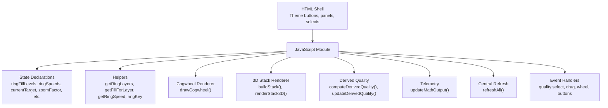
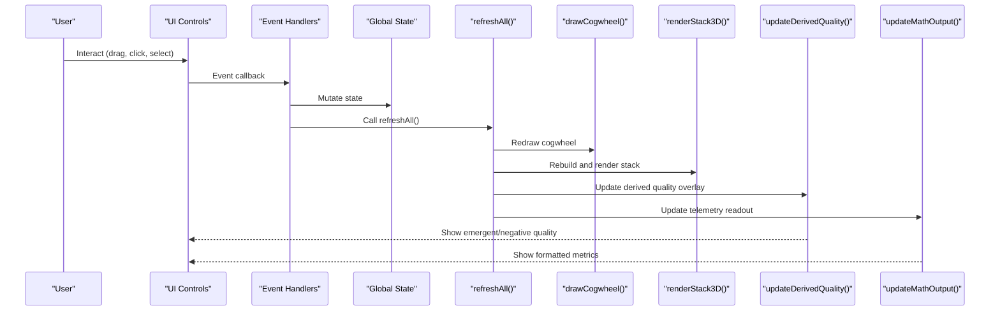
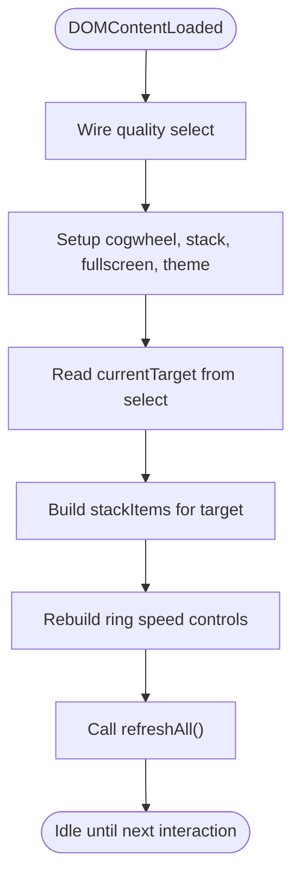
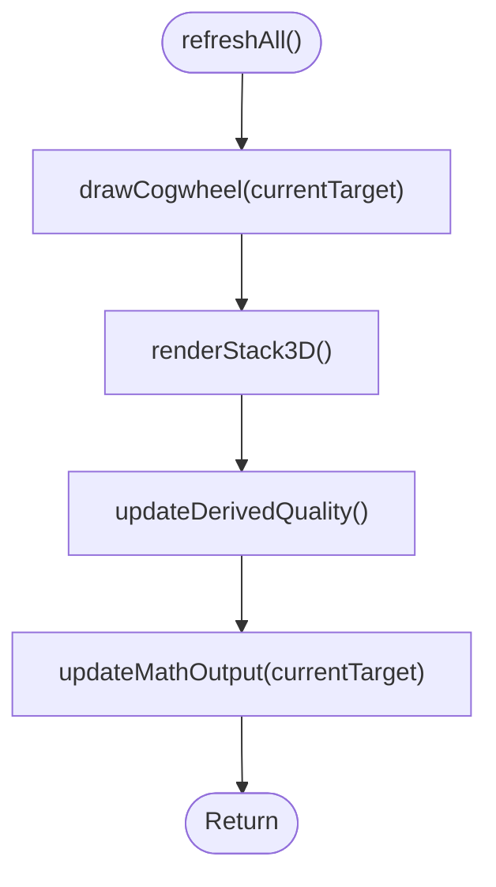
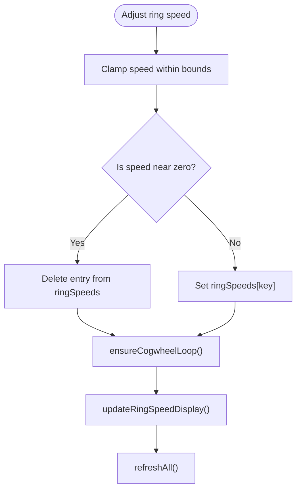
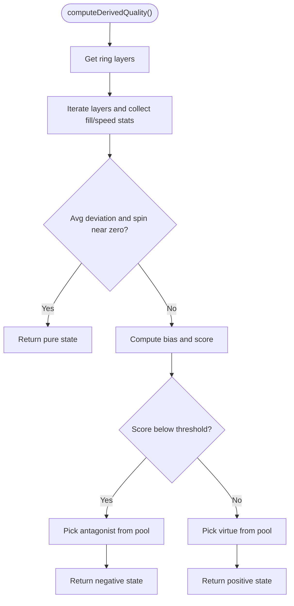
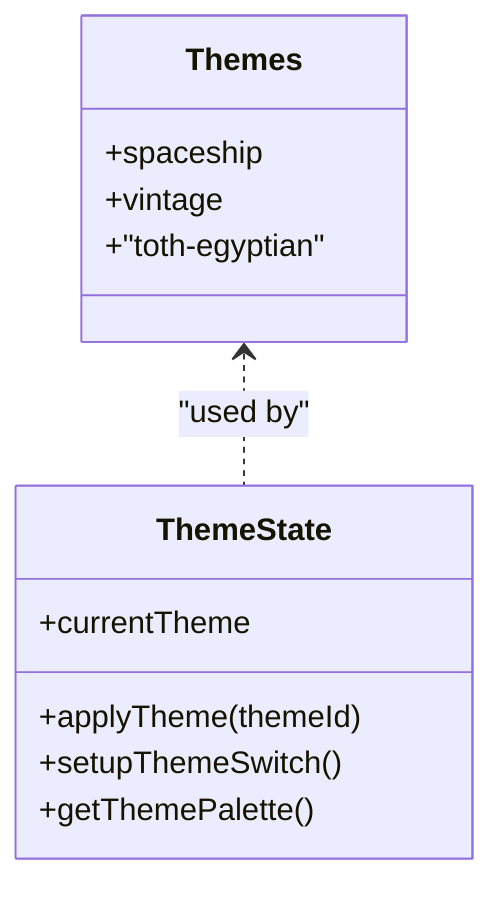
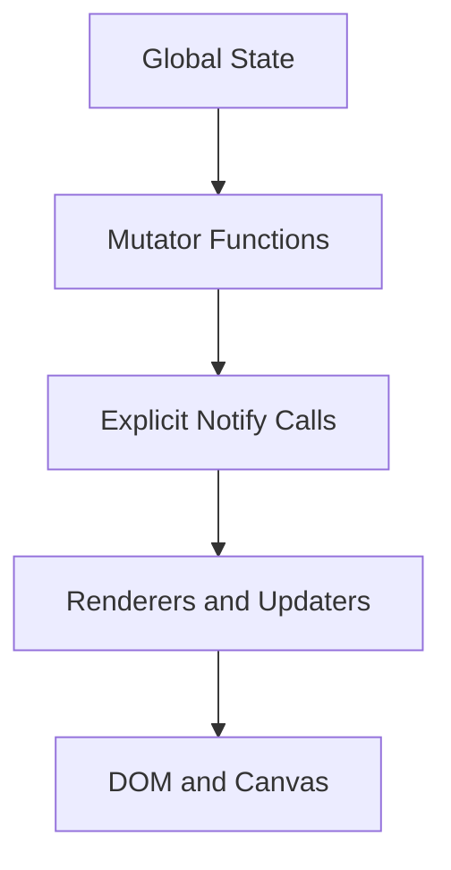
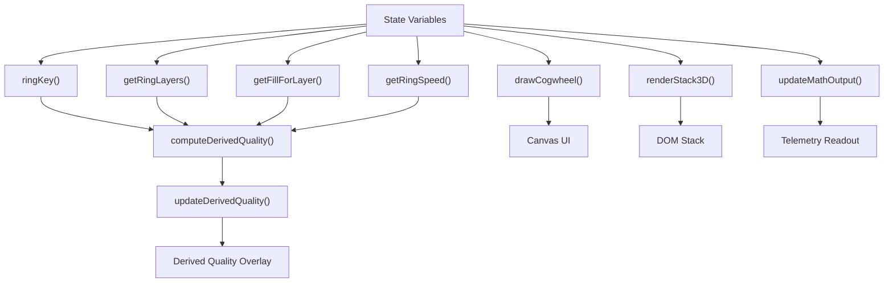

# State Management

<cite>
**Referenced Files in This Document**
- [Alg_Virt_WhLL.html](file://Alg_Virt_WhLL.html)
</cite>

## Table of Contents
1. [Introduction](#introduction)
2. [Project Structure](#project-structure)
3. [Core Components](#core-components)
4. [Architecture Overview](#architecture-overview)
5. [Detailed Component Analysis](#detailed-component-analysis)
6. [Dependency Analysis](#dependency-analysis)
7. [Performance Considerations](#performance-considerations)
8. [Troubleshooting Guide](#troubleshooting-guide)
9. [Conclusion](#conclusion)

## Introduction
This document explains the application state management system implemented in a single-page HTML application. The system centers around a small set of global variables that represent:
- Ring fill levels per layer for the selected quality
- Per-ring spin speeds and angles
- Selected target quality
- Theme configuration
- UI animation and interaction flags

The central refresh function coordinates updates across the cogwheel canvas, 3D stack view, derived quality overlay, and telemetry readout. Changes propagate through event-driven handlers and helper functions rather than a formal observer library, using explicit calls to update and render functions.

## Project Structure
The application is contained in one HTML file with embedded CSS and JavaScript. Key areas relevant to state management are:
- Design templates and theme switching logic
- Global state declarations
- Helper functions for dependency resolution and ring accessors
- Cogwheel rendering and interaction handlers
- 3D stack builder and renderer
- Derived quality computation and display
- Central refresh and initialization

**Diagram sources**
- [Alg_Virt_WhLL.html:867-918](file://Alg_Virt_WhLL.html#L867-L918)
- [Alg_Virt_WhLL.html:920-943](file://Alg_Virt_WhLL.html#L920-L943)
- [Alg_Virt_WhLL.html:944-1008](file://Alg_Virt_WhLL.html#L944-L1008)
- [Alg_Virt_WhLL.html:1142-1354](file://Alg_Virt_WhLL.html#L1142-L1354)
- [Alg_Virt_WhLL.html:1620-1763](file://Alg_Virt_WhLL.html#L1620-L1763)
- [Alg_Virt_WhLL.html:1019-1093](file://Alg_Virt_WhLL.html#L1019-L1093)
- [Alg_Virt_WhLL.html:1886-1945](file://Alg_Virt_WhLL.html#L1886-L1945)
- [Alg_Virt_WhLL.html:1988-1993](file://Alg_Virt_WhLL.html#L1988-L1993)
- [Alg_Virt_WhLL.html:2010-2032](file://Alg_Virt_WhLL.html#L2010-L2032)

**Section sources**
- [Alg_Virt_WhLL.html:867-918](file://Alg_Virt_WhLL.html#L867-L918)
- [Alg_Virt_WhLL.html:920-943](file://Alg_Virt_WhLL.html#L920-L943)
- [Alg_Virt_WhLL.html:1988-2032](file://Alg_Virt_WhLL.html#L1988-L2032)

## Core Components
This section documents the central state object structure and the primary methods used to access, modify, and synchronize state.

### Central State Object Structure
The application uses several top-level variables to hold runtime state:
- `ringFillLevels`: Map from composite keys (target + layer) to fill values between 0 and 1
- `ringAngles`: Map from composite keys to cumulative rotation angles for each ring
- `ringSpeeds`: Map from composite keys to angular speed in radians per second
- `currentTarget`: Currently selected quality name
- `zoomFactor`, `cogwheelRotation`, `autoRotate`: Cogwheel visualization state
- `stackItems`, `stackRotX`, `stackRotY`, `stackZoom`, `stackSpin`, `stackShowAntagonists`: 3D stack state
- Interaction flags like `isDraggingFill`, `dragRingIndex`, `hoveredRing`

These variables are initialized at module scope and mutated by event handlers and helper functions. There is no single centralized state object; instead, related fields are grouped conceptually by feature.

**Section sources**
- [Alg_Virt_WhLL.html:920-943](file://Alg_Virt_WhLL.html#L920-L943)

### Accessor Helpers
To keep state access consistent, the code provides helpers:
- `ringKey(layer)` returns the composite key for the current target and layer
- `getRingLayers()` returns ordered layers for the current target
- `getRingAngle(layer)` reads the angle for a ring
- `getRingSpeed(layer)` reads the speed for a ring
- `getFillForLayer(layer, targetName)` reads fill level with a default value

These helpers abstract the composite key format and provide safe defaults.

**Section sources**
- [Alg_Virt_WhLL.html:990-1008](file://Alg_Virt_WhLL.html#L990-L1008)

### Modifying Values
State mutations occur through focused functions:
- Fill changes during drag operations update `ringFillLevels[key]`
- Spin speed changes via `adjustRingSpeed(layer, delta)` clamp values and remove zero entries
- Target selection updates `currentTarget`, rebuilds `stackItems`, and refreshes controls
- Zoom and rotation updates mutate `zoomFactor` and `cogwheelRotation`
- Theme changes mutate `currentTheme` and apply CSS attributes

**Section sources**
- [Alg_Virt_WhLL.html:1390-1419](file://Alg_Virt_WhLL.html#L1390-L1419)
- [Alg_Virt_WhLL.html:1120-1129](file://Alg_Virt_WhLL.html#L1120-L1129)
- [Alg_Virt_WhLL.html:1995-2005](file://Alg_Virt_WhLL.html#L1995-L2005)
- [Alg_Virt_WhLL.html:1614-1615](file://Alg_Virt_WhLL.html#L1614-L1615)
- [Alg_Virt_WhLL.html:895-918](file://Alg_Virt_WhLL.html#L895-L918)

### Triggering Re-renders
Most mutation paths call `refreshAll()` to ensure all views stay synchronized:
- Dragging a ring fill calls `refreshAll()`
- Adjusting ring speed calls `refreshAll()`
- Resetting controls clears state and calls `refreshAll()`
- Changing target quality calls `refreshAll()`
- Resize events debounce and call `refreshAll()`

Additionally, some UI-only updates call specific renderers directly:
- Hover changes redraw only the cogwheel
- Zoom button clicks redraw only the cogwheel
- 3D stack transform updates apply transforms without full refresh

**Section sources**
- [Alg_Virt_WhLL.html:1390-1419](file://Alg_Virt_WhLL.html#L1390-L1419)
- [Alg_Virt_WhLL.html:1120-1129](file://Alg_Virt_WhLL.html#L1120-L1129)
- [Alg_Virt_WhLL.html:1548-1558](file://Alg_Virt_WhLL.html#L1548-L1558)
- [Alg_Virt_WhLL.html:1995-2005](file://Alg_Virt_WhLL.html#L1995-L2005)
- [Alg_Virt_WhLL.html:2027-2031](file://Alg_Virt_WhLL.html#L2027-L2031)
- [Alg_Virt_WhLL.html:1434-1444](file://Alg_Virt_WhLL.html#L1434-L1444)
- [Alg_Virt_WhLL.html:1568-1587](file://Alg_Virt_WhLL.html#L1568-L1587)
- [Alg_Virt_WhLL.html:1765-1770](file://Alg_Virt_WhLL.html#L1765-L1770)

### Handling State Persistence
Theme persistence is implemented using `localStorage`:
- On theme change, the current theme ID is saved
- On startup, the saved theme is loaded if valid
- Other state fields are not persisted automatically

This pattern can be extended to persist other state such as `currentTarget`, `ringFillLevels`, `ringSpeeds`, and UI preferences.

**Section sources**
- [Alg_Virt_WhLL.html:895-918](file://Alg_Virt_WhLL.html#L895-L918)

## Architecture Overview
The state management architecture follows an event-driven model with explicit coordination:
- User interactions trigger handlers
- Handlers mutate state
- Handlers call `refreshAll()` or targeted renderers
- Renderers read state via helpers and update DOM/canvas
- Derived computations combine state into higher-level outputs

**Diagram sources**
- [Alg_Virt_WhLL.html:1390-1419](file://Alg_Virt_WhLL.html#L1390-L1419)
- [Alg_Virt_WhLL.html:1120-1129](file://Alg_Virt_WhLL.html#L1120-L1129)
- [Alg_Virt_WhLL.html:1988-1993](file://Alg_Virt_WhLL.html#L1988-L1993)
- [Alg_Virt_WhLL.html:1142-1354](file://Alg_Virt_WhLL.html#L1142-L1354)
- [Alg_Virt_WhLL.html:1620-1763](file://Alg_Virt_WhLL.html#L1620-L1763)
- [Alg_Virt_WhLL.html:1083-1093](file://Alg_Virt_WhLL.html#L1083-L1093)
- [Alg_Virt_WhLL.html:1886-1945](file://Alg_Virt_WhLL.html#L1886-L1945)

## Detailed Component Analysis

### Central State Object and Lifecycle
The lifecycle begins on DOM load:
- Select element is wired to `updateSystem()`
- Cogwheel interactions, stack controls, fullscreen, and theme setup run
- Initial target is read from the select
- Stack is built for the initial target
- Ring speed controls are rebuilt
- `refreshAll()` renders everything

**Diagram sources**
- [Alg_Virt_WhLL.html:2010-2032](file://Alg_Virt_WhLL.html#L2010-L2032)
- [Alg_Virt_WhLL.html:1988-1993](file://Alg_Virt_WhLL.html#L1988-L1993)

**Section sources**
- [Alg_Virt_WhLL.html:2010-2032](file://Alg_Virt_WhLL.html#L2010-L2032)
- [Alg_Virt_WhLL.html:1988-1993](file://Alg_Virt_WhLL.html#L1988-L1993)

### refreshAll() Coordination
`refreshAll()` is the central synchronization point:
- Draws the cogwheel for the current target
- Rebuilds and renders the 3D stack
- Updates the derived quality overlay
- Updates the telemetry readout

This ensures consistency across all visual components after any state change.

**Diagram sources**
- [Alg_Virt_WhLL.html:1988-1993](file://Alg_Virt_WhLL.html#L1988-L1993)

**Section sources**
- [Alg_Virt_WhLL.html:1988-1993](file://Alg_Virt_WhLL.html#L1988-L1993)

### Ring Fill Levels and Speeds
Ring fills and speeds are stored per layer using composite keys:
- Keys combine the current target and layer number
- Fill levels range from 0 to 1
- Speeds are clamped within a maximum bound
- Zero speeds are removed to save space
- Animation loop updates ring angles based on speeds

**Diagram sources**
- [Alg_Virt_WhLL.html:1120-1129](file://Alg_Virt_WhLL.html#L1120-L1129)
- [Alg_Virt_WhLL.html:1514-1523](file://Alg_Virt_WhLL.html#L1514-L1523)

**Section sources**
- [Alg_Virt_WhLL.html:1120-1129](file://Alg_Virt_WhLL.html#L1120-L1129)
- [Alg_Virt_WhLL.html:1514-1523](file://Alg_Virt_WhLL.html#L1514-L1523)

### Derived Quality Computation
Derived quality combines fill levels and spin speeds to produce:
- A pure state when there is no deviation
- A positive emergent state otherwise
- A negative state when deviations indicate antagonistic alignment

It also selects a source component and maps it to either a virtue or antagonist label.

**Diagram sources**
- [Alg_Virt_WhLL.html:1019-1081](file://Alg_Virt_WhLL.html#L1019-L1081)

**Section sources**
- [Alg_Virt_WhLL.html:1019-1081](file://Alg_Virt_WhLL.html#L1019-L1081)

### Theme Configuration
Theme configuration includes:
- A palette map with accent colors and fonts
- Current theme variable
- Functions to apply theme and switch themes
- LocalStorage persistence for theme

**Diagram sources**
- [Alg_Virt_WhLL.html:867-918](file://Alg_Virt_WhLL.html#L867-L918)

**Section sources**
- [Alg_Virt_WhLL.html:867-918](file://Alg_Virt_WhLL.html#L867-L918)

### Observer Pattern Implementation
There is no formal observer library. Instead, the application implements an implicit observer pattern:
- State is global
- Handlers mutate state
- Handlers explicitly call render/update functions
- Derived computations read state and update UI

This approach is simple and effective for a single-file app but lacks automatic propagation. To adopt a true observer pattern, you could introduce an event bus or reactive store that notifies subscribers on state changes.

[No sources needed since this diagram shows conceptual workflow, not actual code structure]

### Integration with External Systems
Current integration points include:
- LocalStorage for theme persistence
- Canvas API for cogwheel rendering
- DOM manipulation for 3D stack and telemetry
- Fullscreen API for panel expansion

External integrations can be added by:
- Persisting additional state to LocalStorage
- Exposing state via a global API object
- Emitting custom events for third-party listeners
- Integrating analytics or logging hooks into mutation paths

**Section sources**
- [Alg_Virt_WhLL.html:895-918](file://Alg_Virt_WhLL.html#L895-L918)
- [Alg_Virt_WhLL.html:1142-1354](file://Alg_Virt_WhLL.html#L1142-L1354)
- [Alg_Virt_WhLL.html:1620-1763](file://Alg_Virt_WhLL.html#L1620-L1763)
- [Alg_Virt_WhLL.html:1950-1983](file://Alg_Virt_WhLL.html#L1950-L1983)

## Dependency Analysis
The following diagram shows how core functions depend on state and each other:

**Diagram sources**
- [Alg_Virt_WhLL.html:990-1008](file://Alg_Virt_WhLL.html#L990-L1008)
- [Alg_Virt_WhLL.html:1019-1093](file://Alg_Virt_WhLL.html#L1019-L1093)
- [Alg_Virt_WhLL.html:1142-1354](file://Alg_Virt_WhLL.html#L1142-L1354)
- [Alg_Virt_WhLL.html:1620-1763](file://Alg_Virt_WhLL.html#L1620-L1763)
- [Alg_Virt_WhLL.html:1886-1945](file://Alg_Virt_WhLL.html#L1886-L1945)

**Section sources**
- [Alg_Virt_WhLL.html:990-1008](file://Alg_Virt_WhLL.html#L990-L1008)
- [Alg_Virt_WhLL.html:1019-1093](file://Alg_Virt_WhLL.html#L1019-L1093)
- [Alg_Virt_WhLL.html:1142-1354](file://Alg_Virt_WhLL.html#L1142-L1354)
- [Alg_Virt_WhLL.html:1620-1763](file://Alg_Virt_WhLL.html#L1620-L1763)
- [Alg_Virt_WhLL.html:1886-1945](file://Alg_Virt_WhLL.html#L1886-L1945)

## Performance Considerations
- Use debounced resize handling to avoid excessive re-renders
- Avoid unnecessary full refreshes by calling targeted renderers when possible
- Keep ring speed entries minimal by deleting zero speeds
- Prefer computed properties or memoization for expensive derivations if the app grows
- Batch multiple state mutations before calling `refreshAll()` to reduce redundant work

[No sources needed since this section provides general guidance]

## Troubleshooting Guide
Common issues and resolutions:
- Derived quality not updating: Ensure `refreshAll()` is called after state changes
- Ring speed not animating: Verify `ensureCogwheelLoop()` is invoked and intervals are not cleared unexpectedly
- Theme not persisting: Check browser storage availability and error handling around `localStorage`
- Stack not rebuilding: Confirm `stackItems` is rebuilt when target changes
- Canvas sizing issues: Trigger redraw on fullscreen or resize events

**Section sources**
- [Alg_Virt_WhLL.html:1988-1993](file://Alg_Virt_WhLL.html#L1988-L1993)
- [Alg_Virt_WhLL.html:1514-1523](file://Alg_Virt_WhLL.html#L1514-L1523)
- [Alg_Virt_WhLL.html:895-918](file://Alg_Virt_WhLL.html#L895-L918)
- [Alg_Virt_WhLL.html:1995-2005](file://Alg_Virt_WhLL.html#L1995-L2005)
- [Alg_Virt_WhLL.html:1972-1983](file://Alg_Virt_WhLL.html#L1972-L1983)

## Conclusion
The application’s state management is straightforward and effective for its scope. It relies on global state, explicit mutators, and a central refresh function to keep the UI consistent. While it does not use a formal observer pattern, it achieves similar results through direct calls to renderers and updaters. For larger applications, consider introducing a reactive store or event bus to improve maintainability, testability, and scalability.

[No sources needed since this section summarizes without analyzing specific files]