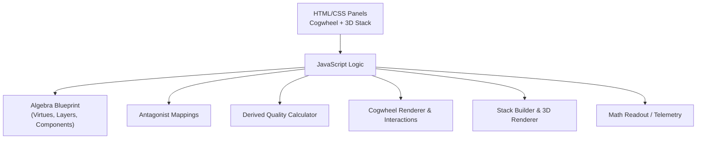
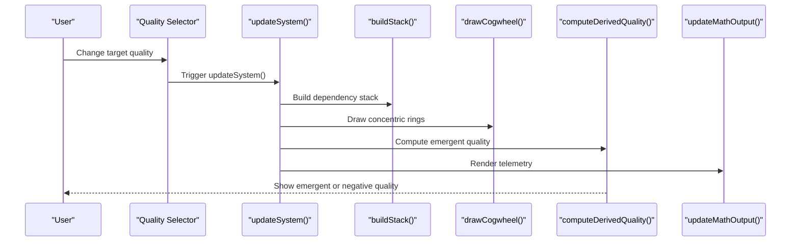
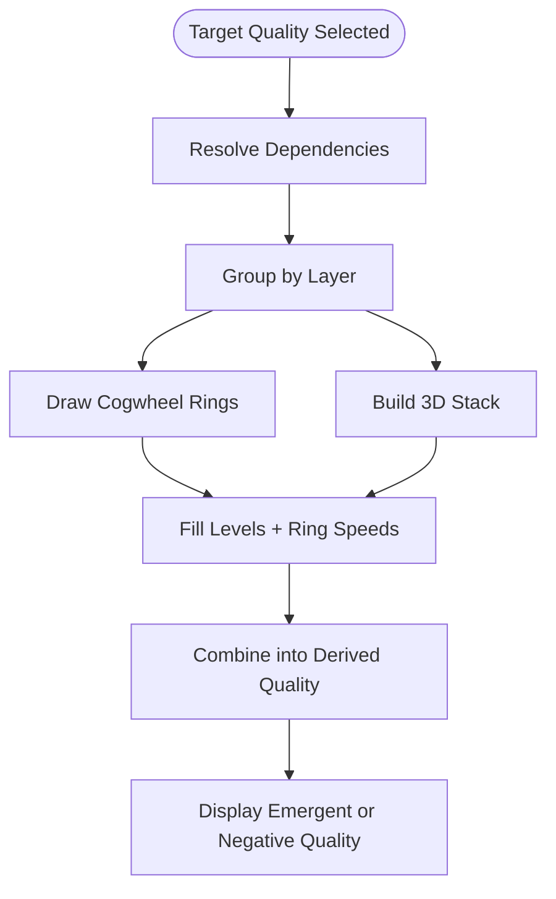
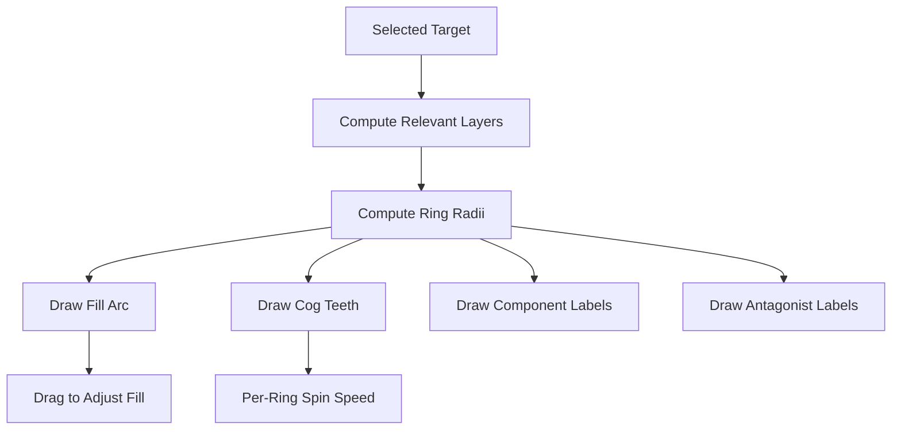
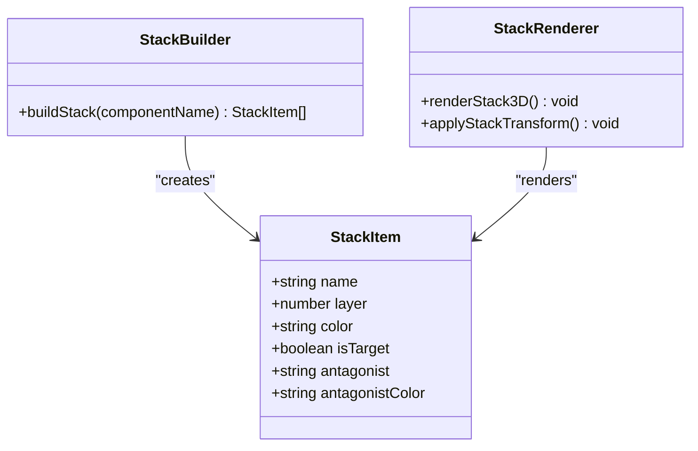
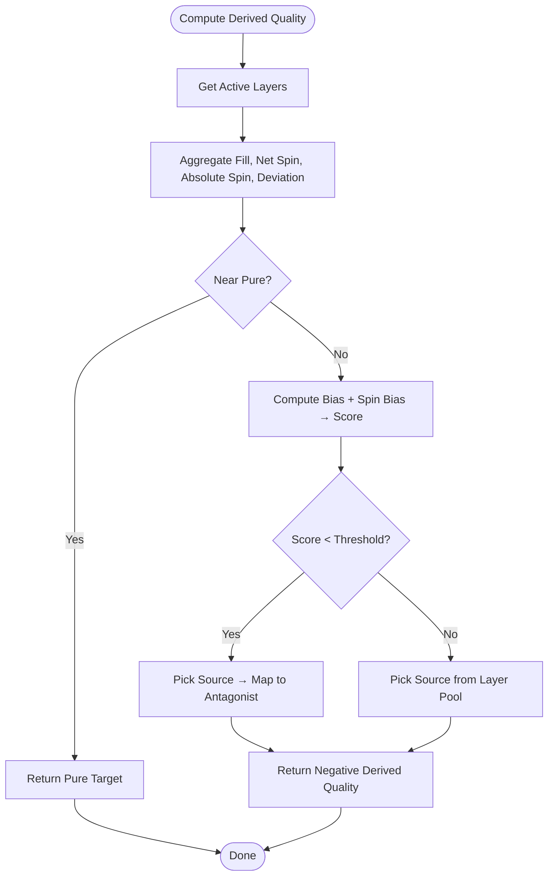
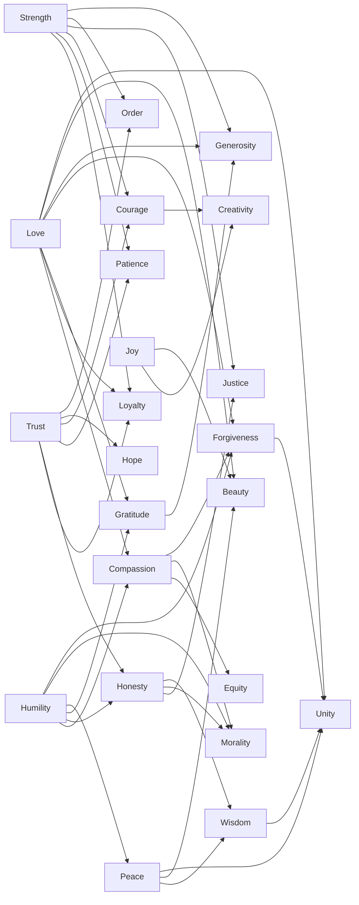

# Core Concepts

<cite>
**Referenced Files in This Document**
- [Alg_Virt_WhLL.html](file://Alg_Virt_WhLL.html)
</cite>

## Table of Contents
1. [Introduction](#introduction)
2. [Project Structure](#project-structure)
3. [Core Components](#core-components)
4. [Architecture Overview](#architecture-overview)
5. [Detailed Component Analysis](#detailed-component-analysis)
6. [Dependency Analysis](#dependency-analysis)
7. [Performance Considerations](#performance-considerations)
8. [Troubleshooting Guide](#troubleshooting-guide)
9. [Conclusion](#conclusion)

## Introduction
This document explains the algebraic virtue system implemented by the application. The system models 24 virtues across five conceptual layers, from four Core Primes through Direct Derivatives, Peak Emotional States, Structural Systems, and Meta-Existential Peaks. Each virtue is represented as a numerical value with explicit component dependencies and antagonist mappings. The user interface visualizes these relationships using:

- A concentric cogwheel where each ring corresponds to a virtue layer for the selected target quality.
- A 3D stratified stack showing the target’s dependency chain, fill levels, and antagonists.
- A derived quality overlay that emerges from the combination of base virtues, ring fills, and ring spin speeds.

The goal is to make the mathematical structure of virtues accessible while preserving their philosophical relationships.

## Project Structure
The entire application is contained in a single HTML file that includes:

- CSS for theming, layout, and visualization panels.
- A two-panel UI:
  - Left panel: Concentric cogwheel canvas with controls for rotation, zoom, per-ring spin speed, and fill dragging.
  - Right panel: 3D stack view with drag-to-reorder, auto-spin, and antagonist visibility toggles.
- JavaScript defining:
  - The algebra blueprint (virtues, components, colors, descriptions, layers).
  - Antagonist mappings.
  - Derived quality computation.
  - Cogwheel rendering and interaction logic.
  - Stack building and 3D rendering.
  - Telemetry output and refresh orchestration.

**Diagram sources**
- [Alg_Virt_WhLL.html:707-825](file://Alg_Virt_WhLL.html#L707-L825)
- [Alg_Virt_WhLL.html:827-940](file://Alg_Virt_WhLL.html#L827-L940)
- [Alg_Virt_WhLL.html:1136-1609](file://Alg_Virt_WhLL.html#L1136-L1609)
- [Alg_Virt_WhLL.html:1614-1878](file://Alg_Virt_WhLL.html#L1614-L1878)
- [Alg_Virt_WhLL.html:1880-2033](file://Alg_Virt_WhLL.html#L1880-L2033)

**Section sources**
- [Alg_Virt_WhLL.html:707-825](file://Alg_Virt_WhLL.html#L707-L825)
- [Alg_Virt_WhLL.html:827-940](file://Alg_Virt_WhLL.html#L827-L940)

## Core Components
At the heart of the system is the algebra blueprint, which defines:

- Virtue names.
- Numerical component dependencies.
- Visual color.
- Philosophical description.
- Layer index from 0 to 4.

The five layers are:

| Layer | Conceptual Name | Example Virtues |
|---|---|---|
| 0 | Core Primes | Love, Trust, Strength, Humility |
| 1 | Direct Derivatives | Compassion, Loyalty, Honesty, Patience, Gratitude |
| 2 | Peak Emotional States | Courage, Peace, Joy, Hope |
| 3 | Structural Systems | Equity, Justice, Morality, Order |
| 4 | Meta-Existential Peaks | Forgiveness, Generosity, Wisdom, Creativity, Beauty, Unity |

Each non-prime virtue lists its component virtues. For example, Unity depends on Love, Peace, Wisdom, and Forgiveness. Core Primes have no components and act as independent axioms.

The antagonist mapping pairs each virtue with its opposing tendency, such as Love with Indifference, Trust with Suspicion, Strength with Weakness, and so on.

**Section sources**
- [Alg_Virt_WhLL.html:829-862](file://Alg_Virt_WhLL.html#L829-L862)

## Architecture Overview
The application implements a layered algebraic model with interactive visualization. The control flow is:

1. User selects a target quality.
2. The system resolves all dependencies for that target.
3. The cogwheel draws one ring per relevant layer.
4. The 3D stack shows the ordered dependency chain.
5. Fill levels and ring spin speeds influence the derived quality.
6. Telemetry displays formulas, ring states, and combined results.

**Diagram sources**
- [Alg_Virt_WhLL.html:1992-2002](file://Alg_Virt_WhLL.html#L1992-L2002)
- [Alg_Virt_WhLL.html:1617-1642](file://Alg_Virt_WhLL.html#L1617-L1642)
- [Alg_Virt_WhLL.html:1139-1351](file://Alg_Virt_WhLL.html#L1139-L1351)
- [Alg_Virt_WhLL.html:1016-1078](file://Alg_Virt_WhLL.html#L1016-L1078)
- [Alg_Virt_WhLL.html:1883-1942](file://Alg_Virt_WhLL.html#L1883-L1942)

## Detailed Component Analysis

### Algebraic Model of Virtues
The algebra model represents virtues as nodes in a dependency graph. Core Primes are leaf axioms; higher-layer virtues are composed from lower-layer virtues. The model supports:

- Ordered dependency resolution.
- Layer grouping for visualization.
- Color-coded representation.
- Philosophical descriptions.
- Antagonist oppositions.

**Diagram sources**
- [Alg_Virt_WhLL.html:942-990](file://Alg_Virt_WhLL.html#L942-L990)
- [Alg_Virt_WhLL.html:1139-1351](file://Alg_Virt_WhLL.html#L1139-L1351)
- [Alg_Virt_WhLL.html:1617-1642](file://Alg_Virt_WhLL.html#L1617-L1642)
- [Alg_Virt_WhLL.html:1016-1078](file://Alg_Virt_WhLL.html#L1016-L1078)

**Section sources**
- [Alg_Virt_WhLL.html:829-862](file://Alg_Virt_WhLL.html#L829-L862)
- [Alg_Virt_WhLL.html:942-990](file://Alg_Virt_WhLL.html#L942-L990)

### Concentric Cogwheel Visualization
The cogwheel visualizes the selected target’s layers as concentric rings:

- Inner rings correspond to lower layers.
- Outer rings correspond to higher layers.
- Each ring’s arc length represents fill level.
- Cog teeth make rotation visible even when a ring is full or empty.
- Labels show layer number, percentage fill, and optional spin direction/speed.
- Antagonist labels appear in unfilled portions of rings.

**Diagram sources**
- [Alg_Virt_WhLL.html:1139-1351](file://Alg_Virt_WhLL.html#L1139-L1351)
- [Alg_Virt_WhLL.html:1353-1492](file://Alg_Virt_WhLL.html#L1353-L1492)
- [Alg_Virt_WhLL.html:1494-1609](file://Alg_Virt_WhLL.html#L1494-L1609)

**Section sources**
- [Alg_Virt_WhLL.html:1139-1351](file://Alg_Virt_WhLL.html#L1139-L1351)
- [Alg_Virt_WhLL.html:1353-1492](file://Alg_Virt_WhLL.html#L1353-L1492)
- [Alg_Virt_WhLL.html:1494-1609](file://Alg_Virt_WhLL.html#L1494-L1609)

### 3D Stratified Stack
The 3D stack shows the target virtue and its resolved dependencies:

- Each block represents a virtue.
- Front face shows the virtue name and current fill percentage.
- Back face shows the antagonist.
- Top and side faces show layer information.
- Blocks can be reordered by drag-and-drop.
- The scene supports rotation, zoom, and auto-spin.

**Diagram sources**
- [Alg_Virt_WhLL.html:1617-1642](file://Alg_Virt_WhLL.html#L1617-L1642)
- [Alg_Virt_WhLL.html:1644-1767](file://Alg_Virt_WhLL.html#L1644-L1767)
- [Alg_Virt_WhLL.html:1769-1878](file://Alg_Virt_WhLL.html#L1769-L1878)

**Section sources**
- [Alg_Virt_WhLL.html:1617-1642](file://Alg_Virt_WhLL.html#L1617-L1642)
- [Alg_Virt_WhLL.html:1644-1767](file://Alg_Virt_WhLL.html#L1644-L1767)
- [Alg_Virt_WhLL.html:1769-1878](file://Alg_Virt_WhLL.html#L1769-L1878)

### Derived Quality Calculation
The derived quality is an emergent result of:

- Target quality selection.
- Per-layer fill levels.
- Per-ring spin speeds.
- Dominant layer detection.
- Deterministic naming based on state signature.

Key behaviors:

- If fill deviation and spin deviation are near zero, the result is labeled pure and equals the target.
- Otherwise, a weighted score combines fill bias and spin bias.
- Negative scores produce antagonist-derived names.
- Positive scores select a source virtue from the dominant layer pool.

**Diagram sources**
- [Alg_Virt_WhLL.html:1016-1078](file://Alg_Virt_WhLL.html#L1016-L1078)
- [Alg_Virt_WhLL.html:1080-1090](file://Alg_Virt_WhLL.html#L1080-L1090)

**Section sources**
- [Alg_Virt_WhLL.html:1016-1078](file://Alg_Virt_WhLL.html#L1016-L1078)
- [Alg_Virt_WhLL.html:1080-1090](file://Alg_Virt_WhLL.html#L1080-L1090)

### Philosophy and Mathematical Relationships
The chosen virtues reflect a progression from foundational human capacities to systemic and existential synthesis:

- Core Primes represent fundamental forces: binding, stability, fortitude, and ego dissolution.
- Direct Derivatives combine core primes into relational and temporal virtues.
- Peak Emotional States emerge from combinations involving trust, strength, humility, patience, gratitude, and peace.
- Structural Systems formalize fairness, ethics, coherence, and equilibrium.
- Meta-Existential Peaks synthesize emotional, structural, and reflective capacities into higher-order qualities like wisdom, creativity, beauty, forgiveness, generosity, and unity.

Mathematically, this means:

- Lower-layer virtues are more foundational.
- Higher-layer virtues depend on multiple lower-layer virtues.
- The system treats virtues as composable values rather than isolated traits.
- Antagonists provide a symmetric opposition structure.
- Derived quality captures how interactions among layers can produce emergent positive or negative outcomes.

**Section sources**
- [Alg_Virt_WhLL.html:829-862](file://Alg_Virt_WhLL.html#L829-L862)

## Dependency Analysis
The dependency structure is defined explicitly in the algebra blueprint and used throughout the application:

- `valueAlgebra` maps each virtue to components, color, description, and layer.
- `antagonists` maps each virtue to its opposite.
- Dependency resolution produces an ordered list of all transitive components.
- Layer grouping determines cogwheel rings and stack ordering.
- Derived quality uses layer composition, fill levels, and spin speeds.

**Diagram sources**
- [Alg_Virt_WhLL.html:829-853](file://Alg_Virt_WhLL.html#L829-L853)

**Section sources**
- [Alg_Virt_WhLL.html:829-862](file://Alg_Virt_WhLL.html#L829-L862)
- [Alg_Virt_WhLL.html:942-990](file://Alg_Virt_WhLL.html#L942-L990)

## Performance Considerations
The application prioritizes interactivity over heavy computation:

- Canvas redraws occur on interaction, animation ticks, and resize events.
- Animation loops run only when needed: global autoplay or per-ring spin.
- Derived quality calculation is lightweight and runs on refresh.
- Stack rendering builds DOM elements per item but avoids expensive operations.
- Theme switching and fullscreen changes trigger re-rendering to adapt sizes.

Recommendations:

- Avoid excessive per-frame calculations outside the animation loop.
- Keep dependency resolution memoized if the same target is frequently recomputed.
- Limit telemetry string construction to necessary updates.
- Debounce resize handlers already exist; keep them minimal.

[No sources needed since this section provides general guidance]

## Troubleshooting Guide
Common issues and their likely causes:

| Symptom | Likely Cause | Resolution |
|---|---|---|
| Derived quality remains “pure” | Fill levels and spin speeds are near neutral | Adjust ring fills or set nonzero ring speeds |
| Derived quality becomes negative | Average fill deviates below half or net spin opposes expected direction | Increase fill toward or above half, or align spin direction |
| No rings appear | Target has no resolved layers | Verify target exists in the algebra blueprint |
| Antagonist labels not visible | Ring is fully filled | Reduce fill below full to reveal antagonist segments |
| Stack does not update after changing target | Refresh function not triggered | Ensure `refreshAll()` is called after target change |
| Animation stops unexpectedly | Loop disabled because autoplay is off and no ring spins | Enable autoplay or set nonzero ring speed |

**Section sources**
- [Alg_Virt_WhLL.html:1016-1078](file://Alg_Virt_WhLL.html#L1016-L1078)
- [Alg_Virt_WhLL.html:1139-1351](file://Alg_Virt_WhLL.html#L1139-L1351)
- [Alg_Virt_WhLL.html:1617-1642](file://Alg_Virt_WhLL.html#L1617-L1642)
- [Alg_Virt_WhLL.html:1985-2002](file://Alg_Virt_WhLL.html#L1985-L2002)

## Conclusion
The algebraic virtue system models 24 virtues as a layered, compositional structure rooted in four Core Primes. The application makes this structure visible through:

- A concentric cogwheel representing layers and their dynamic state.
- A 3D stack representing the target’s dependency hierarchy.
- A derived quality mechanism that emerges from fill levels and ring spin dynamics.
- Antagonist mappings that provide symmetry and tension.

Philosophically, the system frames virtues as interdependent capacities that grow from foundational forces into systemic and existential synthesis. Mathematically, it treats virtues as composable values whose interactions can produce emergent positive or negative outcomes. This dual approach allows users to explore both the conceptual relationships and the quantitative behavior of the virtue system.

[No sources needed since this section summarizes without analyzing specific files]