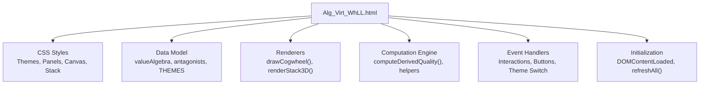
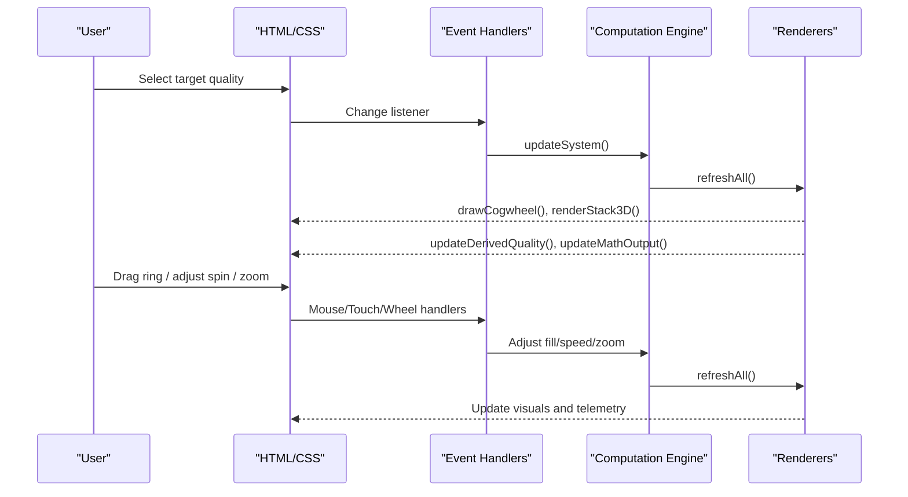
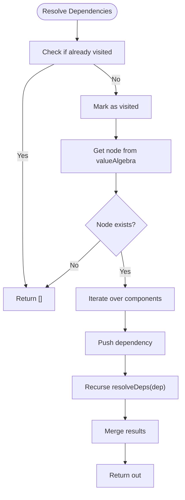
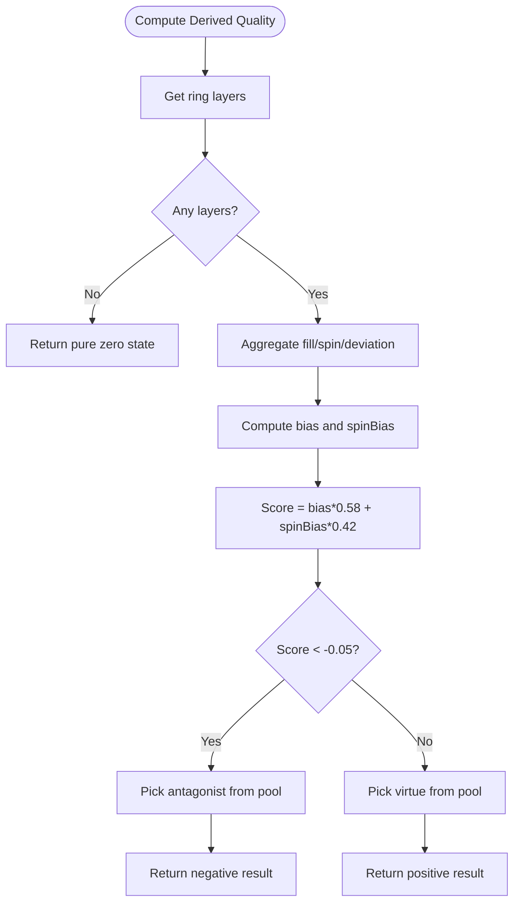
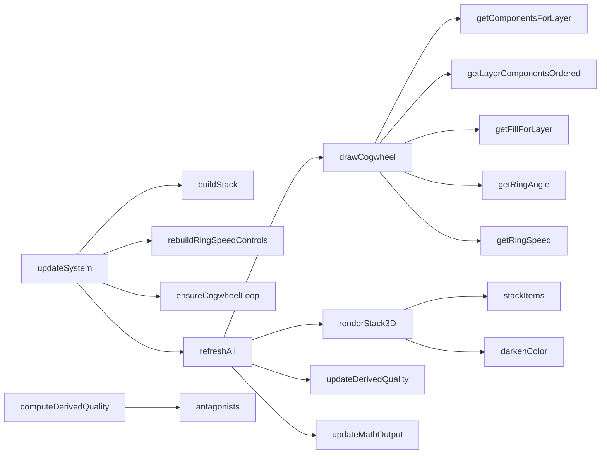

# Customization Guide

<cite>
**Referenced Files in This Document**
- [Alg_Virt_WhLL.html](file://Alg_Virt_WhLL.html)
</cite>

## Table of Contents
1. [Introduction](#introduction)
2. [Project Structure](#project-structure)
3. [Core Components](#core-components)
4. [Architecture Overview](#architecture-overview)
5. [Detailed Component Analysis](#detailed-component-analysis)
6. [Dependency Analysis](#dependency-analysis)
7. [Performance Considerations](#performance-considerations)
8. [Troubleshooting Guide](#troubleshooting-guide)
9. [Conclusion](#conclusion)
10. [Appendices](#appendices)

## Introduction
This guide explains how to extend and customize the Algebraic Virtue Wheel application. It focuses on:
- Adding new virtues to the value algebra system, including component dependencies, colors, descriptions, layers, and antagonist mappings.
- Creating themes using CSS custom properties for color schemes, typography, backgrounds, and visual effects.
- Modifying mathematical formulas for derived quality calculations and extending the computation engine.
- Extending visualization types beyond the existing cogwheel and 3D stack representations.
- Understanding configuration objects, event handling patterns, and extension points available in the codebase.
- Providing concrete examples of common customization scenarios and best practices for maintaining code organization.

The application is implemented as a single-page HTML file with embedded CSS and JavaScript. All customization should be performed within this file unless you choose to refactor it into separate modules later.

## Project Structure
The project consists of one primary file:
- `Alg_Virt_WhLL.html`: Contains the full UI, styles, data model, rendering logic, interaction handlers, and initialization.

**Diagram sources**
- [Alg_Virt_WhLL.html:7-705](file://Alg_Virt_WhLL.html#L7-L705)
- [Alg_Virt_WhLL.html:827-2033](file://Alg_Virt_WhLL.html#L827-L2033)

**Section sources**
- [Alg_Virt_WhLL.html:1-2033](file://Alg_Virt_WhLL.html#L1-L2033)

## Core Components
Key extensible components include:
- Value Algebra Blueprint: Defines virtues, their dependencies, colors, descriptions, and layers.
- Antagonist Mappings: Maps each virtue to its corresponding antagonist.
- Theme System: CSS custom properties and JS theme palette for consistent styling across views.
- Computation Engine: Calculates derived qualities based on ring fills and spin speeds.
- Renderers: Cogwheel canvas drawing and 3D stack DOM rendering.
- Event Handling: Interactions for dragging rings, adjusting spin speed, zooming, fullscreen, and theme switching.

**Section sources**
- [Alg_Virt_WhLL.html:827-862](file://Alg_Virt_WhLL.html#L827-L862)
- [Alg_Virt_WhLL.html:864-915](file://Alg_Virt_WhLL.html#L864-L915)
- [Alg_Virt_WhLL.html:1016-1090](file://Alg_Virt_WhLL.html#L1016-L1090)
- [Alg_Virt_WhLL.html:1139-1351](file://Alg_Virt_WhLL.html#L1139-L1351)
- [Alg_Virt_WhLL.html:1617-1760](file://Alg_Virt_WhLL.html#L1617-L1760)
- [Alg_Virt_WhLL.html:1423-1609](file://Alg_Virt_WhLL.html#L1423-L1609)
- [Alg_Virt_WhLL.html:1769-1878](file://Alg_Virt_WhLL.html#L1769-L1878)

## Architecture Overview
The application follows a clear separation between data, rendering, and interaction:
- Data layer: `valueAlgebra`, `antagonists`, and `THEMES`.
- Rendering layer: `drawCogwheel` for the concentric cogwheel and `renderStack3D` for the stratified stack.
- Computation layer: `computeDerivedQuality` and helper functions for dependency resolution and ring state.
- Interaction layer: Mouse/touch events for drag-to-fill, wheel for zoom/spin, buttons for controls, and theme switcher.
- Initialization: Sets up listeners, builds initial stack, and triggers refresh.

**Diagram sources**
- [Alg_Virt_WhLL.html:1992-2002](file://Alg_Virt_WhLL.html#L1992-L2002)
- [Alg_Virt_WhLL.html:1985-1990](file://Alg_Virt_WhLL.html#L1985-L1990)
- [Alg_Virt_WhLL.html:1423-1609](file://Alg_Virt_WhLL.html#L1423-L1609)
- [Alg_Virt_WhLL.html:1769-1878](file://Alg_Virt_WhLL.html#L1769-L1878)

## Detailed Component Analysis

### Adding New Virtues to the Value Algebra
To add a new virtue:
1. Define the virtue entry in `valueAlgebra` with:
   - `components`: Array of prerequisite virtues (dependencies).
   - `color`: Hex color used in visuals.
   - `desc`: Human-readable description.
   - `layer`: Integer indicating hierarchy level.
2. Add an antagonist mapping in `antagonists` for the new virtue.
3. Optionally add the virtue to the `<select>` options under appropriate optgroups.

Example scenario:
- Add a new virtue “Resilience” at Layer 2 composed of “Strength”, “Patience”, and “Courage”.
- Set its color to a distinct hex.
- Provide a descriptive string.
- Map its antagonist (e.g., “Fragility”).
- Add the option to the select dropdown under “Peak Emotional States (Layer 2)”.

Best practices:
- Keep dependencies acyclic; ensure no circular references.
- Use meaningful layer numbers to reflect conceptual depth.
- Maintain consistent color naming and contrast for accessibility.

**Section sources**
- [Alg_Virt_WhLL.html:827-853](file://Alg_Virt_WhLL.html#L827-L853)
- [Alg_Virt_WhLL.html:855-862](file://Alg_Virt_WhLL.html#L855-L862)
- [Alg_Virt_WhLL.html:735-769](file://Alg_Virt_WhLL.html#L735-L769)

### Defining Component Dependencies and Layers
The dependency resolution uses recursive traversal:
- `getOrderedDependencies` resolves all transitive dependencies while preserving order and uniqueness.
- `resolveDeps` performs depth-first traversal with visited set to avoid cycles.
- `getComponentsForLayer` groups resolved components by layer for rendering and telemetry.

**Diagram sources**
- [Alg_Virt_WhLL.html:942-961](file://Alg_Virt_WhLL.html#L942-L961)

**Section sources**
- [Alg_Virt_WhLL.html:942-985](file://Alg_Virt_WhLL.html#L942-L985)

### Theme Creation Using CSS Custom Properties
Themes are defined via CSS custom properties and a JS palette:
- CSS variables control background, panel colors, borders, text, accents, negative indicators, fonts, and backdrop gradients.
- The `THEMES` object maps theme IDs to accent colors, RGB values, bright text, neutral RGB, and canvas font.
- `applyTheme` updates the body’s `data-theme` attribute and redraws the cogwheel.

Steps to create a new theme:
1. Add a new CSS block under `body[data-theme="your-theme-id"]` defining all required custom properties.
2. Add a corresponding entry in `THEMES` with matching accent, RGB, bright, neutralRgb, and canvasFont.
3. Add a theme button in the theme bar with `data-theme-id` matching your theme ID.
4. Ensure swatch classes exist for visual preview.

Example scenario:
- Create a “Forest” theme with green accents, earthy backgrounds, serif fonts, and subtle leaf-like backdrops.
- Add a button labeled “Forest” with a green swatch.
- Verify that both CSS and JS palette entries align.

**Section sources**
- [Alg_Virt_WhLL.html:7-80](file://Alg_Virt_WhLL.html#L7-L80)
- [Alg_Virt_WhLL.html:864-915](file://Alg_Virt_WhLL.html#L864-L915)
- [Alg_Virt_WhLL.html:709-720](file://Alg_Virt_WhLL.html#L709-L720)

### Modifying Mathematical Formulas for Derived Quality Calculations
The derived quality combines ring fills and spin speeds:
- Aggregates average fill, net spin, absolute spin, and deviation from half-fill.
- Computes bias from fill and spin bias from net speed.
- Determines negativity threshold and selects a base component pool per dominant layer.
- Uses a deterministic hash to pick a name from the pool or antagonist mapping.

To modify the formula:
- Adjust weights for fill vs spin contributions.
- Change thresholds for purity/negativity detection.
- Modify the selection algorithm for emergent names.
- Extend the formula string generation for telemetry.

**Diagram sources**
- [Alg_Virt_WhLL.html:1016-1078](file://Alg_Virt_WhLL.html#L1016-L1078)

**Section sources**
- [Alg_Virt_WhLL.html:1016-1090](file://Alg_Virt_WhLL.html#L1016-L1090)

### Extending the Computation Engine
Extension points:
- Helper functions for dependency resolution and layer grouping.
- Ring speed constants and key generation.
- Fill storage keyed by target and layer.
- Hash function for deterministic selection.

Guidelines:
- Keep helper functions pure and side-effect-free.
- Centralize constants like `RING_SPEED_STEP` and `RING_SPEED_MAX`.
- Ensure any new computations integrate with `refreshAll()` to update visuals and telemetry.

**Section sources**
- [Alg_Virt_WhLL.html:942-1011](file://Alg_Virt_WhLL.html#L942-L1011)
- [Alg_Virt_WhLL.html:1985-1990](file://Alg_Virt_WhLL.html#L1985-L1990)

### Guidelines for Adding New Visualization Types
Current visualizations:
- Cogwheel canvas rendering with rings, teeth, labels, and overlays.
- 3D stack DOM rendering with draggable boxes, faces, and overlays.

To add a new visualization type:
1. Create a container element in the HTML structure.
2. Implement a renderer function (e.g., `renderNewVisualization(targetName)`).
3. Integrate with `refreshAll()` to update when state changes.
4. Add controls and interactions similar to existing ones.
5. Style using CSS custom properties for consistency.

Example scenario:
- Add a radial bar chart showing fill percentages per layer.
- Include hover tooltips and click-to-adjust functionality.
- Ensure accessibility with ARIA attributes and keyboard navigation.

**Section sources**
- [Alg_Virt_WhLL.html:1139-1351](file://Alg_Virt_WhLL.html#L1139-L1351)
- [Alg_Virt_WhLL.html:1617-1760](file://Alg_Virt_WhLL.html#L1617-L1760)
- [Alg_Virt_WhLL.html:1985-1990](file://Alg_Virt_WhLL.html#L1985-L1990)

### Configuration Objects and Extension Points
Configuration objects:
- `valueAlgebra`: Core data model for virtues and dependencies.
- `antagonists`: Mapping of virtues to antagonists.
- `THEMES`: Palette definitions for visual themes.

Extension points:
- Dependency resolution helpers (`getOrderedDependencies`, `resolveDeps`).
- Layer grouping (`getComponentsForLayer`, `getLayerComponentsOrdered`).
- Ring state management (`ringFillLevels`, `ringAngles`, `ringSpeeds`).
- Derived quality computation (`computeDerivedQuality`).
- Rendering functions (`drawCogwheel`, `renderStack3D`).
- Event handlers for interactions and controls.

Best practices:
- Keep configuration declarative and centralized.
- Avoid hardcoding values in multiple places; use constants or config objects.
- Document assumptions and constraints for each extension point.

**Section sources**
- [Alg_Virt_WhLL.html:827-887](file://Alg_Virt_WhLL.html#L827-L887)
- [Alg_Virt_WhLL.html:942-1011](file://Alg_Virt_WhLL.html#L942-L1011)
- [Alg_Virt_WhLL.html:1016-1090](file://Alg_Virt_WhLL.html#L1016-L1090)

### Event Handling Patterns
Patterns observed:
- Button bindings for reset, play/pause, zoom, and ring speed adjustments.
- Mouse and touch event listeners for drag-to-fill and pinch-to-zoom.
- Wheel events for zoom and ring spin speed adjustment.
- Theme switcher with localStorage persistence.
- Fullscreen API integration for panels.

Guidelines:
- Use `preventDefault()` and `stopPropagation()` appropriately.
- Debounce resize events to avoid excessive re-renders.
- Separate concerns: keep event handlers thin and delegate to engine/render functions.

**Section sources**
- [Alg_Virt_WhLL.html:1423-1609](file://Alg_Virt_WhLL.html#L1423-L1609)
- [Alg_Virt_WhLL.html:1769-1878](file://Alg_Virt_WhLL.html#L1769-L1878)
- [Alg_Virt_WhLL.html:1947-1980](file://Alg_Virt_WhLL.html#L1947-L1980)
- [Alg_Virt_WhLL.html:2007-2029](file://Alg_Virt_WhLL.html#L2007-L2029)

## Dependency Analysis
The main dependencies among components:
- `updateSystem` depends on `buildStack`, `rebuildRingSpeedControls`, `ensureCogwheelLoop`, and `refreshAll`.
- `refreshAll` orchestrates `drawCogwheel`, `renderStack3D`, `updateDerivedQuality`, and `updateMathOutput`.
- `drawCogwheel` relies on `getComponentsForLayer`, `getLayerComponentsOrdered`, `getFillForLayer`, `getRingAngle`, `getRingSpeed`, and `antagonists`.
- `renderStack3D` uses `stackItems`, `getFillForLayer`, and `darkenColor`.
- `computeDerivedQuality` integrates ring state and antagonist mappings.

**Diagram sources**
- [Alg_Virt_WhLL.html:1992-2002](file://Alg_Virt_WhLL.html#L1992-L2002)
- [Alg_Virt_WhLL.html:1985-1990](file://Alg_Virt_WhLL.html#L1985-L1990)
- [Alg_Virt_WhLL.html:1139-1351](file://Alg_Virt_WhLL.html#L1139-L1351)
- [Alg_Virt_WhLL.html:1617-1760](file://Alg_Virt_WhLL.html#L1617-L1760)
- [Alg_Virt_WhLL.html:1016-1078](file://Alg_Virt_WhLL.html#L1016-L1078)

**Section sources**
- [Alg_Virt_WhLL.html:1992-2002](file://Alg_Virt_WhLL.html#L1992-L2002)
- [Alg_Virt_WhLL.html:1985-1990](file://Alg_Virt_WhLL.html#L1985-L1990)
- [Alg_Virt_WhLL.html:1139-1351](file://Alg_Virt_WhLL.html#L1139-L1351)
- [Alg_Virt_WhLL.html:1617-1760](file://Alg_Virt_WhLL.html#L1617-L1760)
- [Alg_Virt_WhLL.html:1016-1078](file://Alg_Virt_WhLL.html#L1016-L1078)

## Performance Considerations
- Canvas rendering: High DPI scaling is applied; ensure efficient redraws by minimizing unnecessary operations.
- Animation loops: Only run when auto-rotate or ring spins are active; stop intervals when not needed.
- Resize handling: Debounced refresh to prevent frequent recalculations.
- DOM manipulation: Batch updates where possible; avoid excessive reflows in stack rendering.

Recommendations:
- Use requestAnimationFrame for smooth animations if refactoring to modern APIs.
- Cache computed values when inputs do not change.
- Limit heavy computations to explicit user actions or periodic updates.

[No sources needed since this section provides general guidance]

## Troubleshooting Guide
Common issues and resolutions:
- Theme not applying: Ensure CSS custom properties are defined and `THEMES` object has matching keys.
- Derived quality not updating: Verify `refreshAll()` is called after state changes.
- Ring spin not visible: Check `ensureCogwheelLoop()` and interval management.
- Stack not rendering correctly: Confirm `stackItems` is rebuilt and `renderStack3D()` is invoked.
- Fullscreen not working: Validate browser support and event listeners for fullscreen API.

Debugging tips:
- Inspect console for errors related to missing elements or invalid data.
- Log intermediate values in `computeDerivedQuality` and `drawCogwheel`.
- Test theme switching and verify localStorage persistence.

**Section sources**
- [Alg_Virt_WhLL.html:892-915](file://Alg_Virt_WhLL.html#L892-L915)
- [Alg_Virt_WhLL.html:1512-1520](file://Alg_Virt_WhLL.html#L1512-L1520)
- [Alg_Virt_WhLL.html:1947-1980](file://Alg_Virt_WhLL.html#L1947-L1980)

## Conclusion
This guide provided a comprehensive overview of extending and customizing the Algebraic Virtue Wheel. By understanding the core components, architecture, and extension points, you can confidently add new virtues, create themes, modify computation formulas, and introduce new visualizations. Following the best practices outlined here will help maintain code organization, performance, and usability.

[No sources needed since this section summarizes without analyzing specific files]

## Appendices

### Appendix A: Common Customization Scenarios
- Adding a new virtue:
  - Define entry in `valueAlgebra`.
  - Add antagonist mapping.
  - Update select options.
- Creating a new theme:
  - Add CSS block with custom properties.
  - Add JS palette entry.
  - Add theme button and swatch.
- Modifying derived quality formula:
  - Adjust weights and thresholds.
  - Update formula string generation.
- Adding a new visualization:
  - Create container and renderer.
  - Integrate with `refreshAll()`.
  - Add controls and styling.

**Section sources**
- [Alg_Virt_WhLL.html:827-862](file://Alg_Virt_WhLL.html#L827-L862)
- [Alg_Virt_WhLL.html:864-915](file://Alg_Virt_WhLL.html#L864-L915)
- [Alg_Virt_WhLL.html:1016-1090](file://Alg_Virt_WhLL.html#L1016-L1090)
- [Alg_Virt_WhLL.html:1139-1351](file://Alg_Virt_WhLL.html#L1139-L1351)
- [Alg_Virt_WhLL.html:1617-1760](file://Alg_Virt_WhLL.html#L1617-L1760)