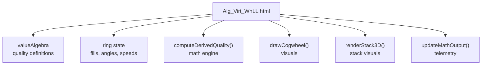
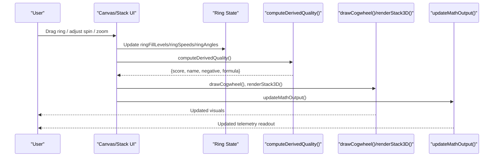
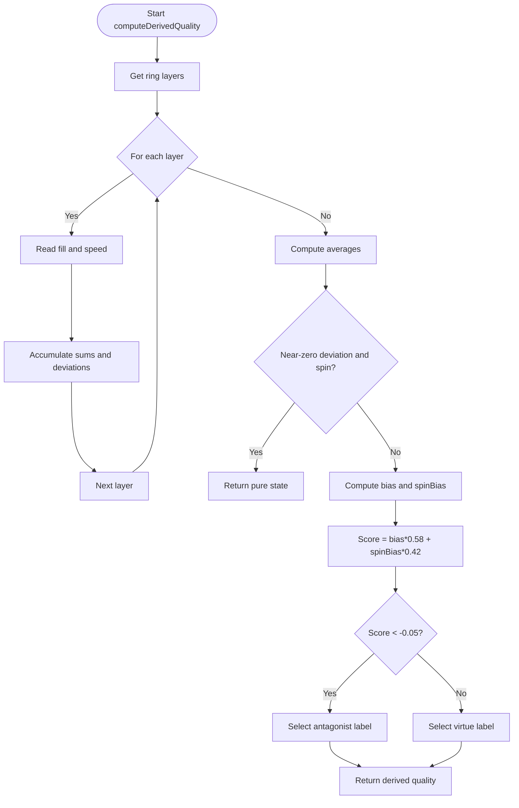
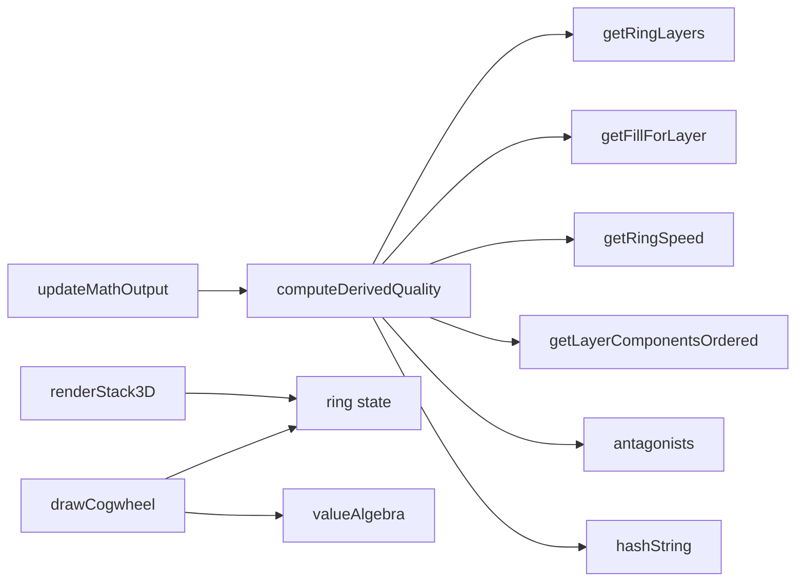

# Mathematical Formulas

<cite>
**Referenced Files in This Document**
- [Alg_Virt_WhLL.html](file://Alg_Virt_WhLL.html)
</cite>

## Table of Contents
1. [Introduction](#introduction)
2. [Project Structure](#project-structure)
3. [Core Components](#core-components)
4. [Architecture Overview](#architecture-overview)
5. [Detailed Component Analysis](#detailed-component-analysis)
6. [Dependency Analysis](#dependency-analysis)
7. [Performance Considerations](#performance-considerations)
8. [Troubleshooting Guide](#troubleshooting-guide)
9. [Conclusion](#conclusion)
10. [Appendices](#appendices)

## Introduction
This document explains how to modify and extend the mathematical computation engine that derives emergent qualities from concentric ring states. It focuses on:
- The current derived quality calculation algorithm
- How ring fill levels and ring spin speeds are processed
- How to customize formulas for different philosophical frameworks or use cases
- How to add new calculation methods, modify existing formulas, and implement alternative models
- Examples of common mathematical operations used in the implementation
- Performance considerations when modifying computational logic
- Testing strategies for validating formula changes
- The relationship between mathematical outputs and visual representations

The system is implemented as a single-page application with embedded JavaScript inside an HTML file. The core math lives in functions that compute derived quality from per-layer ring fills and ring speeds, then map those results to textual labels and visual feedback.

## Project Structure
The repository contains one primary file:
- Alg_Virt_WhLL.html: Contains CSS, UI markup, and all JavaScript logic including the algebra model, ring interactions, rendering, telemetry, and derived quality computation.

**Diagram sources**
- [Alg_Virt_WhLL.html:832-856](file://Alg_Virt_WhLL.html#L832-L856)
- [Alg_Virt_WhLL.html:1019-1081](file://Alg_Virt_WhLL.html#L1019-L1081)
- [Alg_Virt_WhLL.html:1142-1354](file://Alg_Virt_WhLL.html#L1142-L1354)
- [Alg_Virt_WhLL.html:1620-1763](file://Alg_Virt_WhLL.html#L1620-L1763)
- [Alg_Virt_WhLL.html:1886-1945](file://Alg_Virt_WhLL.html#L1886-L1945)

**Section sources**
- [Alg_Virt_WhLL.html:832-856](file://Alg_Virt_WhLL.html#L832-L856)
- [Alg_Virt_WhLL.html:1019-1081](file://Alg_Virt_WhLL.html#L1019-L1081)
- [Alg_Virt_WhLL.html:1142-1354](file://Alg_Virt_WhLL.html#L1142-L1354)
- [Alg_Virt_WhLL.html:1620-1763](file://Alg_Virt_WhLL.html#L1620-L1763)
- [Alg_Virt_WhLL.html:1886-1945](file://Alg_Virt_WhLL.html#L1886-L1945)

## Core Components
- valueAlgebra: Defines target qualities, their component dependencies, colors, layers, and descriptions.
- antagonists: Maps each quality to its antagonist counterpart.
- Ring state:
  - ringFillLevels: Per-target, per-layer fill values (0..1).
  - ringAngles: Per-target, per-layer rotation offsets.
  - ringSpeeds: Per-target, per-layer angular velocities.
- Derived quality engine:
  - computeDerivedQuality(): Aggregates fill and speed across layers into a score and label.
- Visuals:
  - drawCogwheel(): Renders concentric rings with fill arcs, teeth, labels, and antagonists.
  - renderStack3D(): Renders layered blocks showing positive/negative components and fill percentages.
- Telemetry:
  - updateMathOutput(): Prints structured telemetry including formula, ring telemetry, and combined result.

Key responsibilities:
- Algebra model drives which components belong to which layers and how they relate.
- Ring state captures user interaction and animation.
- Derived quality function translates ring state into a unified metric and label.
- Rendering and telemetry visualize and report the computed state.

**Section sources**
- [Alg_Virt_WhLL.html:832-856](file://Alg_Virt_WhLL.html#L832-L856)
- [Alg_Virt_WhLL.html:858-865](file://Alg_Virt_WhLL.html#L858-L865)
- [Alg_Virt_WhLL.html:920-943](file://Alg_Virt_WhLL.html#L920-L943)
- [Alg_Virt_WhLL.html:1019-1081](file://Alg_Virt_WhLL.html#L1019-L1081)
- [Alg_Virt_WhLL.html:1142-1354](file://Alg_Virt_WhLL.html#L1142-L1354)
- [Alg_Virt_WhLL.html:1620-1763](file://Alg_Virt_WhLL.html#L1620-L1763)
- [Alg_Virt_WhLL.html:1886-1945](file://Alg_Virt_WhLL.html#L1886-L1945)

## Architecture Overview
The computation pipeline connects user input and animation state to derived quality and visualization.

**Diagram sources**
- [Alg_Virt_WhLL.html:1390-1419](file://Alg_Virt_WhLL.html#L1390-L1419)
- [Alg_Virt_WhLL.html:1498-1523](file://Alg_Virt_WhLL.html#L1498-L1523)
- [Alg_Virt_WhLL.html:1019-1081](file://Alg_Virt_WhLL.html#L1019-L1081)
- [Alg_Virt_WhLL.html:1142-1354](file://Alg_Virt_WhLL.html#L1142-L1354)
- [Alg_Virt_WhLL.html:1620-1763](file://Alg_Virt_WhLL.html#L1620-L1763)
- [Alg_Virt_WhLL.html:1886-1945](file://Alg_Virt_WhLL.html#L1886-L1945)

## Detailed Component Analysis

### Derived Quality Algorithm: computeDerivedQuality
Purpose:
- Combine per-layer ring fill levels and ring spin speeds into a single derived quality score and label.
- Determine whether the result is “pure” (no deviation), “positive,” or “negative.”
- Select a representative source component and map it to either a virtue or antagonist based on the sign of the score.

Inputs and processing:
- Layers: Determined by getRingLayers(), which enumerates layers present for the current target.
- For each layer:
  - Fill level: getFillForLayer(layer, currentTarget) returns the stored fill or default 0.5.
  - Speed: getRingSpeed(layer) returns stored speed or 0.
- Aggregation:
  - Sums: fillSum, netSum (signed), spinSum (absolute), devSum (deviation from 0.5).
  - A per-layer signature string is built using rounded fill and speed values.
  - Dominant layer selection uses a weight combining fill deviation and normalized speed magnitude.
- Normalization and scoring:
  - Averages: avgFill, avgNet, avgSpin, avgDev.
  - If average deviation and spin are near zero, return a pure state with no score.
  - Bias = (avgFill - 0.5) * 2 maps fill bias to [-1, 1].
  - SpinBias = clamp(avgNet / (RING_SPEED_MAX * 0.8)) to [-1, 1].
  - Score = bias * 0.58 + spinBias * 0.42.
  - Negative if score < -0.05.
- Label selection:
  - Dominant layer’s components are ordered via getLayerComponentsOrdered().
  - If negative, filter out the target itself; otherwise keep non-target components.
  - Deterministic pick via hashString(sigParts | currentTarget) modulo pool length.
  - Map selected base to antagonist if negative, else keep base.

Return structure:
- pure: boolean indicating no meaningful deviation.
- negative: boolean indicating negative emergent quality.
- score: numeric score in approximately [-1, 1] range.
- name: final label (virtue or antagonist).
- base: underlying component used for labeling.
- layer: dominant layer index.
- formula: human-readable derivation summary.

Common mathematical operations used:
- Weighted combination: Score = bias * 0.58 + spinBias * 0.42.
- Clamping: spinBias clamped to [-1, 1].
- Absolute value: Used for spinSum and deviation calculations.
- Rounding: Used to build deterministic signatures for label selection.
- Thresholding: Pure state thresholds for deviation and spin; negative threshold for score.

Customization points:
- Weights (0.58, 0.42) to tune emphasis between fill bias and spin bias.
- Spin normalization divisor (RING_SPEED_MAX * 0.8) to change sensitivity to spin.
- Negative threshold (-0.05) to control when output flips to antagonist.
- Dominant layer weighting formula to emphasize certain layers more.
- Signature construction and hashing strategy for deterministic label selection.

**Diagram sources**
- [Alg_Virt_WhLL.html:1019-1081](file://Alg_Virt_WhLL.html#L1019-L1081)

**Section sources**
- [Alg_Virt_WhLL.html:1019-1081](file://Alg_Virt_WhLL.html#L1019-L1081)

### Ring Fill Levels Processing
- Storage: ringFillLevels keyed by `${target}_${layer}`.
- Default: If not set, getFillForLayer returns 0.5 (neutral baseline).
- Interaction:
  - Mouse/touch drag updates fill based on pointer angle relative to ring rotation.
  - Angle-to-fill conversion normalizes angles to [0, 1] fraction around the circle.
- Visualization:
  - Draw arc proportional to fill.
  - Antagonist labels appear in unfilled portions.
  - Component labels appear within filled portions.

Mathematical transformations:
- Angle normalization: Converts absolute canvas angle to a normalized fill fraction accounting for ring rotation.
- Clamping: Fill values clamped to [0, 1].

Example operations:
- Trigonometric mapping: Uses atan2 to compute angle from coordinates.
- Modular arithmetic: Normalizes angles to [0, 2π) before converting to fill.

**Section sources**
- [Alg_Virt_WhLL.html:990-993](file://Alg_Virt_WhLL.html#L990-L993)
- [Alg_Virt_WhLL.html:1384-1388](file://Alg_Virt_WhLL.html#L1384-L1388)
- [Alg_Virt_WhLL.html:1390-1419](file://Alg_Virt_WhLL.html#L1390-L1419)
- [Alg_Virt_WhLL.html:1218-1294](file://Alg_Virt_WhLL.html#L1218-L1294)

### Ring Spin Speeds Processing
- Storage: ringSpeeds keyed by `${target}_${layer}`.
- Bounds: Constrained to [-RING_SPEED_MAX, RING_SPEED_MAX].
- Animation:
  - cogwheelTick increments ringAngles by speed * dt.
  - ensureCogwheelLoop starts/stops interval based on global autoRotate or any ring spinning.
- UI:
  - Controls allow adjusting speed per ring via buttons and Shift+Wheel.
  - Display shows direction and magnitude.

Mathematical transformations:
- Linear accumulation: Angles += speed * dt.
- Clamping: Speed bounded to max/min limits.

Example operations:
- Linear integration over time steps.
- Threshold checks to start/stop animation loop.

**Section sources**
- [Alg_Virt_WhLL.html:995-1008](file://Alg_Virt_WhLL.html#L995-L1008)
- [Alg_Virt_WhLL.html:1498-1523](file://Alg_Virt_WhLL.html#L1498-L1523)
- [Alg_Virt_WhLL.html:1592-1611](file://Alg_Virt_WhLL.html#L1592-L1611)

### Adding New Calculation Methods
To add a new method:
- Define a new function that accepts ring state (layers, fills, speeds) and returns a derived quality object compatible with the existing interface.
- Integrate it into the UI by exposing a selector or configuration option to choose the active method.
- Ensure the new method produces fields: pure, negative, score, name, base, layer, formula.

Suggested approach:
- Create a registry of methods keyed by names.
- Use a switch or dispatch table to call the selected method.
- Keep computeDerivedQuality as a thin dispatcher.

Validation:
- Unit-test each method against known inputs and expected outputs.
- Validate edge cases: empty layers, extreme fills/spins, negative scores, pure states.

**Section sources**
- [Alg_Virt_WhLL.html:1019-1081](file://Alg_Virt_WhLL.html#L1019-L1081)

### Modifying Existing Formulas
To modify the current formula:
- Adjust weights (e.g., 0.58, 0.42) to change emphasis between fill bias and spin bias.
- Change spin normalization divisor to alter sensitivity to spin.
- Modify thresholds (e.g., -0.05) to tune negativity detection.
- Update dominant layer weighting to prioritize specific layers.

Guidelines:
- Keep transformations monotonic where possible to preserve intuitive behavior.
- Preserve determinism for label selection by keeping signature hashing stable.
- Document changes in telemetry formula strings to reflect new logic.

**Section sources**
- [Alg_Virt_WhLL.html:1038-1064](file://Alg_Virt_WhLL.html#L1038-L1064)
- [Alg_Virt_WhLL.html:1073-1080](file://Alg_Virt_WhLL.html#L1073-L1080)

### Implementing Alternative Mathematical Models
Examples of alternative models you can implement:
- Exponential scaling: Apply exp(k*(fill - 0.5)) to amplify small deviations.
- Trigonometric modulation: Use sin(2π*fill) to create oscillatory influence.
- Power-law weighting: Raise fill deviation to a power > 1 to emphasize extremes.
- Softmax over layers: Convert raw layer contributions into probabilities and select probabilistically.

Integration steps:
- Replace or augment the bias/score computation in computeDerivedQuality.
- Maintain consistent output shape and semantics.
- Provide telemetry strings describing the new transformation.

**Section sources**
- [Alg_Virt_WhLL.html:1019-1081](file://Alg_Virt_WhLL.html#L1019-L1081)

### Examples of Common Mathematical Operations in Current Implementation
- Weighted averages: Score combines bias and spinBias with fixed weights.
- Clamping: spinBias clamped to [-1, 1] to bound influence.
- Absolute value: Used to aggregate spin magnitude and deviation.
- Rounding: Used to build deterministic signatures for label selection.
- Thresholding: Pure state thresholds and negative threshold.
- Trigonometry: atan2 for angle computation; modular arithmetic for angle normalization.

These operations ensure robust, interpretable behavior while allowing customization.

**Section sources**
- [Alg_Virt_WhLL.html:1038-1064](file://Alg_Virt_WhLL.html#L1038-L1064)
- [Alg_Virt_WhLL.html:1384-1388](file://Alg_Virt_WhLL.html#L1384-L1388)

### Relationship Between Mathematical Outputs and Visual Representations
- Derived quality affects:
  - Overlay text: Shows emergent quality name and formula.
  - Color coding: Positive vs negative styling.
  - Telemetry: Combined line includes derived label and formula.
- Ring visuals:
  - Fill arcs represent per-layer fill levels.
  - Teeth indicate rotation; antagonists appear in unfilled regions.
  - Labels show component names and fill percentages.
- Stack visuals:
  - Blocks show component names, layers, and fill percentages.
  - Back faces display antagonists when enabled.

Consistency:
- The same ring state drives both visuals and telemetry.
- Derived quality formula string appears in overlay and telemetry for traceability.

**Section sources**
- [Alg_Virt_WhLL.html:1083-1093](file://Alg_Virt_WhLL.html#L1083-L1093)
- [Alg_Virt_WhLL.html:1142-1354](file://Alg_Virt_WhLL.html#L1142-L1354)
- [Alg_Virt_WhLL.html:1620-1763](file://Alg_Virt_WhLL.html#L1620-L1763)
- [Alg_Virt_WhLL.html:1886-1945](file://Alg_Virt_WhLL.html#L1886-L1945)

## Dependency Analysis
Key dependencies:
- computeDerivedQuality depends on:
  - getRingLayers
  - getFillForLayer
  - getRingSpeed
  - getLayerComponentsOrdered
  - antagonists map
  - hashString utility
- Rendering depends on:
  - ring state (fills, angles, speeds)
  - valueAlgebra for colors and component lists
- Telemetry depends on:
  - computeDerivedQuality
  - stackItems and ring state

Coupling:
- High cohesion within computeDerivedQuality; low coupling to rendering except through shared state.
- Clear separation between data model (valueAlgebra), state (rings), computation (derived quality), and presentation (canvas/stack/telemetry).

Potential circular dependencies:
- None observed; functions are organized linearly without mutual recursion.

External dependencies:
- DOM APIs for canvas and element manipulation.
- Browser event handling for mouse/touch interactions.

**Diagram sources**
- [Alg_Virt_WhLL.html:1019-1081](file://Alg_Virt_WhLL.html#L1019-L1081)
- [Alg_Virt_WhLL.html:1142-1354](file://Alg_Virt_WhLL.html#L1142-L1354)
- [Alg_Virt_WhLL.html:1620-1763](file://Alg_Virt_WhLL.html#L1620-L1763)
- [Alg_Virt_WhLL.html:1886-1945](file://Alg_Virt_WhLL.html#L1886-L1945)

**Section sources**
- [Alg_Virt_WhLL.html:1019-1081](file://Alg_Virt_WhLL.html#L1019-L1081)
- [Alg_Virt_WhLL.html:1142-1354](file://Alg_Virt_WhLL.html#L1142-L1354)
- [Alg_Virt_WhLL.html:1620-1763](file://Alg_Virt_WhLL.html#L1620-L1763)
- [Alg_Virt_WhLL.html:1886-1945](file://Alg_Virt_WhLL.html#L1886-L1945)

## Performance Considerations
- Computation complexity:
  - computeDerivedQuality iterates over layers once; O(L) where L is number of layers.
  - Rendering draws per-layer arcs and labels; O(L) plus constant overhead per component label.
- Animation loop:
  - Interval-based updates at ~20 FPS; only runs when needed (autoRotate or any ring spinning).
- Optimization tips:
  - Avoid recalculating derived quality unless ring state changes.
  - Debounce resize events (already implemented).
  - Minimize DOM manipulations in tight loops; batch updates where possible.
  - Reuse computed values (e.g., layer lists) to avoid repeated resolution.

[No sources needed since this section provides general guidance]

## Troubleshooting Guide
Common issues and resolutions:
- Derived quality remains “pure”:
  - Check that ring fills deviate from 0.5 or speeds are non-zero.
  - Verify thresholds for pure state are appropriate for your use case.
- Unexpected negative labels:
  - Inspect score and negative threshold.
  - Confirm spin direction and magnitude are as intended.
- Visual mismatch with telemetry:
  - Ensure refreshAll is called after state changes.
  - Check that drawCogwheel and renderStack3D use the same ring state.
- Animation not stopping:
  - Verify ensureCogwheelLoop condition and clear intervals when needed.

Debugging aids:
- Use the telemetry readout to inspect per-layer fills, signs, and combined formula.
- Toggle antagonist visibility in the stack to confirm mappings.
- Reset controls to restore neutral state and isolate variables.

**Section sources**
- [Alg_Virt_WhLL.html:1019-1081](file://Alg_Virt_WhLL.html#L1019-L1081)
- [Alg_Virt_WhLL.html:1886-1945](file://Alg_Virt_WhLL.html#L1886-L1945)
- [Alg_Virt_WhLL.html:1514-1523](file://Alg_Virt_WhLL.html#L1514-L1523)

## Conclusion
The mathematical computation engine centers on computeDerivedQuality, which transforms per-layer ring fills and spin speeds into a unified derived quality. Its design balances interpretability and extensibility:
- Simple, transparent formulas make it easy to understand and modify.
- Clear separation of concerns allows adding new methods and customizing transformations.
- Strong ties to visuals and telemetry ensure consistency and traceability.

When extending the engine:
- Preserve the output contract of derived quality objects.
- Keep transformations monotonic and well-documented.
- Test thoroughly with edge cases and validate visual/telemetry alignment.

[No sources needed since this section summarizes without analyzing specific files]

## Appendices

### API Reference: computeDerivedQuality
- Inputs:
  - Implicit ring state: ringFillLevels, ringSpeeds, ringAngles, currentTarget.
- Outputs:
  - Object with fields: pure, negative, score, name, base, layer, formula.
- Behavior:
  - Aggregates fill and speed across layers.
  - Computes bias and spin bias.
  - Applies weighted combination to produce score.
  - Determines negative state and selects label accordingly.

Usage:
- Called during refreshAll to update overlay and telemetry.
- Can be extended by replacing or wrapping this function with alternative models.

**Section sources**
- [Alg_Virt_WhLL.html:1019-1081](file://Alg_Virt_WhLL.html#L1019-L1081)
- [Alg_Virt_WhLL.html:1988-1993](file://Alg_Virt_WhLL.html#L1988-L1993)