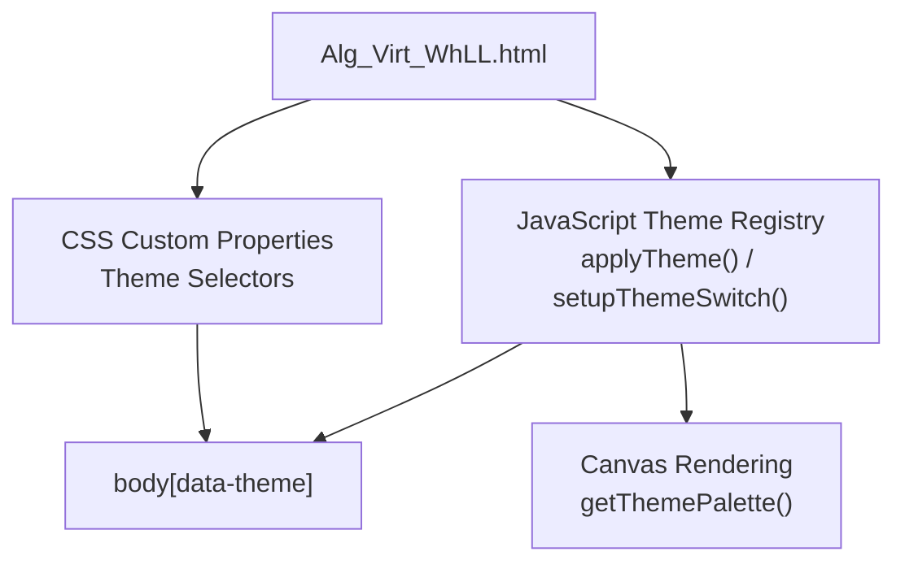
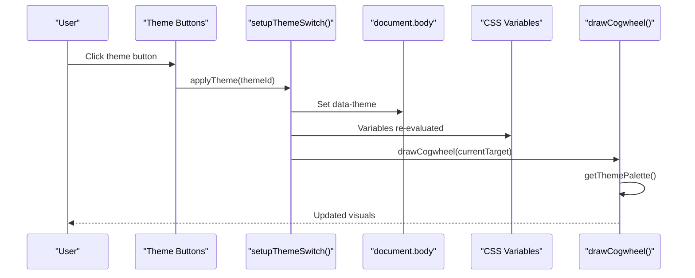
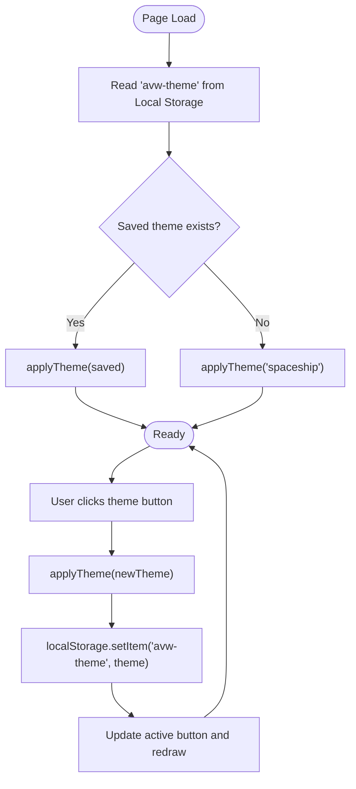
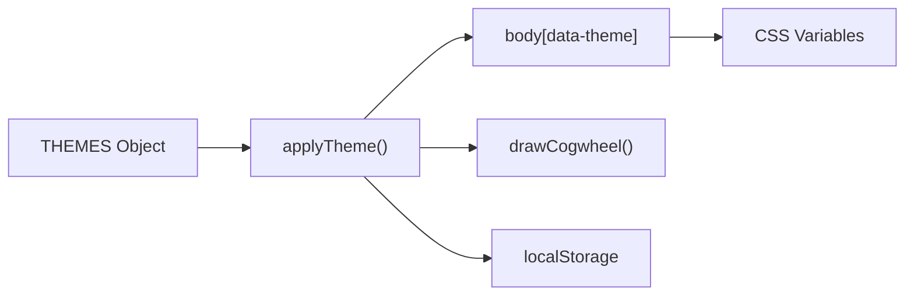

# Theme Development

<cite>
**Referenced Files in This Document**
- [Alg_Virt_WhLL.html](file://Alg_Virt_WhLL.html)
</cite>

## Table of Contents
1. [Introduction](#introduction)
2. [Project Structure](#project-structure)
3. [Core Components](#core-components)
4. [Architecture Overview](#architecture-overview)
5. [Detailed Component Analysis](#detailed-component-analysis)
6. [Dependency Analysis](#dependency-analysis)
7. [Performance Considerations](#performance-considerations)
8. [Troubleshooting Guide](#troubleshooting-guide)
9. [Conclusion](#conclusion)
10. [Appendices](#appendices)

## Introduction
This document explains how to develop custom themes for the Algebraic Virtue Wheel. The theme system is built on CSS custom properties and a small JavaScript theme registry. It ships with three visual templates: Spaceship, Vintage, and Toth Egyptian. You can extend or replace these by defining new CSS variables and adding a new template entry in the JavaScript theme map.

The guide covers:
- How the theme system works under the hood
- All available CSS variables used by the UI and canvas rendering
- Step-by-step instructions for creating a complete theme from scratch
- Accessibility guidance for contrast and readability
- Theme switching and persistence using Local Storage
- Responsive design and cross-browser considerations

## Project Structure
The project is a single-page application contained in one HTML file. Styling and behavior are co-located:
- CSS custom properties define colors, typography, gradients, borders, and animation parameters
- A small JavaScript object maps theme identifiers to palette values used by the canvas renderer
- The body element carries a data attribute that selects the active theme via CSS selectors

**Diagram sources**
- [Alg_Virt_WhLL.html:8-30](file://Alg_Virt_WhLL.html#L8-L30)
- [Alg_Virt_WhLL.html:32-80](file://Alg_Virt_WhLL.html#L32-L80)
- [Alg_Virt_WhLL.html:864-887](file://Alg_Virt_WhLL.html#L864-L887)
- [Alg_Virt_WhLL.html:892-915](file://Alg_Virt_WhLL.html#L892-L915)
- [Alg_Virt_WhLL.html:1152-1153](file://Alg_Virt_WhLL.html#L1152-L1153)

**Section sources**
- [Alg_Virt_WhLL.html:1-10](file://Alg_Virt_WhLL.html#L1-L10)
- [Alg_Virt_WhLL.html:8-30](file://Alg_Virt_WhLL.html#L8-L30)
- [Alg_Virt_WhLL.html:864-887](file://Alg_Virt_WhLL.html#L864-L887)

## Core Components
The theme system has two main parts:
- CSS custom properties that control colors, fonts, backgrounds, borders, and animations
- A JavaScript theme registry that supplies palette values to the Canvas drawing code

Key responsibilities:
- CSS defines default variables and overrides them per theme selector
- JavaScript applies the theme by setting a data attribute on the body and updating UI state
- Canvas rendering reads the current palette to draw rings, labels, and accents

**Section sources**
- [Alg_Virt_WhLL.html:8-30](file://Alg_Virt_WhLL.html#L8-L30)
- [Alg_Virt_WhLL.html:32-80](file://Alg_Virt_WhLL.html#L32-L80)
- [Alg_Virt_WhLL.html:864-887](file://Alg_Virt_WhLL.html#L864-L887)
- [Alg_Virt_WhLL.html:892-915](file://Alg_Virt_WhLL.html#L892-L915)

## Architecture Overview
The theme architecture follows a simple pattern:
- Default variables are declared in :root
- Each theme overrides those variables under a body[data-theme="..."] selector
- JavaScript maintains a THEMES map and switches the active theme by toggling the body data attribute
- The Canvas renderer uses getThemePalette() to access accent, bright, neutralRgb, and font settings

**Diagram sources**
- [Alg_Virt_WhLL.html:892-915](file://Alg_Virt_WhLL.html#L892-L915)
- [Alg_Virt_WhLL.html:1152-1153](file://Alg_Virt_WhLL.html#L1152-L1153)
- [Alg_Virt_WhLL.html:1139-1156](file://Alg_Virt_WhLL.html#L1139-L1156)

## Detailed Component Analysis

### CSS Custom Properties (Variables)
The following variables are defined and consumed across the UI and canvas rendering:

- Color scheme
  - --bg-color: Base background color
  - --panel-bg: Panel background
  - --border-color: Borders and dividers
  - --text-color: Primary text color
  - --heading-color: Headings and important labels
  - --muted-color: Secondary and hint text
  - --accent-glow: Accent highlight color
  - --accent-rgb: RGB triplet for accent glow effects
  - --negative-color: Negative state color
  - --negative-rgb: RGB triplet for negative glow effects
  - --readout-bg: Math readout panel background
  - --overlay-bg: Overlay panels background
  - --canvas-center: Radial gradient center for cogwheel canvas
  - --canvas-edge: Radial gradient edge for cogwheel canvas
  - --scene-center: Radial gradient center for 3D stack scene
  - --scene-edge: Radial gradient edge for 3D stack scene

- Typography
  - --ui-font: Font family for UI elements

- Layout and shape
  - --panel-radius: Border radius for panels and controls

- Backgrounds and gradients
  - --body-backdrop: Body-level backdrop gradient

- Animation parameters
  - dqBlink keyframes use currentColor and text-shadow; no dedicated variable is required, but you can adjust timing and shadow spread through CSS rules targeting .derived-quality .dq-name

These variables are set in the default theme and overridden by each theme selector. They are also referenced by UI components such as panels, buttons, overlays, and the derived quality banner.

**Section sources**
- [Alg_Virt_WhLL.html:8-30](file://Alg_Virt_WhLL.html#L8-L30)
- [Alg_Virt_WhLL.html:32-80](file://Alg_Virt_WhLL.html#L32-L80)
- [Alg_Virt_WhLL.html:84-95](file://Alg_Virt_WhLL.html#L84-L95)
- [Alg_Virt_WhLL.html:178-188](file://Alg_Virt_WhLL.html#L178-L188)
- [Alg_Virt_WhLL.html:362-415](file://Alg_Virt_WhLL.html#L362-L415)
- [Alg_Virt_WhLL.html:422-439](file://Alg_Virt_WhLL.html#L422-L439)
- [Alg_Virt_WhLL.html:451-461](file://Alg_Virt_WhLL.html#L451-L461)

### JavaScript Theme Registry
The JavaScript theme registry provides palette values used by the Canvas renderer:
- accent: Hex color for primary accent
- accentRgb: RGB string for glows and shadows
- bright: Bright text or stroke color
- neutralRgb: Neutral RGB for subtle fills and strokes
- canvasFont: Font family for canvas-drawn text

The registry includes spaceship, vintage, and toth-egyptian entries.

**Section sources**
- [Alg_Virt_WhLL.html:864-887](file://Alg_Virt_WhLL.html#L864-L887)
- [Alg_Virt_WhLL.html:1152-1153](file://Alg_Virt_WhLL.html#L1152-L1153)
- [Alg_Virt_WhLL.html:1166-1172](file://Alg_Virt_WhLL.html#L1166-L1172)
- [Alg_Virt_WhLL.html:1191-1195](file://Alg_Virt_WhLL.html#L1191-L1195)
- [Alg_Virt_WhLL.html:1241-1246](file://Alg_Virt_WhLL.html#L1241-L1246)
- [Alg_Virt_WhLL.html:1277-1288](file://Alg_Virt_WhLL.html#L1277-L1288)
- [Alg_Virt_WhLL.html:1297-1318](file://Alg_Virt_WhLL.html#L1297-L1318)
- [Alg_Virt_WhLL.html:1321-1329](file://Alg_Virt_WhLL.html#L1321-L1329)
- [Alg_Virt_WhLL.html:1332-1346](file://Alg_Virt_WhLL.html#L1332-L1346)

### Theme Switching Mechanism
Theme switching is implemented by:
- Attaching click handlers to theme buttons
- Calling applyTheme(themeId) which sets document.body.dataset.theme and updates active button state
- Persisting the selected theme to localStorage
- Restoring the saved theme on load

**Diagram sources**
- [Alg_Virt_WhLL.html:892-915](file://Alg_Virt_WhLL.html#L892-L915)

**Section sources**
- [Alg_Virt_WhLL.html:892-915](file://Alg_Virt_WhLL.html#L892-L915)

### Creating a Complete Theme From Scratch
Follow these steps to add a new theme beyond Spaceship, Vintage, and Toth Egyptian:

1. Define CSS variables for your theme
   - Add a new body[data-theme="your-theme"] block
   - Override all relevant variables: colors, fonts, radii, gradients, and backdrop
   - Ensure consistent naming and provide both hex and RGB variants where needed

2. Add a JavaScript palette entry
   - Extend the THEMES object with your theme identifier
   - Provide accent, accentRgb, bright, neutralRgb, and canvasFont

3. Add a theme button
   - Include a button with data-theme-id matching your theme identifier
   - Optionally add a swatch class to preview your palette

4. Persist and restore preference
   - The existing setupThemeSwitch already persists and restores the theme via localStorage
   - No additional changes are required if your theme ID is valid

5. Test accessibility and contrast
   - Verify text against backgrounds meets WCAG guidelines
   - Adjust --text-color, --heading-color, and --muted-color as needed

6. Validate canvas rendering
   - Confirm accent, bright, neutralRgb, and canvasFont produce readable labels and glows
   - Inspect ring fills, antagonists, and derived quality overlay

**Section sources**
- [Alg_Virt_WhLL.html:8-30](file://Alg_Virt_WhLL.html#L8-L30)
- [Alg_Virt_WhLL.html:32-80](file://Alg_Virt_WhLL.html#L32-L80)
- [Alg_Virt_WhLL.html:864-887](file://Alg_Virt_WhLL.html#L864-L887)
- [Alg_Virt_WhLL.html:892-915](file://Alg_Virt_WhLL.html#L892-L915)
- [Alg_Virt_WhLL.html:1139-1156](file://Alg_Virt_WhLL.html#L1139-L1156)

### Defining Color Palettes for Different Virtue Layers
Virtue layers are represented by concentric rings and 3D stack blocks. Their colors come from the valueAlgebra definitions rather than theme variables. However, theme variables influence:
- Ring fill gradients and edges
- Antagonist text and back faces
- Glows, shadows, and overlays

Guidelines:
- Keep --accent-glow and --accent-rgb harmonious with virtue layer colors
- Use --negative-color and --negative-rgb to clearly distinguish antagonists
- Ensure --text-color and --heading-color remain legible over layered backgrounds
- Use --panel-bg and --border-color to maintain visual hierarchy

**Section sources**
- [Alg_Virt_WhLL.html:829-853](file://Alg_Virt_WhLL.html#L829-L853)
- [Alg_Virt_WhLL.html:1166-1172](file://Alg_Virt_WhLL.html#L1166-L1172)
- [Alg_Virt_WhLL.html:1219-1232](file://Alg_Virt_WhLL.html#L1219-L1232)
- [Alg_Virt_WhLL.html:1264-1288](file://Alg_Virt_WhLL.html#L1264-L1288)
- [Alg_Virt_WhLL.html:1667-1718](file://Alg_Virt_WhLL.html#L1667-L1718)

### Setting Up Proper Contrast Ratios and Accessibility Compliance
To ensure accessibility:
- Maintain sufficient contrast between text and backgrounds for --text-color, --heading-color, and --muted-color
- Avoid low-opacity overlays obscuring critical information
- Use --negative-color sparingly and consistently for negative states
- Test with browser accessibility tools and high-contrast modes
- Ensure focus indicators remain visible when interacting with theme buttons and controls

Practical checks:
- Readable headings over --bg-color and --panel-bg
- Legible math readout text over --readout-bg
- Clear distinction between positive and negative qualities in the derived quality overlay

**Section sources**
- [Alg_Virt_WhLL.html:84-95](file://Alg_Virt_WhLL.html#L84-L95)
- [Alg_Virt_WhLL.html:178-188](file://Alg_Virt_WhLL.html#L178-L188)
- [Alg_Virt_WhLL.html:362-415](file://Alg_Virt_WhLL.html#L362-L415)
- [Alg_Virt_WhLL.html:422-439](file://Alg_Virt_WhLL.html#L422-L439)

### Theme Switching Examples and Persistence
Theme switching examples:
- Clicking a theme button triggers applyTheme and updates the body data attribute
- The active button receives an active class and highlights using --accent-glow
- The theme preference is stored in localStorage under the key avw-theme
- On page load, the saved theme is applied if present

Persistence details:
- Saved value is validated against the THEMES registry before applying
- If invalid or missing, the default theme is applied

**Section sources**
- [Alg_Virt_WhLL.html:892-915](file://Alg_Virt_WhLL.html#L892-L915)

### Responsive Design Considerations
Responsive behavior is handled via media queries and flexible layouts:
- Grid layout collapses to a single column on smaller screens
- Cogwheel container and 3D stack viewport sizes adapt to screen width
- Stack box dimensions reduce on mobile devices

When creating custom themes:
- Ensure --panel-radius and border styles remain usable at smaller sizes
- Avoid overly complex backdrop gradients that may impact performance on mobile
- Test touch interactions for ring fill dragging and stack rotation

**Section sources**
- [Alg_Virt_WhLL.html:695-704](file://Alg_Virt_WhLL.html#L695-L704)
- [Alg_Virt_WhLL.html:170-176](file://Alg_Virt_WhLL.html#L170-L176)
- [Alg_Virt_WhLL.html:284-298](file://Alg_Virt_WhLL.html#L284-L298)
- [Alg_Virt_WhLL.html:451-461](file://Alg_Virt_WhLL.html#L451-L461)

### Cross-Browser Compatibility
The theme system relies on widely supported features:
- CSS custom properties
- CSS selectors based on data attributes
- Canvas API for rendering
- Local Storage for persistence
- Fullscreen API with vendor prefixes fallback

Considerations:
- Some older browsers may not support CSS custom properties; consider polyfills if needed
- Fullscreen API differences are handled with webkit prefix fallbacks
- Local Storage availability is guarded with try/catch blocks

**Section sources**
- [Alg_Virt_WhLL.html:8-30](file://Alg_Virt_WhLL.html#L8-L30)
- [Alg_Virt_WhLL.html:892-915](file://Alg_Virt_WhLL.html#L892-L915)
- [Alg_Virt_WhLL.html:1947-1980](file://Alg_Virt_WhLL.html#L1947-L1980)

## Dependency Analysis
The theme system has minimal coupling:
- CSS variables are consumed by UI classes and canvas rendering
- JavaScript theme registry is independent of CSS selectors but synchronized via body data attribute
- Theme switching logic depends on DOM elements and localStorage

**Diagram sources**
- [Alg_Virt_WhLL.html:864-887](file://Alg_Virt_WhLL.html#L864-L887)
- [Alg_Virt_WhLL.html:892-915](file://Alg_Virt_WhLL.html#L892-L915)
- [Alg_Virt_WhLL.html:1139-1156](file://Alg_Virt_WhLL.html#L1139-L1156)

**Section sources**
- [Alg_Virt_WhLL.html:864-887](file://Alg_Virt_WhLL.html#L864-L887)
- [Alg_Virt_WhLL.html:892-915](file://Alg_Virt_WhLL.html#L892-L915)
- [Alg_Virt_WhLL.html:1139-1156](file://Alg_Virt_WhLL.html#L1139-L1156)

## Performance Considerations
- CSS custom properties are efficient and avoid heavy repaints during theme switching
- Canvas rendering recalculates gradients and shadows; limit excessive animations
- Backdrop gradients should be simple to avoid GPU strain on mobile devices
- Use will-change judiciously; the stack scene already uses it for transform performance

[No sources needed since this section provides general guidance]

## Troubleshooting Guide
Common issues and resolutions:
- Theme does not apply
  - Ensure body[data-theme="your-theme"] selector matches the theme ID
  - Verify all required CSS variables are defined
  - Check that the JavaScript THEMES entry exists and is referenced correctly

- Colors look washed out or unreadable
  - Adjust --text-color, --heading-color, and --muted-color for better contrast
  - Review --panel-bg and --bg-color combinations
  - Inspect overlay opacities and gradients

- Canvas text is hard to read
  - Update canvasFont in the JavaScript theme registry
  - Ensure bright and neutralRgb provide sufficient luminance contrast

- Theme preference not persisting
  - Confirm localStorage is available and not blocked
  - Check for errors in setupThemeSwitch and applyTheme

**Section sources**
- [Alg_Virt_WhLL.html:892-915](file://Alg_Virt_WhLL.html#L892-L915)
- [Alg_Virt_WhLL.html:1139-1156](file://Alg_Virt_WhLL.html#L1139-L1156)

## Conclusion
The Algebraic Virtue Wheel’s theme system is straightforward and extensible. By defining CSS custom properties and extending the JavaScript theme registry, you can create rich visual themes that integrate seamlessly with the UI and canvas rendering. Follow the accessibility and responsive guidelines to ensure usability across devices and browsers. Use the provided theme switching mechanism and Local Storage persistence to deliver a polished user experience.

[No sources needed since this section summarizes without analyzing specific files]

## Appendices

### Appendix A: Complete List of CSS Variables
- --bg-color
- --panel-bg
- --border-color
- --text-color
- --heading-color
- --muted-color
- --accent-glow
- --accent-rgb
- --negative-color
- --negative-rgb
- --readout-bg
- --overlay-bg
- --canvas-center
- --canvas-edge
- --scene-center
- --scene-edge
- --ui-font
- --panel-radius
- --body-backdrop

**Section sources**
- [Alg_Virt_WhLL.html:8-30](file://Alg_Virt_WhLL.html#L8-L30)
- [Alg_Virt_WhLL.html:32-80](file://Alg_Virt_WhLL.html#L32-L80)

### Appendix B: JavaScript Theme Palette Keys
- accent
- accentRgb
- bright
- neutralRgb
- canvasFont

**Section sources**
- [Alg_Virt_WhLL.html:864-887](file://Alg_Virt_WhLL.html#L864-L887)