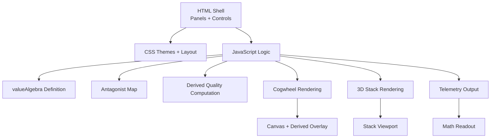
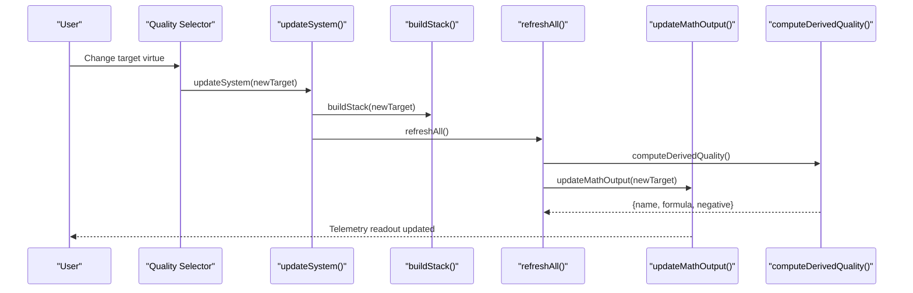
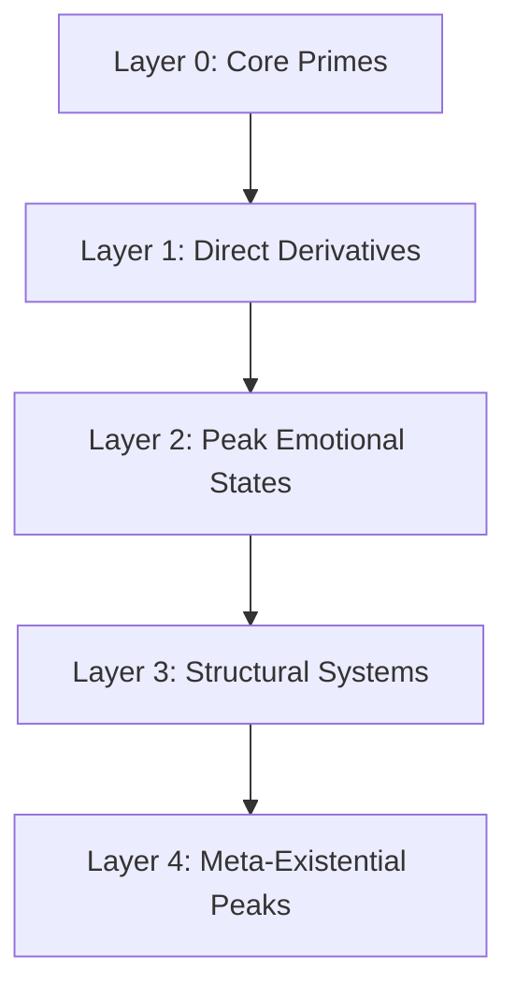
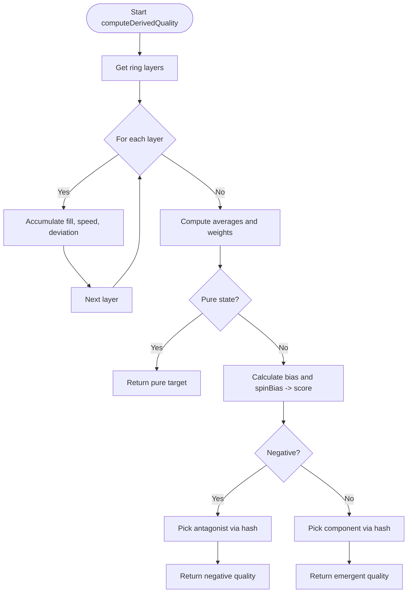
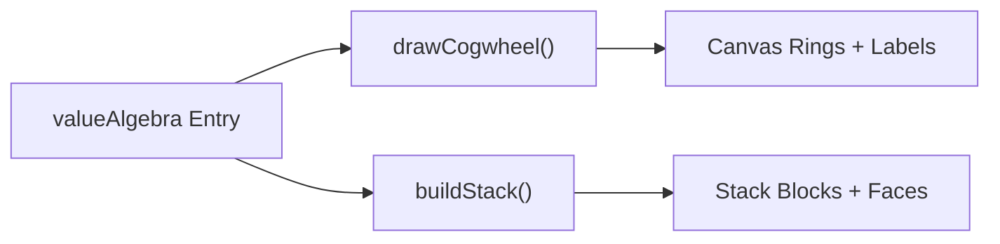
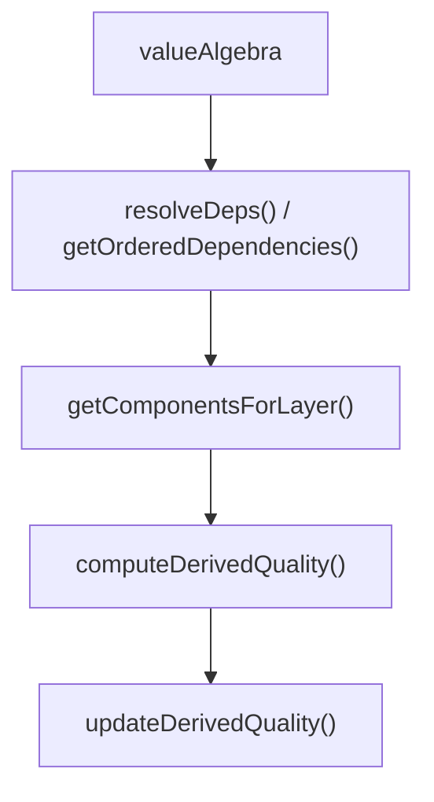

# Virtue System Extension

<cite>
**Referenced Files in This Document**
- [Alg_Virt_WhLL.html](file://Alg_Virt_WhLL.html)
</cite>

## Table of Contents
1. [Introduction](#introduction)
2. [Project Structure](#project-structure)
3. [Core Components](#core-components)
4. [Architecture Overview](#architecture-overview)
5. [Detailed Component Analysis](#detailed-component-analysis)
6. [Dependency Analysis](#dependency-analysis)
7. [Performance Considerations](#performance-considerations)
8. [Troubleshooting Guide](#troubleshooting-guide)
9. [Conclusion](#conclusion)
10. [Appendices](#appendices)

## Introduction
This document explains how to extend the algebraic virtue system implemented in the single-file application. It focuses on adding new virtues to the valueAlgebra object, defining hierarchical relationships and component dependencies, assigning colors and descriptions, mapping antagonists, positioning virtues within the five-layer hierarchy, and understanding how new virtues integrate with the mathematical model for derived quality calculations and visualization rendering.

The system models virtues as a directed dependency graph where higher-level virtues are composed from lower-level components. The UI visualizes this structure through concentric cogwheel rings and a 3D stratified stack. Derived qualities emerge from ring fill levels and spin speeds, combining into an emergent or negative quality depending on deviation and direction.

## Project Structure
The project is a single HTML file that contains:
- CSS styles for multiple design themes
- A DOM layout with two main panels:
  - Left panel: concentric cogwheel canvas and controls
  - Right panel: 3D stack view and telemetry readout
- JavaScript logic for:
  - Algebra definition (virtues, components, colors, layers, descriptions)
  - Antagonist mappings
  - Dependency resolution and layer grouping
  - Derived quality computation
  - Cogwheel drawing and interaction
  - 3D stack building and rendering
  - Telemetry output and theme switching

**Diagram sources**
- [Alg_Virt_WhLL.html:710-827](file://Alg_Virt_WhLL.html#L710-L827)
- [Alg_Virt_WhLL.html:831-865](file://Alg_Virt_WhLL.html#L831-L865)
- [Alg_Virt_WhLL.html:1019-1093](file://Alg_Virt_WhLL.html#L1019-L1093)
- [Alg_Virt_WhLL.html:1142-1354](file://Alg_Virt_WhLL.html#L1142-L1354)
- [Alg_Virt_WhLL.html:1620-1763](file://Alg_Virt_WhLL.html#L1620-L1763)
- [Alg_Virt_WhLL.html:1886-1945](file://Alg_Virt_WhLL.html#L1886-L1945)

**Section sources**
- [Alg_Virt_WhLL.html:710-827](file://Alg_Virt_WhLL.html#L710-L827)
- [Alg_Virt_WhLL.html:831-865](file://Alg_Virt_WhLL.html#L831-L865)

## Core Components
Key data structures and functions involved in extending the system:

- valueAlgebra: Defines each virtue with:
  - components: array of prerequisite virtues
  - color: hex color used in visuals
  - desc: descriptive text shown in telemetry
  - layer: integer indicating position in the five-layer hierarchy
- antagonists: maps each virtue to its antagonist concept
- Derived quality computation: combines ring fills and spins to produce an emergent or negative quality
- Layer grouping utilities: resolve dependencies and group components by layer
- Cogwheel rendering: draws concentric rings per layer, shows component labels and antagonist hints
- 3D stack rendering: builds layered blocks with front/back faces showing virtues and antagonists
- Telemetry output: prints formulas, ring states, and derived quality summary

**Section sources**
- [Alg_Virt_WhLL.html:831-865](file://Alg_Virt_WhLL.html#L831-L865)
- [Alg_Virt_WhLL.html:945-993](file://Alg_Virt_WhLL.html#L945-L993)
- [Alg_Virt_WhLL.html:1019-1093](file://Alg_Virt_WhLL.html#L1019-L1093)
- [Alg_Virt_WhLL.html:1142-1354](file://Alg_Virt_WhLL.html#L1142-L1354)
- [Alg_Virt_WhLL.html:1620-1763](file://Alg_Virt_WhLL.html#L1620-L1763)
- [Alg_Virt_WhLL.html:1886-1945](file://Alg_Virt_WhLL.html#L1886-L1945)

## Architecture Overview
The extension points center around valueAlgebra and antagonists. Adding a new virtue requires:
- Defining the virtue entry in valueAlgebra with components, color, description, and layer
- Optionally adding an antagonist mapping
- Ensuring the new virtue’s components exist and respect the layer hierarchy
- Verifying that derived quality and visualization render correctly

**Diagram sources**
- [Alg_Virt_WhLL.html:1995-2005](file://Alg_Virt_WhLL.html#L1995-L2005)
- [Alg_Virt_WhLL.html:1620-1645](file://Alg_Virt_WhLL.html#L1620-L1645)
- [Alg_Virt_WhLL.html:1988-1993](file://Alg_Virt_WhLL.html#L1988-L1993)
- [Alg_Virt_WhLL.html:1886-1945](file://Alg_Virt_WhLL.html#L1886-L1945)
- [Alg_Virt_WhLL.html:1019-1093](file://Alg_Virt_WhLL.html#L1019-L1093)

## Detailed Component Analysis

### Extending valueAlgebra: Adding New Virtues
To add a new virtue:
- Add an entry to valueAlgebra with:
  - components: list of existing virtues it composes
  - color: a distinct hex color for visualization
  - desc: concise descriptive text
  - layer: integer from 0 to 4, consistent with the five-layer hierarchy
- If desired, add an antagonist mapping in the antagonists object

Guidelines:
- Components should be from lower layers to maintain hierarchy integrity
- Colors should be visually distinct and legible against backgrounds
- Descriptions should explain the philosophical meaning and role in the system
- Avoid circular dependencies; ensure no virtue depends on itself directly or indirectly

Example pattern (conceptual):
- Define a new virtue “Resilience” at layer 2, composed from “Strength”, “Patience”, and “Courage”
- Assign a unique color and a descriptive sentence
- Map an antagonist such as “Fragility”

Validation steps:
- Ensure all referenced components exist in valueAlgebra
- Confirm the layer assignment aligns with the intended depth
- Check that derived quality and visuals reflect the new virtue correctly

**Section sources**
- [Alg_Virt_WhLL.html:831-856](file://Alg_Virt_WhLL.html#L831-L856)
- [Alg_Virt_WhLL.html:858-865](file://Alg_Virt_WhLL.html#L858-L865)

### Five-Layer Hierarchy Structure
The hierarchy organizes virtues by abstraction and synthesis level:
- Layer 0: Core Primes (independent axioms)
- Layer 1: Direct Derivatives (compositions of core primes)
- Layer 2: Peak Emotional States (higher-order emotional integrations)
- Layer 3: Structural Systems (systemic ethical and organizational constructs)
- Layer 4: Meta-Existential Peaks (synthetic peaks integrating multiple domains)

Positioning rules:
- Layer 0 virtues have empty components arrays
- Higher layers compose from lower layers
- The system uses layer values to group components into concentric rings and stack blocks

**Diagram sources**
- [Alg_Virt_WhLL.html:738-772](file://Alg_Virt_WhLL.html#L738-L772)
- [Alg_Virt_WhLL.html:831-856](file://Alg_Virt_WhLL.html#L831-L856)

**Section sources**
- [Alg_Virt_WhLL.html:738-772](file://Alg_Virt_WhLL.html#L738-L772)
- [Alg_Virt_WhLL.html:831-856](file://Alg_Virt_WhLL.html#L831-L856)

### Mathematical Model Behind Virtue Composition
Derived quality calculation integrates:
- Ring fill levels per layer (deviation from 0.5 indicates bias)
- Ring spin speeds per layer (direction and magnitude influence net bias)
- Dominant layer selection based on combined weight of fill deviation and speed
- Deterministic selection of source virtue using a hash over signature parts and current target
- Negative quality when score falls below threshold, selecting antagonist mapping

Key behaviors:
- Pure state occurs when fill and spin deviations are minimal; returns the target virtue name
- Emergent positive quality selects a component from the dominant layer pool
- Negative quality selects the antagonist of the chosen component

**Diagram sources**
- [Alg_Virt_WhLL.html:1019-1081](file://Alg_Virt_WhLL.html#L1019-L1081)

**Section sources**
- [Alg_Virt_WhLL.html:1019-1093](file://Alg_Virt_WhLL.html#L1019-L1093)

### Visualization Rendering Integration
New virtues affect rendering in two primary areas:

Cogwheel:
- Each layer becomes a concentric ring
- Component names are displayed along the filled arc
- Antagonist hints appear in unfilled portions
- Fill gradient uses component colors; edge glow uses first component color
- Spin speed tags and layer labels are rendered

3D Stack:
- Each virtue appears as a block with front face colored by virtue color
- Back face displays antagonist name
- Top/bottom/left/right faces show layer and fill percentage
- Drag-and-drop reordering updates the stack order

**Diagram sources**
- [Alg_Virt_WhLL.html:1142-1354](file://Alg_Virt_WhLL.html#L1142-L1354)
- [Alg_Virt_WhLL.html:1620-1763](file://Alg_Virt_WhLL.html#L1620-L1763)

**Section sources**
- [Alg_Virt_WhLL.html:1142-1354](file://Alg_Virt_WhLL.html#L1142-L1354)
- [Alg_Virt_WhLL.html:1620-1763](file://Alg_Virt_WhLL.html#L1620-L1763)

### Guidelines for Balance and Avoiding Circular Dependencies
Balance considerations:
- Keep component counts reasonable to avoid overly complex compositions
- Use distinct colors to prevent visual ambiguity
- Provide clear descriptions to aid interpretation
- Maintain symmetry between virtues and antagonists

Avoiding circular dependencies:
- Ensure no virtue references itself in components
- Validate transitive dependencies do not form cycles
- Prefer strictly lower-layer components for composition
- Test derived quality behavior across different fill/spin configurations

Validation checklist:
- All components exist in valueAlgebra
- Layers are non-decreasing along dependency chains
- No self-referencing or indirect cycles
- Derived quality remains interpretable and stable

**Section sources**
- [Alg_Virt_WhLL.html:945-993](file://Alg_Virt_WhLL.html#L945-L993)
- [Alg_Virt_WhLL.html:1019-1093](file://Alg_Virt_WhLL.html#L1019-L1093)

### Concrete Examples: Adding Philosophical Concepts as Virtues
Conceptual example patterns:
- Name convention: Use clear, capitalized terms representing philosophical concepts (e.g., “Resilience”, “Equanimity”)
- Color assignment: Choose a distinct hex color that contrasts well with other virtues
- Description: Write a concise sentence explaining the concept’s role and meaning
- Layer placement: Place at a layer that logically synthesizes lower-level virtues
- Antagonist mapping: Map to a contrasting concept (e.g., “Resilience” → “Fragility”)

Steps:
- Add the virtue entry to valueAlgebra with components, color, desc, and layer
- Add antagonist mapping if applicable
- Verify UI selector includes the new virtue (if needed)
- Test derived quality and visuals

Note: These examples are conceptual and should be adapted to fit the existing system semantics.

**Section sources**
- [Alg_Virt_WhLL.html:831-865](file://Alg_Virt_WhLL.html#L831-L865)

## Dependency Analysis
The system’s dependency graph is defined by valueAlgebra components. Utilities resolve dependencies recursively and group them by layer. The derived quality function uses these groupings to select dominant layers and source components.

**Diagram sources**
- [Alg_Virt_WhLL.html:945-993](file://Alg_Virt_WhLL.html#L945-L993)
- [Alg_Virt_WhLL.html:1019-1093](file://Alg_Virt_WhLL.html#L1019-L1093)
- [Alg_Virt_WhLL.html:1083-1093](file://Alg_Virt_WhLL.html#L1083-L1093)

**Section sources**
- [Alg_Virt_WhLL.html:945-993](file://Alg_Virt_WhLL.html#L945-L993)
- [Alg_Virt_WhLL.html:1019-1093](file://Alg_Virt_WhLL.html#L1019-L1093)

## Performance Considerations
- Derived quality computation is O(L) per frame where L is the number of layers; keep layer count reasonable
- Cogwheel rendering iterates over layers and components; avoid excessive component lists per layer
- 3D stack rendering creates DOM nodes per virtue; limit stack size to relevant layers
- Animation loops run only when auto-rotate or ring spins are active; minimize unnecessary updates
- Theme switching triggers redraw; batch UI changes where possible

[No sources needed since this section provides general guidance]

## Troubleshooting Guide
Common issues and resolutions:
- Missing component reference: Ensure all components listed in a virtue’s components array exist in valueAlgebra
- Circular dependency detected: Review dependency chains and remove cycles
- Derived quality always negative: Check fill levels and spin directions; verify thresholds and weights
- Visual artifacts: Confirm colors are valid hex codes and descriptions are present
- Stack not updating: Rebuild stack after changing target virtue; ensure refreshAll is called

Relevant code paths:
- Dependency resolution and layer grouping
- Derived quality computation and display
- Cogwheel drawing and hit testing
- Stack building and rendering
- Telemetry output formatting

**Section sources**
- [Alg_Virt_WhLL.html:945-993](file://Alg_Virt_WhLL.html#L945-L993)
- [Alg_Virt_WhLL.html:1019-1093](file://Alg_Virt_WhLL.html#L1019-L1093)
- [Alg_Virt_WhLL.html:1142-1354](file://Alg_Virt_WhLL.html#L1142-L1354)
- [Alg_Virt_WhLL.html:1620-1763](file://Alg_Virt_WhLL.html#L1620-L1763)
- [Alg_Virt_WhLL.html:1886-1945](file://Alg_Virt_WhLL.html#L1886-L1945)

## Conclusion
Extending the algebraic virtue system involves carefully defining new virtues in valueAlgebra, ensuring hierarchical consistency, assigning meaningful colors and descriptions, mapping antagonists, and validating integration with derived quality calculations and visualization rendering. By following the guidelines for balance and avoiding circular dependencies, you can expand the system while preserving interpretability and stability.

[No sources needed since this section summarizes without analyzing specific files]

## Appendices

### Quick Reference: Extension Checklist
- Add virtue entry to valueAlgebra with components, color, desc, layer
- Add antagonist mapping if applicable
- Verify all components exist and layers are consistent
- Test derived quality behavior across fill/spin configurations
- Confirm cogwheel and 3D stack render correctly
- Update UI selector if necessary

**Section sources**
- [Alg_Virt_WhLL.html:831-865](file://Alg_Virt_WhLL.html#L831-L865)
- [Alg_Virt_WhLL.html:1019-1093](file://Alg_Virt_WhLL.html#L1019-L1093)
- [Alg_Virt_WhLL.html:1142-1354](file://Alg_Virt_WhLL.html#L1142-L1354)
- [Alg_Virt_WhLL.html:1620-1763](file://Alg_Virt_WhLL.html#L1620-L1763)