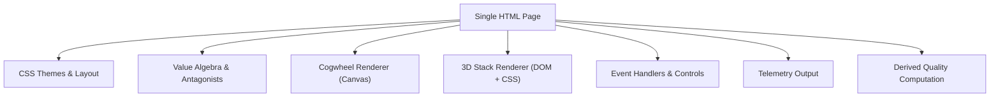
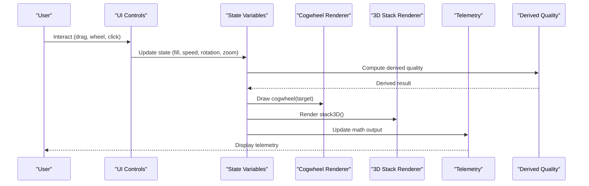
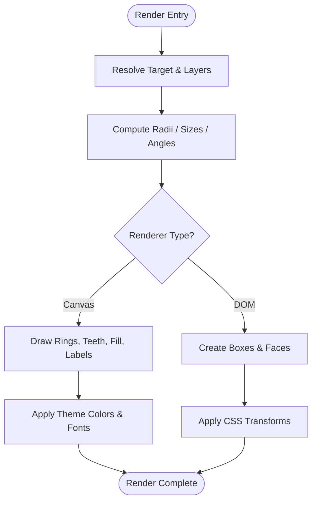
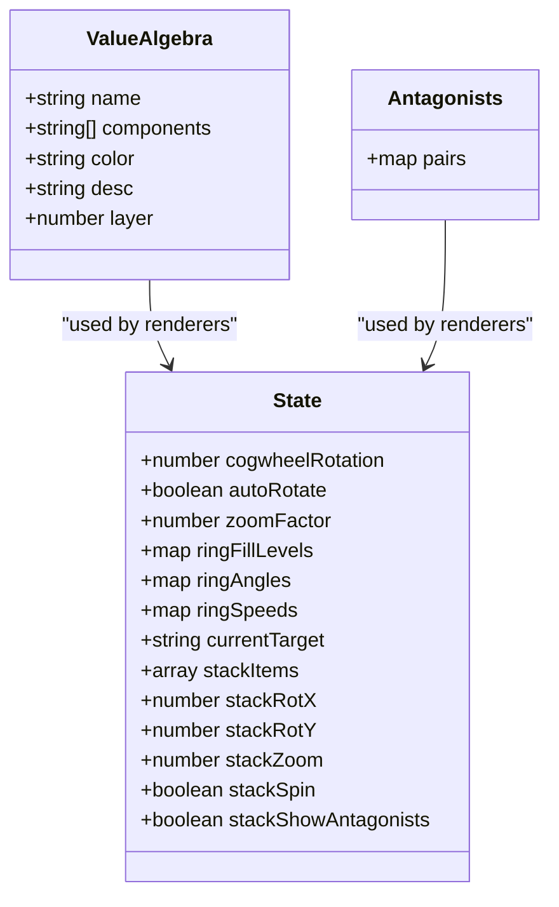
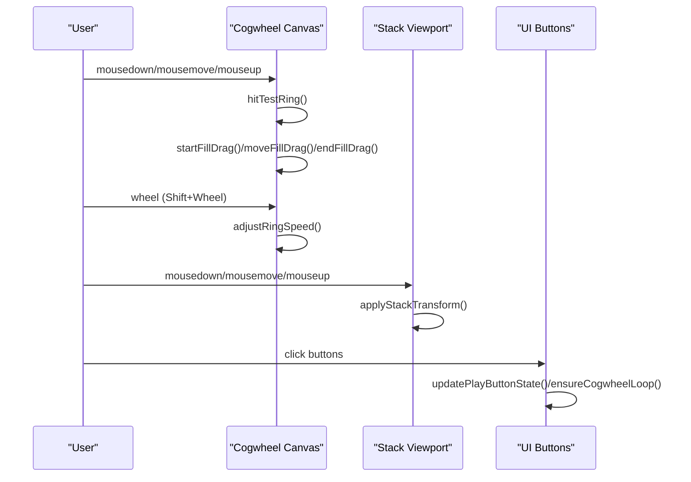
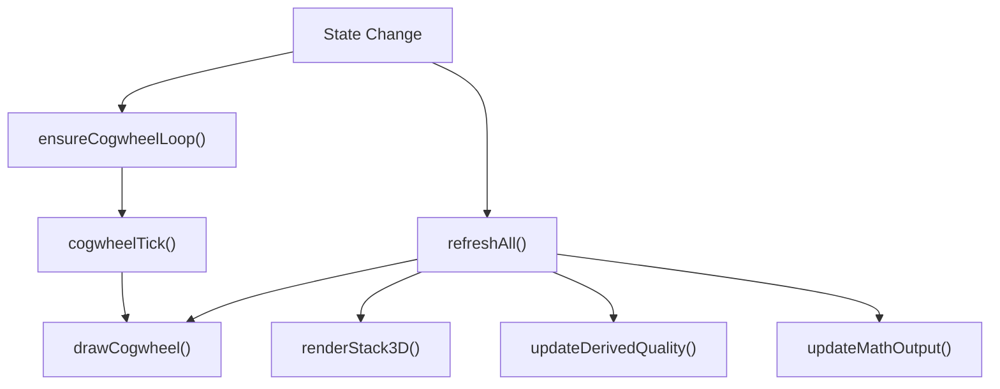
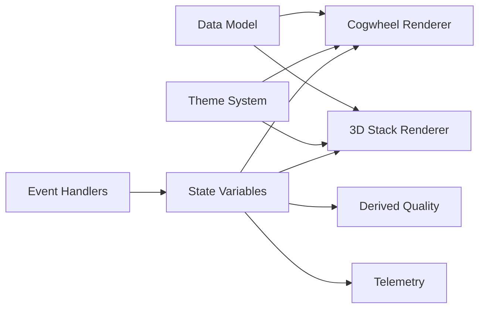

# Visualization Extensions

<cite>
**Referenced Files in This Document**
- [Alg_Virt_WhLL.html](file://Alg_Virt_WhLL.html)
</cite>

## Table of Contents
1. [Introduction](#introduction)
2. [Project Structure](#project-structure)
3. [Core Components](#core-components)
4. [Architecture Overview](#architecture-overview)
5. [Detailed Component Analysis](#detailed-component-analysis)
6. [Dependency Analysis](#dependency-analysis)
7. [Performance Considerations](#performance-considerations)
8. [Troubleshooting Guide](#troubleshooting-guide)
9. [Conclusion](#conclusion)
10. [Appendices](#appendices)

## Introduction
This document explains how to extend the application with new visualization types beyond the existing cogwheel and 3D stack representations. It focuses on the rendering architecture, data binding model, event handling patterns, and state synchronization mechanisms used by the current codebase. You will learn how to implement custom visualizations using either Canvas API or DOM manipulation, integrate third-party libraries while preserving compatibility, and optimize performance for complex scenes. The guidance includes step-by-step instructions for creating alternative views such as network graphs, radar charts, or interactive timelines.

## Project Structure
The project is a single-page HTML application that contains:
- CSS styles defining themes, layout, and responsive behavior
- A data model describing values, dependencies, antagonists, and theme palettes
- JavaScript modules implementing:
  - State management for both visualizations
  - Cogwheel rendering via Canvas API
  - 3D stack rendering via DOM manipulation and CSS transforms
  - Event handling for mouse, touch, wheel, fullscreen, and UI controls
  - Telemetry output and derived quality computation

**Diagram sources**
- [Alg_Virt_WhLL.html:7-708](file://Alg_Virt_WhLL.html#L7-L708)
- [Alg_Virt_WhLL.html:830-943](file://Alg_Virt_WhLL.html#L830-L943)
- [Alg_Virt_WhLL.html:1139-1615](file://Alg_Virt_WhLL.html#L1139-L1615)
- [Alg_Virt_WhLL.html:1617-1881](file://Alg_Virt_WhLL.html#L1617-L1881)
- [Alg_Virt_WhLL.html:1883-2032](file://Alg_Virt_WhLL.html#L1883-L2032)

**Section sources**
- [Alg_Virt_WhLL.html:7-708](file://Alg_Virt_WhLL.html#L7-L708)
- [Alg_Virt_WhLL.html:830-943](file://Alg_Virt_WhLL.html#L830-L943)
- [Alg_Virt_WhLL.html:1139-1615](file://Alg_Virt_WhLL.html#L1139-L1615)
- [Alg_Virt_WhLL.html:1617-1881](file://Alg_Virt_WhLL.html#L1617-L1881)
- [Alg_Virt_WhLL.html:1883-2032](file://Alg_Virt_WhLL.html#L1883-L2032)

## Core Components
- Value algebra and antagonists define the conceptual data model for qualities and their relationships.
- Theme system provides consistent colors and fonts across renderers.
- Cogwheel renderer draws concentric rings representing layered components, supports fill levels, rotation, spin speeds, zoom, and hit testing.
- 3D stack renderer builds DOM-based boxes with CSS 3D transforms, supports drag-to-reorder, rotation, zoom, and antagonist labels.
- Derived quality computation synthesizes ring fills and spin speeds into an emergent label and formula.
- Telemetry updates a text readout summarizing state and computed metrics.
- Fullscreen support re-renders visuals when panel size changes.

Key responsibilities:
- Data binding: layer maps, component lists, fill levels, and ring angles/speeds are bound to both renderers.
- Event handling: mouse/touch/wheel events drive interactions; UI buttons control animation and view state.
- State synchronization: a central refresh function updates all views consistently.

**Section sources**
- [Alg_Virt_WhLL.html:830-943](file://Alg_Virt_WhLL.html#L830-L943)
- [Alg_Virt_WhLL.html:1139-1615](file://Alg_Virt_WhLL.html#L1139-L1615)
- [Alg_Virt_WhLL.html:1617-1881](file://Alg_Virt_WhLL.html#L1617-L1881)
- [Alg_Virt_WhLL.html:1883-1945](file://Alg_Virt_WhLL.html#L1883-L1945)
- [Alg_Virt_WhLL.html:1947-1983](file://Alg_Virt_WhLL.html#L1947-L1983)

## Architecture Overview
The application follows a simple but robust architecture:
- Centralized data model and state variables
- Two independent renderers (Canvas and DOM)
- Shared helpers for dependency resolution, layer mapping, and derived computations
- Event-driven interaction model
- Global refresh pipeline ensuring consistency

**Diagram sources**
- [Alg_Virt_WhLL.html:1139-1615](file://Alg_Virt_WhLL.html#L1139-L1615)
- [Alg_Virt_WhLL.html:1617-1881](file://Alg_Virt_WhLL.html#L1617-L1881)
- [Alg_Virt_WhLL.html:1883-1945](file://Alg_Virt_WhLL.html#L1883-L1945)
- [Alg_Virt_WhLL.html:1985-2005](file://Alg_Virt_WhLL.html#L1985-L2005)

## Detailed Component Analysis

### Rendering Architecture
- Canvas-based cogwheel:
  - Computes geometry per layer based on target dependencies and zoom factor
  - Draws background gradients, ring outlines, teeth, filled arcs, edge highlights, knobs, labels, and antagonist indicators
  - Hit tests pointer coordinates against ring radii to determine interaction targets
  - Supports mouse and touch interactions including drag-to-fill, wheel zoom, Shift+Wheel spin speed adjustment
- DOM-based 3D stack:
  - Builds scene container and floor element
  - Creates box elements with faces (front, back, top, bottom, left, right)
  - Applies CSS transforms for perspective, rotation, and scaling
  - Implements drag-and-drop reorder and viewport rotation/zoom via mouse and touch events

**Diagram sources**
- [Alg_Virt_WhLL.html:1139-1354](file://Alg_Virt_WhLL.html#L1139-L1354)
- [Alg_Virt_WhLL.html:1617-1763](file://Alg_Virt_WhLL.html#L1617-L1763)

**Section sources**
- [Alg_Virt_WhLL.html:1139-1354](file://Alg_Virt_WhLL.html#L1139-L1354)
- [Alg_Virt_WhLL.html:1617-1763](file://Alg_Virt_WhLL.html#L1617-L1763)

### Data Binding Model
- Layer mapping:
  - Dependencies are resolved recursively to build ordered layers for a target
  - Each layer contains component names and associated metadata (color, description, layer index)
- Fill levels:
  - Stored per target and layer key
  - Default value applied if not set
- Ring angles and speeds:
  - Per-layer angle accumulates over time based on speed
  - Speeds are adjustable via UI and wheel interactions
- Stack items:
  - Built from dependencies and sorted by layer
  - Includes antagonist info and color mappings

**Diagram sources**
- [Alg_Virt_WhLL.html:830-943](file://Alg_Virt_WhLL.html#L830-L943)
- [Alg_Virt_WhLL.html:1139-1615](file://Alg_Virt_WhLL.html#L1139-L1615)
- [Alg_Virt_WhLL.html:1617-1881](file://Alg_Virt_WhLL.html#L1617-L1881)

**Section sources**
- [Alg_Virt_WhLL.html:830-943](file://Alg_Virt_WhLL.html#L830-L943)
- [Alg_Virt_WhLL.html:1139-1615](file://Alg_Virt_WhLL.html#L1139-L1615)
- [Alg_Virt_WhLL.html:1617-1881](file://Alg_Virt_WhLL.html#L1617-L1881)

### Event Handling and Interaction Patterns
- Cogwheel interactions:
  - Mouse down/move/up for drag-to-fill and hover detection
  - Wheel for zoom and Shift+Wheel for ring speed adjustment
  - Touchstart/move/end for mobile drag and pinch-zoom
- Stack interactions:
  - Mouse drag to rotate viewport
  - Wheel to zoom viewport
  - Touch drag and pinch-zoom
  - Drag-and-drop reorder of stack boxes
- UI controls:
  - Buttons for reset, play/pause, zoom, ring speed increment/decrement/clear
  - Fullscreen toggle for panels
  - Theme switcher updating palette and re-rendering

**Diagram sources**
- [Alg_Virt_WhLL.html:1356-1495](file://Alg_Virt_WhLL.html#L1356-L1495)
- [Alg_Virt_WhLL.html:1497-1615](file://Alg_Virt_WhLL.html#L1497-L1615)
- [Alg_Virt_WhLL.html:1772-1881](file://Alg_Virt_WhLL.html#L1772-L1881)

**Section sources**
- [Alg_Virt_WhLL.html:1356-1495](file://Alg_Virt_WhLL.html#L1356-L1495)
- [Alg_Virt_WhLL.html:1497-1615](file://Alg_Virt_WhLL.html#L1497-L1615)
- [Alg_Virt_WhLL.html:1772-1881](file://Alg_Virt_WhLL.html#L1772-L1881)

### State Synchronization and Refresh Pipeline
- Central refresh function triggers:
  - Cogwheel redraw
  - Stack rebuild
  - Derived quality update
  - Telemetry update
- Animation loops:
  - Cogwheel tick updates rotation and ring angles at intervals
  - Stack spin interval rotates viewport continuously
- Fullscreen change handlers re-render visuals after layout settles

**Diagram sources**
- [Alg_Virt_WhLL.html:1497-1523](file://Alg_Virt_WhLL.html#L1497-L1523)
- [Alg_Virt_WhLL.html:1985-2005](file://Alg_Virt_WhLL.html#L1985-L2005)
- [Alg_Virt_WhLL.html:1947-1983](file://Alg_Virt_WhLL.html#L1947-L1983)

**Section sources**
- [Alg_Virt_WhLL.html:1497-1523](file://Alg_Virt_WhLL.html#L1497-L1523)
- [Alg_Virt_WhLL.html:1985-2005](file://Alg_Virt_WhLL.html#L1985-L2005)
- [Alg_Virt_WhLL.html:1947-1983](file://Alg_Virt_WhLL.html#L1947-L1983)

### Interface Requirements for New Visualization Types
To create a new visualization type compatible with the existing codebase, follow these requirements:
- Data binding:
  - Use the shared dependency resolver and layer mapper to compute components for a target
  - Bind fill levels per layer and target
  - Optionally bind additional properties (e.g., node positions, edge weights)
- Event handling:
  - Implement pointer/touch interactions similar to existing patterns
  - Dispatch state updates through the central refresh pipeline
- State synchronization:
  - Integrate with refreshAll() to ensure your visualization updates alongside others
  - If animating, use setInterval or requestAnimationFrame consistently with existing loops
- Theming:
  - Use getThemePalette() for colors and fonts
  - Respect CSS variables for UI chrome
- Responsive design:
  - Recalculate dimensions on resize and fullscreen changes
  - Use devicePixelRatio for crisp rendering on high-DPI displays

Step-by-step guidance for common alternatives:
- Network graph:
  - Compute nodes from valueAlgebra components and edges from dependencies
  - Position nodes using a force-directed or radial layout algorithm
  - Draw edges and nodes using Canvas paths or DOM SVG elements
  - Handle drag-to-move nodes and pan/zoom viewport
- Radar chart:
  - Map each component to an axis angle
  - Plot fill levels as polygon vertices
  - Animate transitions between targets
  - Support hover tooltips for component details
- Interactive timeline:
  - Represent historical states or simulated evolution over time
  - Bind timestamps to data points
  - Provide scrubbing controls and playback animations

Integration with third-party libraries:
- Load library scripts before initialization
- Initialize within a dedicated container element
- Bridge library events to the application’s state model
- Ensure cleanup on view changes to avoid memory leaks
- Maintain theme compatibility by mapping library colors to theme palette

**Section sources**
- [Alg_Virt_WhLL.html:830-943](file://Alg_Virt_WhLL.html#L830-L943)
- [Alg_Virt_WhLL.html:1139-1615](file://Alg_Virt_WhLL.html#L1139-L1615)
- [Alg_Virt_WhLL.html:1617-1881](file://Alg_Virt_WhLL.html#L1617-L1881)
- [Alg_Virt_WhLL.html:1985-2005](file://Alg_Virt_WhLL.html#L1985-L2005)

## Dependency Analysis
The main dependencies among components are:
- Renderers depend on the data model and theme system
- Event handlers modify state and trigger refreshes
- Derived quality computation depends on ring fills and speeds
- Telemetry depends on current state and derived results

**Diagram sources**
- [Alg_Virt_WhLL.html:830-943](file://Alg_Virt_WhLL.html#L830-L943)
- [Alg_Virt_WhLL.html:1139-1615](file://Alg_Virt_WhLL.html#L1139-L1615)
- [Alg_Virt_WhLL.html:1617-1881](file://Alg_Virt_WhLL.html#L1617-L1881)
- [Alg_Virt_WhLL.html:1883-1945](file://Alg_Virt_WhLL.html#L1883-L1945)

**Section sources**
- [Alg_Virt_WhLL.html:830-943](file://Alg_Virt_WhLL.html#L830-L943)
- [Alg_Virt_WhLL.html:1139-1615](file://Alg_Virt_WhLL.html#L1139-L1615)
- [Alg_Virt_WhLL.html:1617-1881](file://Alg_Virt_WhLL.html#L1617-L1881)
- [Alg_Virt_WhLL.html:1883-1945](file://Alg_Virt_WhLL.html#L1883-L1945)

## Performance Considerations
- Canvas rendering:
  - Minimize path operations and shadow effects during frequent updates
  - Batch drawing commands where possible
  - Use devicePixelRatio appropriately to balance clarity and performance
- DOM rendering:
  - Avoid excessive DOM mutations; reuse elements when feasible
  - Use CSS transforms for animations instead of layout-triggering properties
  - Debounce resize events to prevent thrashing
- Animation loops:
  - Stop loops when no animation is needed
  - Use requestAnimationFrame for smooth motion if replacing setInterval
- Memory management:
  - Remove event listeners when destroying views
  - Clear intervals and timeouts on navigation or view changes
- Responsive design:
  - Recalculate layouts on resize and fullscreen changes
  - Use media queries to adjust complexity for smaller screens

[No sources needed since this section provides general guidance]

## Troubleshooting Guide
Common issues and resolutions:
- Canvas not resizing correctly:
  - Ensure canvas width/height are updated with devicePixelRatio
  - Re-draw after fullscreen change
- Interactions not responding:
  - Verify event listeners are attached to correct elements
  - Check passive event flags for wheel/touch handlers
- State inconsistencies:
  - Call refreshAll() after any state mutation
  - Ensure animation loops are started/stopped appropriately
- Third-party library conflicts:
  - Isolate library initialization and cleanup
  - Map library events to application state carefully

**Section sources**
- [Alg_Virt_WhLL.html:1947-1983](file://Alg_Virt_WhLL.html#L1947-L1983)
- [Alg_Virt_WhLL.html:1985-2005](file://Alg_Virt_WhLL.html#L1985-L2005)

## Conclusion
Extending this application with new visualization types requires adherence to the established data model, event handling patterns, and refresh pipeline. By following the interface requirements and leveraging the existing architecture, you can implement Canvas-based or DOM-based visualizations that integrate seamlessly with the cogwheel and 3D stack views. Performance optimization and responsive design considerations ensure smooth user experiences across devices and screen sizes.

[No sources needed since this section summarizes without analyzing specific files]

## Appendices

### Step-by-Step Implementation Checklist
- Define data bindings for your visualization using the shared dependency resolver
- Implement event handlers for pointer/touch interactions
- Integrate with the central refresh pipeline
- Apply theme colors and fonts consistently
- Test responsiveness and fullscreen behavior
- Optimize rendering performance for complex scenes

[No sources needed since this section provides general guidance]