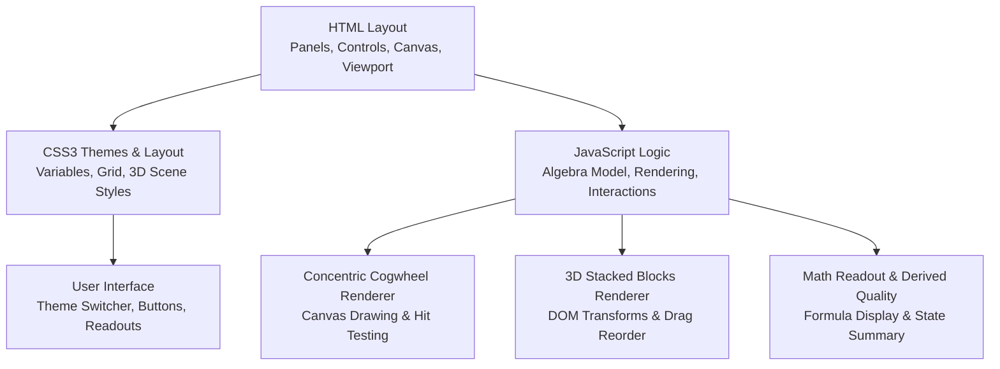
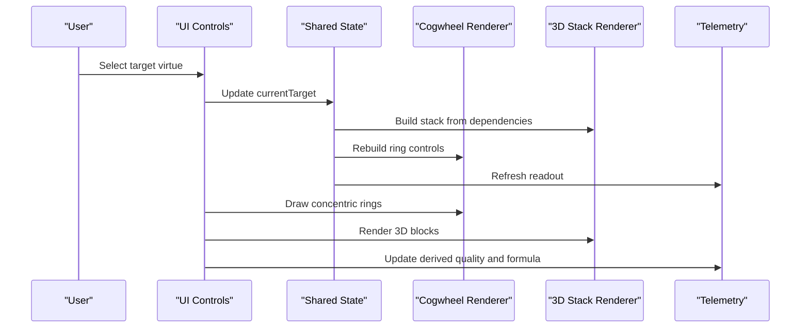
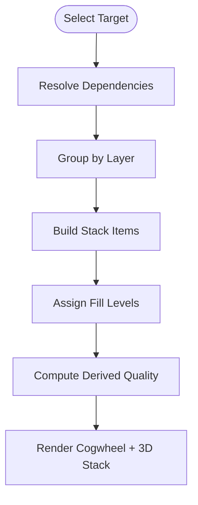
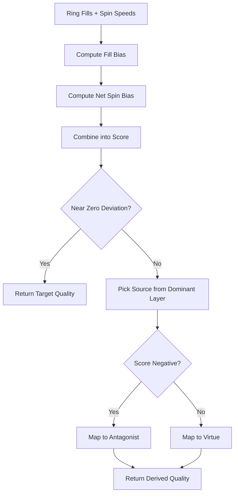
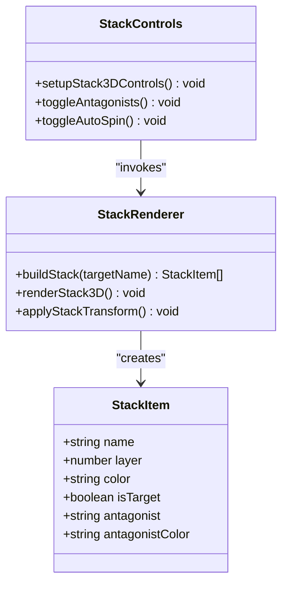
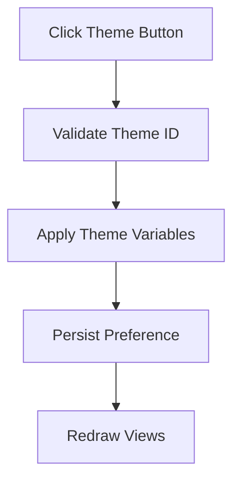
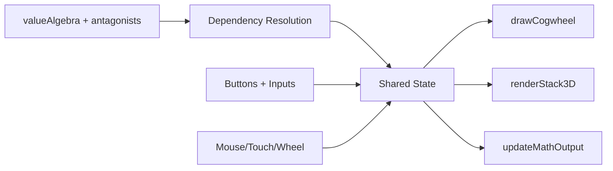

# Project Overview

<cite>
**Referenced Files in This Document**
- [Alg_Virt_WhLL.html](file://Alg_Virt_WhLL.html)
</cite>

## Table of Contents
1. [Introduction](#introduction)
2. [Project Structure](#project-structure)
3. [Core Components](#core-components)
4. [Architecture Overview](#architecture-overview)
5. [Detailed Component Analysis](#detailed-component-analysis)
6. [Dependency Analysis](#dependency-analysis)
7. [Performance Considerations](#performance-considerations)
8. [Troubleshooting Guide](#troubleshooting-guide)
9. [Conclusion](#conclusion)

## Introduction
The Algebraic Virtue Wheel is a single-file, interactive educational application that visualizes how virtues and values relate to one another and to their antagonistic counterparts. It models abstract ethical concepts as an algebraic system: core “prime” virtues combine into higher-order qualities, while each virtue has a corresponding negative counterpart. The interface presents this model through two synchronized views:
- A concentric cogwheel where each ring represents a layer of the algebraic structure, with fill levels and per-ring spin speeds influencing an emergent derived quality.
- A 3D stacked block view showing layered components, their fill proportions, and antagonist labels on the back faces.

The project targets educators, philosophers, students, and developers interested in mathematical modeling of abstract concepts. It also serves as a technical demonstration of vanilla JavaScript, HTML5 Canvas rendering, CSS3 theming, and DOM-based 3D transforms without any external dependencies.

## Project Structure
The entire application lives in one file: `Alg_Virt_WhLL.html`. It combines:
- HTML layout for panels, controls, canvas container, and 3D viewport.
- CSS3 variables and theme rules defining three design templates.
- Vanilla JavaScript implementing the algebraic model, rendering logic, interaction handlers, animation loops, and telemetry output.

**Diagram sources**
- [Alg_Virt_WhLL.html:1-705](file://Alg_Virt_WhLL.html#L1-L705)
- [Alg_Virt_WhLL.html:706-826](file://Alg_Virt_WhLL.html#L706-L826)
- [Alg_Virt_WhLL.html:827-2033](file://Alg_Virt_WhLL.html#L827-L2033)

**Section sources**
- [Alg_Virt_WhLL.html:1-705](file://Alg_Virt_WhLL.html#L1-L705)
- [Alg_Virt_WhLL.html:706-826](file://Alg_Virt_WhLL.html#L706-L826)

## Core Components
This section summarizes the main conceptual and technical building blocks.

- Algebraic Virtue System
  - Defines virtues as nodes with named components (dependencies), colors, descriptions, and layers.
  - Maps each virtue to an antagonist representing its negative counterpart.
  - Supports recursive dependency resolution to compute layered structures for any target virtue.

- Concentric Cogwheel Visualization
  - Renders rings per algebraic layer with gear teeth to make rotation visible.
  - Allows dragging to set fill levels per ring and adjusting per-ring spin speed.
  - Computes a derived quality based on combined fill bias and net spin direction.

- 3D Stacked Blocks Visualization
  - Builds a stack from the target’s dependencies and itself, sorted by layer.
  - Displays front faces with fill overlays and back faces with antagonist names.
  - Supports drag-to-reorder, perspective rotation, zoom, and optional auto-spin.

- Theme System
  - Three themes: Spaceship, Vintage, Toth Egyptian.
  - Controlled via CSS variables and a lightweight JavaScript theme switcher.
  - Persists user choice using local storage when available.

- Telemetry and Readouts
  - A formatted math readout panel shows formulas, layer fills, positive/negative component lists, and runtime state.
  - An overlay displays the current derived quality name and formula.

**Section sources**
- [Alg_Virt_WhLL.html:827-940](file://Alg_Virt_WhLL.html#L827-L940)
- [Alg_Virt_WhLL.html:941-1134](file://Alg_Virt_WhLL.html#L941-L1134)
- [Alg_Virt_WhLL.html:1135-1612](file://Alg_Virt_WhLL.html#L1135-L1612)
- [Alg_Virt_WhLL.html:1613-1879](file://Alg_Virt_WhLL.html#L1613-L1879)
- [Alg_Virt_WhLL.html:1880-2033](file://Alg_Virt_WhLL.html#L1880-L2033)

## Architecture Overview
At runtime, the application initializes the DOM, wires interactions, builds the initial stack for the selected target virtue, and renders both views. User actions update shared state (target, fills, spins, rotations, zoom), which triggers coordinated redraws and telemetry updates.

**Diagram sources**
- [Alg_Virt_WhLL.html:1992-2002](file://Alg_Virt_WhLL.html#L1992-L2002)
- [Alg_Virt_WhLL.html:1985-1990](file://Alg_Virt_WhLL.html#L1985-L1990)
- [Alg_Virt_WhLL.html:1617-1642](file://Alg_Virt_WhLL.html#L1617-L1642)
- [Alg_Virt_WhLL.html:1139-1351](file://Alg_Virt_WhLL.html#L1139-L1351)
- [Alg_Virt_WhLL.html:1644-1760](file://Alg_Virt_WhLL.html#L1644-L1760)
- [Alg_Virt_WhLL.html:1883-1942](file://Alg_Virt_WhLL.html#L1883-L1942)

## Detailed Component Analysis

### Algebraic Virtue System
The algebra defines virtues as structured objects with:
- components: ordered list of prerequisite virtues.
- color: visual identity used in both views.
- desc: human-readable explanation.
- layer: hierarchical depth starting at zero for prime axioms.

Antagonists are mapped one-to-one with virtues, providing negative counterparts for visualization and derivation.

Key behaviors:
- Dependency resolution returns a deduplicated, ordered list of all transitive prerequisites.
- Layer grouping organizes components into concentric rings and stack tiers.
- Fill levels are stored per target and layer, defaulting to neutral when unset.

**Diagram sources**
- [Alg_Virt_WhLL.html:941-990](file://Alg_Virt_WhLL.html#L941-L990)
- [Alg_Virt_WhLL.html:1016-1090](file://Alg_Virt_WhLL.html#L1016-L1090)
- [Alg_Virt_WhLL.html:1617-1642](file://Alg_Virt_WhLL.html#L1617-L1642)

**Section sources**
- [Alg_Virt_WhLL.html:827-862](file://Alg_Virt_WhLL.html#L827-L862)
- [Alg_Virt_WhLL.html:941-990](file://Alg_Virt_WhLL.html#L941-L990)
- [Alg_Virt_WhLL.html:1016-1090](file://Alg_Virt_WhLL.html#L1016-L1090)

### Concentric Cogwheel
The cogwheel visualizes the algebraic layers as concentric rings:
- Each ring corresponds to a layer and contains the components assigned to that layer.
- Fill level determines the angular extent of the colored segment.
- Gear teeth are drawn to make rotation perceptible even when a ring is fully filled or empty.
- Per-ring spin speed can be adjusted; it contributes to the derived quality calculation.

Interactions:
- Dragging on a ring sets its fill level.
- Shift+Wheel adjusts the selected ring’s spin speed.
- Mouse wheel zooms the entire wheel.
- Touch gestures support pinch-zoom and drag-fill.

Derived quality computation:
- Combines average fill deviation from neutral and net spin bias.
- If deviations are near zero, the result is “pure” and equals the target.
- Otherwise, selects a source component from the dominant layer and maps it to either a virtue or antagonist depending on sign.

**Diagram sources**
- [Alg_Virt_WhLL.html:1016-1090](file://Alg_Virt_WhLL.html#L1016-L1090)
- [Alg_Virt_WhLL.html:1139-1351](file://Alg_Virt_WhLL.html#L1139-L1351)
- [Alg_Virt_WhLL.html:1353-1492](file://Alg_Virt_WhLL.html#L1353-L1492)

**Section sources**
- [Alg_Virt_WhLL.html:1135-1612](file://Alg_Virt_WhLL.html#L1135-L1612)

### 3D Stacked Blocks
The 3D stack shows the target virtue and its dependencies as layered blocks:
- Front face shows the virtue name and fill percentage.
- Back face shows the antagonist.
- Top/bottom/side faces show layer identifiers and fill percentages.
- Blocks are draggable to reorder, allowing exploratory manipulation of layer emphasis.

Controls:
- Drag to rotate the scene.
- Mouse wheel or pinch to zoom.
- Toggle antagonist visibility.
- Auto-spin rotates the scene continuously.

**Diagram sources**
- [Alg_Virt_WhLL.html:1617-1642](file://Alg_Virt_WhLL.html#L1617-L1642)
- [Alg_Virt_WhLL.html:1644-1760](file://Alg_Virt_WhLL.html#L1644-L1760)
- [Alg_Virt_WhLL.html:1769-1879](file://Alg_Virt_WhLL.html#L1769-L1879)

**Section sources**
- [Alg_Virt_WhLL.html:1613-1879](file://Alg_Virt_WhLL.html#L1613-L1879)

### Theme System
Three design templates are implemented:
- Spaceship: cyan accent, monospace font, dark futuristic palette.
- Vintage: warm gold accents, serif fonts, aged paper-like backdrop.
- Toth Egyptian: golden tones with subtle repeating patterns and classical serif typography.

Implementation highlights:
- CSS variables define colors, fonts, gradients, and panel styling per theme.
- JavaScript toggles a data attribute on the body and updates active button states.
- Theme preference is persisted in local storage when available.

**Diagram sources**
- [Alg_Virt_WhLL.html:32-80](file://Alg_Virt_WhLL.html#L32-L80)
- [Alg_Virt_WhLL.html:864-915](file://Alg_Virt_WhLL.html#L864-L915)

**Section sources**
- [Alg_Virt_WhLL.html:32-80](file://Alg_Virt_WhLL.html#L32-L80)
- [Alg_Virt_WhLL.html:864-915](file://Alg_Virt_WhLL.html#L864-L915)

### Telemetry and Readouts
The telemetry panel provides:
- Timestamped header.
- Target virtue and its algebraic formula.
- Per-layer fill bars and lists of positive/negative components.
- Combined derived quality label and formula.
- Runtime state including zoom, rotation, autoplay status, and stack rotation.

It uses a fixed-width box-drawing style for clarity and readability.

**Section sources**
- [Alg_Virt_WhLL.html:1883-1942](file://Alg_Virt_WhLL.html#L1883-L1942)

## Dependency Analysis
The application exhibits clear separation between data, rendering, and interaction:
- Data model: valueAlgebra and antagonists.
- Rendering: drawCogwheel and renderStack3D.
- Interaction: mouse/touch handlers, button bindings, and fullscreen setup.
- State coordination: refreshAll orchestrates redraws after state changes.

Potential coupling points:
- Shared state variables (currentTarget, ringFillLevels, ringSpeeds, stackItems).
- Derived quality depends on both fill levels and spin speeds.
- Theme switching triggers redraws to apply new palettes.

**Diagram sources**
- [Alg_Virt_WhLL.html:827-862](file://Alg_Virt_WhLL.html#L827-L862)
- [Alg_Virt_WhLL.html:941-990](file://Alg_Virt_WhLL.html#L941-L990)
- [Alg_Virt_WhLL.html:1139-1351](file://Alg_Virt_WhLL.html#L1139-L1351)
- [Alg_Virt_WhLL.html:1644-1760](file://Alg_Virt_WhLL.html#L1644-L1760)
- [Alg_Virt_WhLL.html:1883-1942](file://Alg_Virt_WhLL.html#L1883-L1942)

**Section sources**
- [Alg_Virt_WhLL.html:827-940](file://Alg_Virt_WhLL.html#L827-L940)
- [Alg_Virt_WhLL.html:1985-2002](file://Alg_Virt_WhLL.html#L1985-L2002)

## Performance Considerations
- Canvas rendering is performed only when necessary, triggered by interactions and animation ticks.
- Animation loops run conditionally:
  - Cogwheel loop runs when autoplay is enabled or any ring has non-zero spin speed.
  - Stack auto-spin uses a separate interval when toggled.
- Device pixel ratio is applied to canvas sizing for crisp rendering on high-DPI screens.
- Resize events debounce redraws to avoid excessive reflows.
- DOM-based 3D stack leverages CSS transforms and will-change hints for smoother animations.

[No sources needed since this section provides general guidance]

## Troubleshooting Guide
Common issues and resolutions:
- Theme not persisting: Local storage may be unavailable; the app falls back to default theme.
- Canvas appears blurry: Ensure device pixel ratio is applied; resizing should trigger redraw.
- Ring spin not updating: Verify per-ring speed controls and ensure the loop is running when any ring has non-zero speed.
- 3D stack not rotating: Confirm pointer events are not blocked by child elements; drag-to-rotate ignores stack boxes.
- Fullscreen not working: Some browsers require user gesture; the app handles both standard and webkit prefixes.

**Section sources**
- [Alg_Virt_WhLL.html:892-915](file://Alg_Virt_WhLL.html#L892-L915)
- [Alg_Virt_WhLL.html:1494-1612](file://Alg_Virt_WhLL.html#L1494-L1612)
- [Alg_Virt_WhLL.html:1769-1879](file://Alg_Virt_WhLL.html#L1769-L1879)
- [Alg_Virt_WhLL.html:1947-1980](file://Alg_Virt_WhLL.html#L1947-L1980)

## Conclusion
The Algebraic Virtue Wheel offers a self-contained, dependency-free environment for exploring how virtues interrelate and oppose each other through a formal algebraic model. Its dual visualization approach—concentric cogwheels and 3D stacked blocks—supports both intuitive exploration and rigorous analysis. Educators can use it to demonstrate systems thinking and ethical modeling; developers can study its architecture as a compact example of Canvas rendering, DOM-based 3D transforms, event-driven state management, and CSS3 theming.

[No sources needed since this section summarizes without analyzing specific files]