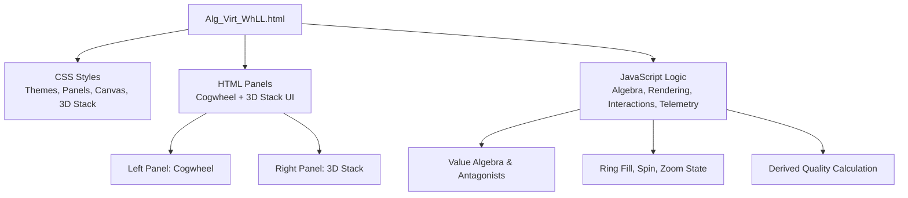
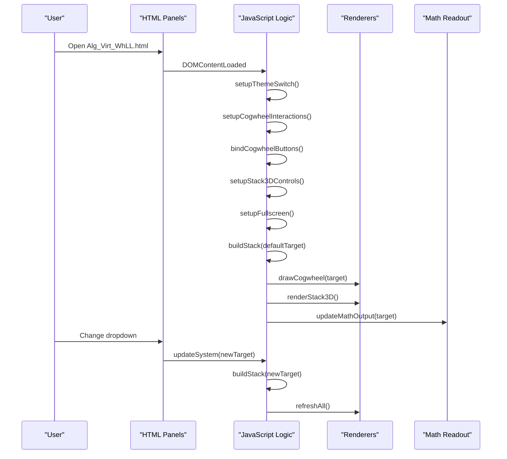
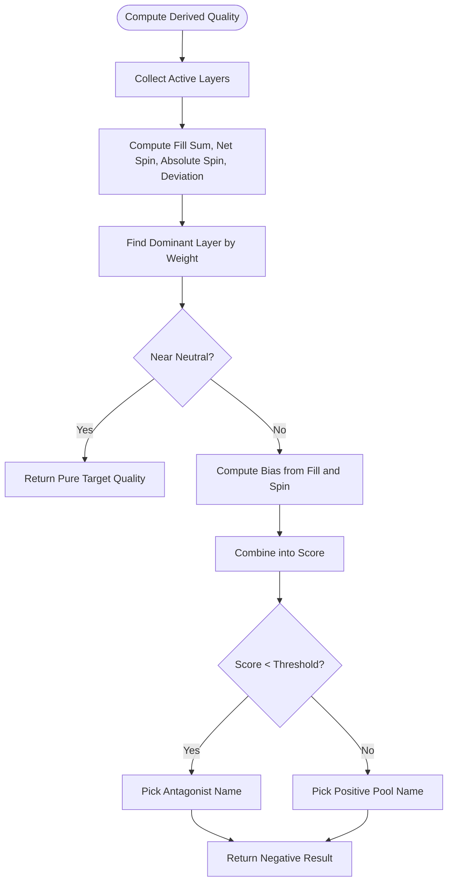
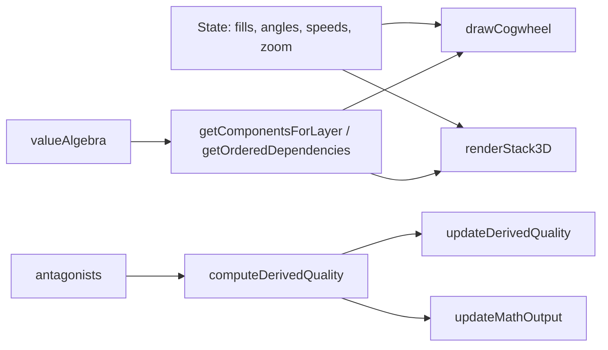

# Quick Start Guide

<cite>
**Referenced Files in This Document**
- [Alg_Virt_WhLL.html](file://Alg_Virt_WhLL.html)
</cite>

## Table of Contents
1. [Introduction](#introduction)
2. [Project Structure](#project-structure)
3. [Core Components](#core-components)
4. [Architecture Overview](#architecture-overview)
5. [Detailed Component Analysis](#detailed-component-analysis)
6. [Dependency Analysis](#dependency-analysis)
7. [Performance Considerations](#performance-considerations)
8. [Troubleshooting Guide](#troubleshooting-guide)
9. [Conclusion](#conclusion)

## Introduction
This guide helps you get started with the Algebraic Virtue Wheel. It explains how to open the application, what each part of the interface does, and how to interact with both visualization modes:
- Concentric Cogwheel (left panel): select a target quality, drag rings to adjust fill levels, use the mouse wheel to zoom, and explore ring spin speeds.
- 3D Stratified Stack (right panel): view layered virtue blocks, rotate and zoom the stack, toggle antagonist labels, and auto-spin the scene.

You will also learn how to switch themes, enter fullscreen mode, and understand how derived qualities are calculated from your interactions.

## Project Structure
The project is a single self-contained HTML file that includes:
- CSS styles for layout, themes, and visual effects
- HTML panels for the cogwheel and 3D stack
- JavaScript for algebra definitions, rendering, interaction handling, and telemetry output

**Diagram sources**
- [Alg_Virt_WhLL.html:7-705](file://Alg_Virt_WhLL.html#L7-L705)
- [Alg_Virt_WhLL.html:707-825](file://Alg_Virt_WhLL.html#L707-L825)
- [Alg_Virt_WhLL.html:827-2033](file://Alg_Virt_WhLL.html#L827-L2033)

**Section sources**
- [Alg_Virt_WhLL.html:7-705](file://Alg_Virt_WhLL.html#L7-L705)
- [Alg_Virt_WhLL.html:707-825](file://Alg_Virt_WhLL.html#L707-L825)
- [Alg_Virt_WhLL.html:827-2033](file://Alg_Virt_WhLL.html#L827-L2033)

## Core Components
- Target Quality Selector: Dropdown to choose a target virtue or system quality. Changing it rebuilds the stack and updates both visualizations.
- Concentric Cogwheel: Interactive canvas where each ring represents a layer of components. Dragging adjusts fill; Shift+Wheel sets spin speed; regular Wheel zooms.
- Derived Quality Overlay: Shows the emergent or negative quality based on ring fills and spins.
- 3D Stratified Stack: Layered blocks showing virtues and their antagonists, with rotation, zoom, and optional auto-spin.
- Math Readout: Telemetry log showing formulas, ring telemetry, combined result, and current state.
- Theme Switcher: Apply Vintage, Toth Egyptian, or Spaceship design templates.
- Fullscreen Mode: Expand either panel to full screen.

**Section sources**
- [Alg_Virt_WhLL.html:725-825](file://Alg_Virt_WhLL.html#L725-L825)
- [Alg_Virt_WhLL.html:827-940](file://Alg_Virt_WhLL.html#L827-L940)
- [Alg_Virt_WhLL.html:1016-1090](file://Alg_Virt_WhLL.html#L1016-L1090)
- [Alg_Virt_WhLL.html:1139-1351](file://Alg_Virt_WhLL.html#L1139-L1351)
- [Alg_Virt_WhLL.html:1617-1760](file://Alg_Virt_WhLL.html#L1617-L1760)
- [Alg_Virt_WhLL.html:1883-1942](file://Alg_Virt_WhLL.html#L1883-L1942)
- [Alg_Virt_WhLL.html:864-915](file://Alg_Virt_WhLL.html#L864-L915)
- [Alg_Virt_WhLL.html:1947-1980](file://Alg_Virt_WhLL.html#L1947-L1980)

## Architecture Overview
At runtime, the page initializes the DOM, wires up interactions, builds the initial stack for the default target, and renders both views. User actions update shared state (target, ring fills, ring angles/spins, zoom), which triggers redraws and telemetry updates.

**Diagram sources**
- [Alg_Virt_WhLL.html:2007-2029](file://Alg_Virt_WhLL.html#L2007-L2029)
- [Alg_Virt_WhLL.html:1992-2002](file://Alg_Virt_WhLL.html#L1992-L2002)
- [Alg_Virt_WhLL.html:1985-1990](file://Alg_Virt_WhLL.html#L1985-L1990)

## Detailed Component Analysis

### Getting Started
- Open the HTML file in any modern web browser (Chrome, Edge, Firefox, Safari).
- The app loads with the “Spaceship” theme and the default target quality set to Unity.
- You can immediately start interacting with both panels.

**Section sources**
- [Alg_Virt_WhLL.html:707-724](file://Alg_Virt_WhLL.html#L707-L724)
- [Alg_Virt_WhLL.html:2007-2029](file://Alg_Virt_WhLL.html#L2007-L2029)

### Selecting Target Qualities
- Use the left panel’s dropdown to pick a target quality.
- Options are grouped by layers:
  - Core Primes (Layer 0)
  - Direct Derivatives (Layer 1)
  - Peak Emotional States (Layer 2)
  - Structural Systems (Layer 3)
  - Meta-Existential Peaks (Layer 4)
- Changing the selection rebuilds the 3D stack and recalculates derived results.

**Section sources**
- [Alg_Virt_WhLL.html:735-769](file://Alg_Virt_WhLL.html#L735-L769)
- [Alg_Virt_WhLL.html:1992-2002](file://Alg_Virt_WhLL.html#L1992-L2002)

### Adjusting Ring Fill Levels (Cogwheel)
- Drag anywhere on a ring to change its fill level.
- A glowing knob marks the end of the filled arc.
- Negative components (antagonists) appear in the unfilled portion of the ring.
- Each ring corresponds to a layer of components that compose the selected target.

**Section sources**
- [Alg_Virt_WhLL.html:1139-1351](file://Alg_Virt_WhLL.html#L1139-L1351)
- [Alg_Virt_WhLL.html:1353-1416](file://Alg_Virt_WhLL.html#L1353-L1416)

### Using Mouse Wheel for Zoom
- Scroll over the cogwheel to zoom in/out.
- The current zoom percentage is shown in the header.
- On touch devices, pinch-to-zoom works similarly.

**Section sources**
- [Alg_Virt_WhLL.html:1448-1459](file://Alg_Virt_WhLL.html#L1448-L1459)
- [Alg_Virt_WhLL.html:1461-1492](file://Alg_Virt_WhLL.html#L1461-L1492)
- [Alg_Virt_WhLL.html:1565-1584](file://Alg_Virt_WhLL.html#L1565-L1584)

### Exploring Ring Spin Speeds
- Hold Shift and scroll while hovering a ring to adjust its spin speed.
- Alternatively, select a ring layer in the “Ring Spin” dropdown and use the plus/minus buttons.
- Positive speed rotates clockwise; negative speed rotates counter-clockwise.
- Clear all spins using the “✕ Spins” button.

**Section sources**
- [Alg_Virt_WhLL.html:1448-1459](file://Alg_Virt_WhLL.html#L1448-L1459)
- [Alg_Virt_WhLL.html:1092-1126](file://Alg_Virt_WhLL.html#L1092-L1126)
- [Alg_Virt_WhLL.html:1586-1608](file://Alg_Virt_WhLL.html#L1586-L1608)

### Understanding Derived Quality Calculations
The overlay shows an emergent or negative quality based on:
- Average fill across rings
- Net spin direction and magnitude
- Deviation from neutral fill (0.5)
- Dominant layer influence

Key behaviors:
- If fills and spins are near neutral, the result remains the pure target quality.
- Significant deviation can produce a positive emergent quality or a negative antagonist quality.
- The formula line explains how the dominant layer and ring behavior influenced the result.

**Diagram sources**
- [Alg_Virt_WhLL.html:1016-1078](file://Alg_Virt_WhLL.html#L1016-L1078)

**Section sources**
- [Alg_Virt_WhLL.html:1016-1090](file://Alg_Virt_WhLL.html#L1016-L1090)

### Navigating the 3D Stack Visualization
- Drag inside the viewport to rotate the stack horizontally and vertically.
- Scroll to zoom in/out.
- Pinch on touch devices to rotate and zoom.
- Use “Reset View” to restore default rotation and zoom.
- Toggle “Hide Antagonists” to show/hide the back faces labeled with antagonists.
- Enable “Spin” for automatic continuous rotation.

**Section sources**
- [Alg_Virt_WhLL.html:1769-1878](file://Alg_Virt_WhLL.html#L1769-L1878)
- [Alg_Virt_WhLL.html:1617-1760](file://Alg_Virt_WhLL.html#L1617-L1760)

### Theme Switching
- Click one of the theme buttons at the top to apply Vintage, Toth Egyptian, or Spaceship.
- Your choice is saved in local storage when possible.
- The active theme is indicated by a highlighted button.

**Section sources**
- [Alg_Virt_WhLL.html:112-169](file://Alg_Virt_WhLL.html#L112-L169)
- [Alg_Virt_WhLL.html:709-720](file://Alg_Virt_WhLL.html#L709-L720)
- [Alg_Virt_WhLL.html:864-915](file://Alg_Virt_WhLL.html#L864-L915)

### Fullscreen Mode
- Click “Fullscreen” in either panel header to expand that panel to full screen.
- Press Escape or click the button again to exit.
- The canvas and stack re-render after entering fullscreen for proper sizing.

**Section sources**
- [Alg_Virt_WhLL.html:190-223](file://Alg_Virt_WhLL.html#L190-L223)
- [Alg_Virt_WhLL.html:1947-1980](file://Alg_Virt_WhLL.html#L1947-L1980)

### First-Time User Scenarios

#### Explore Different Virtue Combinations
- Try selecting different targets from the dropdown.
- Observe how the cogwheel rings and 3D stack rebuild according to the target’s component hierarchy.
- Notice how higher-layer targets include more rings and deeper dependencies.

**Section sources**
- [Alg_Virt_WhLL.html:829-853](file://Alg_Virt_WhLL.html#L829-L853)
- [Alg_Virt_WhLL.html:1617-1642](file://Alg_Virt_WhLL.html#L1617-L1642)

#### Understand Derived Quality Changes
- Set some rings to high fill and others low to see how the derived quality shifts.
- Add spin to rings to observe how net spin influences the result.
- Watch the overlay label and formula to understand why a particular emergent or negative quality appears.

**Section sources**
- [Alg_Virt_WhLL.html:1016-1090](file://Alg_Virt_WhLL.html#L1016-L1090)

#### Navigate Between Visualization Modes
- Use the left panel to tune fills and spins.
- Use the right panel to inspect the layered structure and antagonists.
- Keep both panels synchronized by changing the target once; both views update automatically.

**Section sources**
- [Alg_Virt_WhLL.html:1985-1990](file://Alg_Virt_WhLL.html#L1985-L1990)

### Common Beginner Questions

- What do the rings represent?
  - Each ring is a layer of components that contribute to the selected target. Dragging changes the fill for that layer.

- How do I zoom?
  - Scroll over the cogwheel to zoom. In the 3D stack, scroll over the viewport to zoom.

- How do I control ring spin?
  - Hold Shift and scroll over a ring, or use the “Ring Spin” dropdown and +/- buttons.

- What is the “derived quality”?
  - It is the emergent or negative quality resulting from your ring fills and spins. It reflects whether the configuration leans toward the target or away from it.

- How do I reset everything?
  - Use “⟲ Reset” in the cogwheel controls to clear fills, spins, and rotation. Use “⟲ Reset View” in the stack controls to restore camera settings.

**Section sources**
- [Alg_Virt_WhLL.html:1538-1608](file://Alg_Virt_WhLL.html#L1538-L1608)
- [Alg_Virt_WhLL.html:1840-1878](file://Alg_Virt_WhLL.html#L1840-L1878)
- [Alg_Virt_WhLL.html:1016-1090](file://Alg_Virt_WhLL.html#L1016-L1090)

## Dependency Analysis
The application logic depends on:
- Value Algebra: Defines components, colors, descriptions, layers, and composition rules.
- Antagonists Map: Maps each virtue to its opposing concept.
- State Variables: Track rotation, zoom, ring fills, ring angles, ring speeds, and stack view parameters.
- Renderers: Draw the cogwheel canvas and construct the 3D stack DOM elements.
- Interaction Handlers: Manage mouse/touch events for dragging, spinning, zooming, and fullscreen.

**Diagram sources**
- [Alg_Virt_WhLL.html:829-862](file://Alg_Virt_WhLL.html#L829-L862)
- [Alg_Virt_WhLL.html:917-940](file://Alg_Virt_WhLL.html#L917-L940)
- [Alg_Virt_WhLL.html:942-990](file://Alg_Virt_WhLL.html#L942-L990)
- [Alg_Virt_WhLL.html:1016-1090](file://Alg_Virt_WhLL.html#L1016-L1090)
- [Alg_Virt_WhLL.html:1139-1351](file://Alg_Virt_WhLL.html#L1139-L1351)
- [Alg_Virt_WhLL.html:1617-1760](file://Alg_Virt_WhLL.html#L1617-L1760)
- [Alg_Virt_WhLL.html:1883-1942](file://Alg_Virt_WhLL.html#L1883-L1942)

**Section sources**
- [Alg_Virt_WhLL.html:829-862](file://Alg_Virt_WhLL.html#L829-L862)
- [Alg_Virt_WhLL.html:917-990](file://Alg_Virt_WhLL.html#L917-L990)
- [Alg_Virt_WhLL.html:1016-1090](file://Alg_Virt_WhLL.html#L1016-L1090)
- [Alg_Virt_WhLL.html:1139-1351](file://Alg_Virt_WhLL.html#L1139-L1351)
- [Alg_Virt_WhLL.html:1617-1760](file://Alg_Virt_WhLL.html#L1617-L1760)
- [Alg_Virt_WhLL.html:1883-1942](file://Alg_Virt_WhLL.html#L1883-L1942)

## Performance Considerations
- The cogwheel uses a canvas renderer optimized for frequent redraws during animation and interaction.
- The 3D stack uses lightweight DOM nodes with CSS transforms for rotation and scaling.
- Animation loops run only when needed (auto-rotate or ring spin active).
- Resize events debounce redraws to avoid excessive work.

[No sources needed since this section provides general guidance]

## Troubleshooting Guide
- Canvas not updating after fullscreen:
  - The app re-renders after fullscreen transitions. If visuals look incorrect, try toggling fullscreen again or resizing the window.
- Touch gestures not working:
  - Ensure your device supports multi-touch. Pinch to zoom and drag to rotate are supported on both panels.
- Derived quality seems unstable:
  - Small deviations in fill or spin can flip between positive and negative results. Tweak fills closer to neutral or reduce spin magnitudes to stabilize.
- Theme not saving:
  - Local storage may be unavailable in some environments. The app defaults to the Spaceship theme if no saved preference exists.

**Section sources**
- [Alg_Virt_WhLL.html:1947-1980](file://Alg_Virt_WhLL.html#L1947-L1980)
- [Alg_Virt_WhLL.html:2024-2029](file://Alg_Virt_WhLL.html#L2024-L2029)
- [Alg_Virt_WhLL.html:892-915](file://Alg_Virt_WhLL.html#L892-L915)

## Conclusion
You now have the essentials to explore the Algebraic Virtue Wheel:
- Choose a target quality and observe how the cogwheel and 3D stack reflect its structure.
- Drag rings to adjust fills, use the mouse wheel to zoom, and experiment with ring spin speeds.
- Interpret the derived quality overlay and math readout to understand how your interactions shape emergent outcomes.
- Customize the experience with themes and fullscreen mode.

Enjoy experimenting with different virtue combinations and discovering how the system responds to your configurations.