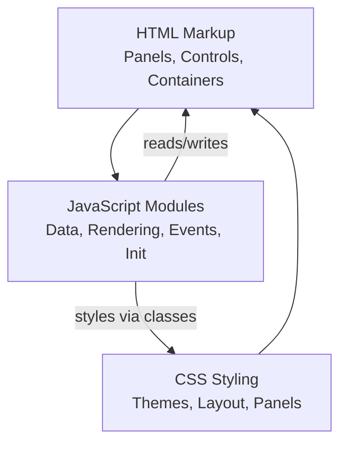
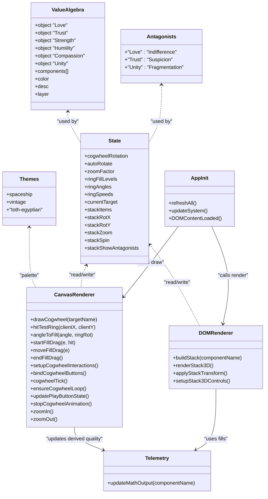
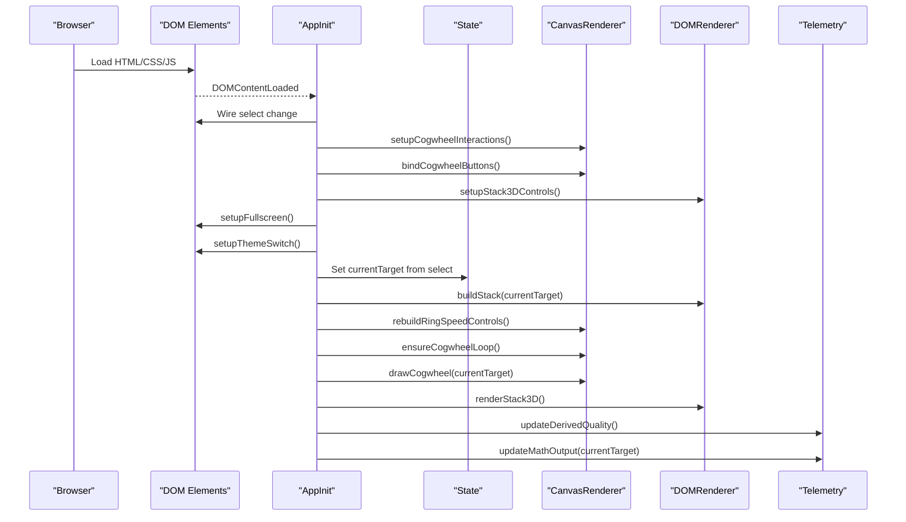
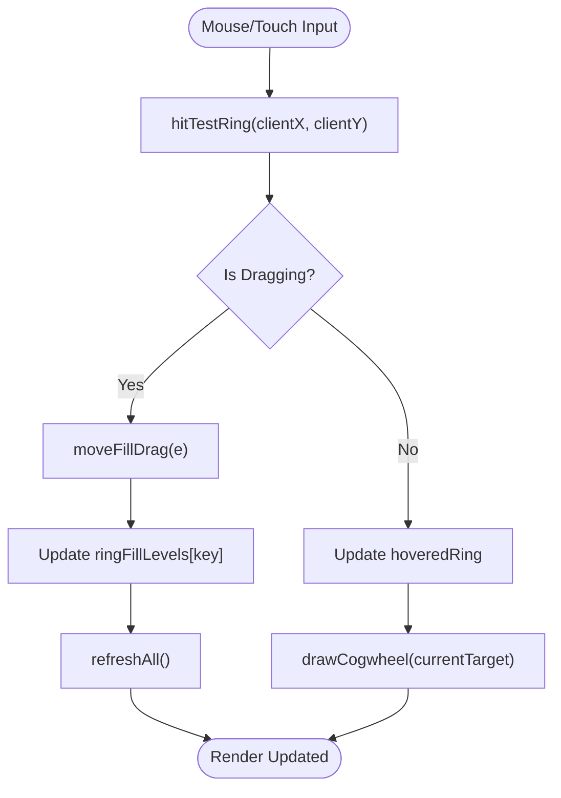
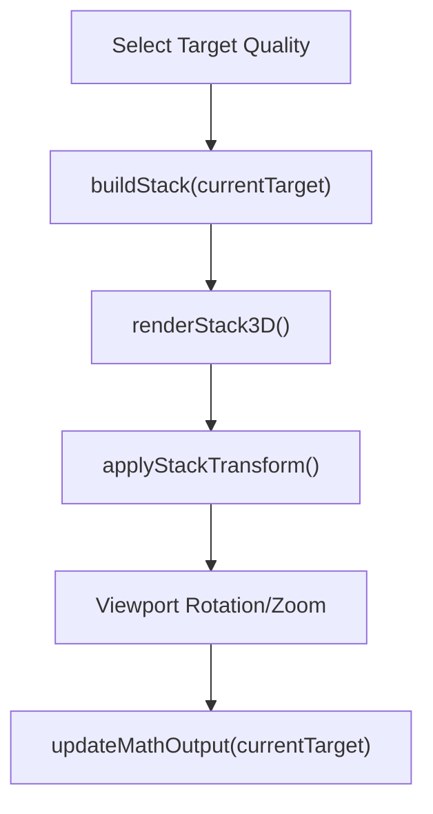
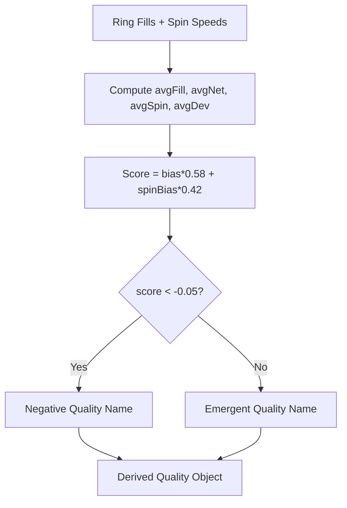
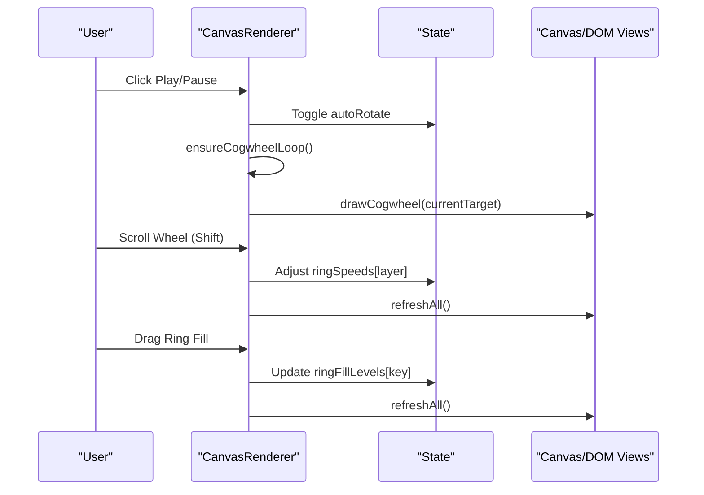
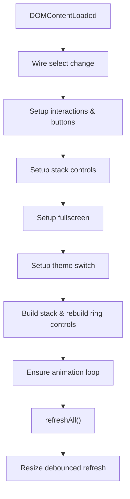
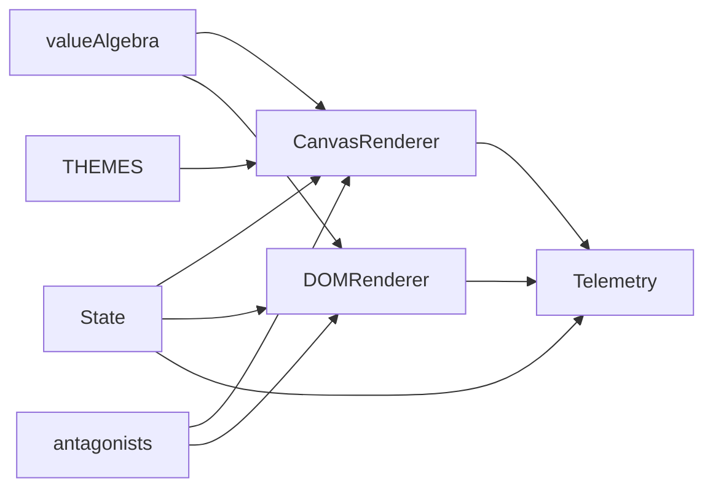

# Application Structure

<cite>
**Referenced Files in This Document**
- [Alg_Virt_WhLL.html](file://Alg_Virt_WhLL.html)
</cite>

## Table of Contents
1. [Introduction](#introduction)
2. [Project Structure](#project-structure)
3. [Core Components](#core-components)
4. [Architecture Overview](#architecture-overview)
5. [Detailed Component Analysis](#detailed-component-analysis)
6. [Dependency Analysis](#dependency-analysis)
7. [Performance Considerations](#performance-considerations)
8. [Troubleshooting Guide](#troubleshooting-guide)
9. [Conclusion](#conclusion)

## Introduction
This document explains the single-file application structure of a monolithic HTML file that implements an interactive “Algebraic Virtue Wheel” system. The file is organized into three logical sections:

- HTML markup: UI panels, controls, and containers for the Canvas-based cogwheel and the DOM-based 3D stack.
- CSS styling: Theme variables, layout, panel styles, and responsive rules.
- JavaScript modules: Data models, rendering engines, state management, event handling, and initialization.

The goal is to make clear how responsibilities are separated within one file while preserving modularity through named functions, data structures, and explicit initialization order.

## Project Structure
The entire application lives in a single HTML file with these internal boundaries:

- HTML body: Two main panels (cogwheel and 3D stack), theme switcher, and telemetry readout.
- CSS: Theme variables, layout grid, panel styles, canvas container, 3D scene, and responsive breakpoints.
- JavaScript:
  - Data model: valueAlgebra and antagonists.
  - Theme configuration and switching.
  - State variables for both renderers.
  - Helpers for dependency resolution and derived quality computation.
  - Canvas renderer for concentric rings.
  - DOM renderer for the 3D stratified stack.
  - Event handlers for interactions and animations.
  - Initialization sequence.

**Diagram sources**
- [Alg_Virt_WhLL.html:1-705](file://Alg_Virt_WhLL.html#L1-L705)
- [Alg_Virt_WhLL.html:707-828](file://Alg_Virt_WhLL.html#L707-L828)
- [Alg_Virt_WhLL.html:830-2033](file://Alg_Virt_WhLL.html#L830-L2033)

**Section sources**
- [Alg_Virt_WhLL.html:1-705](file://Alg_Virt_WhLL.html#L1-L705)
- [Alg_Virt_WhLL.html:707-828](file://Alg_Virt_WhLL.html#L707-L828)
- [Alg_Virt_WhLL.html:830-2033](file://Alg_Virt_WhLL.html#L830-L2033)

## Core Components
The application separates concerns across these core components:

- Data Models
  - valueAlgebra: Defines virtues as nodes with components, colors, descriptions, and layers.
  - antagonists: Maps each virtue to its antagonist counterpart.
  - THEMES: Visual palette definitions for different design templates.

- Rendering Engines
  - Canvas Renderer: Draws concentric rings representing layered components, fill levels, rotation, and speed indicators.
  - DOM Renderer: Builds 3D boxes using CSS transforms to represent the stratified stack and fills.

- State Management
  - Global state variables track rotation, zoom, ring fills, angles, speeds, current target, drag states, and stack view parameters.
  - Derived state computed from ring fills and spin speeds determines emergent or negative qualities.

- Event Handling
  - Mouse and touch events for dragging ring fills, adjusting spin speeds, zooming, and rotating the 3D stack.
  - Button handlers for reset, play/pause, zoom controls, fullscreen toggles, and theme switching.

- Initialization Sequence
  - DOMContentLoaded wires up all event listeners, builds initial stack, rebuilds ring speed controls, and performs the first refresh cycle.

**Diagram sources**
- [Alg_Virt_WhLL.html:832-890](file://Alg_Virt_WhLL.html#L832-L890)
- [Alg_Virt_WhLL.html:920-943](file://Alg_Virt_WhLL.html#L920-L943)
- [Alg_Virt_WhLL.html:1142-1615](file://Alg_Virt_WhLL.html#L1142-L1615)
- [Alg_Virt_WhLL.html:1620-1881](file://Alg_Virt_WhLL.html#L1620-L1881)
- [Alg_Virt_WhLL.html:1886-1945](file://Alg_Virt_WhLL.html#L1886-L1945)
- [Alg_Virt_WhLL.html:1988-2032](file://Alg_Virt_WhLL.html#L1988-L2032)

**Section sources**
- [Alg_Virt_WhLL.html:832-890](file://Alg_Virt_WhLL.html#L832-L890)
- [Alg_Virt_WhLL.html:920-943](file://Alg_Virt_WhLL.html#L920-L943)
- [Alg_Virt_WhLL.html:1142-1615](file://Alg_Virt_WhLL.html#L1142-L1615)
- [Alg_Virt_WhLL.html:1620-1881](file://Alg_Virt_WhLL.html#L1620-L1881)
- [Alg_Virt_WhLL.html:1886-1945](file://Alg_Virt_WhLL.html#L1886-L1945)
- [Alg_Virt_WhLL.html:1988-2032](file://Alg_Virt_WhLL.html#L1988-L2032)

## Architecture Overview
The architecture follows a simple MVC-like pattern inside a single script block:

- Model: valueAlgebra and antagonists define the domain data.
- View: Canvas renderer draws the cogwheel; DOM renderer constructs the 3D stack.
- Controller: Event handlers update state and trigger re-renders.
- Bootstrap: Initialization wires UI elements, sets initial state, and performs the first render.

**Diagram sources**
- [Alg_Virt_WhLL.html:2010-2032](file://Alg_Virt_WhLL.html#L2010-L2032)
- [Alg_Virt_WhLL.html:1988-2005](file://Alg_Virt_WhLL.html#L1988-L2005)
- [Alg_Virt_WhLL.html:1142-1615](file://Alg_Virt_WhLL.html#L1142-L1615)
- [Alg_Virt_WhLL.html:1620-1881](file://Alg_Virt_WhLL.html#L1620-L1881)
- [Alg_Virt_WhLL.html:1886-1945](file://Alg_Virt_WhLL.html#L1886-L1945)

## Detailed Component Analysis

### Data Models: valueAlgebra and Antagonists
- valueAlgebra defines virtues with:
  - components: list of prerequisite virtues.
  - color: visual identity.
  - desc: textual description.
  - layer: hierarchical level used for ring grouping and stack ordering.
- antagonists maps each virtue to its opposing concept.
- THEMES provides palettes for Canvas text and accents.

These models are referenced throughout rendering and telemetry logic to compute layers, derive names, and style visuals.

**Section sources**
- [Alg_Virt_WhLL.html:832-890](file://Alg_Virt_WhLL.html#L832-L890)

### Rendering Engine: Canvas Cogwheel
Responsibilities:
- Compute ring geometry based on layers and zoom.
- Draw background gradients, ring outlines, teeth, fills, labels, and antagonists.
- Handle hover and drag interactions to adjust ring fills.
- Manage auto-rotation and per-ring spin speeds.
- Update UI overlays like rotation degrees and zoom percentage.

Key behaviors:
- drawCogwheel computes layer map, radii, and iterates layers to draw filled arcs and labels.
- hitTestRing maps pointer coordinates to ring indices and layers.
- angleToFill converts pointer angle to fill fraction accounting for ring rotation.
- startFillDrag/moveFillDrag/endFillDrag manage drag state and update ringFillLevels.
- setupCogwheelInteractions binds mouse/touch events and wheel zoom.
- cogwheelTick updates global rotation and per-ring angles, then redraws.
- ensureCogwheelLoop starts/stops setInterval based on autoRotate or any ring spin.

**Diagram sources**
- [Alg_Virt_WhLL.html:1356-1495](file://Alg_Virt_WhLL.html#L1356-L1495)
- [Alg_Virt_WhLL.html:1498-1615](file://Alg_Virt_WhLL.html#L1498-L1615)

**Section sources**
- [Alg_Virt_WhLL.html:1142-1615](file://Alg_Virt_WhLL.html#L1142-L1615)

### Rendering Engine: DOM 3D Stack
Responsibilities:
- Build stack items from dependencies and target virtue.
- Render 3D boxes with front/back/top/bottom/left/right faces.
- Apply CSS transforms for rotation and zoom.
- Support drag-to-reorder and viewport rotation/zoom via mouse and touch.
- Toggle antagonist visibility and auto-spin.

Key behaviors:
- buildStack creates ordered items including antagonists and fill references.
- renderStack3D clears scene, creates floor, and appends box elements with face divs.
- applyStackTransform sets transform string based on stackRotX/Y and stackZoom.
- setupStack3DControls binds viewport interactions and button actions.

**Diagram sources**
- [Alg_Virt_WhLL.html:1620-1770](file://Alg_Virt_WhLL.html#L1620-L1770)
- [Alg_Virt_WhLL.html:1772-1881](file://Alg_Virt_WhLL.html#L1772-L1881)

**Section sources**
- [Alg_Virt_WhLL.html:1620-1881](file://Alg_Virt_WhLL.html#L1620-L1881)

### State Management
Global state includes:
- Cogwheel: rotation, autoRotate flag, zoomFactor, ringFillLevels, ringAngles, ringSpeeds, currentTarget, hoveredRing, drag flags.
- Stack: stackItems array, stackRotX/Y, stackZoom, drag flags, spin flags, antagonist visibility.

Helper functions:
- getOrderedDependencies and resolveDeps compute dependency chains.
- getComponentsForLayer groups components by layer.
- getFillForLayer retrieves per-layer fill values keyed by target and layer.
- computeDerivedQuality aggregates fill and spin metrics to determine emergent/negative quality.

**Diagram sources**
- [Alg_Virt_WhLL.html:1019-1081](file://Alg_Virt_WhLL.html#L1019-L1081)

**Section sources**
- [Alg_Virt_WhLL.html:920-943](file://Alg_Virt_WhLL.html#L920-L943)
- [Alg_Virt_WhLL.html:945-993](file://Alg_Virt_WhLL.html#L945-L993)
- [Alg_Virt_WhLL.html:1019-1081](file://Alg_Virt_WhLL.html#L1019-L1081)

### Event Handling
Event handling is split between:
- Canvas interactions: mousedown/mousemove/mouseup, wheel zoom, Shift+Wheel for ring speed, touchstart/touchmove/touchend for drag and pinch-zoom.
- Button handlers: reset, play/pause, zoom controls, ring speed increment/decrement/clear.
- Stack interactions: viewport drag to rotate, wheel to zoom, touch gestures, drag-to-reorder, toggle labels, auto-spin.
- Fullscreen: toggles panel fullscreen and triggers re-render after resize.
- Theme switching: applies theme dataset and redraws cogwheel.

**Diagram sources**
- [Alg_Virt_WhLL.html:1426-1495](file://Alg_Virt_WhLL.html#L1426-L1495)
- [Alg_Virt_WhLL.html:1541-1615](file://Alg_Virt_WhLL.html#L1541-L1615)
- [Alg_Virt_WhLL.html:1772-1881](file://Alg_Virt_WhLL.html#L1772-L1881)

**Section sources**
- [Alg_Virt_WhLL.html:1426-1495](file://Alg_Virt_WhLL.html#L1426-L1495)
- [Alg_Virt_WhLL.html:1541-1615](file://Alg_Virt_WhLL.html#L1541-L1615)
- [Alg_Virt_WhLL.html:1772-1881](file://Alg_Virt_WhLL.html#L1772-L1881)

### Initialization Sequence and Component Loading Order
Initialization occurs in DOMContentLoaded and follows this order:
1. Wire select change to updateSystem.
2. Setup canvas interactions and button bindings.
3. Setup stack 3D controls.
4. Setup fullscreen toggles.
5. Setup theme switch and apply saved theme.
6. Read current target from select, build stack, rebuild ring speed controls.
7. Ensure animation loop state.
8. Perform full refresh: draw cogwheel, render stack, update derived quality, update telemetry.
9. Debounced window resize handler calls refreshAll.

**Diagram sources**
- [Alg_Virt_WhLL.html:2010-2032](file://Alg_Virt_WhLL.html#L2010-L2032)
- [Alg_Virt_WhLL.html:1988-2005](file://Alg_Virt_WhLL.html#L1988-L2005)

**Section sources**
- [Alg_Virt_WhLL.html:2010-2032](file://Alg_Virt_WhLL.html#L2010-L2032)

## Dependency Analysis
Internal dependencies:
- CanvasRenderer depends on:
  - valueAlgebra for component metadata and colors.
  - antagonists for negative labels.
  - THEMES for palette.
  - State for ring fills, angles, speeds, and zoom.
- DOMRenderer depends on:
  - valueAlgebra for building stack items and layers.
  - antagonists for antagonist names/colors.
  - State for fills and view parameters.
- Telemetry depends on:
  - valueAlgebra for formulas and descriptions.
  - State for fills and derived quality computation.

External dependencies:
- DOM APIs: getElementById, querySelectorAll, addEventListener.
- Canvas API: getContext('2d'), drawing methods.
- Fullscreen API: requestFullscreen, exitFullscreen.
- LocalStorage: theme persistence (with try/catch).

**Diagram sources**
- [Alg_Virt_WhLL.html:832-890](file://Alg_Virt_WhLL.html#L832-L890)
- [Alg_Virt_WhLL.html:920-943](file://Alg_Virt_WhLL.html#L920-L943)
- [Alg_Virt_WhLL.html:1142-1615](file://Alg_Virt_WhLL.html#L1142-L1615)
- [Alg_Virt_WhLL.html:1620-1881](file://Alg_Virt_WhLL.html#L1620-L1881)
- [Alg_Virt_WhLL.html:1886-1945](file://Alg_Virt_WhLL.html#L1886-L1945)

**Section sources**
- [Alg_Virt_WhLL.html:832-890](file://Alg_Virt_WhLL.html#L832-L890)
- [Alg_Virt_WhLL.html:920-943](file://Alg_Virt_WhLL.html#L920-L943)
- [Alg_Virt_WhLL.html:1142-1615](file://Alg_Virt_WhLL.html#L1142-L1615)
- [Alg_Virt_WhLL.html:1620-1881](file://Alg_Virt_WhLL.html#L1620-L1881)
- [Alg_Virt_WhLL.html:1886-1945](file://Alg_Virt_WhLL.html#L1886-L1945)

## Performance Considerations
- Animation loops:
  - setInterval used for cogwheel tick and stack auto-spin; intervals are cleared when not needed to avoid unnecessary CPU usage.
- Rendering frequency:
  - Canvas redraws only when necessary (drag, hover changes, zoom, or animation ticks).
  - DOM stack rebuilds on selection change and reorder operations.
- Device pixel ratio:
  - Canvas dimensions scaled by devicePixelRatio for crisp rendering on high-DPI displays.
- Debounced resize:
  - Window resize triggers a delayed refresh to reduce redundant redraws.
- Memory:
  - Minimal allocations during interaction; heavy DOM creation happens on stack rebuilds.

[No sources needed since this section provides general guidance]

## Troubleshooting Guide
Common issues and resolutions:
- Canvas not updating after fullscreen:
  - Fullscreen change listeners trigger redraws after a short delay; ensure panels have correct IDs and fullscreen APIs are supported.
- Theme not persisting:
  - localStorage may be unavailable; code uses try/catch blocks to handle storage errors gracefully.
- Ring speed not changing:
  - Verify Shift+Wheel is used over a ring; check ringSpeeds state and ensure ensureCogwheelLoop is called.
- Stack not rotating:
  - Confirm viewport drag events are bound and not intercepted by child elements; check stackDragging flags.
- Derived quality not reflecting changes:
  - Ensure refreshAll is called after modifying ringFillLevels or ringSpeeds; verify computeDerivedQuality inputs.

**Section sources**
- [Alg_Virt_WhLL.html:1950-1983](file://Alg_Virt_WhLL.html#L1950-L1983)
- [Alg_Virt_WhLL.html:895-918](file://Alg_Virt_WhLL.html#L895-L918)
- [Alg_Virt_WhLL.html:1514-1523](file://Alg_Virt_WhLL.html#L1514-L1523)
- [Alg_Virt_WhLL.html:1772-1881](file://Alg_Virt_WhLL.html#L1772-L1881)
- [Alg_Virt_WhLL.html:1083-1093](file://Alg_Virt_WhLL.html#L1083-L1093)

## Conclusion
The single-file architecture organizes a complex interactive application into clear logical sections: HTML markup, CSS styling, and JavaScript modules. Despite being monolithic, it maintains separation of concerns through distinct data models, rendering engines, state management, and event handling. The initialization sequence ensures consistent startup and rendering. While this approach simplifies deployment and reduces build complexity, it requires careful organization to maintain readability and performance. The provided diagrams and analysis illustrate how components interact and how the system evolves in response to user input.

[No sources needed since this section summarizes without analyzing specific files]