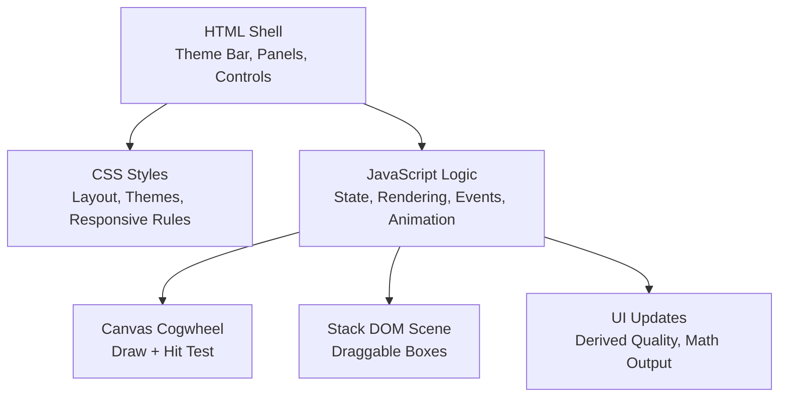
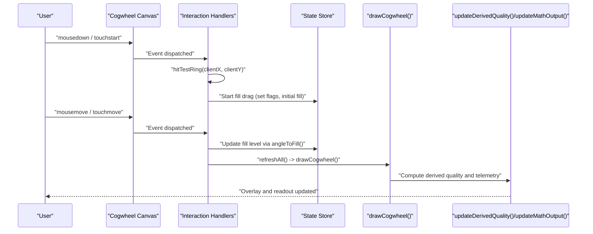
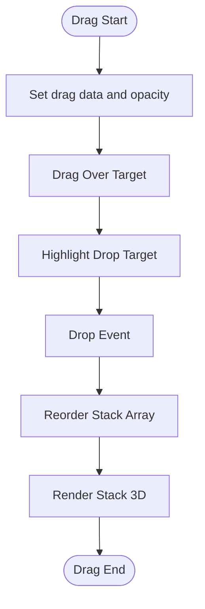
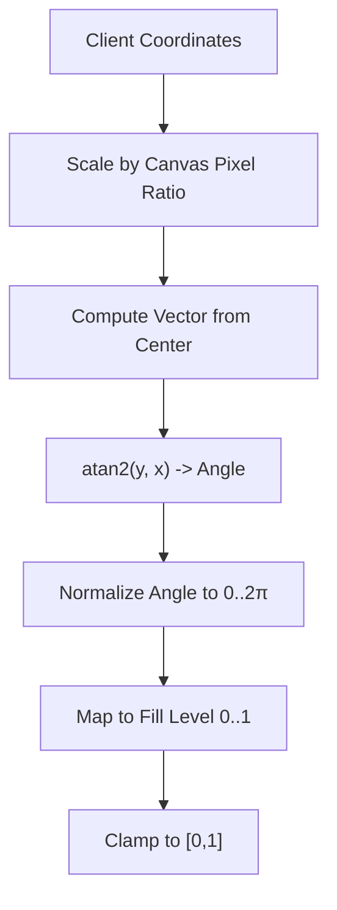
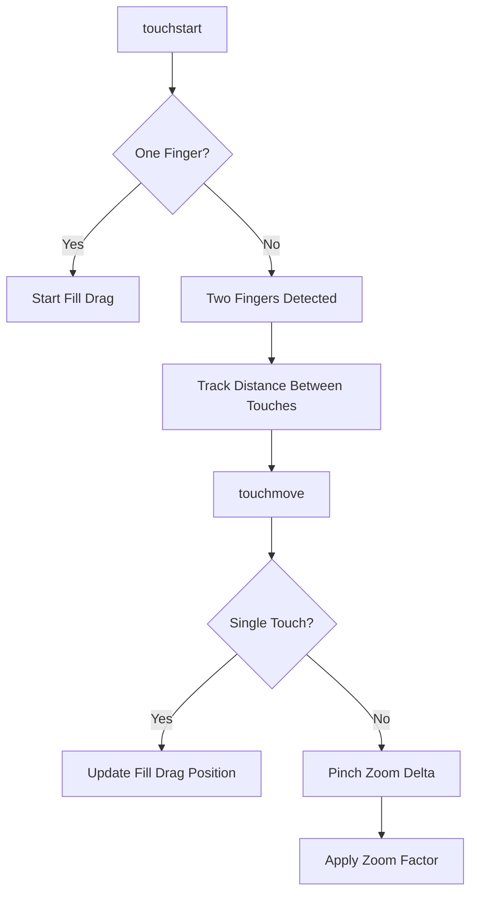
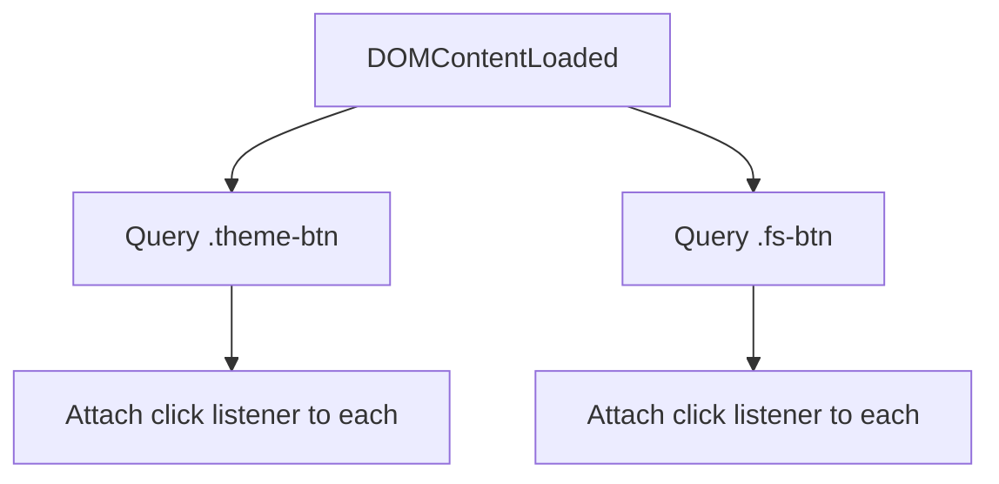
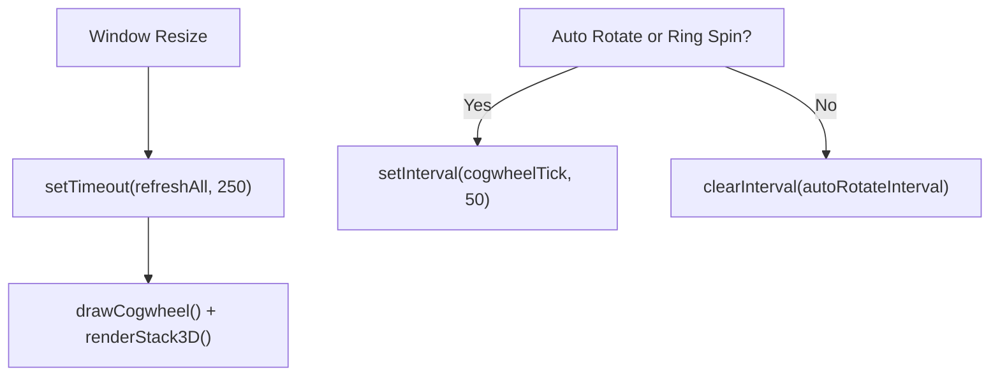
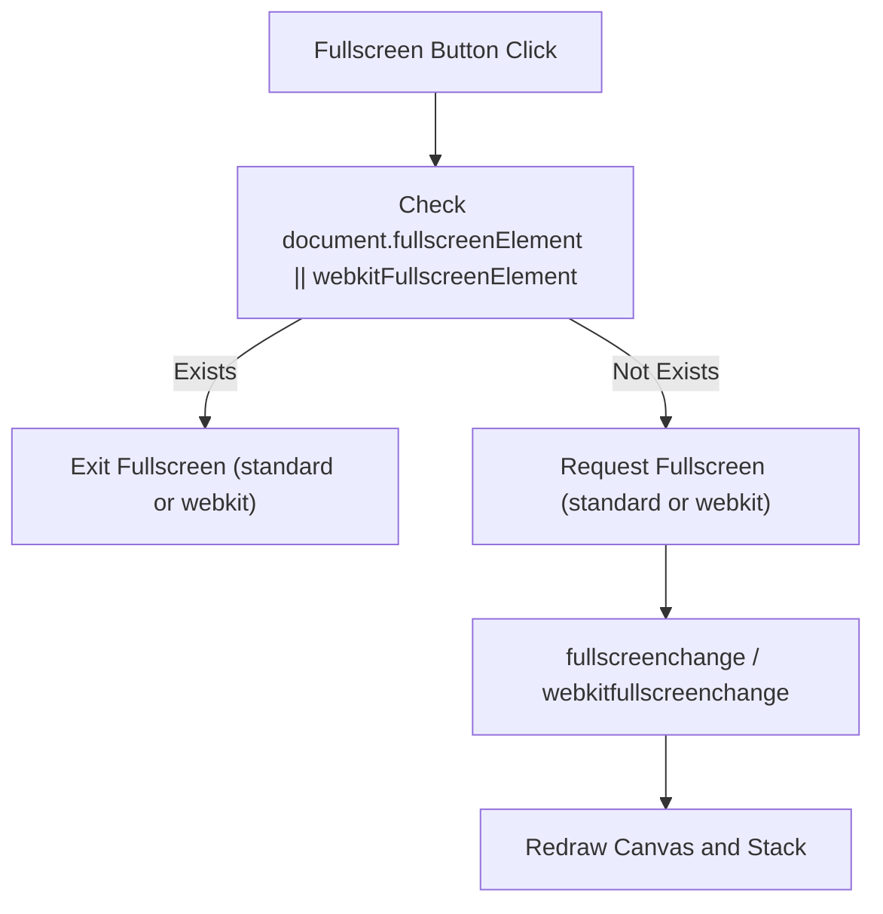
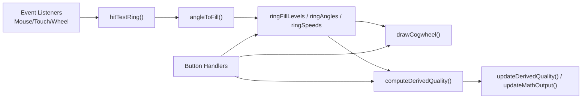

# Event System

<cite>
**Referenced Files in This Document**
- [Alg_Virt_WhLL.html](file://Alg_Virt_WhLL.html)
</cite>

## Table of Contents
1. [Introduction](#introduction)
2. [Project Structure](#project-structure)
3. [Core Components](#core-components)
4. [Architecture Overview](#architecture-overview)
5. [Detailed Component Analysis](#detailed-component-analysis)
6. [Dependency Analysis](#dependency-analysis)
7. [Performance Considerations](#performance-considerations)
8. [Troubleshooting Guide](#troubleshooting-guide)
9. [Conclusion](#conclusion)

## Introduction
This document explains the event handling and interaction system for user input processing and gesture recognition in a single-file interactive application. It focuses on:
- Mouse and touch event listener setup
- Drag-and-drop functionality
- Coordinate transformation logic between screen coordinates, canvas pixels, and polar geometry
- Interaction handler for cogwheel manipulation (angle calculations, fill level updates, rotation controls)
- Responsive design considerations for mobile devices and touch gestures
- Examples of event delegation patterns, performance optimization techniques, and cross-browser compatibility handling
- Accessibility considerations and keyboard navigation support

The application provides two main interactive areas:
- A concentric cogwheel visualization rendered on a canvas with drag-to-fill, wheel zoom, and ring spin speed control
- A 3D stack view with drag-to-rotate, pinch-to-zoom, and native HTML drag-and-drop reordering

## Project Structure
The project is a single self-contained HTML file that includes:
- CSS styles for layout, themes, responsive breakpoints, and visual feedback
- DOM elements for the theme bar, quality selector, cogwheel panel, and 3D stack panel
- JavaScript for state management, rendering, event handling, animation loops, and telemetry output



**Diagram sources**
- [Alg_Virt_WhLL.html:1-708](file://Alg_Virt_WhLL.html#L1-L708)
- [Alg_Virt_WhLL.html:709-830](file://Alg_Virt_WhLL.html#L709-L830)
- [Alg_Virt_WhLL.html:831-2036](file://Alg_Virt_WhLL.html#L831-L2036)

**Section sources**
- [Alg_Virt_WhLL.html:1-708](file://Alg_Virt_WhLL.html#L1-L708)
- [Alg_Virt_WhLL.html:709-830](file://Alg_Virt_WhLL.html#L709-L830)
- [Alg_Virt_WhLL.html:831-2036](file://Alg_Virt_WhLL.html#L831-L2036)

## Core Components
- Theme and UI wiring:
  - Theme buttons update body attributes and redraw visuals
  - Fullscreen toggles handle both standard and vendor-prefixed APIs
- Cogwheel subsystem:
  - State variables track rotation, auto-rotation, zoom, per-ring fill levels, angles, and speeds
  - Drawing function computes layer radii, fills, teeth, labels, and derived metrics
  - Hit testing maps client coordinates to rings using scaled canvas coordinates and polar math
  - Interaction handlers manage mouse/touch drag for fill, wheel zoom, Shift+Wheel for ring speed, and button controls
- 3D stack subsystem:
  - Builds ordered stack items from algebraic dependencies
  - Renders DOM-based 3D boxes with front/back/top/bottom/left/right faces
  - Handles drag-to-rotate via mouse and touch, pinch-to-zoom, and native drag-and-drop reorder
- Telemetry and derived quality:
  - Computes combined quality from ring fills and spin speeds
  - Updates overlay text and ASCII-style telemetry readout

**Section sources**
- [Alg_Virt_WhLL.html:895-918](file://Alg_Virt_WhLL.html#L895-L918)
- [Alg_Virt_WhLL.html:920-1137](file://Alg_Virt_WhLL.html#L920-L1137)
- [Alg_Virt_WhLL.html:1142-1354](file://Alg_Virt_WhLL.html#L1142-L1354)
- [Alg_Virt_WhLL.html:1356-1495](file://Alg_Virt_WhLL.html#L1356-L1495)
- [Alg_Virt_WhLL.html:1497-1615](file://Alg_Virt_WhLL.html#L1497-L1615)
- [Alg_Virt_WhLL.html:1620-1881](file://Alg_Virt_WhLL.html#L1620-L1881)
- [Alg_Virt_WhLL.html:1886-1945](file://Alg_Virt_WhLL.html#L1886-L1945)
- [Alg_Virt_WhLL.html:1947-2032](file://Alg_Virt_WhLL.html#L1947-L2032)

## Architecture Overview
The event system follows a clear separation between input capture, coordinate transformation, state mutation, and rendering/telemetry updates.



**Diagram sources**
- [Alg_Virt_WhLL.html:1356-1495](file://Alg_Virt_WhLL.html#L1356-L1495)
- [Alg_Virt_WhLL.html:1142-1354](file://Alg_Virt_WhLL.html#L1142-L1354)
- [Alg_Virt_WhLL.html:1019-1093](file://Alg_Virt_WhLL.html#L1019-L1093)
- [Alg_Virt_WhLL.html:1886-1945](file://Alg_Virt_WhLL.html#L1886-L1945)

## Detailed Component Analysis

### Mouse and Touch Event Listener Setup
- Mouse events:
  - mousedown on canvas triggers hit test; if a ring is hit, start fill drag
  - window-level mousemove updates hover state or continues drag
  - window-level mouseup ends drag
- Wheel events:
  - Prevent default behavior
  - Shift+Wheel over a ring adjusts ring spin speed
  - Normal wheel zooms in/out
- Touch events:
  - Single-finger touch mimics mouse drag for fill
  - Two-finger pinch calculates distance delta to zoom
  - passive:false used where preventDefault is required

Key implementation references:
- Mouse listeners and drag lifecycle
- Wheel handling with modifier key check
- Touch start/move/end with one- and two-finger branches

**Section sources**
- [Alg_Virt_WhLL.html:1426-1495](file://Alg_Virt_WhLL.html#L1426-L1495)

### Drag-and-Drop Functionality (3D Stack)
- Each stack box is draggable using the HTML5 drag-and-drop API
- dragstart sets effect and data payload
- dragover prevents default and highlights drop target
- drop reorders the stack array and refreshes rendering
- Visual feedback uses outline styling during drag interactions



**Diagram sources**
- [Alg_Virt_WhLL.html:1723-1754](file://Alg_Virt_WhLL.html#L1723-L1754)

**Section sources**
- [Alg_Virt_WhLL.html:1620-1763](file://Alg_Virt_WhLL.html#L1620-L1763)

### Coordinate Transformation Logic
- Canvas scaling:
  - The canvas element’s pixel dimensions are set based on devicePixelRatio
  - getBoundingClientRect returns CSS size; hit tests scale client coordinates by width/height ratios
- Polar conversion:
  - atan2 computes pointer angle relative to center
  - angleToFill normalizes angle into a 0..1 fill fraction accounting for ring rotation
- Distance checks:
  - Hypotenuse distance determines which ring is under the pointer
  - Ring inner/outer radii computed from layer index and zoom factor



**Diagram sources**
- [Alg_Virt_WhLL.html:1356-1388](file://Alg_Virt_WhLL.html#L1356-L1388)

**Section sources**
- [Alg_Virt_WhLL.html:1142-1158](file://Alg_Virt_WhLL.html#L1142-L1158)
- [Alg_Virt_WhLL.html:1356-1388](file://Alg_Virt_WhLL.html#L1356-L1388)

### Interaction Handler for Cogwheel Manipulation
- Fill level updates:
  - On drag start, compute initial fill from pointer angle and ring rotation
  - On move, recalculate fill and clamp to valid range
- Rotation controls:
  - Global rotation can be auto-incremented when play mode is active
  - Per-ring angles accumulate based on ring speed
- Zoom controls:
  - Wheel and pinch gestures adjust zoom factor within bounds
- Ring spin speed:
  - Shift+Wheel over a ring increments/decrements speed
  - Dedicated buttons allow fine-tuning selected ring speed
  - Speed display updates dynamically

```mermaid
sequenceDiagram
participant User as "User"
participant Canvas as "Cogwheel Canvas"
participant Handler as "setupCogwheelInteractions()"
participant State as "ringSpeeds/ringAngles"
participant Loop as "ensureCogwheelLoop()"
participant Draw as "drawCogwheel()"
User->>Canvas : "Shift+Wheel over ring"
Canvas->>Handler : "wheel event"
Handler->>State : "adjustRingSpeed(layer, delta)"
Handler->>Loop : "ensureCogwheelLoop()"
Loop->>Draw : "cogwheelTick() -> drawCogwheel()"
Draw-->>User : "Updated ring visuals and telemetry"
```

**Diagram sources**
- [Alg_Virt_WhLL.html:1451-1462](file://Alg_Virt_WhLL.html#L1451-L1462)
- [Alg_Virt_WhLL.html:1120-1129](file://Alg_Virt_WhLL.html#L1120-L1129)
- [Alg_Virt_WhLL.html:1497-1523](file://Alg_Virt_WhLL.html#L1497-L1523)
- [Alg_Virt_WhLL.html:1142-1354](file://Alg_Virt_WhLL.html#L1142-L1354)

**Section sources**
- [Alg_Virt_WhLL.html:1390-1424](file://Alg_Virt_WhLL.html#L1390-L1424)
- [Alg_Virt_WhLL.html:1497-1615](file://Alg_Virt_WhLL.html#L1497-L1615)

### Responsive Design Considerations for Mobile Devices and Touch Gestures
- CSS media queries adjust grid layout, container sizes, and 3D box dimensions for smaller screens
- touch-action: none applied to interactive containers to prevent browser scrolling while interacting
- Touch event handlers use passive:true where preventDefault is not needed to improve scroll performance
- Pinch-to-zoom implemented by tracking distance between two touches and adjusting zoom factors



**Diagram sources**
- [Alg_Virt_WhLL.html:1464-1495](file://Alg_Virt_WhLL.html#L1464-L1495)
- [Alg_Virt_WhLL.html:1804-1841](file://Alg_Virt_WhLL.html#L1804-L1841)

**Section sources**
- [Alg_Virt_WhLL.html:698-707](file://Alg_Virt_WhLL.html#L698-L707)
- [Alg_Virt_WhLL.html:299-301](file://Alg_Virt_WhLL.html#L299-L301)
- [Alg_Virt_WhLL.html:461-463](file://Alg_Virt_WhLL.html#L461-L463)
- [Alg_Virt_WhLL.html:1464-1495](file://Alg_Virt_WhLL.html#L1464-L1495)
- [Alg_Virt_WhLL.html:1804-1841](file://Alg_Virt_WhLL.html#L1804-L1841)

### Examples of Event Delegation Patterns
- Theme buttons:
  - Iterates all theme buttons and attaches click listeners individually
- Fullscreen buttons:
  - Selects all fullscreen toggle buttons and binds click handlers
- These patterns centralize initialization but do not use true event delegation on a shared parent node



**Diagram sources**
- [Alg_Virt_WhLL.html:905-918](file://Alg_Virt_WhLL.html#L905-L918)
- [Alg_Virt_WhLL.html:1950-1983](file://Alg_Virt_WhLL.html#L1950-L1983)

**Section sources**
- [Alg_Virt_WhLL.html:905-918](file://Alg_Virt_WhLL.html#L905-L918)
- [Alg_Virt_WhLL.html:1950-1983](file://Alg_Virt_WhLL.html#L1950-L1983)

### Performance Optimization Techniques
- Debounced resize handler:
  - Uses setTimeout to defer full redraw after window resize
- Passive event listeners:
  - Used for non-blocking touch interactions where preventDefault is not required
- Conditional animation loop:
  - Animation interval runs only when auto-rotation or any ring spin is active
- Device pixel ratio scaling:
  - Ensures crisp rendering without unnecessary overdraw by matching CSS size to pixel size



**Diagram sources**
- [Alg_Virt_WhLL.html:2027-2031](file://Alg_Virt_WhLL.html#L2027-L2031)
- [Alg_Virt_WhLL.html:1514-1523](file://Alg_Virt_WhLL.html#L1514-L1523)

**Section sources**
- [Alg_Virt_WhLL.html:1514-1523](file://Alg_Virt_WhLL.html#L1514-L1523)
- [Alg_Virt_WhLL.html:2027-2031](file://Alg_Virt_WhLL.html#L2027-L2031)
- [Alg_Virt_WhLL.html:1142-1158](file://Alg_Virt_WhLL.html#L1142-L1158)
- [Alg_Virt_WhLL.html:1804-1841](file://Alg_Virt_WhLL.html#L1804-L1841)

### Cross-Browser Compatibility Handling
- Fullscreen API:
  - Checks for standard and webkit-prefixed methods for entering and exiting fullscreen
- Fullscreen change events:
  - Listens to both standard and webkit-prefixed change events to trigger re-rendering
- Theme persistence:
  - Wraps localStorage access in try/catch blocks to avoid errors when storage is unavailable



**Diagram sources**
- [Alg_Virt_WhLL.html:1950-1983](file://Alg_Virt_WhLL.html#L1950-L1983)

**Section sources**
- [Alg_Virt_WhLL.html:1950-1983](file://Alg_Virt_WhLL.html#L1950-L1983)
- [Alg_Virt_WhLL.html:905-918](file://Alg_Virt_WhLL.html#L905-L918)

### Accessibility Considerations and Keyboard Navigation Support
- Current implementation relies primarily on mouse and touch interactions
- No explicit keyboard event listeners are present for:
  - Adjusting ring fill levels
  - Changing ring spin speeds
  - Rotating or zooming the 3D stack
  - Triggering fullscreen or theme changes via keys
- Recommendations:
  - Add keyboard shortcuts for common actions (e.g., arrow keys to adjust fill, +/- for zoom, Space for play/pause)
  - Ensure focusable controls have visible focus indicators
  - Provide aria-live regions for telemetry updates so screen readers announce changes
  - Use semantic roles and labels for interactive elements

[No sources needed since this section provides general guidance]

## Dependency Analysis
The event system interacts with several core modules:



**Diagram sources**
- [Alg_Virt_WhLL.html:1356-1495](file://Alg_Virt_WhLL.html#L1356-L1495)
- [Alg_Virt_WhLL.html:1142-1354](file://Alg_Virt_WhLL.html#L1142-L1354)
- [Alg_Virt_WhLL.html:1019-1093](file://Alg_Virt_WhLL.html#L1019-L1093)
- [Alg_Virt_WhLL.html:1497-1615](file://Alg_Virt_WhLL.html#L1497-L1615)

**Section sources**
- [Alg_Virt_WhLL.html:1356-1495](file://Alg_Virt_WhLL.html#L1356-L1495)
- [Alg_Virt_WhLL.html:1142-1354](file://Alg_Virt_WhLL.html#L1142-L1354)
- [Alg_Virt_WhLL.html:1019-1093](file://Alg_Virt_WhLL.html#L1019-L1093)
- [Alg_Virt_WhLL.html:1497-1615](file://Alg_Virt_WhLL.html#L1497-L1615)

## Performance Considerations
- Avoid unnecessary redraws:
  - Only redraw when state actually changes (dragging, zooming, spinning)
- Minimize layout thrashing:
  - Batch DOM updates in renderStack3D
- Use passive listeners where possible:
  - Improves scroll responsiveness on mobile
- Limit heavy computations:
  - Derived quality calculation is O(n) over layers; acceptable given small n
- Debounce resize events:
  - Prevents excessive redraws during window resizing

[No sources needed since this section provides general guidance]

## Troubleshooting Guide
Common issues and resolutions:
- Canvas appears blurry:
  - Ensure devicePixelRatio scaling is applied consistently
  - Verify canvas.width/height vs style.width/height
- Drag does not register on mobile:
  - Confirm touch-action: none is applied to interactive containers
  - Ensure passive:false is used where preventDefault is called
- Wheel zoom conflicts with page scroll:
  - Use { passive: false } and call preventDefault on wheel handlers
- Fullscreen not working:
  - Check for webkit-prefixed methods and events
- Animation keeps running:
  - Ensure ensureCogwheelLoop clears intervals when autoRotate and ring spins are zero

**Section sources**
- [Alg_Virt_WhLL.html:1142-1158](file://Alg_Virt_WhLL.html#L1142-L1158)
- [Alg_Virt_WhLL.html:299-301](file://Alg_Virt_WhLL.html#L299-L301)
- [Alg_Virt_WhLL.html:1451-1462](file://Alg_Virt_WhLL.html#L1451-L1462)
- [Alg_Virt_WhLL.html:1950-1983](file://Alg_Virt_WhLL.html#L1950-L1983)
- [Alg_Virt_WhLL.html:1514-1523](file://Alg_Virt_WhLL.html#L1514-L1523)

## Conclusion
The event system integrates mouse and touch inputs with robust coordinate transformations to drive cogwheel manipulation, including fill adjustments, rotation, and ring spin speed control. It also supports a 3D stack with drag-to-rotate, pinch-to-zoom, and native drag-and-drop reordering. The architecture emphasizes clear separation between input capture, state mutation, and rendering, with attention to performance and cross-browser compatibility. To enhance accessibility, adding keyboard navigation and ARIA support would further improve usability across devices and assistive technologies.

[No sources needed since this section summarizes without analyzing specific files]