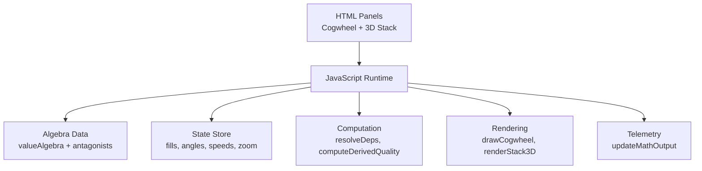
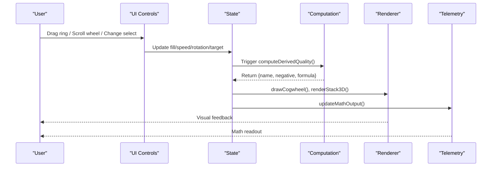
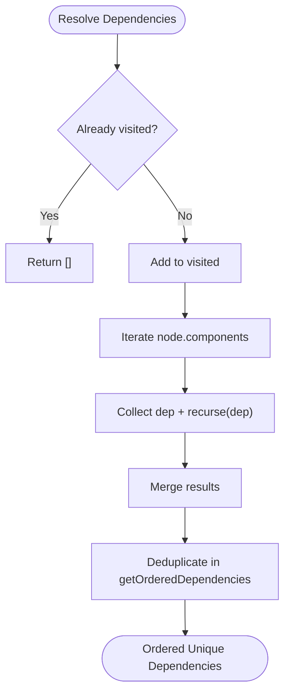
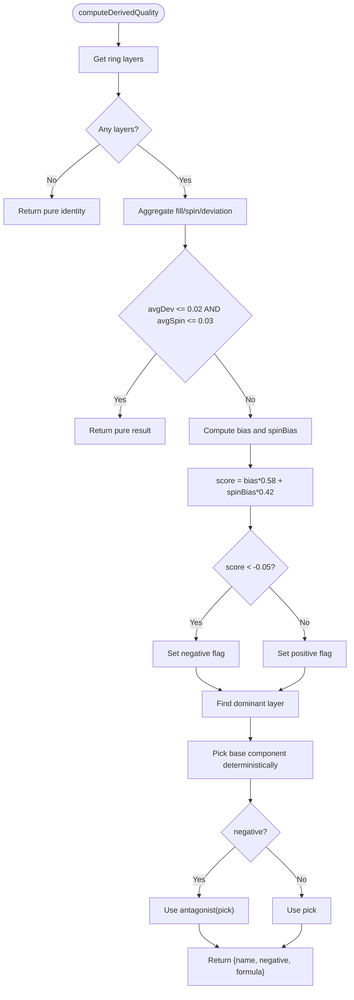
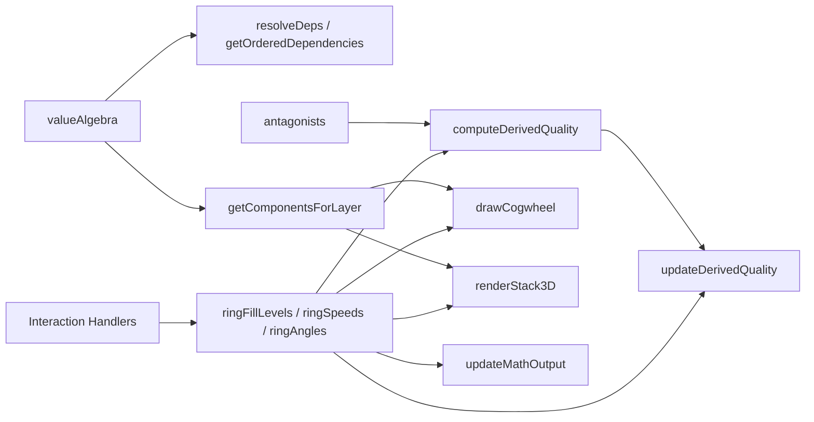

# Mathematics Engine

<cite>
**Referenced Files in This Document**
- [Alg_Virt_WhLL.html](file://Alg_Virt_WhLL.html)
</cite>

## Table of Contents
1. [Introduction](#introduction)
2. [Project Structure](#project-structure)
3. [Core Components](#core-components)
4. [Architecture Overview](#architecture-overview)
5. [Detailed Component Analysis](#detailed-component-analysis)
6. [Dependency Analysis](#dependency-analysis)
7. [Performance Considerations](#performance-considerations)
8. [Troubleshooting Guide](#troubleshooting-guide)
9. [Conclusion](#conclusion)

## Introduction
This document explains the mathematical computation system behind the algebraic virtue calculator. It focuses on:
- How virtues are modeled as a hierarchical, dependency-driven algebra.
- How derived quality is computed from ring fills and ring spin speeds.
- How component dependencies are resolved and mapped to layers.
- How antagonist mapping turns positive or negative emergent states into named qualities.
- How user interactions drive recomputation and how numerical precision and performance are handled.

The system is implemented as a single-page application where data structures define the algebra, and interactive controls update state that flows through rendering and telemetry.

## Project Structure
The repository contains one primary file:
- `Alg_Virt_WhLL.html`: Contains CSS for UI themes, HTML panels for the cogwheel and 3D stack, and JavaScript implementing the algebra, interaction handlers, rendering, and telemetry.

Conceptually, the application has:
- Data layer: virtue algebra and antagonist mappings.
- State layer: current target, ring fills, ring angles, ring speeds, view state.
- Computation layer: dependency resolution, derived quality calculation.
- Presentation layer: canvas-based cogwheel, DOM-based 3D stack, math readout.

**Diagram sources**
- [Alg_Virt_WhLL.html:830-943](file://Alg_Virt_WhLL.html#L830-L943)
- [Alg_Virt_WhLL.html:1142-1354](file://Alg_Virt_WhLL.html#L1142-L1354)
- [Alg_Virt_WhLL.html:1620-1763](file://Alg_Virt_WhLL.html#L1620-L1763)
- [Alg_Virt_WhLL.html:1886-1945](file://Alg_Virt_WhLL.html#L1886-L1945)

**Section sources**
- [Alg_Virt_WhLL.html:1-830](file://Alg_Virt_WhLL.html#L1-L830)
- [Alg_Virt_WhLL.html:830-943](file://Alg_Virt_WhLL.html#L830-L943)

## Core Components
- Algebra blueprint: defines each virtue’s components, color, description, and layer.
- Antagonist map: maps each virtue to its opposing concept.
- Dependency resolver: computes ordered dependencies and groups by layer.
- Derived quality engine: combines fill levels and spin speeds into a signed score and selects an emergent name.
- Interaction handlers: drag-to-fill, wheel-to-spin, theme switching, fullscreen, and selection changes.
- Rendering systems: concentric cogwheel with teeth and labels; 3D stacked blocks with front/back faces.
- Telemetry: formatted output showing formulas, per-layer telemetry, and combined result.

Key responsibilities:
- `valueAlgebra` and `antagonists` provide declarative knowledge.
- `getOrderedDependencies`, `resolveDeps`, `getComponentsForLayer` implement hierarchy and grouping.
- `computeDerivedQuality` implements the core formula.
- `drawCogwheel` and `renderStack3D` visualize state.
- `updateMathOutput` exposes the math narrative.

**Section sources**
- [Alg_Virt_WhLL.html:832-865](file://Alg_Virt_WhLL.html#L832-L865)
- [Alg_Virt_WhLL.html:945-993](file://Alg_Virt_WhLL.html#L945-L993)
- [Alg_Virt_WhLL.html:1019-1081](file://Alg_Virt_WhLL.html#L1019-L1081)
- [Alg_Virt_WhLL.html:1142-1354](file://Alg_Virt_WhLL.html#L1142-L1354)
- [Alg_Virt_WhLL.html:1620-1763](file://Alg_Virt_WhLL.html#L1620-L1763)
- [Alg_Virt_WhLL.html:1886-1945](file://Alg_Virt_WhLL.html#L1886-L1945)

## Architecture Overview
The system follows a reactive pipeline:
- User input updates state (fill, speed, rotation).
- State changes trigger recomputation of derived quality and dependent visuals.
- Rendering reads current state to draw the cogwheel and stack.
- Telemetry summarizes the algebra and current values.

**Diagram sources**
- [Alg_Virt_WhLL.html:1390-1495](file://Alg_Virt_WhLL.html#L1390-L1495)
- [Alg_Virt_WhLL.html:1541-1612](file://Alg_Virt_WhLL.html#L1541-L1612)
- [Alg_Virt_WhLL.html:1988-2005](file://Alg_Virt_WhLL.html#L1988-L2005)
- [Alg_Virt_WhLL.html:1019-1081](file://Alg_Virt_WhLL.html#L1019-L1081)

## Detailed Component Analysis

### Algebra Blueprint and Antagonist Mapping
- The algebra defines virtues as nodes with:
  - `components`: direct prerequisite virtues.
  - `layer`: hierarchical depth from 0 (primes) to 4 (meta peaks).
  - `color` and `desc`: presentation and explanation.
- The antagonist map provides a one-to-one opposite for each virtue.

Implications:
- Layer 0 virtues have no components and act as independent axioms.
- Higher layers compose lower layers, enabling multi-level derivations.
- Antagonists enable negative emergent naming when derived quality becomes negative.

Example relationships:
- Layer 0: Love, Trust, Strength, Humility.
- Layer 1: Compassion = Love + Humility; Loyalty = Love + Trust + Strength; etc.
- Layer 4: Unity = Love + Peace + Wisdom + Forgiveness.

**Section sources**
- [Alg_Virt_WhLL.html:832-856](file://Alg_Virt_WhLL.html#L832-L856)
- [Alg_Virt_WhLL.html:858-865](file://Alg_Virt_WhLL.html#L858-L865)

### Component Dependency Resolution
- `resolveDeps(name, visited)` performs recursive traversal over `components`, avoiding cycles via a visited set.
- `getOrderedDependencies(componentName)` returns a deduplicated ordered list of all transitive dependencies.
- `getComponentsForLayer(targetName)` builds a map from layer number to component names involved in the target’s derivation graph.
- `getLayerComponentsOrdered(targetName, layer)` returns components at a specific layer, preferring the currently rendered stack order if available.

Complexity:
- Dependency resolution is O(V + E) where V is the number of unique components and E is the number of component edges across the dependency graph.
- Layer grouping is linear in the size of the dependency closure.

Edge cases:
- Unknown component names return empty results safely.
- Circular references are prevented by the visited set.

**Diagram sources**
- [Alg_Virt_WhLL.html:945-964](file://Alg_Virt_WhLL.html#L945-L964)

**Section sources**
- [Alg_Virt_WhLL.html:945-988](file://Alg_Virt_WhLL.html#L945-L988)

### Derived Quality Calculation
`computeDerivedQuality()` synthesizes:
- Per-layer fill levels (from 0 to 1).
- Per-layer spin speeds (bounded by `RING_SPEED_MAX`).
- A dominance heuristic to pick the “dominant” layer based on deviation and speed magnitude.
- A weighted score combining fill bias and spin bias.
- A threshold to determine negativity.
- Deterministic selection of a base component using a hash of signature parts and current target.
- Final emergent name via antagonist mapping when negative.

Algorithm outline:
1. Gather active layers for the current target.
2. If no rings exist, return a pure, non-negative identity result.
3. Aggregate averages:
   - Average fill (`avgFill`)
   - Average net speed (`avgNet`)
   - Average absolute speed (`avgSpin`)
   - Average deviation from neutral fill (`avgDev`)
4. Pure-state shortcut: if both deviation and spin are near zero, return a pure identity.
5. Compute:
   - Fill bias: `(avgFill - 0.5) * 2`
   - Spin bias: clamped average net speed normalized by `RING_SPEED_MAX * 0.8`
   - Score: `bias * 0.58 + spinBias * 0.42`
6. Negative if score < -0.05.
7. Determine dominant layer by weight: `|fill - 0.5| * 2 + min(1, |speed| / RING_SPEED_MAX)`.
8. Select base component deterministically from the dominant layer’s pool.
9. Map to antagonist if negative; otherwise use the selected component name.

Numerical precision considerations:
- Uses small thresholds for “pure” state detection to avoid jitter around neutral fill/spin.
- Clamps spin bias to [-1, 1] to prevent extreme swings.
- Uses integer rounding for display signatures to stabilize deterministic selection.

**Diagram sources**
- [Alg_Virt_WhLL.html:1019-1081](file://Alg_Virt_WhLL.html#L1019-L1081)

**Section sources**
- [Alg_Virt_WhLL.html:996-1014](file://Alg_Virt_WhLL.html#L996-L1014)
- [Alg_Virt_WhLL.html:1019-1081](file://Alg_Virt_WhLL.html#L1019-L1081)

### Hierarchical Layer System
- Layers represent abstraction depth:
  - Layer 0: Core primes (Love, Trust, Strength, Humility).
  - Layer 1: Direct derivatives composed from primes.
  - Layer 2: Peak emotional states.
  - Layer 3: Structural systems.
  - Layer 4: Meta-existential peaks including Unity.
- Each layer’s components influence the visual representation:
  - Cogwheel rings correspond to layers.
  - 3D stack items are sorted by layer.
- Layer grouping enables per-ring control of fill and spin.

Data flow:
- Target selection triggers rebuilding of the stack and ring controls.
- Layer grouping determines which components appear on each ring and stack block.

**Section sources**
- [Alg_Virt_WhLL.html:832-856](file://Alg_Virt_WhLL.html#L832-L856)
- [Alg_Virt_WhLL.html:966-988](file://Alg_Virt_WhLL.html#L966-L988)
- [Alg_Virt_WhLL.html:1620-1645](file://Alg_Virt_WhLL.html#L1620-L1645)

### Antagonist Mapping Algorithms
- Antagonists are defined as a static map from virtue to opposite.
- In the cogwheel, antagonist names are shown along the unfilled portion of rings.
- In the derived quality, negative scores map the selected base component to its antagonist.
- In the 3D stack, back faces show the antagonist label for each item.

Behavioral notes:
- When derived quality is negative, the displayed name is the antagonist of the chosen base component.
- When positive, the displayed name is the selected component itself.

**Section sources**
- [Alg_Virt_WhLL.html:858-865](file://Alg_Virt_WhLL.html#L858-L865)
- [Alg_Virt_WhLL.html:1267-1293](file://Alg_Virt_WhLL.html#L1267-L1293)
- [Alg_Virt_WhLL.html:1689-1694](file://Alg_Virt_WhLL.html#L1689-L1694)
- [Alg_Virt_WhLL.html:1069-1075](file://Alg_Virt_WhLL.html#L1069-L1075)

### User Interactions and Mathematical Recomputation
Interactions:
- Dragging on a ring sets the fill level for that layer.
- Shift+Wheel adjusts the spin speed for the hovered ring.
- Wheel without Shift zooms the cogwheel.
- Theme buttons switch visual palette and redraw.
- Fullscreen toggles panel sizes and re-renders.
- Quality selector changes the target and rebuilds the stack.

Recomputation chain:
- Interaction updates state (fill, speed, rotation, zoom).
- `refreshAll()` calls:
  - `drawCogwheel(currentTarget)`
  - `renderStack3D()`
  - `updateDerivedQuality()`
  - `updateMathOutput(currentTarget)`

Real-time behavior:
- The cogwheel animation loop runs while auto-rotate is enabled or any ring spins.
- Ring speeds accumulate angles over time, affecting derived quality continuously.

**Section sources**
- [Alg_Virt_WhLL.html:1390-1495](file://Alg_Virt_WhLL.html#L1390-L1495)
- [Alg_Virt_WhLL.html:1541-1612](file://Alg_Virt_WhLL.html#L1541-L1612)
- [Alg_Virt_WhLL.html:1988-2005](file://Alg_Virt_WhLL.html#L1988-L2005)
- [Alg_Virt_WhLL.html:1498-1523](file://Alg_Virt_WhLL.html#L1498-L1523)

### Concrete Calculation Flows

#### Example Flow: Unity with Neutral Rings
- Target: Unity (Layer 4).
- Layers present: those in Unity’s dependency closure.
- All ring fills near 0.5 and speeds near 0.
- Result: pure identity, name remains Unity, formula indicates no deviation.

#### Example Flow: Unity with Positive Deviation
- Target: Unity.
- Dominant layer shows high fill and moderate positive spin.
- Score positive; emergent name is a component from the dominant layer.
- Formula shows target plus dominant layer info and resulting name.

#### Example Flow: Unity with Negative Deviation
- Target: Unity.
- Dominant layer shows low fill or negative spin.
- Score below threshold; emergent name is the antagonist of the selected base component.
- Formula reflects negative emergence.

These flows are driven by the aggregation and weighting logic in `computeDerivedQuality`.

**Section sources**
- [Alg_Virt_WhLL.html:1019-1081](file://Alg_Virt_WhLL.html#L1019-L1081)

### Formula Implementations and Edge Cases
- Pure-state detection avoids noise when fills and spins are near neutral.
- Spin bias normalization prevents extreme negative spikes.
- Deterministic selection uses a stable hash of signature parts and target name.
- Missing components or unknown targets are handled gracefully with defaults or empty outputs.

**Section sources**
- [Alg_Virt_WhLL.html:1019-1081](file://Alg_Virt_WhLL.html#L1019-L1081)
- [Alg_Virt_WhLL.html:1886-1891](file://Alg_Virt_WhLL.html#L1886-L1891)

## Dependency Analysis
The main runtime modules and their relationships:

**Diagram sources**
- [Alg_Virt_WhLL.html:832-865](file://Alg_Virt_WhLL.html#L832-L865)
- [Alg_Virt_WhLL.html:945-993](file://Alg_Virt_WhLL.html#L945-L993)
- [Alg_Virt_WhLL.html:1019-1081](file://Alg_Virt_WhLL.html#L1019-L1081)
- [Alg_Virt_WhLL.html:1142-1354](file://Alg_Virt_WhLL.html#L1142-L1354)
- [Alg_Virt_WhLL.html:1620-1763](file://Alg_Virt_WhLL.html#L1620-L1763)
- [Alg_Virt_WhLL.html:1886-1945](file://Alg_Virt_WhLL.html#L1886-L1945)

Coupling and cohesion:
- High cohesion within computation functions (`resolveDeps`, `computeDerivedQuality`).
- Clear separation between data definitions and rendering logic.
- Minimal coupling between UI events and math; events mutate state, and rendering reads state.

Potential circular dependencies:
- None observed; recursion in dependency resolution is guarded by a visited set.

External integration points:
- Canvas API for drawing.
- DOM APIs for event handling and element manipulation.
- Browser storage for theme persistence.

**Section sources**
- [Alg_Virt_WhLL.html:832-865](file://Alg_Virt_WhLL.html#L832-L865)
- [Alg_Virt_WhLL.html:945-993](file://Alg_Virt_WhLL.html#L945-L993)
- [Alg_Virt_WhLL.html:1019-1081](file://Alg_Virt_WhLL.html#L1019-L1081)
- [Alg_Virt_WhLL.html:1142-1354](file://Alg_Virt_WhLL.html#L1142-L1354)
- [Alg_Virt_WhLL.html:1620-1763](file://Alg_Virt_WhLL.html#L1620-L1763)
- [Alg_Virt_WhLL.html:1886-1945](file://Alg_Virt_WhLL.html#L1886-L1945)

## Performance Considerations
- Animation loop:
  - Runs only when needed (auto-rotate or any ring spinning).
  - Updates angles incrementally and redraws the cogwheel.
- Rendering:
  - Canvas drawing is bounded by device pixel ratio and zoom factor.
  - Teeth and labels are drawn per ring; complexity grows with number of layers.
- State updates:
  - Fill and speed updates trigger full refresh of visuals and telemetry.
- Optimization opportunities:
  - Debounce rapid resize events (already partially done).
  - Avoid unnecessary redraws when state does not change.
  - Cache derived computations when inputs are unchanged.
  - Batch DOM updates in stack rendering.

Numerical precision:
- Small thresholds for pure-state detection reduce flicker.
- Clamping and rounding ensure stable behavior under repeated updates.

[No sources needed since this section provides general guidance]

## Troubleshooting Guide
Common issues and resolutions:
- Derived quality appears unstable:
  - Check ring fills and speeds; ensure they are near neutral for pure-state behavior.
  - Verify thresholds in derived calculation are appropriate for your use case.
- Antagonist names not appearing:
  - Ensure antagonist map includes entries for all components.
  - Confirm unfilled portions of rings are visible (fill < ~0.92).
- Stack not updating after selection:
  - Confirm `buildStack` is called and `stackItems` is rebuilt.
  - Ensure `refreshAll` is invoked after state changes.
- Canvas sizing issues:
  - Re-render on fullscreen or resize events; verify device pixel ratio handling.

**Section sources**
- [Alg_Virt_WhLL.html:1019-1081](file://Alg_Virt_WhLL.html#L1019-L1081)
- [Alg_Virt_WhLL.html:1267-1293](file://Alg_Virt_WhLL.html#L1267-L1293)
- [Alg_Virt_WhLL.html:1620-1645](file://Alg_Virt_WhLL.html#L1620-L1645)
- [Alg_Virt_WhLL.html:1972-1983](file://Alg_Virt_WhLL.html#L1972-L1983)

## Conclusion
The mathematics engine models virtues as a layered, dependency-driven algebra. Derived quality emerges from ring fills and spin speeds, producing either positive or negative emergent names via antagonist mapping. The system cleanly separates data, state, computation, and presentation, enabling real-time interaction and clear telemetry. With careful attention to numerical thresholds and rendering performance, it supports responsive, precise calculations suitable for interactive exploration of virtue dynamics.

[No sources needed since this section summarizes without analyzing specific files]