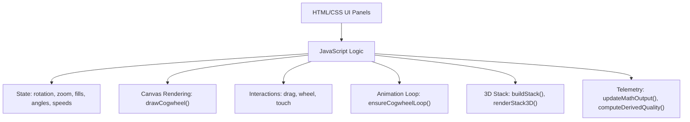
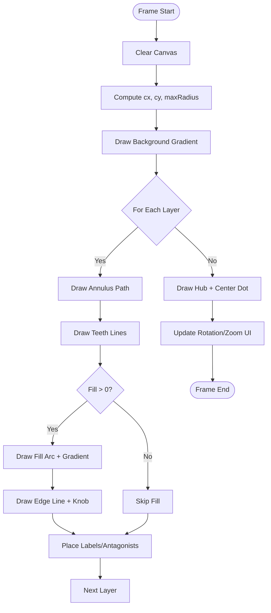
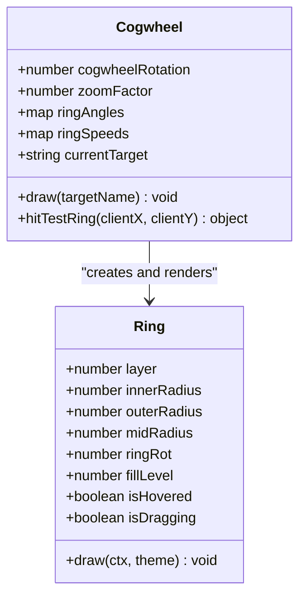
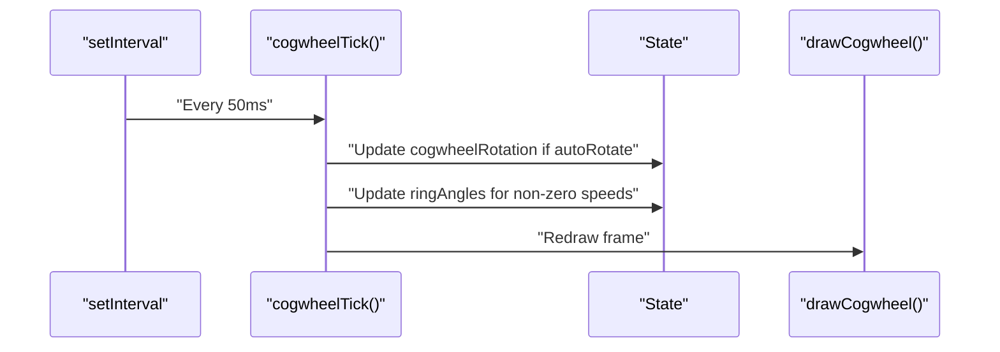
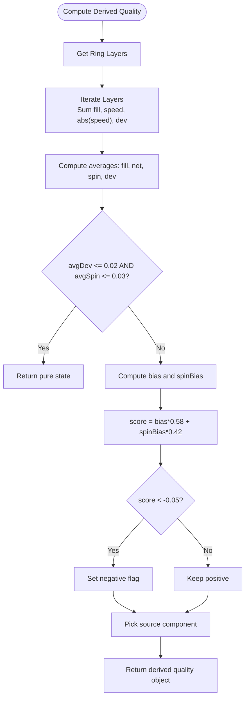
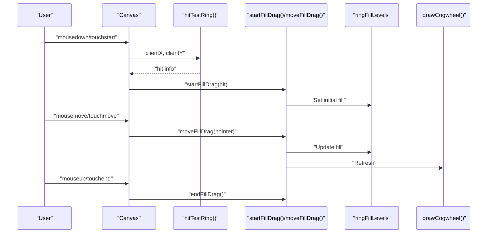
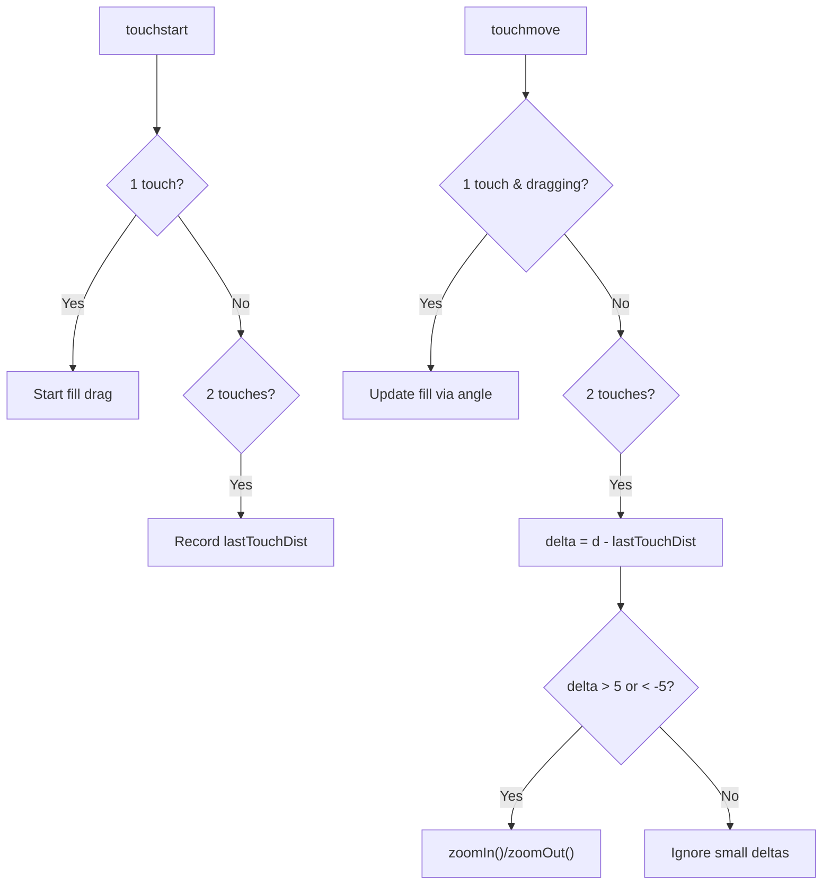
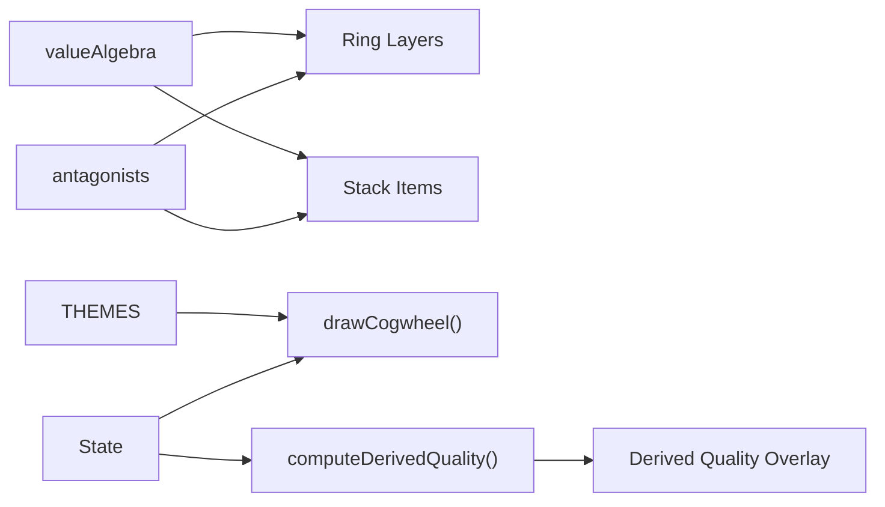

# Canvas Cogwheel Renderer

<cite>
**Referenced Files in This Document**
- [Alg_Virt_WhLL.html](file://Alg_Virt_WhLL.html)
</cite>

## Table of Contents
1. [Introduction](#introduction)
2. [Project Structure](#project-structure)
3. [Core Components](#core-components)
4. [Architecture Overview](#architecture-overview)
5. [Detailed Component Analysis](#detailed-component-analysis)
6. [Dependency Analysis](#dependency-analysis)
7. [Performance Considerations](#performance-considerations)
8. [Troubleshooting Guide](#troubleshooting-guide)
9. [Conclusion](#conclusion)

## Introduction
This document explains the Canvas API-based cogwheel rendering system implemented in a single-page application. It focuses on:
- The coordinate system and high-performance 2D drawing pipeline
- Concentric ring drawing algorithms, including fill arcs, gradient fills, and animated teeth
- Animation loop architecture for rotation and per-ring spin
- Fill level computation and derived quality calculation
- Drag-to-fill interaction mechanics, touch event handling, and zoom functionality
- Browser compatibility, canvas scaling for different screen sizes, and memory management strategies

The implementation is contained within one HTML file that includes CSS styling and JavaScript logic.

## Project Structure
The project consists of a single HTML file containing:
- A themed UI with two panels: a left panel for the concentric cogwheel canvas and a right panel for a 3D stack visualization
- CSS variables and theme templates controlling colors, fonts, and layout
- JavaScript modules for:
  - Value algebra and antagonist mappings
  - Theme switching
  - State management for rotation, zoom, ring fills, angles, and speeds
  - Cogwheel rendering and hit testing
  - Interaction handlers for mouse, wheel, and touch events
  - Animation loop control
  - 3D stack rendering and controls
  - Telemetry output and fullscreen support



**Diagram sources**
- [Alg_Virt_WhLL.html:830-943](file://Alg_Virt_WhLL.html#L830-L943)
- [Alg_Virt_WhLL.html:1142-1354](file://Alg_Virt_WhLL.html#L1142-L1354)
- [Alg_Virt_WhLL.html:1426-1495](file://Alg_Virt_WhLL.html#L1426-L1495)
- [Alg_Virt_WhLL.html:1498-1523](file://Alg_Virt_WhLL.html#L1498-L1523)
- [Alg_Virt_WhLL.html:1620-1763](file://Alg_Virt_WhLL.html#L1620-L1763)
- [Alg_Virt_WhLL.html:1886-1945](file://Alg_Virt_WhLL.html#L1886-L1945)

**Section sources**
- [Alg_Virt_WhLL.html:1-709](file://Alg_Virt_WhLL.html#L1-L709)
- [Alg_Virt_WhLL.html:710-829](file://Alg_Virt_WhLL.html#L710-L829)

## Core Components
- Coordinate System and Scaling
  - Canvas dimensions are set using devicePixelRatio to ensure crisp rendering on high-DPI displays
  - Center coordinates (cx, cy) are computed from canvas width/height
  - Zoom factor scales the maximum radius used for rings
- Concentric Ring Drawing
  - Layers are computed from the selected target’s dependency graph
  - Each layer draws an annulus path using arc commands
  - Teeth are drawn by rotating the context and stroking radial lines at regular angular intervals
  - Fill arcs use start/end angles based on fill level and current rotation
  - Radial gradients are applied across each ring’s color components
  - Edge lines and knobs mark the end of filled segments
  - Antagonist labels are placed along unfilled portions when fill is below thresholds
  - Positive component labels are placed along filled portions
- Animation Loop
  - Global rotation increments when auto-rotate is enabled
  - Per-ring angles increment based on ring speed values
  - The loop runs only when needed (auto-rotate or any ring spinning)
- Derived Quality Computation
  - Combines average fill deviation, net spin bias, and absolute spin magnitude
  - Determines positive/negative emergent quality and selects a representative source component
- Interaction Mechanics
  - Mouse drag updates fill levels for the targeted ring
  - Shift+Wheel adjusts per-ring spin speed
  - Wheel zooms in/out; pinch-zoom supported via touch gestures
  - Touch events mirror mouse interactions for mobile devices
- 3D Stack Visualization
  - Builds a layered stack of components and antagonists
  - Renders 3D boxes with front/back/top/bottom/left/right faces
  - Supports drag-to-reorder, view rotation, zoom, and auto-spin

**Section sources**
- [Alg_Virt_WhLL.html:1142-1354](file://Alg_Virt_WhLL.html#L1142-L1354)
- [Alg_Virt_WhLL.html:1356-1424](file://Alg_Virt_WhLL.html#L1356-L1424)
- [Alg_Virt_WhLL.html:1426-1495](file://Alg_Virt_WhLL.html#L1426-L1495)
- [Alg_Virt_WhLL.html:1498-1523](file://Alg_Virt_WhLL.html#L1498-L1523)
- [Alg_Virt_WhLL.html:1019-1093](file://Alg_Virt_WhLL.html#L1019-L1093)
- [Alg_Virt_WhLL.html:1620-1763](file://Alg_Virt_WhLL.html#L1620-L1763)

## Architecture Overview
The system follows a clear separation between state, rendering, and interaction:
- State holds rotation, zoom, ring fills, angles, speeds, and current target
- Rendering functions transform state into visual elements on the canvas
- Interaction handlers update state and trigger redraws
- Animation loop periodically updates rotation and per-ring angles and redraws
- Derived quality and telemetry provide feedback about the system state

```mermaid
sequenceDiagram
participant User as "User"
participant Canvas as "Canvas Context"
participant Render as "drawCogwheel()"
participant State as "State Variables"
participant Loop as "ensureCogwheelLoop()"
participant Interact as "Interaction Handlers"
User->>Interact : "Mouse/Touch/Wheel Events"
Interact->>State : "Update fills, angles, speeds, zoom"
Interact->>Render : "Request redraw"
Render->>Canvas : "Clear, set transforms, draw paths"
Loop->>State : "Increment rotation/ring angles"
Loop->>Render : "Redraw frame"
Render-->>User : "Updated visuals"
```

**Diagram sources**
- [Alg_Virt_WhLL.html:1142-1354](file://Alg_Virt_WhLL.html#L1142-L1354)
- [Alg_Virt_WhLL.html:1426-1495](file://Alg_Virt_WhLL.html#L1426-L1495)
- [Alg_Virt_WhLL.html:1498-1523](file://Alg_Virt_WhLL.html#L1498-L1523)

## Detailed Component Analysis

### Coordinate System and High-Performance 2D Graphics
- Canvas sizing uses devicePixelRatio to match physical pixels, preventing blur on high-DPI screens
- Center coordinates (cx, cy) are calculated from canvas.width and canvas.height
- Maximum radius is scaled by zoomFactor to implement zoom behavior
- Clearing the canvas before each frame avoids ghosting artifacts
- Path operations:
  - Annulus paths created by drawing outer arc then inner arc in reverse direction
  - Teeth drawn by translating to center, rotating, and stroking radial line segments
  - Fill arcs computed from startAngle and endAngle based on fillLevel and rotation
  - Gradient fills created with createRadialGradient and multiple color stops
  - Shadow effects applied selectively to edges and knobs for performance
- Text rendering uses theme-specific fonts and baseline alignment for readability



**Diagram sources**
- [Alg_Virt_WhLL.html:1142-1354](file://Alg_Virt_WhLL.html#L1142-L1354)

**Section sources**
- [Alg_Virt_WhLL.html:1142-1354](file://Alg_Virt_WhLL.html#L1142-L1354)

### Concentric Ring Drawing Algorithms
- Layer computation derives from the selected target’s dependency graph
- Each layer maps to a ring with inner and outer radii determined by numLayers and maxRadius
- Teeth count increases per layer to emphasize motion visibility
- Fill arcs span from -π/2 offset plus rotation, covering angle proportional to fillLevel
- Gradient colors are taken from component definitions and blended across the arc
- Negative space shows antagonist labels when fill is below threshold
- Positive labels show component names when fill is above threshold



**Diagram sources**
- [Alg_Virt_WhLL.html:1142-1354](file://Alg_Virt_WhLL.html#L1142-L1354)
- [Alg_Virt_WhLL.html:1356-1388](file://Alg_Virt_WhLL.html#L1356-L1388)

**Section sources**
- [Alg_Virt_WhLL.html:1142-1354](file://Alg_Virt_WhLL.html#L1142-L1354)
- [Alg_Virt_WhLL.html:1356-1388](file://Alg_Virt_WhLL.html#L1356-L1388)

### Animation Loop Architecture
- Global rotation increments when autoRotate is true
- Per-ring angles increment based on ringSpeeds
- The loop runs on a fixed interval and redraws the canvas
- ensureCogwheelLoop starts/stops the interval based on active animations



**Diagram sources**
- [Alg_Virt_WhLL.html:1498-1523](file://Alg_Virt_WhLL.html#L1498-L1523)

**Section sources**
- [Alg_Virt_WhLL.html:1498-1523](file://Alg_Virt_WhLL.html#L1498-L1523)

### Fill Level Computations and Derived Quality
- Fill levels are stored per target and layer
- Derived quality combines:
  - Average fill deviation from 0.5
  - Net spin bias normalized by maximum speed
  - Absolute spin magnitude
- Pure state occurs when fill deviation and spin are near zero
- Negative state emerges when combined score falls below threshold
- Representative source component is chosen deterministically using a hash function



**Diagram sources**
- [Alg_Virt_WhLL.html:1019-1093](file://Alg_Virt_WhLL.html#L1019-L1093)

**Section sources**
- [Alg_Virt_WhLL.html:1019-1093](file://Alg_Virt_WhLL.html#L1019-L1093)

### Drag-to-Fill Interaction Mechanics
- Hit testing determines which ring is under the pointer
- On mousedown/touchstart, drag state is activated for the targeted ring
- During drag/move, the pointer angle is converted to a fill level
- Fill level is clamped between 0 and 1
- On mouseup/touchend, drag state is cleared



**Diagram sources**
- [Alg_Virt_WhLL.html:1356-1424](file://Alg_Virt_WhLL.html#L1356-L1424)
- [Alg_Virt_WhLL.html:1426-1495](file://Alg_Virt_WhLL.html#L1426-L1495)

**Section sources**
- [Alg_Virt_WhLL.html:1356-1424](file://Alg_Virt_WhLL.html#L1356-L1424)
- [Alg_Virt_WhLL.html:1426-1495](file://Alg_Virt_WhLL.html#L1426-L1495)

### Touch Event Handling and Zoom Functionality
- Single-touch drag mirrors mouse drag for fill control
- Two-finger distance change triggers zoom in/out
- Wheel events adjust zoom or per-ring spin speed depending on modifier keys
- Pinch-zoom uses delta thresholds to avoid jitter



**Diagram sources**
- [Alg_Virt_WhLL.html:1464-1495](file://Alg_Virt_WhLL.html#L1464-L1495)

**Section sources**
- [Alg_Virt_WhLL.html:1464-1495](file://Alg_Virt_WhLL.html#L1464-L1495)

### Code Examples and Techniques
- Canvas context usage:
  - Clearing canvas: ctx.clearRect
  - Creating gradients: ctx.createRadialGradient
  - Drawing arcs: ctx.arc with start/end angles
  - Stroking paths: ctx.stroke with shadow effects
  - Text rendering: ctx.fillText with font and alignment
- Path drawing methods:
  - Annulus paths via outer arc then inner arc reversed
  - Teeth via rotated radial line segments
  - Fill arcs via startAngle/endAngle calculations
- Gradient applications:
  - Multi-stop radial gradients blending component colors
  - Hub background gradient for subtle glow
- Performance optimization strategies:
  - DPR-aware canvas sizing
  - Conditional shadowBlur usage
  - Minimal DOM updates during animation
  - Interval-based animation only when necessary

**Section sources**
- [Alg_Virt_WhLL.html:1142-1354](file://Alg_Virt_WhLL.html#L1142-L1354)

## Dependency Analysis
Key dependencies and relationships:
- Value algebra defines components, layers, colors, and descriptions
- Antagonists map to each component for negative representation
- Themes define accent colors, RGB values, bright text, neutral RGB, and fonts
- State variables link UI interactions to rendering outputs
- Derived quality depends on ring fills and speeds
- 3D stack depends on component layers and fill levels



**Diagram sources**
- [Alg_Virt_WhLL.html:832-865](file://Alg_Virt_WhLL.html#L832-L865)
- [Alg_Virt_WhLL.html:868-893](file://Alg_Virt_WhLL.html#L868-L893)
- [Alg_Virt_WhLL.html:920-943](file://Alg_Virt_WhLL.html#L920-L943)
- [Alg_Virt_WhLL.html:1019-1093](file://Alg_Virt_WhLL.html#L1019-L1093)

**Section sources**
- [Alg_Virt_WhLL.html:832-865](file://Alg_Virt_WhLL.html#L832-L865)
- [Alg_Virt_WhLL.html:868-893](file://Alg_Virt_WhLL.html#L868-L893)
- [Alg_Virt_WhLL.html:920-943](file://Alg_Virt_WhLL.html#L920-L943)
- [Alg_Virt_WhLL.html:1019-1093](file://Alg_Virt_WhLL.html#L1019-L1093)

## Performance Considerations
- Canvas Scaling
  - Use devicePixelRatio to set canvas.width/height for sharp rendering on high-DPI displays
  - Adjust style width/height to match container size
- Animation Efficiency
  - Run animation loop only when auto-rotate or ring spins are active
  - Use setInterval with a fixed tick interval to avoid requestAnimationFrame overhead where not needed
- Drawing Optimization
  - Avoid unnecessary shadowBlur calls; apply conditionally
  - Reuse gradient objects when possible
  - Minimize text measurements by precomputing font metrics if needed
- Memory Management
  - Clear canvas every frame to prevent accumulation artifacts
  - Avoid creating heavy objects inside tight loops
  - Debounce resize handlers to reduce redraw frequency
- Browser Compatibility
  - Use standard Canvas 2D API methods available in modern browsers
  - Provide fallbacks for fullscreen APIs using vendor prefixes
  - Ensure touch events are handled consistently across devices

[No sources needed since this section provides general guidance]

## Troubleshooting Guide
Common issues and resolutions:
- Blurry Canvas Rendering
  - Ensure canvas.width/height are set using devicePixelRatio
  - Verify container dimensions are correct before drawing
- Stuttering Animations
  - Confirm animation loop is only running when needed
  - Reduce shadowBlur complexity or disable for offscreen rendering
- Incorrect Fill Levels
  - Validate angleToFill normalization and clamping
  - Check hitTestRing distance thresholds
- Touch Events Not Working
  - Ensure passive:false for touch listeners that call preventDefault
  - Verify two-finger distance calculations for pinch-zoom
- Fullscreen Mode Issues
  - Handle both standard and webkitFullscreenElement properties
  - Redraw canvas after fullscreen change to update dimensions

**Section sources**
- [Alg_Virt_WhLL.html:1142-1158](file://Alg_Virt_WhLL.html#L1142-L1158)
- [Alg_Virt_WhLL.html:1451-1495](file://Alg_Virt_WhLL.html#L1451-L1495)
- [Alg_Virt_WhLL.html:1950-1983](file://Alg_Virt_WhLL.html#L1950-L1983)

## Conclusion
The Canvas Cogwheel Renderer implements a robust, interactive visualization combining concentric ring drawing, dynamic fill levels, and animated rotations. It leverages high-performance 2D graphics techniques, careful state management, and responsive interaction handling to deliver smooth user experiences across devices. The derived quality system provides meaningful feedback based on fill and spin states, while the 3D stack complements the visualization with layered component insights. With attention to scaling, animation efficiency, and browser compatibility, the system offers a solid foundation for further enhancements and integrations.

[No sources needed since this section summarizes without analyzing specific files]