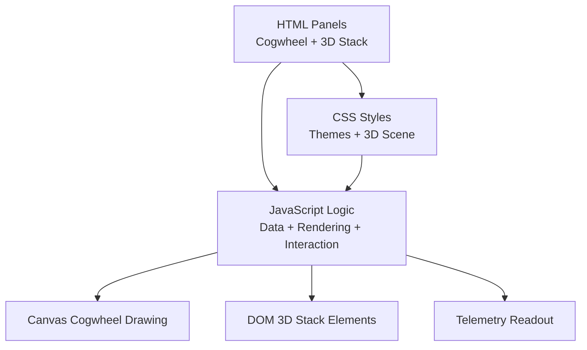
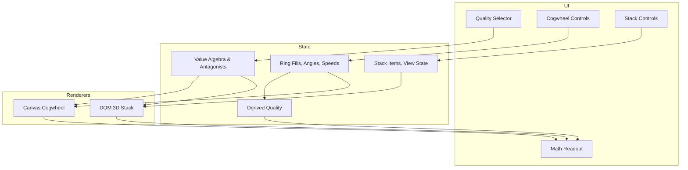
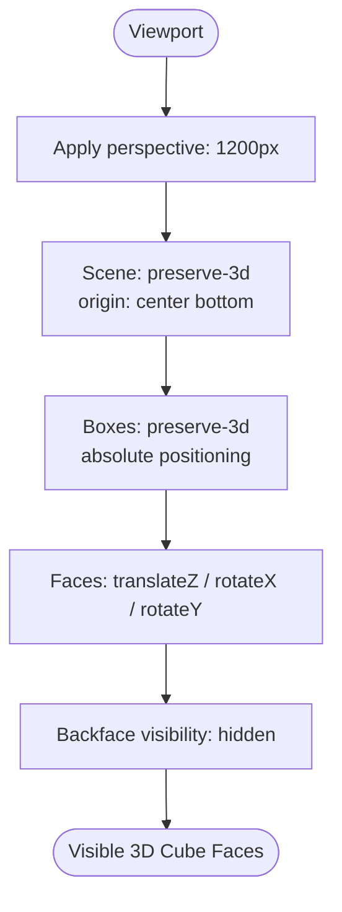
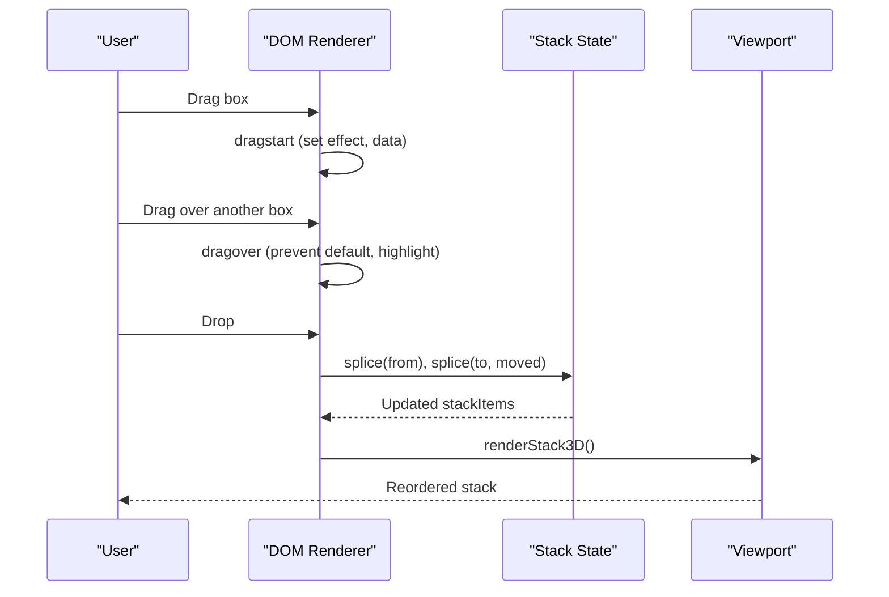
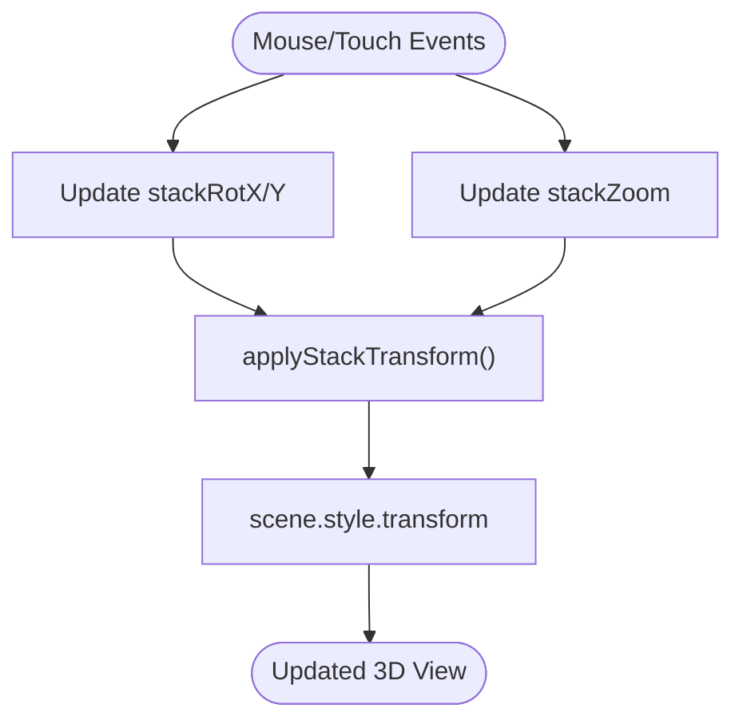
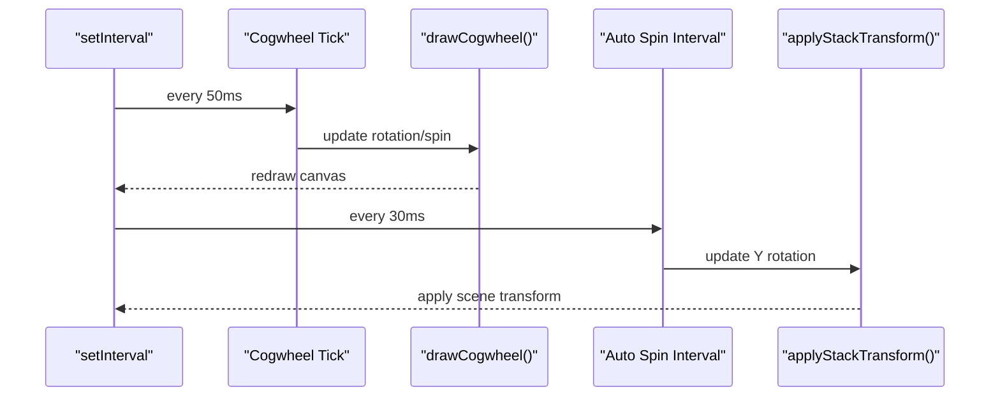
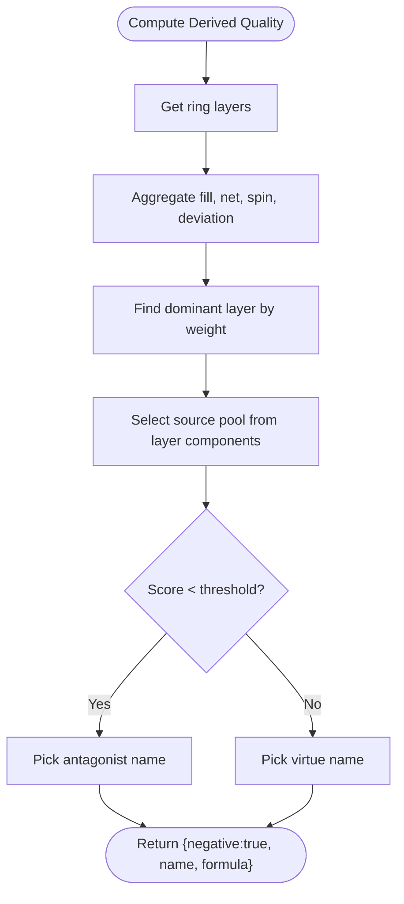
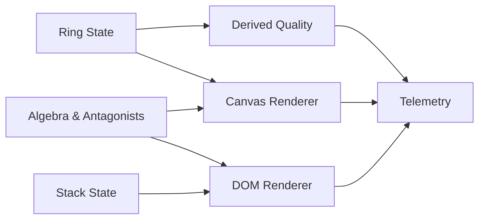

# DOM 3D Stack Renderer

<cite>
**Referenced Files in This Document**   
- [Alg_Virt_WhLL.html](file://Alg_Virt_WhLL.html)
</cite>

## Table of Contents
1. [Introduction](#introduction)
2. [Project Structure](#project-structure)
3. [Core Components](#core-components)
4. [Architecture Overview](#architecture-overview)
5. [Detailed Component Analysis](#detailed-component-analysis)
6. [Dependency Analysis](#dependency-analysis)
7. [Performance Considerations](#performance-considerations)
8. [Troubleshooting Guide](#troubleshooting-guide)
9. [Conclusion](#conclusion)

## Introduction
This document explains the DOM-based 3D stack visualization system implemented in a single-page application. The system combines:
- A 2D concentric “cogwheel” canvas for selecting and tuning target qualities, ring fills, and per-ring spin speeds.
- A CSS 3D stack that visualizes layered components as stacked boxes with front/back/top/bottom/left/right faces.
- Interactive controls for drag-and-drop reordering, 3D rotation, zooming, auto-spinning, and fullscreen display.
- Telemetry output that summarizes formulas, ring telemetry, derived quality, and runtime state.

The implementation uses CSS 3D transforms for rendering, native HTML Drag-and-Drop for block reordering, and JavaScript timers for animation loops. There is no Web Animations API usage in this codebase; animations are driven by `setInterval` and direct style updates.

## Project Structure
The project consists of one file containing:
- CSS styles defining themes, layout, and the 3D scene.
- HTML panels for the cogwheel and the 3D stack.
- JavaScript logic for data models, rendering, interaction, and telemetry.

**Diagram sources**
- [Alg_Virt_WhLL.html:710-828](file://Alg_Virt_WhLL.html#L710-L828)
- [Alg_Virt_WhLL.html:7-708](file://Alg_Virt_WhLL.html#L7-L708)
- [Alg_Virt_WhLL.html:830-2032](file://Alg_Virt_WhLL.html#L830-L2032)

**Section sources**
- [Alg_Virt_WhLL.html:710-828](file://Alg_Virt_WhLL.html#L710-L828)
- [Alg_Virt_WhLL.html:830-2032](file://Alg_Virt_WhLL.html#L830-L2032)

## Core Components
- Data model: value algebra defines virtues, their layers, colors, descriptions, and component dependencies. Antagonists map each virtue to its opposite.
- Cogwheel renderer: draws concentric rings representing layers, fill levels, labels, teeth, and negative segments. Supports drag-to-fill, wheel zoom, Shift+Wheel per-ring spin speed, and touch interactions.
- 3D stack renderer: builds DOM nodes for each layer’s block with six faces, positions them in a 3D scene, supports drag-and-drop reorder, mouse/touch rotation, wheel zoom, auto-spin toggle, and antagonist label visibility toggle.
- Derived quality computation: aggregates ring fills and spins into a positive or negative emergent quality name and formula.
- Telemetry readout: prints structured text summarizing target, formula, ring telemetry, combined result, description, and runtime state.

**Section sources**
- [Alg_Virt_WhLL.html:832-865](file://Alg_Virt_WhLL.html#L832-L865)
- [Alg_Virt_WhLL.html:1142-1354](file://Alg_Virt_WhLL.html#L1142-L1354)
- [Alg_Virt_WhLL.html:1620-1763](file://Alg_Virt_WhLL.html#L1620-L1763)
- [Alg_Virt_WhLL.html:1019-1093](file://Alg_Virt_WhLL.html#L1019-L1093)
- [Alg_Virt_WhLL.html:1886-1945](file://Alg_Virt_WhLL.html#L1886-L1945)

## Architecture Overview
The application follows a clear separation between UI (HTML/CSS), rendering (Canvas + DOM), and state management (JavaScript).

**Diagram sources**
- [Alg_Virt_WhLL.html:832-865](file://Alg_Virt_WhLL.html#L832-L865)
- [Alg_Virt_WhLL.html:920-943](file://Alg_Virt_WhLL.html#L920-L943)
- [Alg_Virt_WhLL.html:1142-1354](file://Alg_Virt_WhLL.html#L1142-L1354)
- [Alg_Virt_WhLL.html:1620-1763](file://Alg_Virt_WhLL.html#L1620-L1763)
- [Alg_Virt_WhLL.html:1886-1945](file://Alg_Virt_WhLL.html#L1886-L1945)

## Detailed Component Analysis

### CSS 3D Transforms Implementation
The 3D stack uses CSS 3D transforms to create a perspective-aware scene and positioned box faces.

Key properties and patterns:
- Perspective container:
  - `.stack-viewport` sets `perspective: 1200px`, enabling depth perception.
  - It also enables touch handling and grab cursor states.
- Scene container:
  - `.stack-3d-scene` uses `transform-style: preserve-3d`, `transform-origin: center bottom`, and `will-change: transform`.
  - Positioning is centered horizontally and anchored near the bottom of the viewport.
- Box container:
  - `.stack-box` uses `transform-style: preserve-3d`, `transform-origin: center center`, and absolute positioning within the scene.
- Face positioning matrices:
  - Front face: `translateZ(20px)` to push it toward the viewer.
  - Back face: `translateZ(-20px) rotateY(180deg)` to face away from the viewer.
  - Top face: `rotateX(90deg) translateZ(0)` to form the top surface.
  - Bottom face: `rotateX(-90deg) translateZ(0)` to form the bottom surface.
  - Left face: `rotateY(-90deg) translateZ(0)` to form the left surface.
  - Right face: `rotateY(90deg) translateZ(0)` to form the right surface.
- Backface visibility:
  - Faces use `backface-visibility: hidden` so only the intended side is visible at any orientation.
- Floor grid:
  - `.stack-floor` is rotated and translated to simulate a ground plane beneath the stack.

**Diagram sources**
- [Alg_Virt_WhLL.html:454-475](file://Alg_Virt_WhLL.html#L454-L475)
- [Alg_Virt_WhLL.html:477-585](file://Alg_Virt_WhLL.html#L477-L585)
- [Alg_Virt_WhLL.html:593-605](file://Alg_Virt_WhLL.html#L593-L605)

**Section sources**
- [Alg_Virt_WhLL.html:454-475](file://Alg_Virt_WhLL.html#L454-L475)
- [Alg_Virt_WhLL.html:477-585](file://Alg_Virt_WhLL.html#L477-L585)
- [Alg_Virt_WhLL.html:593-605](file://Alg_Virt_WhLL.html#L593-L605)

### Block Stacking Algorithm and Dynamic Reordering
Block stacking algorithm:
- Build stack items from the selected target’s dependency graph:
  - Resolve ordered dependencies via recursive traversal.
  - Include the target itself as the final item.
  - Sort by layer to ensure correct stacking order.
- Render loop:
  - Clear the scene and append a floor element.
  - For each item, create a box with six faces.
  - Compute fill level from ring telemetry for the corresponding layer.
  - Attach front overlay proportional to fill percentage.
  - Optionally show back face with antagonist label.
  - Attach top/bottom/left/right faces with contextual labels.
  - Enable HTML Drag-and-Drop attributes and event listeners for reorder.
  - Apply scene transform after building all boxes.
  - Adjust scene bottom position based on viewport height.

Dynamic reordering:
- Each box is draggable using `draggable="true"` and standard drag events (`dragstart`, `dragover`, `dragleave`, `drop`).
- On drop, splice the moved item out and insert it at the target index, then refresh the entire view.

**Diagram sources**
- [Alg_Virt_WhLL.html:1620-1645](file://Alg_Virt_WhLL.html#L1620-L1645)
- [Alg_Virt_WhLL.html:1647-1763](file://Alg_Virt_WhLL.html#L1647-L1763)

**Section sources**
- [Alg_Virt_WhLL.html:945-988](file://Alg_Virt_WhLL.html#L945-L988)
- [Alg_Virt_WhLL.html:1620-1763](file://Alg_Virt_WhLL.html#L1620-L1763)

### 3D Rotation Controls and Zoom
Rotation and zoom are handled through mouse and touch events:
- Mouse drag rotates the scene around X and Y axes:
  - Horizontal movement adjusts Y rotation.
  - Vertical movement adjusts X rotation with clamping to avoid extreme angles.
- Wheel zoom scales the scene and applies a Z translation to maintain perceived distance.
- Touch interactions mirror mouse behavior:
  - Single-finger drag rotates.
  - Two-finger pinch zooms.
- Auto-spin toggles continuous Y-axis rotation via an interval timer.

Transform application:
- `applyStackTransform` composes `translateZ`, `scale`, `rotateX`, and `rotateY` into a single transform string.

**Diagram sources**
- [Alg_Virt_WhLL.html:1765-1770](file://Alg_Virt_WhLL.html#L1765-L1770)
- [Alg_Virt_WhLL.html:1772-1881](file://Alg_Virt_WhLL.html#L1772-L1881)

**Section sources**
- [Alg_Virt_WhLL.html:1765-1770](file://Alg_Virt_WhLL.html#L1765-L1770)
- [Alg_Virt_WhLL.html:1772-1881](file://Alg_Virt_WhLL.html#L1772-L1881)

### Animation Model and Transitions
Animation approach:
- No Web Animations API is used.
- Cogwheel animation:
  - Uses `setInterval` to increment global rotation and per-ring angles when auto-rotation or ring spin is active.
  - Redraws the canvas each tick.
- Stack animation:
  - Uses `setInterval` to continuously update Y rotation when auto-spin is enabled.
- CSS transitions:
  - Some UI elements have transition properties (e.g., theme buttons, overlays), but the 3D scene transform is updated directly without CSS transitions.

**Diagram sources**
- [Alg_Virt_WhLL.html:1498-1523](file://Alg_Virt_WhLL.html#L1498-L1523)
- [Alg_Virt_WhLL.html:1860-1880](file://Alg_Virt_WhLL.html#L1860-L1880)

**Section sources**
- [Alg_Virt_WhLL.html:1498-1523](file://Alg_Virt_WhLL.html#L1498-L1523)
- [Alg_Virt_WhLL.html:1860-1880](file://Alg_Virt_WhLL.html#L1860-L1880)

### Derived Quality Computation
Derived quality combines:
- Per-layer fill levels relative to 0.5 baseline.
- Per-ring spin speeds and directions.
- Dominant layer selection based on deviation weight.
- Deterministic naming using a hash of signal parts and current target.

Output includes:
- Pure vs. non-pure status.
- Positive vs. negative classification.
- Selected emergent or antagonistic name.
- Formula string showing transformation from target and dominant layer telemetry.

**Diagram sources**
- [Alg_Virt_WhLL.html:1019-1081](file://Alg_Virt_WhLL.html#L1019-L1081)

**Section sources**
- [Alg_Virt_WhLL.html:1019-1093](file://Alg_Virt_WhLL.html#L1019-L1093)

### Event Handling Patterns
Common patterns across the codebase:
- Prevent default and stop propagation on button clicks to avoid unintended behaviors.
- Use passive listeners where appropriate (e.g., touchmove for performance).
- Debounce resize events to avoid excessive redraws.
- Centralize refresh via `refreshAll()` to keep canvas, stack, derived quality, and telemetry in sync.

Examples:
- Cogwheel interactions: mousedown/mousemove/mouseup, wheel, touchstart/touchmove/touchend.
- Stack interactions: mousedown/mousemove/mouseup, wheel, touchstart/touchmove/touchend.
- Button bindings: reset, play/pause, zoom in/out/reset, ring speed controls, stack controls.

**Section sources**
- [Alg_Virt_WhLL.html:1426-1495](file://Alg_Virt_WhLL.html#L1426-L1495)
- [Alg_Virt_WhLL.html:1541-1612](file://Alg_Virt_WhLL.html#L1541-L1612)
- [Alg_Virt_WhLL.html:1772-1881](file://Alg_Virt_WhLL.html#L1772-L1881)
- [Alg_Virt_WhLL.html:1988-2032](file://Alg_Virt_WhLL.html#L1988-L2032)

### Responsive Behavior Across Devices
Responsive considerations:
- Grid layout switches to single column below 768px.
- Cogwheel container max-height reduces on small screens.
- Stack viewport height reduces on small screens.
- Stack box dimensions reduce on small screens.
- Fullscreen support for both panels with CSS adjustments for fullscreen mode.
- Touch actions disabled on interactive containers to prevent browser gestures interfering with custom handlers.

**Section sources**
- [Alg_Virt_WhLL.html:698-707](file://Alg_Virt_WhLL.html#L698-L707)
- [Alg_Virt_WhLL.html:194-225](file://Alg_Virt_WhLL.html#L194-L225)
- [Alg_Virt_WhLL.html:299-301](file://Alg_Virt_WhLL.html#L299-L301)
- [Alg_Virt_WhLL.html:461-466](file://Alg_Virt_WhLL.html#L461-L466)

## Dependency Analysis
High-level dependencies:
- Data model drives both canvas and DOM renderers.
- Ring state influences derived quality and telemetry.
- Stack state affects DOM rendering and user interaction.
- UI controls mutate state and trigger refresh cycles.

**Diagram sources**
- [Alg_Virt_WhLL.html:832-865](file://Alg_Virt_WhLL.html#L832-L865)
- [Alg_Virt_WhLL.html:920-943](file://Alg_Virt_WhLL.html#L920-L943)
- [Alg_Virt_WhLL.html:1142-1354](file://Alg_Virt_WhLL.html#L1142-L1354)
- [Alg_Virt_WhLL.html:1620-1763](file://Alg_Virt_WhLL.html#L1620-L1763)
- [Alg_Virt_WhLL.html:1886-1945](file://Alg_Virt_WhLL.html#L1886-L1945)

**Section sources**
- [Alg_Virt_WhLL.html:832-865](file://Alg_Virt_WhLL.html#L832-L865)
- [Alg_Virt_WhLL.html:920-943](file://Alg_Virt_WhLL.html#L920-L943)
- [Alg_Virt_WhLL.html:1142-1354](file://Alg_Virt_WhLL.html#L1142-L1354)
- [Alg_Virt_WhLL.html:1620-1763](file://Alg_Virt_WhLL.html#L1620-L1763)
- [Alg_Virt_WhLL.html:1886-1945](file://Alg_Virt_WhLL.html#L1886-L1945)

## Performance Considerations
- GPU acceleration:
  - `will-change: transform` on the scene hints the compositor to promote the element for smoother transforms.
  - CSS 3D transforms leverage hardware acceleration in modern browsers.
- DOM cost:
  - Rebuilding the entire stack on every change can be expensive with many layers; consider incremental updates if the stack grows significantly.
- Canvas cost:
  - Frequent redraws during drag and animation should be throttled or coalesced if needed.
- Animation strategy:
  - Using `setInterval` is simple but not synchronized with the display refresh; consider `requestAnimationFrame` for smoother animation loops.
- Fallback strategies:
  - If 3D transforms are unsupported, degrade to a flat list view or provide a 2D fallback.
  - If WebGL or advanced features are unavailable, rely on CSS 3D transforms which have broad support.
- Touch performance:
  - Use passive listeners for touchmove where possible to improve scrolling performance.
  - Avoid heavy computations inside frequent event callbacks.

[No sources needed since this section provides general guidance]

## Troubleshooting Guide
Common issues and resolutions:
- Stack does not respond to drag-and-drop:
  - Ensure `draggable="true"` is set on boxes and that `dragover` calls `preventDefault`.
  - Verify `dataTransfer.setData` and `getData` are used consistently.
- 3D rotation feels unresponsive:
  - Check that `mousedown` on viewport sets dragging flag and that `mousemove` updates rotations and applies transform.
  - Confirm `touchmove` handlers update rotations and apply transform.
- Zoom not working:
  - Verify wheel event prevents default and updates zoom factor.
  - Ensure two-finger pinch logic updates zoom and applies transform.
- Derived quality not updating:
  - Confirm `refreshAll` is called after changes to ring fills, speeds, or target selection.
  - Validate `computeDerivedQuality` receives correct layer fills and speeds.
- Fullscreen not resizing correctly:
  - Ensure fullscreen change listeners redraw canvas and re-render stack after delay.

**Section sources**
- [Alg_Virt_WhLL.html:1723-1754](file://Alg_Virt_WhLL.html#L1723-L1754)
- [Alg_Virt_WhLL.html:1772-1881](file://Alg_Virt_WhLL.html#L1772-L1881)
- [Alg_Virt_WhLL.html:1950-1983](file://Alg_Virt_WhLL.html#L1950-L1983)
- [Alg_Virt_WhLL.html:1988-2005](file://Alg_Virt_WhLL.html#L1988-L2005)

## Conclusion
The DOM 3D stack renderer provides a rich, interactive visualization combining a 2D cogwheel control panel with a CSS 3D stack of layered blocks. It leverages CSS 3D transforms for depth, HTML Drag-and-Drop for reordering, and JavaScript timers for animation. While it does not use the Web Animations API, it achieves smooth interactions through efficient DOM updates and GPU-accelerated transforms. The system is responsive, supports fullscreen modes, and offers comprehensive telemetry for understanding the underlying algebraic relationships and emergent qualities.

[No sources needed since this section summarizes without analyzing specific files]