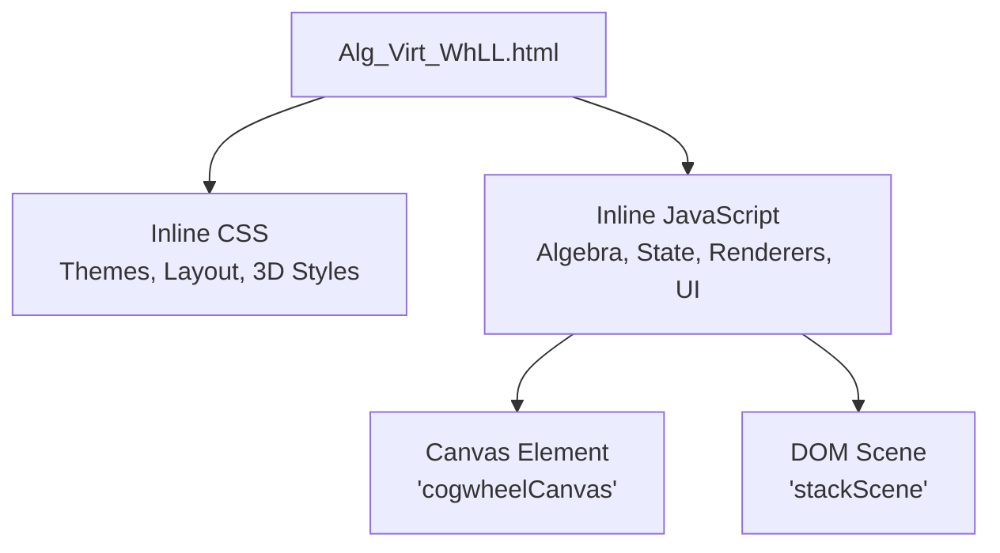
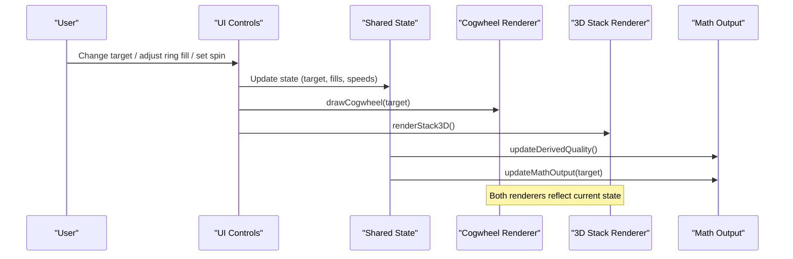
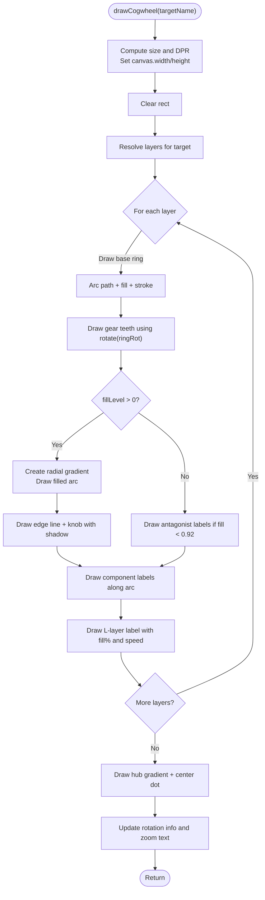
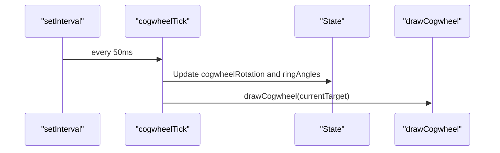
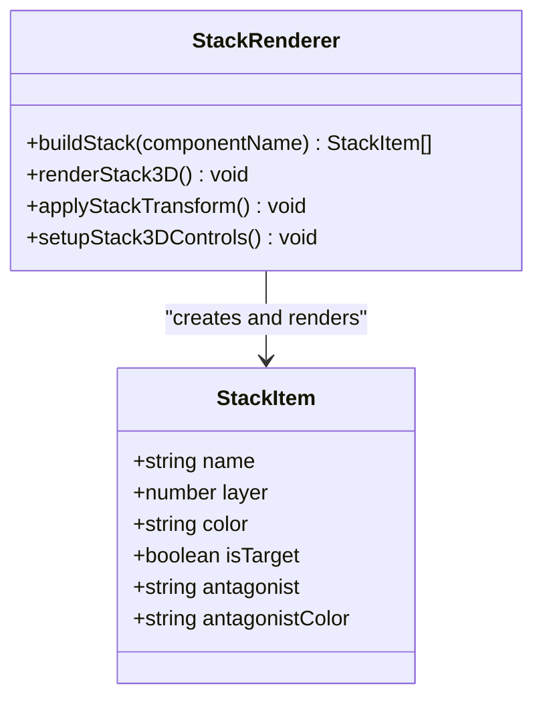
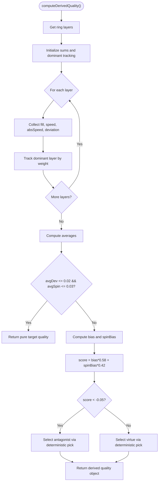
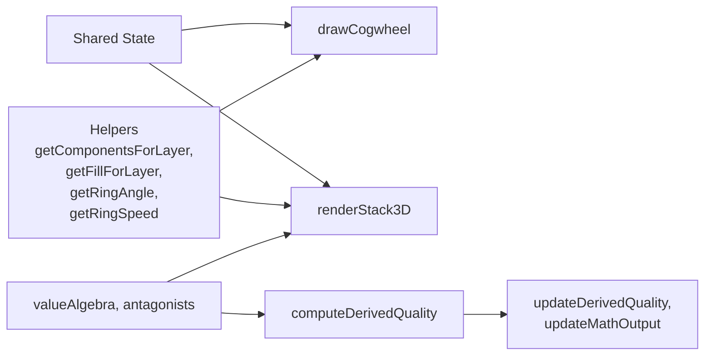

# Rendering Engines

<cite>
**Referenced Files in This Document**   
- [Alg_Virt_WhLL.html](file://Alg_Virt_WhLL.html)
</cite>

## Table of Contents
1. [Introduction](#introduction)
2. [Project Structure](#project-structure)
3. [Core Components](#core-components)
4. [Architecture Overview](#architecture-overview)
5. [Detailed Component Analysis](#detailed-component-analysis)
6. [Dependency Analysis](#dependency-analysis)
7. [Performance Considerations](#performance-considerations)
8. [Troubleshooting Guide](#troubleshooting-guide)
9. [Conclusion](#conclusion)

## Introduction
This document explains the dual rendering system implemented in a single-page application that visualizes an algebraic value model through two coordinated renderers:

- A Canvas API-based 2D cogwheel renderer optimized for high-performance drawing of concentric rings, gear teeth, gradients, and text labels.
- A DOM-based 3D stack renderer using CSS transforms and perspective to present layered blocks with front/back faces and fill overlays.

The two renderers share state (target quality, ring fills, ring spin speeds) and are synchronized by a central refresh pipeline. The document covers coordinate systems, drawing algorithms, animation loops, performance characteristics, usage guidance, synchronization, browser compatibility, and fallback strategies.

## Project Structure
The entire application is contained in one HTML file. It includes:

- Inline CSS defining themes, layout, canvas container styles, and 3D scene styles.
- Inline JavaScript implementing:
  - Algebra data model and antagonist mappings.
  - Theme switching.
  - Cogwheel Canvas rendering and interaction.
  - 3D DOM stack rendering and interaction.
  - Derived quality computation and telemetry output.
  - Fullscreen handling and global refresh orchestration.

**Diagram sources**
- [Alg_Virt_WhLL.html:1-10](file://Alg_Virt_WhLL.html#L1-L10)
- [Alg_Virt_WhLL.html:710-830](file://Alg_Virt_WhLL.html#L710-L830)
- [Alg_Virt_WhLL.html:830-2036](file://Alg_Virt_WhLL.html#L830-L2036)

**Section sources**
- [Alg_Virt_WhLL.html:1-10](file://Alg_Virt_WhLL.html#L1-L10)
- [Alg_Virt_WhLL.html:710-830](file://Alg_Virt_WhLL.html#L710-L830)

## Core Components
- Value algebra and antagonists define the conceptual model and colors.
- Theme palette provides accent colors and fonts used by both renderers.
- Shared state includes target quality, ring fills, ring angles, ring speeds, zoom, rotation, and stack view parameters.
- Derived quality combines ring fills and spins into a composite signal.
- Two renderers:
  - Cogwheel Canvas renderer draws concentric rings, gear teeth, gradient fills, labels, and a glowing hub.
  - 3D Stack DOM renderer builds box elements with six faces, fill overlays, and applies CSS transforms for rotation and zoom.

Key responsibilities:
- Data model: [valueAlgebra:832-856](file://Alg_Virt_WhLL.html#L832-L856), [antagonists:858-865](file://Alg_Virt_WhLL.html#L858-L865).
- Theme: [THEMES:868-890](file://Alg_Virt_WhLL.html#L868-L890), [applyTheme:895-903](file://Alg_Virt_WhLL.html#L895-L903).
- Shared state: [state variables:921-943](file://Alg_Virt_WhLL.html#L921-L943).
- Derived quality: [computeDerivedQuality:1019-1081](file://Alg_Virt_WhLL.html#L1019-L1081), [updateDerivedQuality:1083-1093](file://Alg_Virt_WhLL.html#L1083-L1093).
- Canvas renderer: [drawCogwheel:1142-1354](file://Alg_Virt_WhLL.html#L1142-L1354), interactions and loop ([setupCogwheelInteractions:1426-1495](file://Alg_Virt_WhLL.html#L1426-L1495), [cogwheelTick:1498-1508](file://Alg_Virt_WhLL.html#L1498-L1508), [ensureCogwheelLoop:1515-1523](file://Alg_Virt_WhLL.html#L1515-L1523)).
- DOM 3D renderer: [buildStack:1620-1645](file://Alg_Virt_WhLL.html#L1620-L1645), [renderStack3D:1647-1763](file://Alg_Virt_WhLL.html#L1647-L1763), [applyStackTransform:1765-1770](file://Alg_Virt_WhLL.html#L1765-L1770), controls ([setupStack3DControls:1772-1881](file://Alg_Virt_WhLL.html#L1772-L1881)).
- Synchronization: [refreshAll:1988-1993](file://Alg_Virt_WhLL.html#L1988-L1993), [updateSystem:1995-2005](file://Alg_Virt_WhLL.html#L1995-L2005).

**Section sources**
- [Alg_Virt_WhLL.html:832-890](file://Alg_Virt_WhLL.html#L832-L890)
- [Alg_Virt_WhLL.html:921-943](file://Alg_Virt_WhLL.html#L921-L943)
- [Alg_Virt_WhLL.html:1019-1093](file://Alg_Virt_WhLL.html#L1019-L1093)
- [Alg_Virt_WhLL.html:1142-1354](file://Alg_Virt_WhLL.html#L1142-L1354)
- [Alg_Virt_WhLL.html:1426-1523](file://Alg_Virt_WhLL.html#L1426-L1523)
- [Alg_Virt_WhLL.html:1620-1770](file://Alg_Virt_WhLL.html#L1620-L1770)
- [Alg_Virt_WhLL.html:1988-2005](file://Alg_Virt_WhLL.html#L1988-L2005)

## Architecture Overview
The application uses a shared state model with two independent renderers. A central refresh function updates both renderers and telemetry whenever state changes. Animation loops run only when needed:

- Cogwheel loop runs when auto-rotation is enabled or any ring has non-zero speed.
- Stack auto-spin runs on a separate interval controlled by user action.

**Diagram sources**
- [Alg_Virt_WhLL.html:1988-2005](file://Alg_Virt_WhLL.html#L1988-L2005)
- [Alg_Virt_WhLL.html:1142-1354](file://Alg_Virt_WhLL.html#L1142-L1354)
- [Alg_Virt_WhLL.html:1620-1770](file://Alg_Virt_WhLL.html#L1620-L1770)

## Detailed Component Analysis

### Canvas-Based Cogwheel Renderer
Responsibilities:
- Compute device pixel ratio and scale canvas dimensions for crisp rendering.
- Build concentric rings per layer, including background, stroke, and gear teeth.
- Draw gradient-filled arcs representing fill levels.
- Render component names and antagonist labels along arcs.
- Draw a glowing hub and dynamic labels showing layer index, fill percentage, and spin direction/speed.
- Handle hit testing, drag-to-fill, wheel zoom, Shift+Wheel ring spin, and touch gestures.

Coordinate system:
- Origin at canvas center after translation.
- Angles measured from top (-π/2) around the circle.
- Fill arc starts at -π/2 + ringRotation and spans fillLevel × 2π.

Drawing algorithm highlights:
- Radial gradients for ring fills and hub glow.
- Gear teeth drawn by alternating inner and outer radii around the ring perimeter.
- Shadow effects applied selectively for edge lines and knobs.
- Text rotated to align with arc tangent; orientation corrected for readability.

Animation loop:
- cogwheelTick advances global rotation and per-ring angles based on speeds.
- ensureCogwheelLoop starts/stops setInterval based on autoRotate or any ring speed.

Interaction flow:
- mousedown/touchstart initiates fill drag on a hit-tested ring.
- mousemove/touchmove updates fill level via angleToFill.
- wheel adjusts zoom or ring speed depending on modifier key.

**Diagram sources**
- [Alg_Virt_WhLL.html:1142-1354](file://Alg_Virt_WhLL.html#L1142-L1354)

**Section sources**
- [Alg_Virt_WhLL.html:1142-1354](file://Alg_Virt_WhLL.html#L1142-L1354)
- [Alg_Virt_WhLL.html:1356-1495](file://Alg_Virt_WhLL.html#L1356-L1495)
- [Alg_Virt_WhLL.html:1498-1523](file://Alg_Virt_WhLL.html#L1498-L1523)

#### Coordinate Systems and Transformations
- Canvas context origin is translated to center before rotating per ring.
- Ring rotation equals global cogwheelRotation plus per-ring angle.
- Fill arc startAngle = -π/2 + ringRotation; endAngle = startAngle + fillLevel × 2π.
- Hit testing converts client coordinates to canvas space using scaleX/scaleY derived from getBoundingClientRect and canvas.width/height.

**Section sources**
- [Alg_Virt_WhLL.html:1142-1158](file://Alg_Virt_WhLL.html#L1142-L1158)
- [Alg_Virt_WhLL.html:1177-1216](file://Alg_Virt_WhLL.html#L1177-L1216)
- [Alg_Virt_WhLL.html:1218-1261](file://Alg_Virt_WhLL.html#L1218-L1261)
- [Alg_Virt_WhLL.html:1356-1388](file://Alg_Virt_WhLL.html#L1356-L1388)

#### Drawing Functions and Algorithms
- Background radial gradient centered at canvas center.
- Per-layer ring paths composed of two arcs (outer clockwise, inner counter-clockwise) to create annular segments.
- Gradient fills use multiple color stops mapped from component colors.
- Edge line drawn from inner to outer radius at endAngle; knob drawn at midRadius.
- Antagonist labels placed at evenly spaced angles within unfilled portion.
- Component labels placed at evenly spaced angles within filled portion.

**Section sources**
- [Alg_Virt_WhLL.html:1169-1175](file://Alg_Virt_WhLL.html#L1169-L1175)
- [Alg_Virt_WhLL.html:1190-1216](file://Alg_Virt_WhLL.html#L1190-L1216)
- [Alg_Virt_WhLL.html:1218-1294](file://Alg_Virt_WhLL.html#L1218-L1294)
- [Alg_Virt_WhLL.html:1296-1333](file://Alg_Virt_WhLL.html#L1296-L1333)

#### Animation Loops
- cogwheelTick increments global rotation and per-ring angles by dt × speed.
- ensureCogwheelLoop toggles setInterval based on autoRotate or presence of non-zero ring speeds.
- Button handlers toggle autoRotate and update loop state.

**Diagram sources**
- [Alg_Virt_WhLL.html:1498-1523](file://Alg_Virt_WhLL.html#L1498-L1523)

**Section sources**
- [Alg_Virt_WhLL.html:1498-1523](file://Alg_Virt_WhLL.html#L1498-L1523)
- [Alg_Virt_WhLL.html:1541-1612](file://Alg_Virt_WhLL.html#L1541-L1612)

### DOM-Based 3D Stack Renderer
Responsibilities:
- Build a list of stack items from the selected target’s dependencies and target itself.
- Create DOM nodes for each item with six faces (front, back, top, bottom, left, right).
- Apply CSS transforms to position faces in 3D space.
- Render fill overlay width proportional to ring fill for the item’s layer.
- Support drag-and-drop reordering of stack items.
- Provide interactive rotation and zoom via mouse and touch events.
- Optional auto-spinning of the stack.

Coordinate system:
- Scene uses CSS perspective and transform-style: preserve-3d.
- Boxes positioned absolutely within the scene; vertical stacking via negative top offsets.
- Faces positioned using translateZ and rotations (rotateX, rotateY) to form a cube-like block.
- Scene transform applies translateZ(-200*(zoom-1)), scale(zoom), rotateX(stackRotX), rotateY(stackRotY).

Rendering algorithm highlights:
- Front face shows component name and fill overlay.
- Back face shows antagonist name when enabled.
- Top/bottom/left/right faces show layer index and fill percentage.
- Drag-and-drop updates stackItems order and re-renders.

**Diagram sources**
- [Alg_Virt_WhLL.html:1620-1645](file://Alg_Virt_WhLL.html#L1620-L1645)
- [Alg_Virt_WhLL.html:1647-1770](file://Alg_Virt_WhLL.html#L1647-L1770)

**Section sources**
- [Alg_Virt_WhLL.html:1620-1770](file://Alg_Virt_WhLL.html#L1620-L1770)
- [Alg_Virt_WhLL.html:1772-1881](file://Alg_Virt_WhLL.html#L1772-L1881)

#### Transforms and 3D Layout
- Scene transform: translateZ(-200*(stackZoom-1)) scale(stackZoom) rotateX(stackRotX) rotateY(stackRotY).
- Box faces:
  - Front: translateZ(20px)
  - Back: translateZ(-20px) rotateY(180deg)
  - Top: rotateX(90deg) translateZ(0)
  - Bottom: rotateX(-90deg) translateZ(0)
  - Left: rotateY(-90deg) translateZ(0)
  - Right: rotateY(90deg) translateZ(0)

These transforms create a pseudo-cube representation for each stack item.

**Section sources**
- [Alg_Virt_WhLL.html:1765-1770](file://Alg_Virt_WhLL.html#L1765-L1770)
- [Alg_Virt_WhLL.html:1696-1721](file://Alg_Virt_WhLL.html#L1696-L1721)

#### Interaction and Auto-Spin
- Mouse drag rotates the scene; wheel zooms.
- Touch drag and pinch-zoom supported.
- Auto-spin toggled via button; uses setInterval to increment stackRotY.

**Section sources**
- [Alg_Virt_WhLL.html:1772-1881](file://Alg_Virt_WhLL.html#L1772-L1881)

### Derived Quality Computation
Purpose:
- Combine ring fills and spin directions/speeds into a composite “quality” signal.
- Determine whether the emergent quality is positive or negative.
- Select a representative source component and map to either a virtue or antagonist.

Algorithm overview:
- Aggregate fill sum, net speed sum, absolute speed sum, and deviation from 0.5 fill across layers.
- If average deviation and spin are near zero, return pure target quality.
- Otherwise compute bias from fill and spinBias from net speed.
- Score = bias × 0.58 + spinBias × 0.42.
- Negative if score < -0.05.
- Choose dominant layer by weight combining deviation and speed magnitude.
- Pick a component deterministically using a hash of signature parts and target name.

**Diagram sources**
- [Alg_Virt_WhLL.html:1019-1081](file://Alg_Virt_WhLL.html#L1019-L1081)

**Section sources**
- [Alg_Virt_WhLL.html:1019-1081](file://Alg_Virt_WhLL.html#L1019-L1081)

## Dependency Analysis
The renderers depend on shared state and helper functions:

- drawCogwheel depends on:
  - getComponentsForLayer, getLayerComponentsOrdered, getFillForLayer, getRingAngle, getRingSpeed.
  - THEMES and theme utilities.
  - State variables: cogwheelRotation, zoomFactor, hoveredRing, isDraggingFill, dragRingIndex.
- renderStack3D depends on:
  - buildStack, getFillForLayer, stackItems, stackShowAntagonists.
  - State variables: stackRotX, stackRotY, stackZoom.
- Derived quality depends on:
  - getRingLayers, getFillForLayer, getRingSpeed, getLayerComponentsOrdered, antagonists, hashString.

**Diagram sources**
- [Alg_Virt_WhLL.html:945-1008](file://Alg_Virt_WhLL.html#L945-L1008)
- [Alg_Virt_WhLL.html:1019-1081](file://Alg_Virt_WhLL.html#L1019-L1081)
- [Alg_Virt_WhLL.html:1142-1354](file://Alg_Virt_WhLL.html#L1142-L1354)
- [Alg_Virt_WhLL.html:1620-1770](file://Alg_Virt_WhLL.html#L1620-L1770)

**Section sources**
- [Alg_Virt_WhLL.html:945-1008](file://Alg_Virt_WhLL.html#L945-L1008)
- [Alg_Virt_WhLL.html:1019-1081](file://Alg_Virt_WhLL.html#L1019-L1081)
- [Alg_Virt_WhLL.html:1142-1354](file://Alg_Virt_WhLL.html#L1142-L1354)
- [Alg_Virt_WhLL.html:1620-1770](file://Alg_Virt_WhLL.html#L1620-L1770)

## Performance Considerations
- Canvas renderer:
  - Uses devicePixelRatio scaling for sharp rendering on high-DPI displays.
  - Clears canvas each frame and redraws all layers; efficient for moderate numbers of layers and components.
  - ShadowBlur and gradients can be GPU-accelerated but may increase cost; used sparingly and conditionally.
  - Animation loop runs only when necessary (autoRotate or any ring speed), reducing idle CPU usage.
- DOM renderer:
  - Rebuilds DOM nodes on full re-render; acceptable for small stacks.
  - CSS transforms and perspective are hardware-accelerated in modern browsers.
  - Drag-and-drop and event listeners add overhead; minimized by delegating to window-level handlers where appropriate.
- Synchronization:
  - refreshAll triggers both renderers and telemetry; called on significant state changes.
  - Resize handler debounces refresh to avoid excessive redraws.

Recommendations:
- Prefer Canvas for dense, frequently updated graphics (e.g., many animated rings).
- Prefer DOM 3D for structured, interactive blocks with semantic content and accessibility benefits.
- Keep animation intervals minimal and stop them when not needed.
- Avoid unnecessary DOM rebuilds; batch updates where possible.

[No sources needed since this section provides general guidance]

## Troubleshooting Guide
Common issues and resolutions:

- Canvas appears blurry:
  - Ensure devicePixelRatio scaling is applied to canvas.width/height.
  - Verify container sizing and aspect-ratio constraints.
- Interactions not responding:
  - Check event listeners bound to canvas and viewport.
  - Confirm passive:false where preventDefault is used.
- 3D scene not rotating:
  - Verify applyStackTransform is called on mousemove/touchmove.
  - Ensure perspective and transform-style: preserve-3d are set on scene.
- Derived quality not updating:
  - Ensure refreshAll is called after state changes.
  - Validate computeDerivedQuality logic and ring speed/fill state.
- Fullscreen behavior inconsistent:
  - Use both standard and webkitFullscreen APIs.
  - Re-render after fullscreen change to adjust sizes.

**Section sources**
- [Alg_Virt_WhLL.html:1426-1495](file://Alg_Virt_WhLL.html#L1426-L1495)
- [Alg_Virt_WhLL.html:1772-1881](file://Alg_Virt_WhLL.html#L1772-L1881)
- [Alg_Virt_WhLL.html:1950-1983](file://Alg_Virt_WhLL.html#L1950-L1983)

## Conclusion
The dual rendering system separates concerns between a high-performance Canvas-based 2D cogwheel and a flexible DOM-based 3D stack. They share a common state model and are synchronized through a centralized refresh pipeline. The Canvas renderer excels at dense, animated graphics with precise control over drawing primitives, while the DOM renderer leverages CSS transforms for 3D presentation and rich interactivity. Together, they provide a responsive, visually engaging interface for exploring the algebraic value model.

[No sources needed since this section summarizes without analyzing specific files]