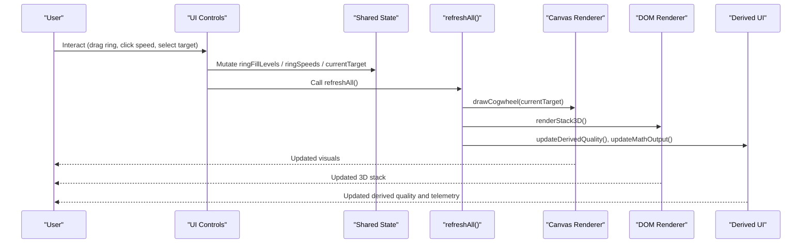
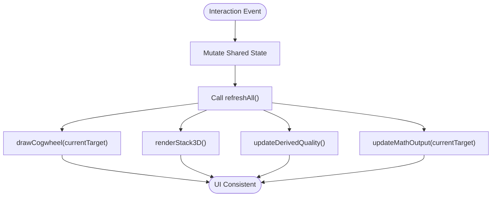
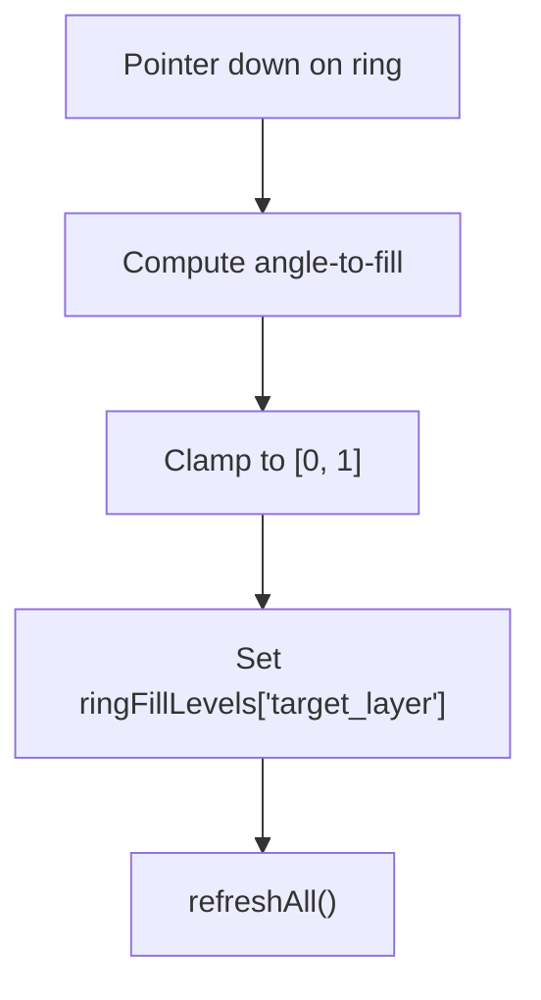
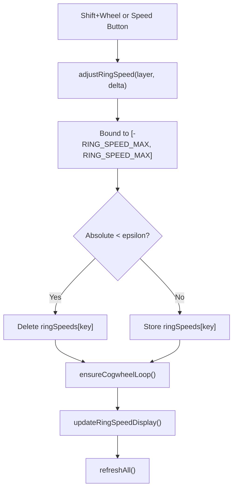
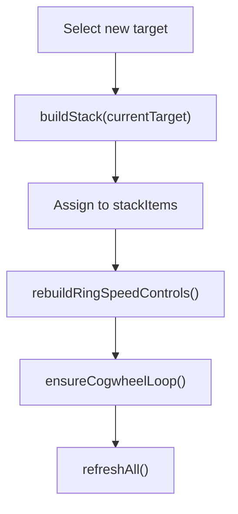
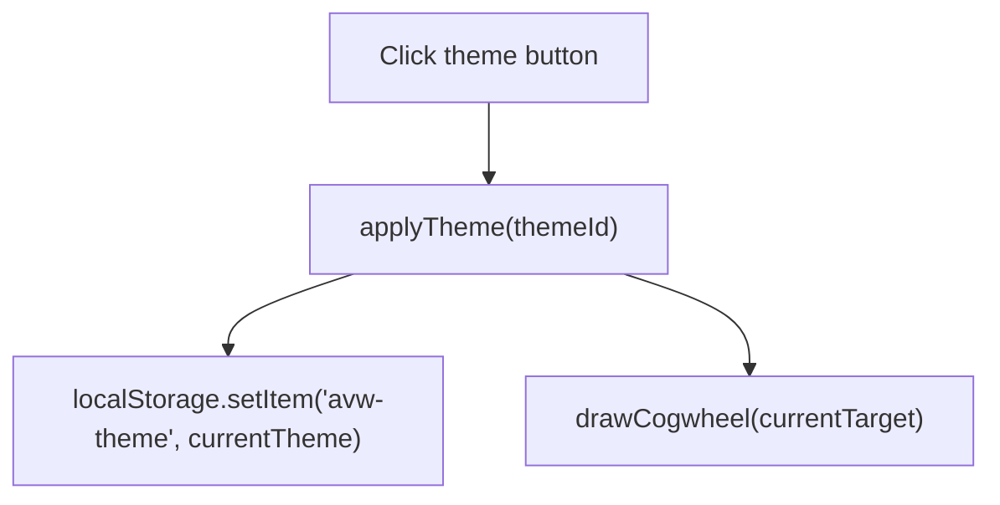
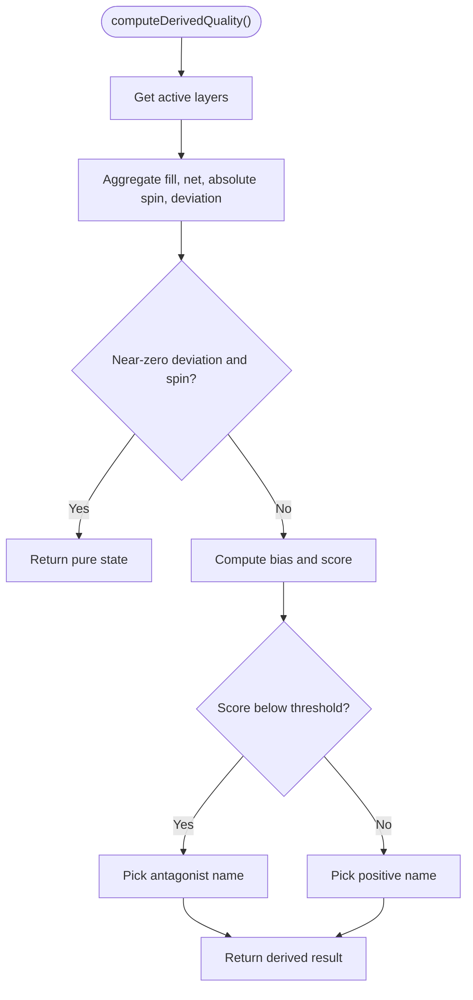
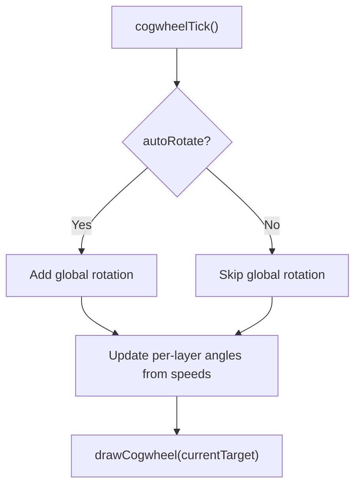
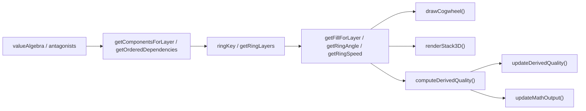

# State Management

<cite>
**Referenced Files in This Document**
- [Alg_Virt_WhLL.html](file://Alg_Virt_WhLL.html)
</cite>

## Table of Contents
1. [Introduction](#introduction)
2. [Project Structure](#project-structure)
3. [Core Components](#core-components)
4. [Architecture Overview](#architecture-overview)
5. [Detailed Component Analysis](#detailed-component-analysis)
6. [Dependency Analysis](#dependency-analysis)
7. [Performance Considerations](#performance-considerations)
8. [Troubleshooting Guide](#troubleshooting-guide)
9. [Conclusion](#conclusion)

## Introduction
This document explains the centralized state management system for the application, focusing on data flow and synchronization between visualizations. The app maintains a single source of truth for:
- Ring fill levels across concentric layers
- Per-ring rotation angles and spin speeds
- A 3D stack of layered items
- Theme configuration persisted to Local Storage

The system uses an observer-like pattern: user interactions mutate shared state, then a central refresh routine synchronizes both Canvas-based and DOM-based renderers.

## Project Structure
The entire application is implemented in a single HTML file that includes:
- CSS design templates and theme variables
- HTML panels for the cogwheel visualization and the 3D stack
- JavaScript logic for algebra definitions, state, rendering, interactions, and persistence

```mermaid
graph TB
App["Single-page App<br/>HTML + CSS + JS"]
subgraph "UI Panels"
CogPanel["Cogwheel Panel<br/>Canvas + Controls"]
StackPanel["3D Stack Panel<br/>DOM Scene + Controls"]
end
subgraph "State Layer"
SharedState["Shared Runtime State<br/>rings, fills, speeds,<br/>stack, theme, zoom"]
Algebra["Value Algebra & Antagonists"]
end
subgraph "Renderers"
CanvasRenderer["Canvas Renderer<br/>drawCogwheel()"]
DOMRenderer["DOM Renderer<br/>renderStack3D()"]
DerivedUI["Derived UI<br/>derived quality overlay<br/>math telemetry"]
end
App --> CogPanel
App --> StackPanel
CogPanel --> SharedState
StackPanel --> SharedState
SharedState --> CanvasRenderer
SharedState --> DOMRenderer
SharedState --> DerivedUI
Algebra --> SharedState
```

**Diagram sources**
- [Alg_Virt_WhLL.html:830-943](file://Alg_Virt_WhLL.html#L830-L943)
- [Alg_Virt_WhLL.html:1142-1354](file://Alg_Virt_WhLL.html#L1142-L1354)
- [Alg_Virt_WhLL.html:1620-1770](file://Alg_Virt_WhLL.html#L1620-L1770)
- [Alg_Virt_WhLL.html:1988-1993](file://Alg_Virt_WhLL.html#L1988-L1993)

**Section sources**
- [Alg_Virt_WhLL.html:1-10](file://Alg_Virt_WhLL.html#L1-L10)
- [Alg_Virt_WhLL.html:710-828](file://Alg_Virt_WhLL.html#L710-L828)
- [Alg_Virt_WhLL.html:830-943](file://Alg_Virt_WhLL.html#L830-L943)

## Core Components
This section documents the primary state objects and their responsibilities.

### Centralized State Object
The application keeps runtime state in module-level variables grouped by concern:

- Cogwheel animation and interaction state
  - `cogwheelRotation`: global wheel rotation angle
  - `autoRotate`: whether the whole wheel auto-rotates
  - `zoomFactor`: canvas zoom level
  - `hoveredRing`, `isDraggingFill`, `dragRingIndex`: pointer-driven ring interaction

- Ring state per layer
  - `ringFillLevels`: map keyed by `"target_layer"` storing normalized fill values
  - `ringAngles`: per-layer accumulated rotation offsets
  - `ringSpeeds`: per-layer angular velocities (rad/s)

- Target and derived state
  - `currentTarget`: selected value from the algebra blueprint
  - Derived quality computed from fills and speeds

- 3D stack state
  - `stackItems`: ordered list of stack entries with metadata
  - `stackRotX`, `stackRotY`, `stackZoom`: camera/view transforms
  - `stackDragging`, `stackSpin`, `stackShowAntagonists`: view controls

- Theme state
  - `currentTheme`: active theme identifier
  - Theme palette lookup via `getThemePalette()`

These fields are mutated by interaction handlers and read by renderers through helper functions such as `getFillForLayer`, `getRingAngle`, and `getRingSpeed`.

**Section sources**
- [Alg_Virt_WhLL.html:920-943](file://Alg_Virt_WhLL.html#L920-L943)
- [Alg_Virt_WhLL.html:990-1008](file://Alg_Virt_WhLL.html#L990-L1008)

### Value Algebra and Antagonists
- `valueAlgebra`: defines each virtue’s components, color, description, and layer
- `antagonists`: maps each virtue to its opposing concept

These structures drive:
- Which rings appear for a given target
- How fills are distributed across component names
- How antagonists are shown in the cogwheel and stack

**Section sources**
- [Alg_Virt_WhLL.html:831-865](file://Alg_Virt_WhLL.html#L831-L865)

### Theme Configuration
- `THEMES`: predefined palettes with accent colors, RGB values, fonts
- `currentTheme`: active theme ID
- `applyTheme(themeId)`: updates DOM attributes, button states, and redraws the cogwheel
- `setupThemeSwitch()`: wires theme buttons and loads saved theme from Local Storage

Persistence:
- On theme change, the theme ID is stored under key `avw-theme`
- On load, the saved theme is applied if valid; otherwise defaults to `spaceship`

**Section sources**
- [Alg_Virt_WhLL.html:867-918](file://Alg_Virt_WhLL.html#L867-L918)

## Architecture Overview
The system follows a unidirectional data flow:
1. User actions or timers mutate shared state
2. A central refresh function triggers synchronized updates
3. Renderers consume current state to draw visuals
4. Derived computations update overlays and telemetry

**Diagram sources**
- [Alg_Virt_WhLL.html:1390-1419](file://Alg_Virt_WhLL.html#L1390-L1419)
- [Alg_Virt_WhLL.html:1548-1611](file://Alg_Virt_WhLL.html#L1548-L1611)
- [Alg_Virt_WhLL.html:1988-1993](file://Alg_Virt_WhLL.html#L1988-L1993)
- [Alg_Virt_WhLL.html:1995-2005](file://Alg_Virt_WhLL.html#L1995-L2005)

## Detailed Component Analysis

### Observer Pattern and Real-Time Updates
Although not implemented as a formal class-based observer, the code implements an observer-like pattern:
- State is centralized in module-level variables
- Interaction handlers mutate state directly
- A central `refreshAll()` acts as the dispatcher that notifies all renderers

Key observers:
- Canvas renderer: `drawCogwheel(targetName)`
- DOM renderer: `renderStack3D()`
- Derived UI: `updateDerivedQuality()` and `updateMathOutput(componentName)`

Triggers:
- Mouse/touch drag on rings mutates `ringFillLevels`
- Wheel with Shift mutates `ringSpeeds`
- Buttons mutate animation flags and reset/clear state
- Select changes trigger `updateSystem()` which rebuilds `stackItems` and refreshes everything

Consistency guarantees:
- All renderers are updated within the same `refreshAll()` call, ensuring consistent snapshots
- Derived computations use current state at the time of update

**Diagram sources**
- [Alg_Virt_WhLL.html:1390-1419](file://Alg_Virt_WhLL.html#L1390-L1419)
- [Alg_Virt_WhLL.html:1548-1611](file://Alg_Virt_WhLL.html#L1548-L1611)
- [Alg_Virt_WhLL.html:1988-1993](file://Alg_Virt_WhLL.html#L1988-L1993)

**Section sources**
- [Alg_Virt_WhLL.html:1390-1419](file://Alg_Virt_WhLL.html#L1390-L1419)
- [Alg_Virt_WhLL.html:1548-1611](file://Alg_Virt_WhLL.html#L1548-L1611)
- [Alg_Virt_WhLL.html:1988-1993](file://Alg_Virt_WhLL.html#L1988-L1993)

### State Mutation Patterns

#### Ring Fill Levels
- Keys: `"target_layer"`
- Values: normalized fill between 0 and 1
- Mutated during mouse/touch drag on a ring
- Default fallback: 0.5 when no explicit fill is set

**Diagram sources**
- [Alg_Virt_WhLL.html:1384-1398](file://Alg_Virt_WhLL.html#L1384-L1398)
- [Alg_Virt_WhLL.html:1400-1419](file://Alg_Virt_WhLL.html#L1400-L1419)
- [Alg_Virt_WhLL.html:1988-1993](file://Alg_Virt_WhLL.html#L1988-L1993)

**Section sources**
- [Alg_Virt_WhLL.html:1384-1419](file://Alg_Virt_WhLL.html#L1384-L1419)
- [Alg_Virt_WhLL.html:990-993](file://Alg_Virt_WhLL.html#L990-L993)

#### Ring Speeds
- Keys: `"target_layer"`
- Values: rad/s bounded by `RING_SPEED_MAX`
- Mutated by Shift+Wheel on a ring or speed increment/decrement buttons
- Zero speeds are deleted from the map to avoid unnecessary animation

**Diagram sources**
- [Alg_Virt_WhLL.html:1120-1129](file://Alg_Virt_WhLL.html#L1120-L1129)
- [Alg_Virt_WhLL.html:1592-1611](file://Alg_Virt_WhLL.html#L1592-L1611)
- [Alg_Virt_WhLL.html:1514-1523](file://Alg_Virt_WhLL.html#L1514-L1523)

**Section sources**
- [Alg_Virt_WhLL.html:1120-1129](file://Alg_Virt_WhLL.html#L1120-L1129)
- [Alg_Virt_WhLL.html:1592-1611](file://Alg_Virt_WhLL.html#L1592-L1611)
- [Alg_Virt_WhLL.html:1514-1523](file://Alg_Virt_WhLL.html#L1514-L1523)

#### Stack Items
- Rebuilt when target changes via `buildStack(targetName)`
- Maintains order for custom stacking and telemetry
- Supports drag-and-drop reordering, toggling antagonist labels, and auto-spinning view

**Diagram sources**
- [Alg_Virt_WhLL.html:1620-1645](file://Alg_Virt_WhLL.html#L1620-L1645)
- [Alg_Virt_WhLL.html:1995-2005](file://Alg_Virt_WhLL.html#L1995-L2005)

**Section sources**
- [Alg_Virt_WhLL.html:1620-1645](file://Alg_Virt_WhLL.html#L1620-L1645)
- [Alg_Virt_WhLL.html:1995-2005](file://Alg_Virt_WhLL.html#L1995-L2005)

#### Theme Configuration
- Applied by setting `document.body.dataset.theme`
- Persists to Local Storage under key `avw-theme`
- Triggers a redraw of the cogwheel to reflect theme colors

**Diagram sources**
- [Alg_Virt_WhLL.html:895-918](file://Alg_Virt_WhLL.html#L895-L918)

**Section sources**
- [Alg_Virt_WhLL.html:895-918](file://Alg_Virt_WhLL.html#L895-L918)

### Derived Quality Computation
Derived quality combines ring fills and spin speeds into a composite signal:
- Computes averages over active layers
- Detects “pure” state when deviations are minimal
- Determines negative vs positive emergent quality
- Chooses a representative name based on dominant layer and deterministic hashing

**Diagram sources**
- [Alg_Virt_WhLL.html:1019-1081](file://Alg_Virt_WhLL.html#L1019-L1081)

**Section sources**
- [Alg_Virt_WhLL.html:1019-1081](file://Alg_Virt_WhLL.html#L1019-L1081)

### Animation Loop and Timing
- Cogwheel animation runs on a timer interval
- Interval starts/stops based on whether global auto-rotation or any ring spin is active
- Each tick updates rotation angles and redraws the canvas

**Diagram sources**
- [Alg_Virt_WhLL.html:1498-1508](file://Alg_Virt_WhLL.html#L1498-L1508)
- [Alg_Virt_WhLL.html:1514-1523](file://Alg_Virt_WhLL.html#L1514-L1523)

**Section sources**
- [Alg_Virt_WhLL.html:1498-1508](file://Alg_Virt_WhLL.html#L1498-L1508)
- [Alg_Virt_WhLL.html:1514-1523](file://Alg_Virt_WhLL.html#L1514-L1523)

## Dependency Analysis
The following diagram shows how core modules depend on each other:

**Diagram sources**
- [Alg_Virt_WhLL.html:831-865](file://Alg_Virt_WhLL.html#L831-L865)
- [Alg_Virt_WhLL.html:945-993](file://Alg_Virt_WhLL.html#L945-L993)
- [Alg_Virt_WhLL.html:1019-1081](file://Alg_Virt_WhLL.html#L1019-L1081)
- [Alg_Virt_WhLL.html:1142-1354](file://Alg_Virt_WhLL.html#L1142-L1354)
- [Alg_Virt_WhLL.html:1620-1770](file://Alg_Virt_WhLL.html#L1620-L1770)
- [Alg_Virt_WhLL.html:1886-1945](file://Alg_Virt_WhLL.html#L1886-L1945)

**Section sources**
- [Alg_Virt_WhLL.html:831-865](file://Alg_Virt_WhLL.html#L831-L865)
- [Alg_Virt_WhLL.html:945-993](file://Alg_Virt_WhLL.html#L945-L993)
- [Alg_Virt_WhLL.html:1019-1081](file://Alg_Virt_WhLL.html#L1019-L1081)
- [Alg_Virt_WhLL.html:1142-1354](file://Alg_Virt_WhLL.html#L1142-L1354)
- [Alg_Virt_WhLL.html:1620-1770](file://Alg_Virt_WhLL.html#L1620-L1770)
- [Alg_Virt_WhLL.html:1886-1945](file://Alg_Virt_WhLL.html#L1886-L1945)

## Performance Considerations
- Frequent state updates occur during:
  - Mouse/touch drag on rings
  - Continuous wheel events for zoom and ring speed
  - Animation intervals for auto-rotation and ring spins
- Optimization strategies present in the code:
  - Animation loop only runs when needed (`ensureCogwheelLoop`)
  - Zero-speed rings are removed from `ringSpeeds` to reduce iteration overhead
  - Resize handler debounces full refresh using a timeout
  - Canvas dimensions are scaled by device pixel ratio for crisp rendering without extra layout passes
- Recommendations:
  - Batch multiple small mutations before calling `refreshAll()` where possible
  - Avoid rebuilding large DOM trees on every frame; prefer updating existing nodes
  - Use requestAnimationFrame for smooth animations instead of setInterval when feasible
  - Debounce high-frequency inputs like wheel events beyond what is already used

[No sources needed since this section provides general guidance]

## Troubleshooting Guide
Common issues and resolutions:
- Theme not persisting
  - Check browser storage permissions and ensure `localStorage` is available
  - Verify that `avw-theme` key exists and holds a valid theme ID
- Derived quality not updating
  - Confirm that `ringFillLevels` and `ringSpeeds` keys match `"target_layer"` format
  - Ensure `refreshAll()` is called after state mutation
- Canvas not resizing correctly
  - Trigger a resize event or fullscreen change to force redraw
  - Verify that `window.devicePixelRatio` is considered in canvas sizing
- Animation not stopping
  - Clear `autoRotateInterval` and reset `autoRotate` flag
  - Remove all non-zero ring speeds

**Section sources**
- [Alg_Virt_WhLL.html:895-918](file://Alg_Virt_WhLL.html#L895-L918)
- [Alg_Virt_WhLL.html:1514-1523](file://Alg_Virt_WhLL.html#L1514-L1523)
- [Alg_Virt_WhLL.html:1972-1983](file://Alg_Virt_WhLL.html#L1972-L1983)
- [Alg_Virt_WhLL.html:2027-2031](file://Alg_Virt_WhLL.html#L2027-L2031)

## Conclusion
The application’s state management centers around a shared runtime state object that drives both Canvas and DOM renderers. Interactions mutate state, and a central refresh routine ensures consistency across visuals and telemetry. Theme preferences are persisted to Local Storage, and derived computations provide real-time feedback on the combined state of fills and spins. With careful batching and efficient rendering, the system remains responsive even under frequent updates.

[No sources needed since this section summarizes without analyzing specific files]