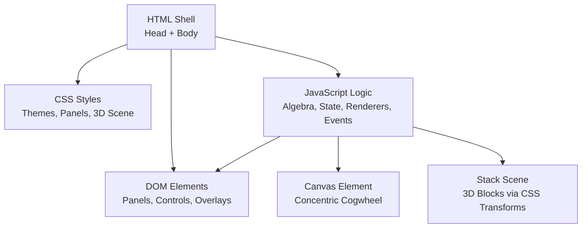
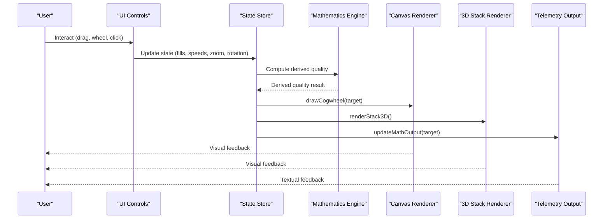
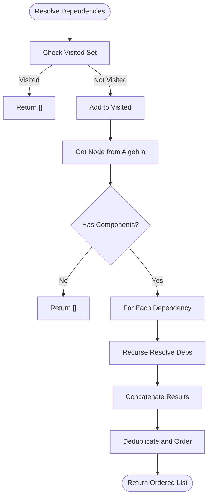
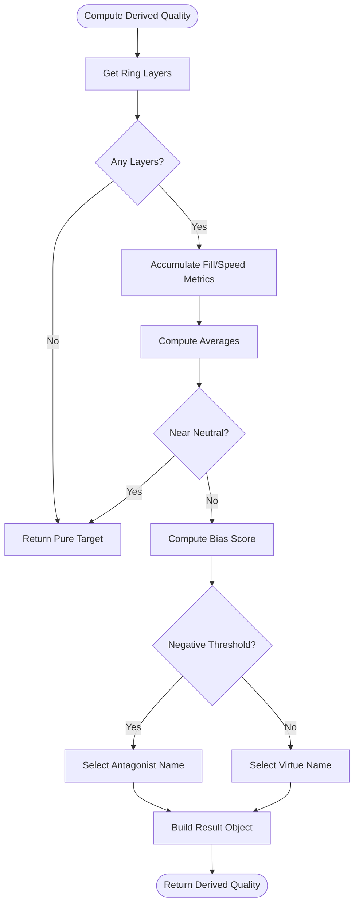
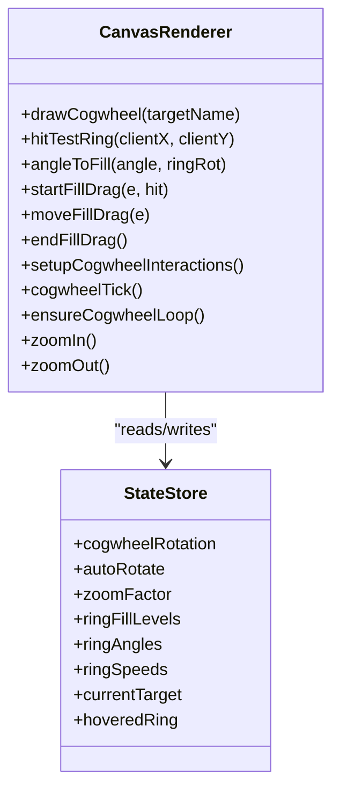
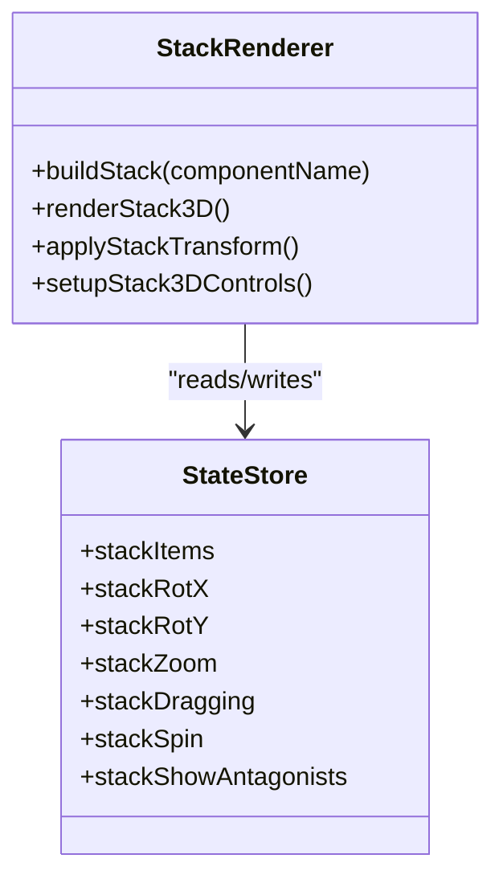
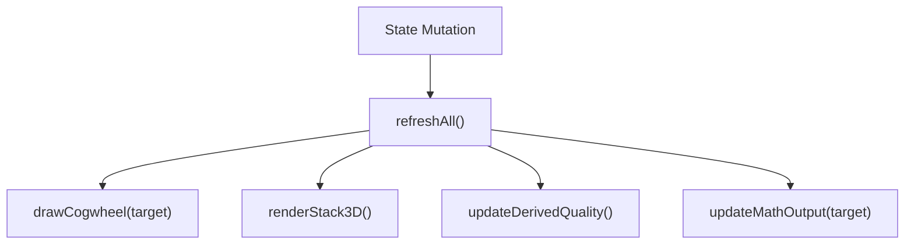
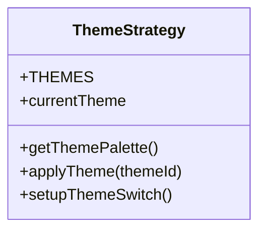
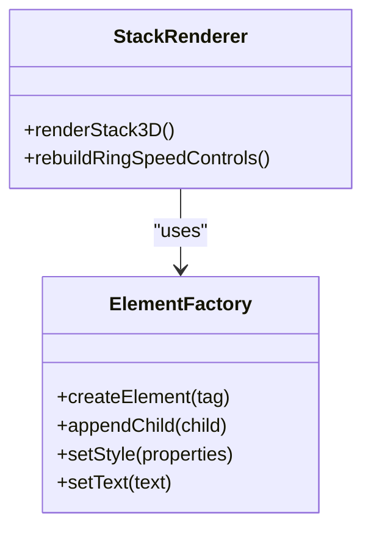
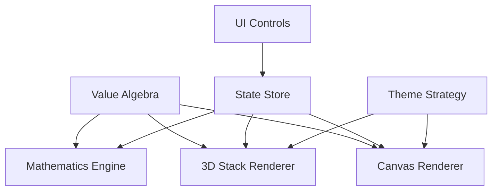

# Technical Architecture

<cite>
**Referenced Files in This Document**
- [Alg_Virt_WhLL.html](file://Alg_Virt_WhLL.html)
</cite>

## Table of Contents
1. [Introduction](#introduction)
2. [Project Structure](#project-structure)
3. [Core Components](#core-components)
4. [Architecture Overview](#architecture-overview)
5. [Detailed Component Analysis](#detailed-component-analysis)
6. [Dependency Analysis](#dependency-analysis)
7. [Performance Considerations](#performance-considerations)
8. [Troubleshooting Guide](#troubleshooting-guide)
9. [Conclusion](#conclusion)

## Introduction
This document describes the architecture of a single-file application that implements an algebraic visualization system. The application is organized as one HTML file containing CSS, DOM structure, and JavaScript logic. It provides:

- A value algebra model defining virtues, their dependencies, colors, layers, and antagonists.
- A mathematics engine that computes derived qualities from ring fills and spin speeds.
- A Canvas-based 2D concentric cogwheel renderer for high-performance graphics.
- A DOM-based 3D block stack using CSS transforms and Web Animations–style transitions.
- State management with observer-like refresh propagation.
- Theme switching via CSS variables and a strategy-style theme palette.
- Dynamic element creation through factory-style functions.

The goal is to make the internal design accessible while preserving technical precision.

## Project Structure
The repository contains a single monolithic HTML file. Its responsibilities are divided into logical sections:

- CSS section: global styles, theme variables, panel layouts, canvas container, 3D stack scene, and responsive rules.
- DOM section: theme bar, two panels (cogwheel and 3D stack), controls, overlays, and telemetry readout.
- JavaScript section: data models, state, helpers, rendering engines, interaction handlers, and initialization.

**Diagram sources**
- [Alg_Virt_WhLL.html:7-705](file://Alg_Virt_WhLL.html#L7-L705)
- [Alg_Virt_WhLL.html:707-825](file://Alg_Virt_WhLL.html#L707-L825)
- [Alg_Virt_WhLL.html:827-2033](file://Alg_Virt_WhLL.html#L827-L2033)

**Section sources**
- [Alg_Virt_WhLL.html:7-705](file://Alg_Virt_WhLL.html#L7-L705)
- [Alg_Virt_WhLL.html:707-825](file://Alg_Virt_WhLL.html#L707-L825)
- [Alg_Virt_WhLL.html:827-2033](file://Alg_Virt_WhLL.html#L827-L2033)

## Core Components
- Value Algebra Model: Defines virtues, components, colors, descriptions, layers, and antagonists.
- Mathematics Engine: Computes derived quality based on ring fill levels and spin speeds.
- Canvas Renderer: Draws concentric rings, teeth, labels, and dynamic overlays.
- 3D Stack Renderer: Builds DOM blocks with CSS 3D faces and applies transforms.
- State Manager: Holds rotation, zoom, ring fills, angles, speeds, target, and stack configuration.
- Interaction Layer: Handles mouse/touch events, wheel zoom, drag-to-fill, and control buttons.
- Theme System: Strategy-style palette selection applied via CSS variables and class toggles.
- Observer-like Refresh: Centralized refresh function updates all visualizations after state changes.

**Section sources**
- [Alg_Virt_WhLL.html:827-940](file://Alg_Virt_WhLL.html#L827-L940)
- [Alg_Virt_WhLL.html:941-1134](file://Alg_Virt_WhLL.html#L941-L1134)
- [Alg_Virt_WhLL.html:1136-1612](file://Alg_Virt_WhLL.html#L1136-L1612)
- [Alg_Virt_WhLL.html:1614-1878](file://Alg_Virt_WhLL.html#L1614-L1878)
- [Alg_Virt_WhLL.html:1880-2033](file://Alg_Virt_WhLL.html#L1880-L2033)

## Architecture Overview
The application follows a unidirectional data flow: user interactions update state; state changes trigger a central refresh that re-renders both the Canvas cogwheel and the DOM 3D stack, then updates derived quality and telemetry output.

**Diagram sources**
- [Alg_Virt_WhLL.html:1387-1492](file://Alg_Virt_WhLL.html#L1387-L1492)
- [Alg_Virt_WhLL.html:1494-1612](file://Alg_Virt_WhLL.html#L1494-L1612)
- [Alg_Virt_WhLL.html:1614-1878](file://Alg_Virt_WhLL.html#L1614-L1878)
- [Alg_Virt_WhLL.html:1880-2033](file://Alg_Virt_WhLL.html#L1880-L2033)

## Detailed Component Analysis

### Value Algebra System
The value algebra defines:

- Core primes at layer 0.
- Derivatives at higher layers composed of lower-layer components.
- Colors and descriptions per virtue.
- Antagonist mappings for each virtue.

Key behaviors:

- Dependency resolution returns ordered unique dependencies.
- Layer grouping organizes components by layer for rendering and telemetry.
- Fill values are keyed by target and layer.

Complexity considerations:

- Dependency resolution uses recursion with visited sets to avoid cycles.
- Layer mapping is O(n) over resolved dependencies.
- Ordered dependency lists ensure stable rendering order.

**Diagram sources**
- [Alg_Virt_WhLL.html:941-961](file://Alg_Virt_WhLL.html#L941-L961)

**Section sources**
- [Alg_Virt_WhLL.html:827-862](file://Alg_Virt_WhLL.html#L827-L862)
- [Alg_Virt_WhLL.html:941-990](file://Alg_Virt_WhLL.html#L941-L990)

### Mathematics Engine
The mathematics engine computes a derived quality combining:

- Average fill deviation from neutral (0.5).
- Net spin bias across rings.
- Dominant layer selection based on combined weight of fill deviation and speed magnitude.
- Deterministic name selection using a hash of signature parts and current target.
- Negative quality detection when score falls below threshold.

Outputs include:

- Pure vs non-pure states.
- Positive vs negative classification.
- Formula string summarizing transformation.

**Diagram sources**
- [Alg_Virt_WhLL.html:1007-1078](file://Alg_Virt_WhLL.html#L1007-L1078)

**Section sources**
- [Alg_Virt_WhLL.html:1007-1090](file://Alg_Virt_WhLL.html#L1007-L1090)

### Canvas Rendering Functions
The Canvas renderer draws:

- Concentric rings per layer with inner/outer radii.
- Cog teeth to visualize spin even when rings are full or empty.
- Gradient fills proportional to fill level.
- Edge lines and knobs indicating fill endpoints.
- Labels for component names and antagonist hints.
- Hub glow and center dot.
- Zoom and rotation updates reflected in UI elements.

Interaction handling includes:

- Hit testing rings by distance and angle.
- Drag-to-fill updating ring fill levels.
- Wheel zoom and Shift+Wheel ring speed adjustment.
- Touch support for mobile devices.

**Diagram sources**
- [Alg_Virt_WhLL.html:1136-1612](file://Alg_Virt_WhLL.html#L1136-L1612)

**Section sources**
- [Alg_Virt_WhLL.html:1136-1612](file://Alg_Virt_WhLL.html#L1136-L1612)

### DOM-Based 3D Block Representation
The 3D stack is implemented using:

- A scene container with perspective and transform-style preserve-3d.
- Individual box elements with six faces (front, back, top, bottom, left, right).
- CSS transforms to position faces in 3D space.
- Fill overlay on front face showing percentage.
- Optional antagonist label on back face.
- Drag-and-drop reorder within the stack.
- Mouse and touch interactions for rotation and zoom.
- Auto-spin interval for continuous rotation.

**Diagram sources**
- [Alg_Virt_WhLL.html:1614-1878](file://Alg_Virt_WhLL.html#L1614-L1878)

**Section sources**
- [Alg_Virt_WhLL.html:1614-1878](file://Alg_Virt_WhLL.html#L1614-L1878)

### Observer Pattern Implementation
Although not using a formal event bus, the application implements an observer-like pattern through:

- Centralized refreshAll function invoked after any state mutation.
- Consistent update calls for drawing, rendering, derived quality, and telemetry.
- Event-driven triggers (mouse, wheel, touch, button clicks) that mutate state and call refreshAll.

**Diagram sources**
- [Alg_Virt_WhLL.html:1982-2002](file://Alg_Virt_WhLL.html#L1982-L2002)

**Section sources**
- [Alg_Virt_WhLL.html:1982-2002](file://Alg_Virt_WhLL.html#L1982-L2002)

### Strategy Pattern for Theme Switching
Theme switching uses a strategy-style approach:

- THEMES object defines palettes for spaceship, vintage, and toth-egyptian.
- getThemePalette returns the active palette.
- applyTheme updates body attribute, toggles active button classes, and redraws visuals.
- setupThemeSwitch wires button clicks and persists preference.

**Diagram sources**
- [Alg_Virt_WhLL.html:864-915](file://Alg_Virt_WhLL.html#L864-L915)

**Section sources**
- [Alg_Virt_WhLL.html:864-915](file://Alg_Virt_WhLL.html#L864-L915)

### Factory Pattern for Dynamic Element Creation
Dynamic element creation is used primarily in:

- Building 3D stack boxes and faces.
- Creating fill overlays and labels.
- Rebuilding ring speed controls dynamically.

**Diagram sources**
- [Alg_Virt_WhLL.html:1644-1759](file://Alg_Virt_WhLL.html#L1644-L1759)
- [Alg_Virt_WhLL.html:1092-1115](file://Alg_Virt_WhLL.html#L1092-L1115)

**Section sources**
- [Alg_Virt_WhLL.html:1644-1759](file://Alg_Virt_WhLL.html#L1644-L1759)
- [Alg_Virt_WhLL.html:1092-1115](file://Alg_Virt_WhLL.html#L1092-L1115)

## Dependency Analysis
The main dependencies between modules are:

- Canvas renderer depends on state store for rotation, zoom, fills, angles, speeds, and target.
- 3D stack renderer depends on state store for stack items, view parameters, and visibility flags.
- Mathematics engine depends on value algebra and state store for fills and speeds.
- UI controls depend on interaction handlers and state mutations.
- Theme system depends on DOM attributes and CSS variables.

**Diagram sources**
- [Alg_Virt_WhLL.html:827-940](file://Alg_Virt_WhLL.html#L827-L940)
- [Alg_Virt_WhLL.html:1136-1612](file://Alg_Virt_WhLL.html#L1136-L1612)
- [Alg_Virt_WhLL.html:1614-1878](file://Alg_Virt_WhLL.html#L1614-L1878)

**Section sources**
- [Alg_Virt_WhLL.html:827-940](file://Alg_Virt_WhLL.html#L827-L940)
- [Alg_Virt_WhLL.html:1136-1612](file://Alg_Virt_WhLL.html#L1136-L1612)
- [Alg_Virt_WhLL.html:1614-1878](file://Alg_Virt_WhLL.html#L1614-L1878)

## Performance Considerations
- Canvas rendering uses devicePixelRatio scaling for crisp visuals on high-DPI displays.
- Animation loops are managed with setInterval and cleared when not needed to reduce CPU usage.
- Resize events debounce refreshAll to avoid excessive redraws.
- CSS will-change hints optimize GPU acceleration for 3D transforms.
- Shadow blur and gradients are used judiciously to balance aesthetics and performance.
- Memory management avoids heavy allocations inside hot paths; state objects are reused where possible.
- Browser compatibility includes vendor prefixes for fullscreen and touch event handling.

[No sources needed since this section provides general guidance]

## Troubleshooting Guide
Common issues and resolutions:

- Canvas not resizing correctly: Ensure refreshAll is called after fullscreen change and window resize.
- Ring speed not updating: Verify adjustRingSpeed is invoked and ensureCogwheelLoop is running.
- 3D stack not rotating: Confirm applyStackTransform is called on mouse/touch move and wheel events.
- Theme not applying: Check body data-theme attribute and active button class toggling.
- Fullscreen API errors: Handle fallbacks for webkitFullscreen methods and catch exceptions.

**Section sources**
- [Alg_Virt_WhLL.html:1947-1980](file://Alg_Virt_WhLL.html#L1947-L1980)
- [Alg_Virt_WhLL.html:1511-1520](file://Alg_Virt_WhLL.html#L1511-L1520)
- [Alg_Virt_WhLL.html:1769-1878](file://Alg_Virt_WhLL.html#L1769-L1878)
- [Alg_Virt_WhLL.html:892-915](file://Alg_Virt_WhLL.html#L892-L915)

## Conclusion
The single-file application demonstrates a cohesive architecture combining a value algebra model, a mathematics engine, Canvas-based 2D rendering, and DOM-based 3D visualization. It employs observer-like refresh propagation, strategy-based theming, and factory-style element creation. The design balances interactivity, performance, and maintainability within a monolithic structure, making it suitable for educational and exploratory use cases.

[No sources needed since this section summarizes without analyzing specific files]