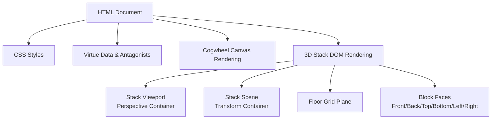
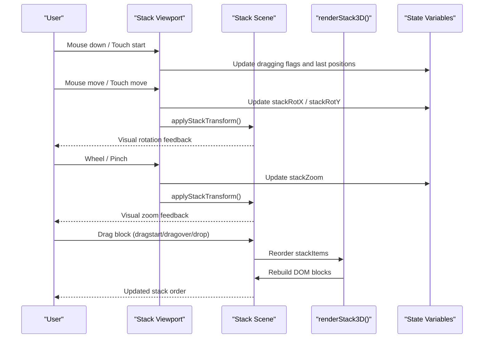
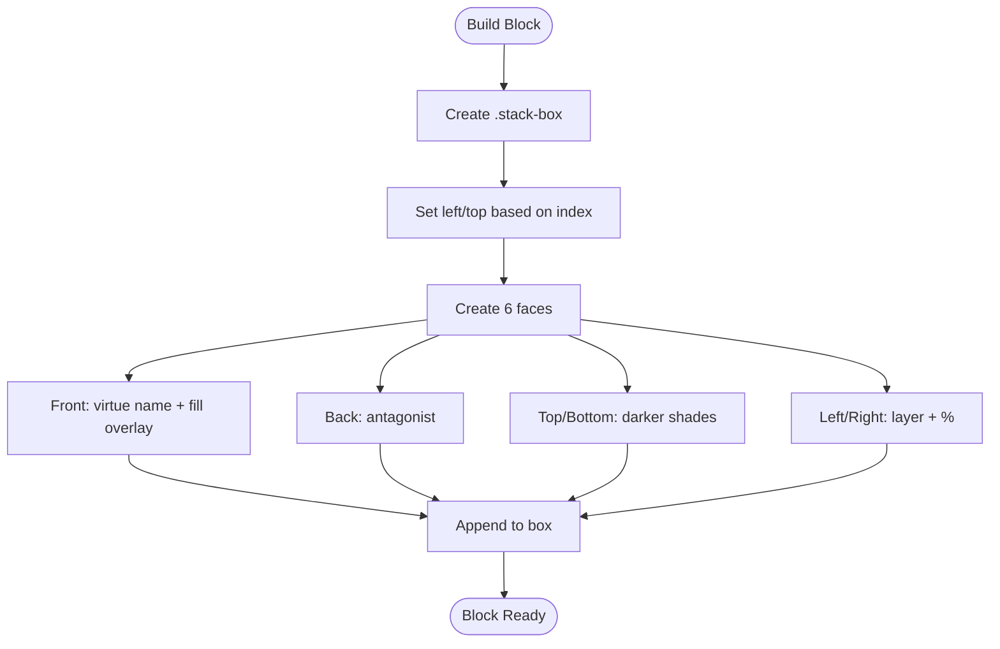
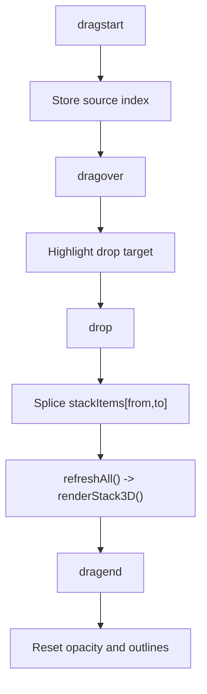
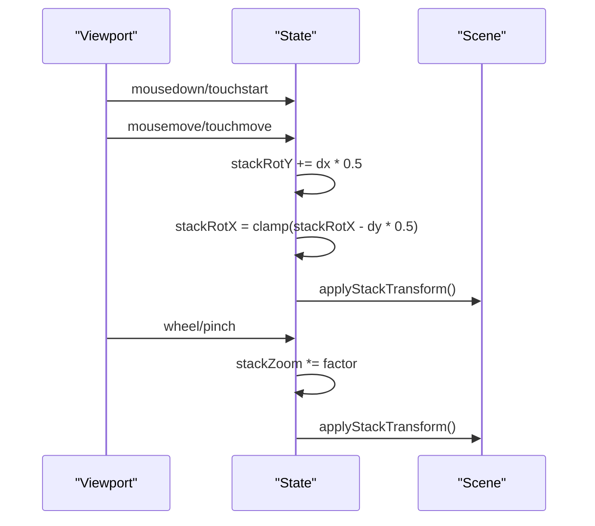
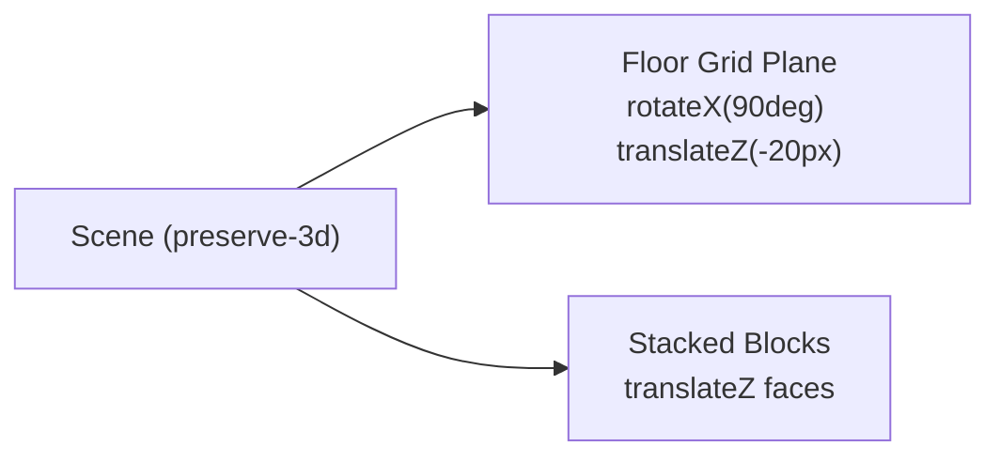
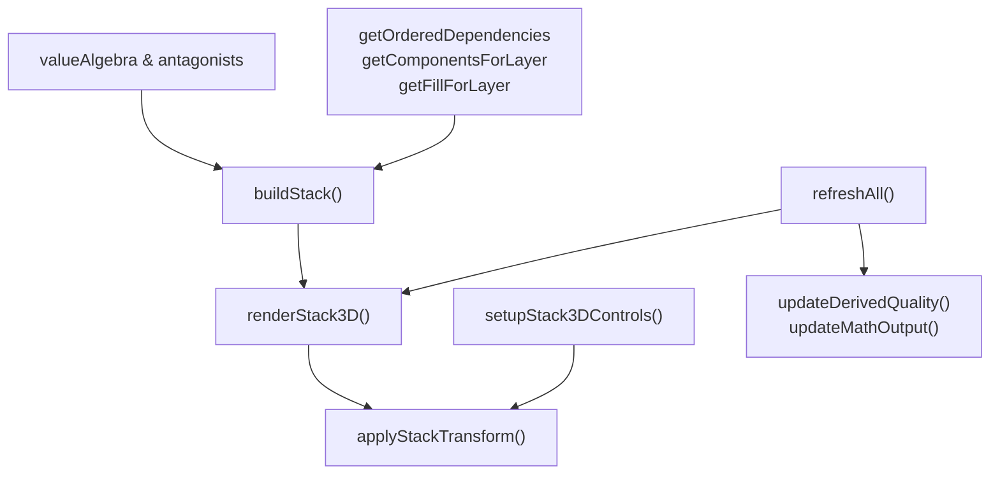

# 3D Stack Visualization

<cite>
**Referenced Files in This Document**
- [Alg_Virt_WhLL.html](file://Alg_Virt_WhLL.html)
</cite>

## Table of Contents
1. [Introduction](#introduction)
2. [Project Structure](#project-structure)
3. [Core Components](#core-components)
4. [Architecture Overview](#architecture-overview)
5. [Detailed Component Analysis](#detailed-component-analysis)
6. [Dependency Analysis](#dependency-analysis)
7. [Performance Considerations](#performance-considerations)
8. [Troubleshooting Guide](#troubleshooting-guide)
9. [Conclusion](#conclusion)

## Introduction
This document explains the DOM-based 3D stack visualization that renders a hierarchy of “virtue blocks” with perspective projection, drag-and-drop reordering, and interactive rotation controls. Each block represents a virtue; its front face shows the virtue name and fill level, its back face shows the antagonist, and side faces display layer and percentage information. The scene includes a floor grid reference plane to help orient the coordinate system. The component supports mouse drag for rotation, touch gestures on mobile devices, zoom via wheel or pinch, and visual feedback through fill overlays and color coding.

## Project Structure
The entire application is implemented as a single HTML file containing:
- CSS styles defining the 3D viewport, block faces, floor grid, and responsive layout
- Data structures describing virtues, their components, colors, layers, and antagonists
- A canvas-based concentric cogwheel visualization (not the focus here)
- A DOM-based 3D stack panel with interactivity and telemetry output

**Diagram sources**
- [Alg_Virt_WhLL.html:453-605](file://Alg_Virt_WhLL.html#L453-L605)
- [Alg_Virt_WhLL.html:1617-1763](file://Alg_Virt_WhLL.html#L1617-L1763)

**Section sources**
- [Alg_Virt_WhLL.html:1-100](file://Alg_Virt_WhLL.html#L1-L100)
- [Alg_Virt_WhLL.html:453-605](file://Alg_Virt_WhLL.html#L453-L605)
- [Alg_Virt_WhLL.html:1617-1763](file://Alg_Virt_WhLL.html#L1617-L1763)

## Core Components
- 3D Viewport: A container with CSS perspective enabling 3D transforms. It captures pointer events for rotation and wheel events for zoom.
- 3D Scene: A transform-origin anchored container holding stacked blocks and a floor grid. Its transform applies rotation and zoom.
- Blocks: Each block is a 3D cube made of six faces (front, back, top, bottom, left, right). Front shows the virtue name and fill overlay; back shows the antagonist; sides show layer and percentage.
- Floor Grid: A rotated plane at the base of the scene providing a reference grid.
- Controls: Buttons to reset view, toggle antagonist labels, and auto-spin the stack.
- Telemetry: A text readout summarizing target, formula, ring fills, derived quality, and current state.

Key responsibilities:
- Build the stack from the selected target virtue and its dependencies
- Render each block with correct 3D positioning and face content
- Handle drag-and-drop to reorder blocks
- Apply rotation and zoom via mouse/touch
- Update derived quality and telemetry

**Section sources**
- [Alg_Virt_WhLL.html:453-605](file://Alg_Virt_WhLL.html#L453-L605)
- [Alg_Virt_WhLL.html:1617-1763](file://Alg_Virt_WhLL.html#L1617-L1763)
- [Alg_Virt_WhLL.html:1886-1945](file://Alg_Virt_WhLL.html#L1886-L1945)

## Architecture Overview
The 3D stack visualization is driven by data structures and rendered into the DOM using CSS 3D transforms. Interactions update state variables (rotation angles, zoom, reorder order), which are then applied to the scene transform.

**Diagram sources**
- [Alg_Virt_WhLL.html:1772-1881](file://Alg_Virt_WhLL.html#L1772-L1881)
- [Alg_Virt_WhLL.html:1647-1763](file://Alg_Virt_WhLL.html#L1647-L1763)

## Detailed Component Analysis

### 3D Block Representation and Perspective Projection
- The viewport sets perspective to create depth perception.
- The scene uses preserve-3d and transform-origin to rotate around a central point near the bottom.
- Each block is positioned absolutely within the scene, stacked vertically with a fixed gap.
- Face transforms position the six faces to form a cube:
  - Front: translateZ to bring it forward
  - Back: translateZ negative and rotateY(180deg)
  - Top/Bottom: rotateX ±90deg
  - Left/Right: rotateY ±90deg

Visual feedback:
- Front face background uses the virtue’s color.
- Fill overlay width reflects the fill level for the block’s layer.
- Target block has an accent glow box-shadow.
- Back face displays the antagonist with a dashed border and negative color styling.
- Side faces show layer index and percentage.

**Diagram sources**
- [Alg_Virt_WhLL.html:1647-1757](file://Alg_Virt_WhLL.html#L1647-L1757)

**Section sources**
- [Alg_Virt_WhLL.html:453-605](file://Alg_Virt_WhLL.html#L453-L605)
- [Alg_Virt_WhLL.html:1647-1757](file://Alg_Virt_WhLL.html#L1647-L1757)

### Drag-and-Drop Reordering
- Each block is draggable using the HTML5 drag API.
- On dragstart, the block’s index is stored and opacity reduced.
- On dragover, a highlight outline indicates drop target.
- On drop, the source and target indices are used to splice the stackItems array and re-render.

**Diagram sources**
- [Alg_Virt_WhLL.html:1723-1754](file://Alg_Virt_WhLL.html#L1723-L1754)

**Section sources**
- [Alg_Virt_WhLL.html:1723-1754](file://Alg_Virt_WhLL.html#L1723-L1754)

### 3D Perspective Rotation Controls
- Mouse drag rotates the scene:
  - Horizontal movement updates stackRotY
  - Vertical movement updates stackRotX with clamping
- Wheel zooms:
  - Zoom factor scaled up/down with min/max bounds
- Touch gestures:
  - Single-finger drag rotates similarly to mouse
  - Two-finger pinch scales zoom
- Auto-spin toggles continuous Y-axis rotation.

**Diagram sources**
- [Alg_Virt_WhLL.html:1772-1881](file://Alg_Virt_WhLL.html#L1772-L1881)

**Section sources**
- [Alg_Virt_WhLL.html:1772-1881](file://Alg_Virt_WhLL.html#L1772-L1881)

### Block Content Semantics
- Front face:
  - Background color from virtue data
  - Fill overlay width proportional to layer fill level
  - Label showing virtue name and percentage
- Back face:
  - Shows antagonist name with negative styling
  - Toggleable visibility via UI button
- Side faces:
  - Left: layer index
  - Right: percentage fill
- Top/Bottom:
  - Shaded variants of the virtue color

Data mapping:
- Virtues include name, color, description, layer, and components
- Antagonists map each virtue to its opposite concept

**Section sources**
- [Alg_Virt_WhLL.html:832-865](file://Alg_Virt_WhLL.html#L832-L865)
- [Alg_Virt_WhLL.html:1647-1757](file://Alg_Virt_WhLL.html#L1647-L1757)

### Visual Feedback Systems
- Fill overlays:
  - Width set to fill percentage for each block’s layer
  - Accent-colored border and glow shadow
- Color coding:
  - Each virtue has a distinct color
  - Antagonist colors are darkened variants
- 3D transformations:
  - Scene transform combines translateZ, scale, rotateX, rotateY
  - Perspective defined on viewport creates depth

**Section sources**
- [Alg_Virt_WhLL.html:453-605](file://Alg_Virt_WhLL.html#L453-L605)
- [Alg_Virt_WhLL.html:1647-1763](file://Alg_Virt_WhLL.html#L1647-L1763)

### Floor Grid Reference Plane and Coordinate System
- The floor grid is a div placed inside the scene and rotated to lie flat along the X axis.
- It provides a visual reference for the base plane and helps users understand the stacking direction.
- The scene’s transform-origin is centered at the bottom, making rotations pivot around the base.

**Diagram sources**
- [Alg_Virt_WhLL.html:593-605](file://Alg_Virt_WhLL.html#L593-L605)
- [Alg_Virt_WhLL.html:1647-1653](file://Alg_Virt_WhLL.html#L1647-L1653)

**Section sources**
- [Alg_Virt_WhLL.html:593-605](file://Alg_Virt_WhLL.html#L593-L605)
- [Alg_Virt_WhLL.html:1647-1653](file://Alg_Virt_WhLL.html#L1647-L1653)

### Responsive Design Considerations
- Media queries adjust viewport height and block dimensions for smaller screens.
- Fullscreen mode adjusts panel sizes and resets aspect ratios for both panels.
- Resize events debounce refresh calls to avoid excessive re-renders.

**Section sources**
- [Alg_Virt_WhLL.html:698-707](file://Alg_Virt_WhLL.html#L698-L707)
- [Alg_Virt_WhLL.html:1950-1983](file://Alg_Virt_WhLL.html#L1950-L1983)
- [Alg_Virt_WhLL.html:2027-2031](file://Alg_Virt_WhLL.html#L2027-L2031)

## Dependency Analysis
The 3D stack depends on shared data and utility functions:
- valueAlgebra: defines virtues, colors, layers, and component relationships
- antagonists: maps virtues to antagonists
- getOrderedDependencies and resolveDeps: compute dependency chains
- getComponentsForLayer and getLayerComponentsOrdered: organize items by layer
- getFillForLayer: retrieves fill levels per layer and target
- buildStack: constructs the ordered list of blocks for the selected target
- renderStack3D: builds DOM nodes and attaches event listeners
- applyStackTransform: updates the scene transform
- setupStack3DControls: wires interaction handlers
- refreshAll: orchestrates redraws across components

**Diagram sources**
- [Alg_Virt_WhLL.html:832-865](file://Alg_Virt_WhLL.html#L832-L865)
- [Alg_Virt_WhLL.html:944-993](file://Alg_Virt_WhLL.html#L944-L993)
- [Alg_Virt_WhLL.html:1620-1763](file://Alg_Virt_WhLL.html#L1620-L1763)
- [Alg_Virt_WhLL.html:1772-1881](file://Alg_Virt_WhLL.html#L1772-L1881)
- [Alg_Virt_WhLL.html:1988-1993](file://Alg_Virt_WhLL.html#L1988-L1993)

**Section sources**
- [Alg_Virt_WhLL.html:832-865](file://Alg_Virt_WhLL.html#L832-L865)
- [Alg_Virt_WhLL.html:944-993](file://Alg_Virt_WhLL.html#L944-L993)
- [Alg_Virt_WhLL.html:1620-1763](file://Alg_Virt_WhLL.html#L1620-L1763)
- [Alg_Virt_WhLL.html:1772-1881](file://Alg_Virt_WhLL.html#L1772-L1881)
- [Alg_Virt_WhLL.html:1988-1993](file://Alg_Virt_WhLL.html#L1988-L1993)

## Performance Considerations
- CSS will-change hint on the scene to promote GPU acceleration for transforms.
- Transform composition in a single applyStackTransform call reduces layout thrashing.
- Debounced resize handler avoids frequent full refreshes.
- Fullscreen changes trigger delayed re-renders to allow layout settling.
- Touch interactions use passive listeners where appropriate to improve scrolling performance.

Recommendations:
- Avoid unnecessary DOM rebuilds when only rotating; reuse existing nodes.
- Batch style updates (e.g., outline clearing) to minimize reflows.
- Consider requestAnimationFrame for smooth auto-spin loops if animations become more complex.

**Section sources**
- [Alg_Virt_WhLL.html:468-475](file://Alg_Virt_WhLL.html#L468-L475)
- [Alg_Virt_WhLL.html:1765-1770](file://Alg_Virt_WhLL.html#L1765-L1770)
- [Alg_Virt_WhLL.html:2027-2031](file://Alg_Virt_WhLL.html#L2027-L2031)
- [Alg_Virt_WhLL.html:1972-1983](file://Alg_Virt_WhLL.html#L1972-L1983)

## Troubleshooting Guide
Common issues and resolutions:
- Blocks not visible after selection:
  - Ensure buildStack returns a non-empty array and renderStack3D is called.
  - Check that getFillForLayer returns valid values for the selected target.
- Rotation not responding:
  - Verify event listeners are attached to the viewport and not blocked by child elements.
  - Confirm stackDragging flag is toggled correctly on mouse/touch events.
- Zoom not working:
  - Ensure wheel events are prevented from default behavior and stackZoom is updated.
- Drag-and-drop not reordering:
  - Confirm dragstart stores the correct index and drop splices stackItems properly.
  - Check that refreshAll triggers a re-render after reorder.
- Antagonist labels not showing:
  - Toggle via the UI button updates stackShowAntagonists and re-renders.

**Section sources**
- [Alg_Virt_WhLL.html:1620-1763](file://Alg_Virt_WhLL.html#L1620-L1763)
- [Alg_Virt_WhLL.html:1772-1881](file://Alg_Virt_WhLL.html#L1772-L1881)
- [Alg_Virt_WhLL.html:1988-1993](file://Alg_Virt_WhLL.html#L1988-L1993)

## Conclusion
The 3D stack visualization provides an intuitive, interactive representation of virtue hierarchies using DOM-based 3D transforms. Users can explore the structure through rotation and zoom, rearrange the hierarchy via drag-and-drop, and observe visual feedback through fill overlays and color coding. The floor grid aids orientation, while responsive design ensures usability across devices. With careful attention to performance and error handling, the component delivers a robust and accessible experience.