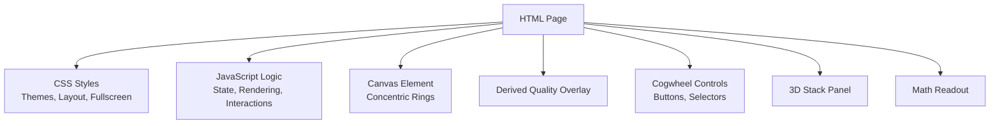
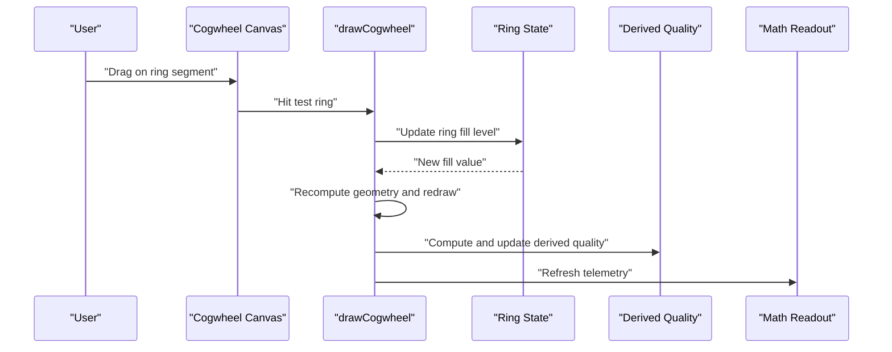
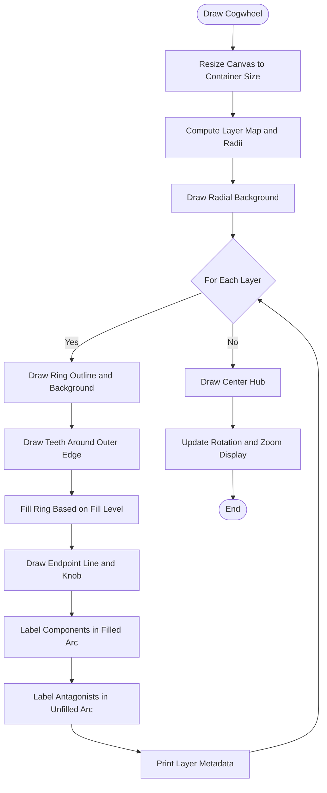
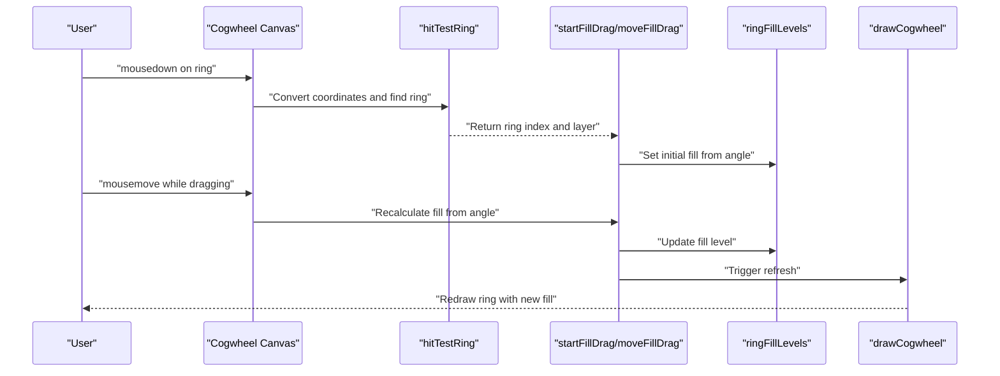
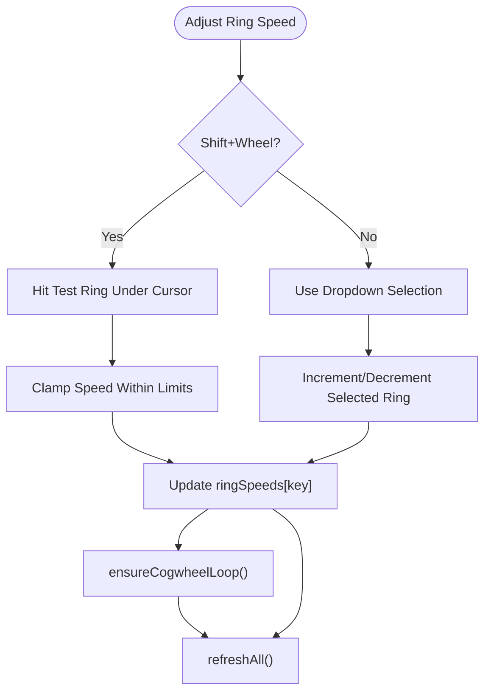
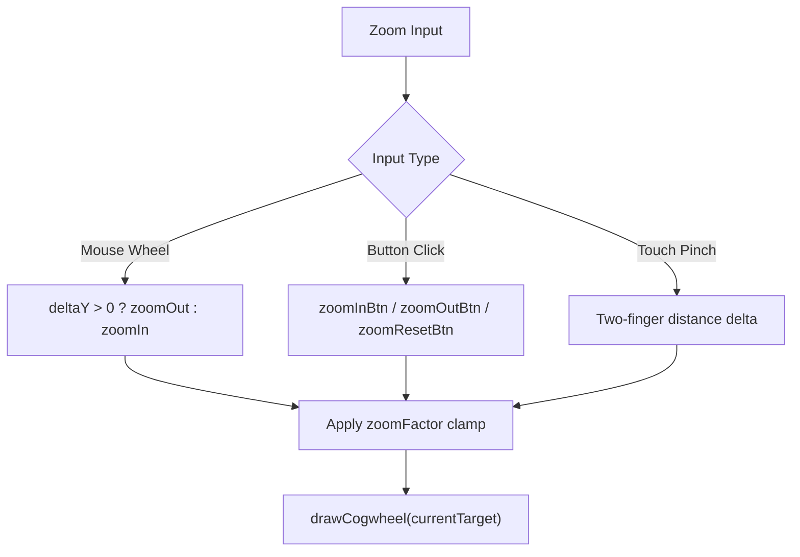
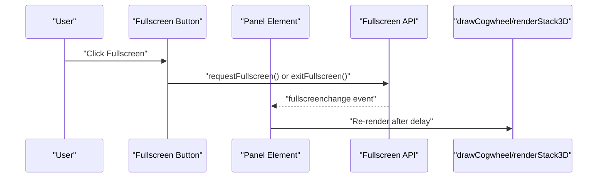
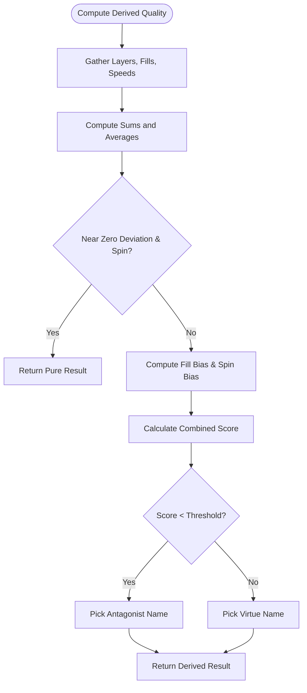
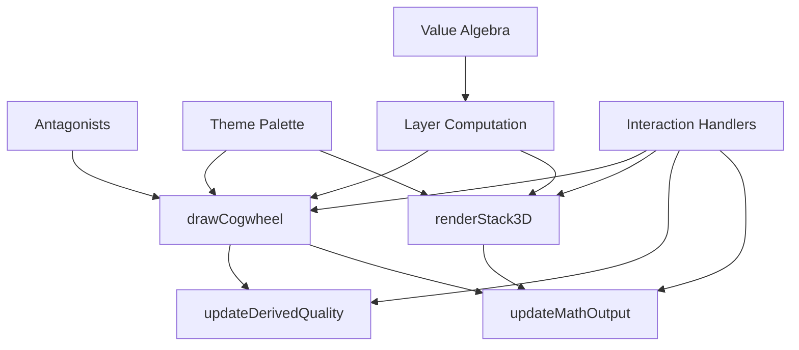

# Concentric Cogwheel Interface

<cite>
**Referenced Files in This Document**
- [Alg_Virt_WhLL.html](file://Alg_Virt_WhLL.html)
</cite>

## Table of Contents
1. [Introduction](#introduction)
2. [Project Structure](#project-structure)
3. [Core Components](#core-components)
4. [Architecture Overview](#architecture-overview)
5. [Detailed Component Analysis](#detailed-component-analysis)
6. [Dependency Analysis](#dependency-analysis)
7. [Performance Considerations](#performance-considerations)
8. [Troubleshooting Guide](#troubleshooting-guide)
9. [Conclusion](#conclusion)
10. [Appendices](#appendices)

## Introduction
This document explains the concentric cogwheel interface component implemented as a single-page Canvas-based visualization. The interface renders concentric rings that represent virtue layers for a selected target quality. Users can:

- Drag on ring segments to adjust fill levels.
- Adjust per-ring rotation speed using Shift+Wheel over a ring or via the ring speed selector and increment/decrement buttons.
- Zoom the cogwheel with mouse wheel, zoom-in/zoom-out/reset buttons, or two-finger pinch gestures on touch devices.
- Toggle fullscreen mode for the cogwheel panel.
- Observe a derived quality overlay that shows the current mathematical result of virtue combinations.
- Use the 3D stack panel alongside the cogwheel for complementary telemetry and visualization.

The implementation is self-contained in one HTML file and uses vanilla JavaScript and CSS.

## Project Structure
The project consists of a single HTML file containing:

- A styled UI layout with two panels:
  - Left panel: Concentric cogwheel canvas, controls, and derived quality overlay.
  - Right panel: 3D stratified stack view with its own controls and telemetry readout.
- Embedded CSS defining themes, layout, fullscreen behavior, and visual styling.
- Embedded JavaScript implementing:
  - Value algebra and antagonist mappings.
  - Ring layer computation, hit testing, drawing, and interaction handling.
  - Derived quality calculation and overlay updates.
  - Per-ring spin speed management.
  - Zoom and fullscreen behaviors.
  - 3D stack rendering and interactions.
  - Telemetry output formatting.

**Diagram sources**
- [Alg_Virt_WhLL.html:728-827](file://Alg_Virt_WhLL.html#L728-L827)
- [Alg_Virt_WhLL.html:778-802](file://Alg_Virt_WhLL.html#L778-L802)
- [Alg_Virt_WhLL.html:806-827](file://Alg_Virt_WhLL.html#L806-L827)

**Section sources**
- [Alg_Virt_WhLL.html:728-827](file://Alg_Virt_WhLL.html#L728-L827)

## Core Components
- Concentric Cogwheel Canvas: Renders rings representing layers of virtues for the selected target quality. Each ring has a fill level and optional rotation speed.
- Derived Quality Overlay: Displays the emergent or antagonistic quality based on ring fills and spins.
- Ring Speed Controls: Dropdown selector for a specific ring, plus increment/decrement/clear buttons. Also supports Shift+Wheel on a ring to adjust speed.
- Zoom Controls: Mouse wheel zoom, dedicated zoom-in/zoom-out/reset buttons, and two-finger pinch zoom on touch devices.
- Fullscreen Mode: Toggles fullscreen for the cogwheel panel, adjusting layout and re-rendering.
- 3D Stack Panel: Visualizes layered components with fill overlays and antagonist labels; supports drag-to-reorder, rotation, zoom, and auto-spin.
- Math Readout: Textual telemetry showing formulas, ring states, combined derived quality, and system state.

**Section sources**
- [Alg_Virt_WhLL.html:778-802](file://Alg_Virt_WhLL.html#L778-L802)
- [Alg_Virt_WhLL.html:806-827](file://Alg_Virt_WhLL.html#L806-L827)
- [Alg_Virt_WhLL.html:832-865](file://Alg_Virt_WhLL.html#L832-L865)
- [Alg_Virt_WhLL.html:1019-1093](file://Alg_Virt_WhLL.html#L1019-L1093)
- [Alg_Virt_WhLL.html:1142-1354](file://Alg_Virt_WhLL.html#L1142-L1354)
- [Alg_Virt_WhLL.html:1356-1495](file://Alg_Virt_WhLL.html#L1356-L1495)
- [Alg_Virt_WhLL.html:1541-1612](file://Alg_Virt_WhLL.html#L1541-L1612)
- [Alg_Virt_WhLL.html:1620-1881](file://Alg_Virt_WhLL.html#L1620-L1881)
- [Alg_Virt_WhLL.html:1886-1945](file://Alg_Virt_WhLL.html#L1886-L1945)

## Architecture Overview
The application follows a clear separation between data definitions, state management, rendering, and user interactions:

- Data Definitions:
  - Value algebra defines virtues, their components, colors, descriptions, and layers.
  - Antagonists map each virtue to an opposing concept.
  - Themes define color palettes and fonts.
- State Management:
  - Global variables track rotation, zoom, ring fills, ring angles, ring speeds, hovered ring, and 3D stack state.
  - Helper functions compute ordered dependencies, layer groupings, and fill values.
- Rendering:
  - drawCogwheel computes geometry, draws background, rings, teeth, fill gradients, labels, and hub.
  - renderStack3D builds DOM nodes for the 3D stack with faces and overlays.
  - updateDerivedQuality updates the overlay text and classes.
  - updateMathOutput formats telemetry into a monospaced readout.
- Interactions:
  - Mouse and touch events handle drag-to-fill, hover, wheel zoom, Shift+Wheel speed adjustment, and pinch zoom.
  - Button handlers manage reset, play/pause, zoom controls, ring speed adjustments, and fullscreen toggles.

**Diagram sources**
- [Alg_Virt_WhLL.html:1356-1495](file://Alg_Virt_WhLL.html#L1356-L1495)
- [Alg_Virt_WhLL.html:1142-1354](file://Alg_Virt_WhLL.html#L1142-L1354)
- [Alg_Virt_WhLL.html:1019-1093](file://Alg_Virt_WhLL.html#L1019-L1093)
- [Alg_Virt_WhLL.html:1886-1945](file://Alg_Virt_WhLL.html#L1886-L1945)

## Detailed Component Analysis

### Concentric Cogwheel Rendering
The cogwheel is drawn on a Canvas element with high-DPI scaling. Key responsibilities include:

- Computing ring radii and step sizes based on the number of layers and zoom factor.
- Drawing a radial background gradient.
- For each layer:
  - Drawing the ring outline and subtle background.
  - Adding visible “teeth” around the outer edge to make rotation perceptible.
  - Filling the ring proportionally to the fill level, using a multi-color gradient across components in that layer.
  - Highlighting the fill endpoint with a bright line and knob.
  - Labeling components within the filled arc and antagonists within the unfilled arc.
  - Printing layer metadata (layer index, fill percentage, and optional spin direction/speed).
- Drawing a glowing center hub.
- Updating rotation and zoom display elements.

**Diagram sources**
- [Alg_Virt_WhLL.html:1142-1354](file://Alg_Virt_WhLL.html#L1142-L1354)

**Section sources**
- [Alg_Virt_WhLL.html:1142-1354](file://Alg_Virt_WhLL.html#L1142-L1354)

### Drag-to-Fill Interaction Mechanics
Users manipulate ring fill levels by dragging on ring segments:

- Hit Testing:
  - Converts client coordinates to canvas coordinates.
  - Computes distance from center and angle.
  - Matches the point against ring inner/outer radii to identify the targeted ring and layer.
- Starting a Drag:
  - Records the dragged ring index.
  - Calculates the pointer’s angular position relative to the ring’s rotation.
  - Maps the angle to a fill level between 0 and 1.
- Moving During Drag:
  - Continuously recalculates the fill level based on the pointer’s angle.
  - Updates the ring fill state and triggers a full refresh.
- Ending a Drag:
  - Clears the drag state.

**Diagram sources**
- [Alg_Virt_WhLL.html:1356-1495](file://Alg_Virt_WhLL.html#L1356-L1495)

**Section sources**
- [Alg_Virt_WhLL.html:1356-1495](file://Alg_Virt_WhLL.html#L1356-L1495)

### Per-Ring Rotation Speed Controls
Per-ring spin speed can be adjusted through multiple mechanisms:

- Shift+Wheel Over a Ring:
  - Detects if Shift is pressed during wheel events.
  - Identifies the ring under the cursor.
  - Adjusts the ring’s speed by a fixed step, clamped to a maximum magnitude.
- Ring Speed Selector Dropdown:
  - Dynamically lists available layers for the current target.
  - Allows selecting a specific ring to adjust.
- Increment/Decrement/Clear Buttons:
  - Increase or decrease the selected ring’s speed.
  - Clear all ring speeds at once.
- Animation Loop:
  - Runs when global auto-rotation is enabled or any ring has non-zero speed.
  - Updates ring angles based on their speeds and redraws the cogwheel.

**Diagram sources**
- [Alg_Virt_WhLL.html:1451-1462](file://Alg_Virt_WhLL.html#L1451-L1462)
- [Alg_Virt_WhLL.html:1095-1129](file://Alg_Virt_WhLL.html#L1095-L1129)
- [Alg_Virt_WhLL.html:1541-1612](file://Alg_Virt_WhLL.html#L1541-L1612)
- [Alg_Virt_WhLL.html:1498-1523](file://Alg_Virt_WhLL.html#L1498-L1523)

**Section sources**
- [Alg_Virt_WhLL.html:1451-1462](file://Alg_Virt_WhLL.html#L1451-L1462)
- [Alg_Virt_WhLL.html:1095-1129](file://Alg_Virt_WhLL.html#L1095-L1129)
- [Alg_Virt_WhLL.html:1541-1612](file://Alg_Virt_WhLL.html#L1541-L1612)
- [Alg_Virt_WhLL.html:1498-1523](file://Alg_Virt_WhLL.html#L1498-L1523)

### Zoom Functionality
Zoom control is available through several inputs:

- Mouse Wheel:
  - Scrolls to zoom in/out unless Shift is held (which changes ring speed instead).
  - Clamps zoom factor between minimum and maximum bounds.
- Dedicated Buttons:
  - Zoom In: Multiplies zoom factor by a growth constant.
  - Zoom Out: Multiplies zoom factor by a shrink constant.
  - Zoom Reset: Resets zoom factor to default.
- Touch Pinch:
  - Two-finger gestures calculate distance change to trigger zoom in/out.
- Visual Feedback:
  - Zoom percentage displayed near the cogwheel header.

**Diagram sources**
- [Alg_Virt_WhLL.html:1451-1462](file://Alg_Virt_WhLL.html#L1451-L1462)
- [Alg_Virt_WhLL.html:1568-1587](file://Alg_Virt_WhLL.html#L1568-L1587)
- [Alg_Virt_WhLL.html:1479-1492](file://Alg_Virt_WhLL.html#L1479-L1492)
- [Alg_Virt_WhLL.html:1614-1615](file://Alg_Virt_WhLL.html#L1614-L1615)

**Section sources**
- [Alg_Virt_WhLL.html:1451-1462](file://Alg_Virt_WhLL.html#L1451-L1462)
- [Alg_Virt_WhLL.html:1568-1587](file://Alg_Virt_WhLL.html#L1568-L1587)
- [Alg_Virt_WhLL.html:1479-1492](file://Alg_Virt_WhLL.html#L1479-L1492)
- [Alg_Virt_WhLL.html:1614-1615](file://Alg_Virt_WhLL.html#L1614-L1615)

### Fullscreen Mode Behavior
Fullscreen mode applies to both panels:

- Toggle Button:
  - Uses the Fullscreen API with vendor prefix fallback.
  - Exits fullscreen if already active.
- CSS Adjustments:
  - Fullscreen panels expand to viewport dimensions.
  - Inner containers adapt to flex layouts.
  - Derived quality overlay scales up for better visibility.
- Re-rendering:
  - After fullscreen change, the cogwheel is redrawn and the 3D stack is refreshed to match new dimensions.

**Diagram sources**
- [Alg_Virt_WhLL.html:1950-1983](file://Alg_Virt_WhLL.html#L1950-L1983)
- [Alg_Virt_WhLL.html:194-225](file://Alg_Virt_WhLL.html#L194-L225)

**Section sources**
- [Alg_Virt_WhLL.html:1950-1983](file://Alg_Virt_WhLL.html#L1950-L1983)
- [Alg_Virt_WhLL.html:194-225](file://Alg_Virt_WhLL.html#L194-L225)

### Derived Quality Overlay
The derived quality overlay summarizes the mathematical combination of ring fills and spins:

- Computation:
  - Aggregates fill levels, net spin, absolute spin, and deviation from neutral fill (0.5).
  - Determines dominance by layer based on weighted deviation and spin.
  - Calculates a score combining fill bias and spin bias.
  - If deviation and spin are near zero, marks the result as “pure.”
  - Otherwise, selects a source component pool and picks a name deterministically.
  - Negative scores select antagonists; positive scores select virtues.
- Display:
  - Shows tag (“Target Quality,” “Emergent Quality,” or “Negative Quality”).
  - Shows name with symbol (⊕ or ⊖).
  - Shows formula string summarizing the transformation.
  - Applies CSS classes for positive/negative styling.

**Diagram sources**
- [Alg_Virt_WhLL.html:1019-1093](file://Alg_Virt_WhLL.html#L1019-L1093)

**Section sources**
- [Alg_Virt_WhLL.html:1019-1093](file://Alg_Virt_WhLL.html#L1019-L1093)

### Touch Support and Accessibility
- Touch Support:
  - Single-finger drag adjusts ring fill.
  - Two-finger pinch adjusts zoom.
  - Prevents default scrolling on canvas interactions to avoid conflicts.
- Accessibility Notes:
  - The interface relies heavily on visual cues and mouse/touch interactions.
  - No explicit ARIA attributes or keyboard navigation are implemented in the provided code.
  - High contrast themes and large text overlays improve readability but do not replace accessibility features.

**Section sources**
- [Alg_Virt_WhLL.html:1464-1495](file://Alg_Virt_WhLL.html#L1464-L1495)
- [Alg_Virt_WhLL.html:364-418](file://Alg_Virt_WhLL.html#L364-L418)

## Dependency Analysis
Key dependencies and relationships:

- Value Algebra and Antagonists:
  - Used to determine ring composition, colors, and antagonist labels.
- Theme System:
  - Provides accent colors, RGB values, and font families for consistent visuals.
- Ring Layer Computation:
  - Depends on the selected target quality to resolve dependencies and group components by layer.
- Rendering Pipeline:
  - drawCogwheel depends on zoom, ring fills, ring angles, and theme palette.
  - renderStack3D depends on stackItems and fill levels.
  - updateDerivedQuality depends on ring fills and speeds.
  - updateMathOutput depends on all above and formats telemetry.
- Interaction Handlers:
  - depend on hit testing, state updates, and refreshAll to synchronize UI.

**Diagram sources**
- [Alg_Virt_WhLL.html:832-865](file://Alg_Virt_WhLL.html#L832-L865)
- [Alg_Virt_WhLL.html:868-903](file://Alg_Virt_WhLL.html#L868-L903)
- [Alg_Virt_WhLL.html:945-993](file://Alg_Virt_WhLL.html#L945-L993)
- [Alg_Virt_WhLL.html:1142-1354](file://Alg_Virt_WhLL.html#L1142-L1354)
- [Alg_Virt_WhLL.html:1620-1881](file://Alg_Virt_WhLL.html#L1620-L1881)
- [Alg_Virt_WhLL.html:1019-1093](file://Alg_Virt_WhLL.html#L1019-L1093)
- [Alg_Virt_WhLL.html:1886-1945](file://Alg_Virt_WhLL.html#L1886-L1945)

**Section sources**
- [Alg_Virt_WhLL.html:832-865](file://Alg_Virt_WhLL.html#L832-L865)
- [Alg_Virt_WhLL.html:868-903](file://Alg_Virt_WhLL.html#L868-L903)
- [Alg_Virt_WhLL.html:945-993](file://Alg_Virt_WhLL.html#L945-L993)
- [Alg_Virt_WhLL.html:1142-1354](file://Alg_Virt_WhLL.html#L1142-L1354)
- [Alg_Virt_WhLL.html:1620-1881](file://Alg_Virt_WhLL.html#L1620-L1881)
- [Alg_Virt_WhLL.html:1019-1093](file://Alg_Virt_WhLL.html#L1019-L1093)
- [Alg_Virt_WhLL.html:1886-1945](file://Alg_Virt_WhLL.html#L1886-L1945)

## Performance Considerations
- Canvas Resizing:
  - Canvas dimensions are set based on container size and device pixel ratio to ensure crisp rendering on high-DPI displays.
- Animation Loop:
  - The cogwheel animation loop runs only when necessary (global auto-rotation or any ring spinning), reducing unnecessary redraws.
- Event Listeners:
  - Wheel events use passive:false to allow preventDefault for zoom and speed control without blocking other scroll behaviors unnecessarily.
- Touch Events:
  - Touchmove and touchstart on the canvas use passive:false to prevent default scrolling during interactions.
- Resize Handling:
  - Debounced resize handler triggers a full refresh after a short delay to avoid excessive redraws during window resizing.

[No sources needed since this section provides general guidance]

## Troubleshooting Guide
Common issues and resolutions:

- Rings Do Not Respond to Drag:
  - Ensure the canvas has focus and no other element is intercepting mouse events.
  - Verify that hit testing returns a valid ring index; check container dimensions and zoom factor.
- Shift+Wheel Does Not Change Ring Speed:
  - Confirm that the cursor is over a ring when pressing Shift+Wheel.
  - Check that the ring speed is not already at the maximum magnitude.
- Zoom Not Working:
  - Mouse wheel zoom may be blocked if another element captures the event.
  - On touch devices, ensure two-finger gestures are recognized and not intercepted by the browser’s default pinch-zoom.
- Fullscreen Not Applying:
  - Some browsers require user gesture to enter fullscreen; click the fullscreen button directly.
  - Check console for permission errors or unsupported API calls.
- Derived Quality Overlay Not Updating:
  - Ensure refreshAll is called after changing ring fills or speeds.
  - Verify that computeDerivedQuality receives valid layer data and fill values.
- 3D Stack Not Rendering Correctly:
  - Check that stackItems are built for the current target and that renderStack3D is invoked after state changes.
  - Verify CSS transforms and perspective settings in the viewport.

**Section sources**
- [Alg_Virt_WhLL.html:1356-1495](file://Alg_Virt_WhLL.html#L1356-L1495)
- [Alg_Virt_WhLL.html:1451-1462](file://Alg_Virt_WhLL.html#L1451-L1462)
- [Alg_Virt_WhLL.html:1950-1983](file://Alg_Virt_WhLL.html#L1950-L1983)
- [Alg_Virt_WhLL.html:1019-1093](file://Alg_Virt_WhLL.html#L1019-L1093)
- [Alg_Virt_WhLL.html:1620-1881](file://Alg_Virt_WhLL.html#L1620-L1881)

## Conclusion
The concentric cogwheel interface provides an interactive, visually rich way to explore virtue combinations through ring fills and rotations. Its architecture cleanly separates data, state, rendering, and interactions, enabling flexible customization and extension. Users can manipulate ring fills via drag, adjust per-ring spin speeds through intuitive gestures and controls, zoom seamlessly, and observe derived quality outcomes in real time. While the interface offers strong visual feedback and touch support, adding explicit accessibility features such as ARIA roles and keyboard navigation would further enhance usability for diverse users.

[No sources needed since this section summarizes without analyzing specific files]

## Appendices

### Common Interaction Patterns
- Set a Target Quality:
  - Select a virtue from the dropdown to populate rings and stack layers.
- Adjust Ring Fills:
  - Drag on any ring segment to set its fill level; the endpoint knob indicates progress.
- Adjust Ring Speeds:
  - Hold Shift and scroll over a ring to increase or decrease its spin speed.
  - Alternatively, select a ring from the dropdown and use increment/decrement buttons.
- Zoom the View:
  - Scroll the mouse wheel to zoom in/out.
  - Use zoom-in/zoom-out/reset buttons for precise control.
  - On touch devices, pinch to zoom.
- Toggle Fullscreen:
  - Click the fullscreen button in the cogwheel panel header to expand the view.
- Observe Derived Quality:
  - Watch the overlay update as you adjust fills and spins; it reflects emergent or antagonistic qualities.

[No sources needed since this section provides general guidance]