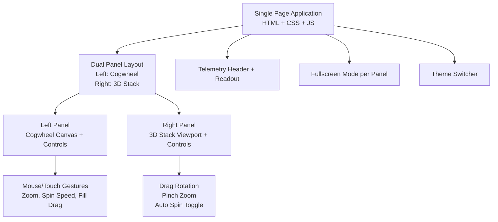
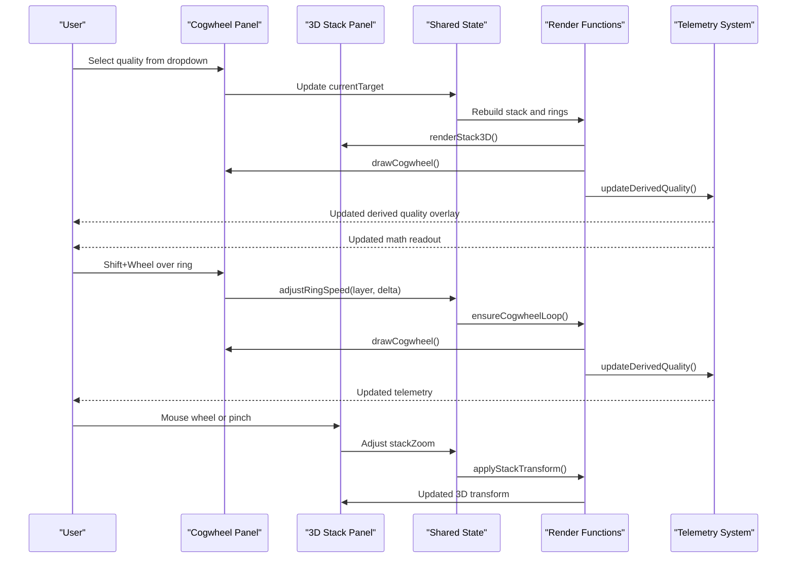
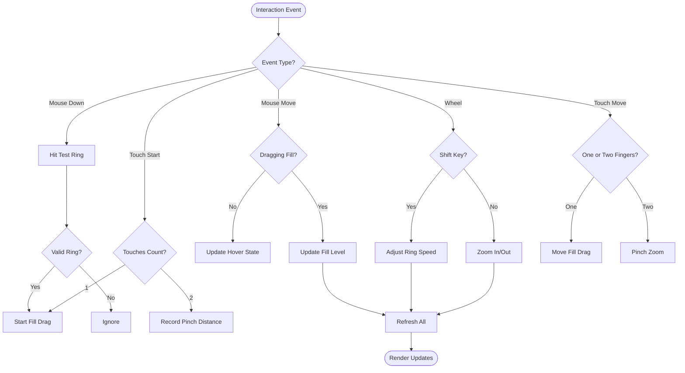
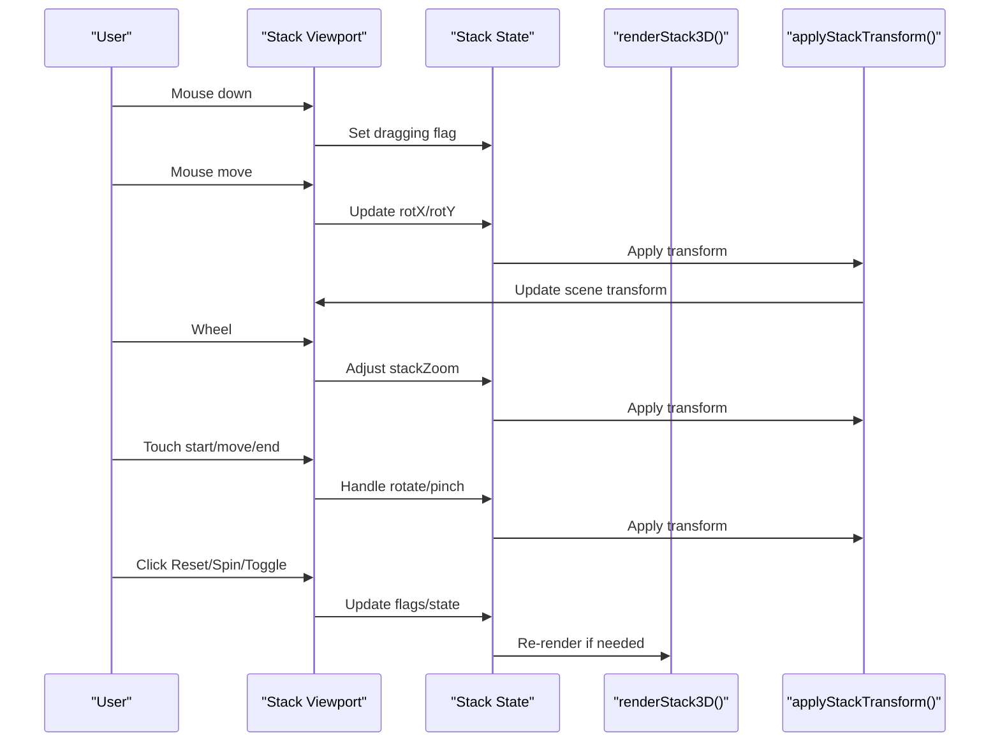
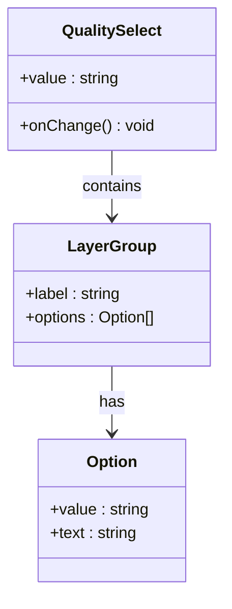
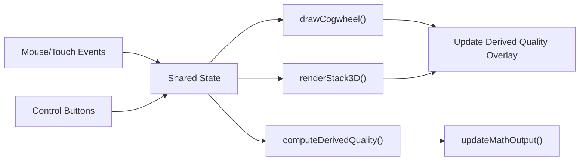

# Controls and Navigation Patterns

<cite>
**Referenced Files in This Document**
- [Alg_Virt_WhLL.html](file://Alg_Virt_WhLL.html)
</cite>

## Table of Contents
1. [Introduction](#introduction)
2. [Project Structure](#project-structure)
3. [Core Components](#core-components)
4. [Architecture Overview](#architecture-overview)
5. [Detailed Component Analysis](#detailed-component-analysis)
6. [Dependency Analysis](#dependency-analysis)
7. [Performance Considerations](#performance-considerations)
8. [Troubleshooting Guide](#troubleshooting-guide)
9. [Accessibility Guidelines](#accessibility-guidelines)
10. [Conclusion](#conclusion)

## Introduction
This document explains all user interface controls and navigation patterns for the application, focusing on:
- Dual-panel layout with a left panel (cogwheel visualization) and right panel (3D stack).
- Fullscreen mode that expands individual panels to full viewport size.
- Keyboard shortcuts and mouse gestures, including Shift+Wheel for spin speed control, mouse wheel for zoom, and touch gestures for mobile devices.
- Quality selection dropdown with hierarchical grouping by layers.
- Telemetry header elements, status indicators, and real-time feedback systems.
- Responsive design patterns across screen sizes and device types.
- Accessibility guidelines and keyboard navigation support details.

## Project Structure
The application is implemented as a single-page HTML file containing:
- CSS styles defining themes, layout, fullscreen behavior, and responsive rules.
- A two-column grid container holding the left cogwheel panel and right 3D stack panel.
- JavaScript logic for rendering, interaction handling, state management, telemetry updates, and fullscreen toggling.

**Diagram sources**
- [Alg_Virt_WhLL.html:173-225](file://Alg_Virt_WhLL.html#L173-L225)
- [Alg_Virt_WhLL.html:728-827](file://Alg_Virt_WhLL.html#L728-L827)
- [Alg_Virt_WhLL.html:1426-1495](file://Alg_Virt_WhLL.html#L1426-L1495)
- [Alg_Virt_WhLL.html:1772-1881](file://Alg_Virt_WhLL.html#L1772-L1881)
- [Alg_Virt_WhLL.html:1948-1983](file://Alg_Virt_WhLL.html#L1948-L1983)

**Section sources**
- [Alg_Virt_WhLL.html:1-12](file://Alg_Virt_WhLL.html#L1-L12)
- [Alg_Virt_WhLL.html:173-225](file://Alg_Virt_WhLL.html#L173-L225)
- [Alg_Virt_WhLL.html:728-827](file://Alg_Virt_WhLL.html#L728-L827)

## Core Components
- Left Panel (Cogwheel):
  - Concentric rings representing layered components of the selected quality.
  - Ring fill controlled by dragging the ring boundary.
  - Per-ring spin speed set via Shift+Wheel over a ring or dedicated controls.
  - Global rotation toggle and zoom controls.
  - Derived quality overlay showing emergent or negative qualities based on ring states.
- Right Panel (3D Stack):
  - Stratified 3D blocks representing components and their antagonists.
  - Drag-to-rotate view and pinch-to-zoom gestures.
  - Auto-spin toggle and antagonist label visibility toggle.
  - Real-time math readout with telemetry data.
- Quality Selection Dropdown:
  - Hierarchical optgroup structure grouped by layers from Core Primes to Meta-Existential Peaks.
- Telemetry Header:
  - Status dot indicator, fullscreen button, and contextual labels.
- Theme Switcher:
  - Buttons to switch between visual templates affecting colors, fonts, and accents.

**Section sources**
- [Alg_Virt_WhLL.html:728-803](file://Alg_Virt_WhLL.html#L728-L803)
- [Alg_Virt_WhLL.html:805-827](file://Alg_Virt_WhLL.html#L805-L827)
- [Alg_Virt_WhLL.html:738-772](file://Alg_Virt_WhLL.html#L738-L772)
- [Alg_Virt_WhLL.html:227-267](file://Alg_Virt_WhLL.html#L227-L267)
- [Alg_Virt_WhLL.html:712-723](file://Alg_Virt_WhLL.html#L712-L723)

## Architecture Overview
The UI architecture centers around a dual-panel layout with shared state and synchronized updates:
- State variables track rotation, zoom, ring fills, ring angles, ring speeds, current target quality, and stack configuration.
- Rendering functions update the canvas-based cogwheel and DOM-based 3D stack.
- Interaction handlers manage mouse/touch events for drag, zoom, spin speed, and auto-rotation.
- Telemetry updates provide real-time feedback in both derived quality overlay and math readout.
- Fullscreen mode toggles per panel and triggers re-rendering to adapt layouts.

**Diagram sources**
- [Alg_Virt_WhLL.html:920-943](file://Alg_Virt_WhLL.html#L920-L943)
- [Alg_Virt_WhLL.html:1142-1354](file://Alg_Virt_WhLL.html#L1142-L1354)
- [Alg_Virt_WhLL.html:1617-1763](file://Alg_Virt_WhLL.html#L1617-L1763)
- [Alg_Virt_WhLL.html:1886-1945](file://Alg_Virt_WhLL.html#L1886-L1945)
- [Alg_Virt_WhLL.html:1988-2005](file://Alg_Virt_WhLL.html#L1988-L2005)

## Detailed Component Analysis

### Left Panel: Cogwheel Controls and Navigation
- Visual Elements:
  - Concentric rings with color gradients representing component layers.
  - Derived quality overlay indicating positive or negative emergent states.
  - Zoom level display and rotation angle indicator.
- Controls:
  - Reset: Clears rotation, ring angles, speeds, and fills.
  - Play/Pause: Toggles global rotation animation.
  - Zoom In/Out/Reset: Adjusts zoom factor within bounds.
  - Ring Speed Controls:
    - Dropdown selects active ring layer.
    - Increment/Decrement buttons adjust speed with clamped range.
    - Clear button resets all ring speeds.
- Gestures:
  - Drag ring boundary to adjust fill level.
  - Shift+Wheel over a ring adjusts its spin speed.
  - Wheel without modifier zooms in/out.
  - Touch: Single-finger drag adjusts fill; two-finger pinch zooms.
- Feedback:
  - Derived quality overlay updates in real time.
  - Math readout shows detailed telemetry including ring fills, speeds, and combined metrics.

**Diagram sources**
- [Alg_Virt_WhLL.html:1356-1495](file://Alg_Virt_WhLL.html#L1356-L1495)
- [Alg_Virt_WhLL.html:1541-1612](file://Alg_Virt_WhLL.html#L1541-L1612)

**Section sources**
- [Alg_Virt_WhLL.html:728-803](file://Alg_Virt_WhLL.html#L728-L803)
- [Alg_Virt_WhLL.html:1142-1354](file://Alg_Virt_WhLL.html#L1142-L1354)
- [Alg_Virt_WhLL.html:1356-1495](file://Alg_Virt_WhLL.html#L1356-L1495)
- [Alg_Virt_WhLL.html:1541-1612](file://Alg_Virt_WhLL.html#L1541-L1612)

### Right Panel: 3D Stack Controls and Navigation
- Visual Elements:
  - 3D boxes representing components with front faces showing filled percentage and back faces showing antagonists.
  - Floor grid and overlay labels indicating front/back semantics.
- Controls:
  - Reset View: Restores default rotation and zoom.
  - Hide/Show Antagonists: Toggles visibility of antagonist faces.
  - Spin/Stop: Toggles automatic rotation of the stack.
- Gestures:
  - Mouse drag rotates the stack horizontally and vertically.
  - Mouse wheel zooms in/out.
  - Touch: Single-finger drag rotates; two-finger pinch zooms.
- Feedback:
  - Real-time math readout includes stack rotation angle and other telemetry.

**Diagram sources**
- [Alg_Virt_WhLL.html:1617-1763](file://Alg_Virt_WhLL.html#L1617-L1763)
- [Alg_Virt_WhLL.html:1772-1881](file://Alg_Virt_WhLL.html#L1772-L1881)

**Section sources**
- [Alg_Virt_WhLL.html:805-827](file://Alg_Virt_WhLL.html#L805-L827)
- [Alg_Virt_WhLL.html:1617-1763](file://Alg_Virt_WhLL.html#L1617-L1763)
- [Alg_Virt_WhLL.html:1772-1881](file://Alg_Virt_WhLL.html#L1772-L1881)

### Quality Selection Dropdown
- Structure:
  - Grouped by layers using optgroup elements:
    - Core Primes (Layer 0)
    - Direct Derivatives (Layer 1)
    - Peak Emotional States (Layer 2)
    - Structural Systems (Layer 3)
    - Meta-Existential Peaks (Layer 4)
- Behavior:
  - Changing selection rebuilds the stack and updates all visuals and telemetry.
  - Default selection is Unity.

**Diagram sources**
- [Alg_Virt_WhLL.html:738-772](file://Alg_Virt_WhLL.html#L738-L772)
- [Alg_Virt_WhLL.html:1995-2005](file://Alg_Virt_WhLL.html#L1995-L2005)

**Section sources**
- [Alg_Virt_WhLL.html:738-772](file://Alg_Virt_WhLL.html#L738-L772)
- [Alg_Virt_WhLL.html:1995-2005](file://Alg_Virt_WhLL.html#L1995-L2005)

### Telemetry Header and Status Indicators
- Header Elements:
  - Left side displays contextual title such as “Select Target Quality” or “3D Stratified Stack Telemetry”.
  - Right side includes a glowing status dot and a fullscreen toggle button.
- Real-Time Feedback:
  - Derived quality overlay shows emergent or negative qualities with formulas.
  - Math readout provides detailed telemetry including timestamps, target formula, ring telemetry, combined metrics, and system state.

**Section sources**
- [Alg_Virt_WhLL.html:227-267](file://Alg_Virt_WhLL.html#L227-L267)
- [Alg_Virt_WhLL.html:731-737](file://Alg_Virt_WhLL.html#L731-L737)
- [Alg_Virt_WhLL.html:807-813](file://Alg_Virt_WhLL.html#L807-L813)
- [Alg_Virt_WhLL.html:1083-1093](file://Alg_Virt_WhLL.html#L1083-L1093)
- [Alg_Virt_WhLL.html:1886-1945](file://Alg_Virt_WhLL.html#L1886-L1945)

### Fullscreen Mode Functionality
- Behavior:
  - Each panel has a fullscreen button that toggles the browser’s fullscreen API for that specific panel.
  - When a panel enters fullscreen, CSS adjusts layout to occupy the full viewport.
  - On fullscreen change, the app re-renders the cogwheel and stack to adapt to new dimensions.
- Styling:
  - Fullscreen panels remove borders and padding constraints, allowing maximum content area.
  - Derived quality text scales up in fullscreen for better readability.

**Section sources**
- [Alg_Virt_WhLL.html:193-225](file://Alg_Virt_WhLL.html#L193-L225)
- [Alg_Virt_WhLL.html:1948-1983](file://Alg_Virt_WhLL.html#L1948-L1983)

### Responsive Design Patterns
- Desktop:
  - Two-column grid layout with equal column widths.
  - Fixed heights for stack viewport and max height for cogwheel container.
- Mobile/Tablet:
  - Single-column layout when width is below 768px.
  - Reduced heights and sizes for stack boxes and viewport.
- Resize Handling:
  - Debounced resize event triggers full refresh to recalculate dimensions.

**Section sources**
- [Alg_Virt_WhLL.html:173-179](file://Alg_Virt_WhLL.html#L173-L179)
- [Alg_Virt_WhLL.html:698-707](file://Alg_Virt_WhLL.html#L698-L707)
- [Alg_Virt_WhLL.html:2027-2031](file://Alg_Virt_WhLL.html#L2027-L2031)

## Dependency Analysis
Key dependencies and relationships:
- State Management:
  - Shared state variables coordinate between cogwheel and stack rendering.
- Rendering Pipeline:
  - drawCogwheel depends on current target, zoom, ring fills, and ring angles.
  - renderStack3D depends on stackItems, fills, and antagonist visibility.
- Interaction Handlers:
  - Mouse and touch events update state and trigger re-renders.
- Telemetry System:
  - computeDerivedQuality combines ring fills and speeds to determine emergent quality.
  - updateMathOutput formats and displays detailed telemetry.

**Diagram sources**
- [Alg_Virt_WhLL.html:920-943](file://Alg_Virt_WhLL.html#L920-L943)
- [Alg_Virt_WhLL.html:1142-1354](file://Alg_Virt_WhLL.html#L1142-L1354)
- [Alg_Virt_WhLL.html:1617-1763](file://Alg_Virt_WhLL.html#L1617-L1763)
- [Alg_Virt_WhLL.html:1019-1093](file://Alg_Virt_WhLL.html#L1019-L1093)
- [Alg_Virt_WhLL.html:1886-1945](file://Alg_Virt_WhLL.html#L1886-L1945)

**Section sources**
- [Alg_Virt_WhLL.html:920-943](file://Alg_Virt_WhLL.html#L920-L943)
- [Alg_Virt_WhLL.html:1142-1354](file://Alg_Virt_WhLL.html#L1142-L1354)
- [Alg_Virt_WhLL.html:1617-1763](file://Alg_Virt_WhLL.html#L1617-L1763)
- [Alg_Virt_WhLL.html:1019-1093](file://Alg_Virt_WhLL.html#L1019-L1093)
- [Alg_Virt_WhLL.html:1886-1945](file://Alg_Virt_WhLL.html#L1886-L1945)

## Performance Considerations
- Rendering Efficiency:
  - Canvas-based cogwheel rendering minimizes DOM manipulation for complex visuals.
  - 3D stack uses CSS transforms for smooth animations and reduced repaint costs.
- Animation Loops:
  - Cogwheel animation runs only when global rotation or any ring spin is active.
  - Stack auto-spin uses setInterval with clear intervals on stop.
- Event Handling:
  - Passive event listeners used where appropriate to improve scroll performance.
  - Debounced resize handler prevents excessive re-renders during window resizing.

[No sources needed since this section provides general guidance]

## Troubleshooting Guide
Common issues and resolutions:
- Fullscreen not working:
  - Ensure the browser supports the fullscreen API and that the panel element is eligible for fullscreen.
  - Check console warnings for fullscreen errors.
- Touch gestures not responding:
  - Verify that touch-action is set appropriately and event listeners are attached correctly.
- Derived quality not updating:
  - Confirm that ring fills and speeds are being updated and that computeDerivedQuality is called after state changes.
- Stack not rotating:
  - Check if stackDragging flag is properly managed and if applyStackTransform is invoked on mouse/touch events.

**Section sources**
- [Alg_Virt_WhLL.html:1948-1983](file://Alg_Virt_WhLL.html#L1948-L1983)
- [Alg_Virt_WhLL.html:1426-1495](file://Alg_Virt_WhLL.html#L1426-L1495)
- [Alg_Virt_WhLL.html:1772-1881](file://Alg_Virt_WhLL.html#L1772-L1881)
- [Alg_Virt_WhLL.html:1083-1093](file://Alg_Virt_WhLL.html#L1083-L1093)

## Accessibility Guidelines
- Keyboard Navigation:
  - The application currently relies heavily on mouse and touch interactions.
  - To improve accessibility, consider adding keyboard shortcuts for:
    - Zoom in/out (e.g., arrow keys or +/- keys).
    - Toggle play/pause (e.g., spacebar).
    - Adjust ring speed (e.g., Up/Down arrows when a ring is focused).
    - Toggle fullscreen (e.g., F key).
- Focus Management:
  - Ensure interactive elements (buttons, select dropdowns) have visible focus indicators.
  - Provide logical tab order through the interface.
- Screen Reader Support:
  - Add ARIA labels to describe the purpose of controls and status indicators.
  - Announce changes in derived quality and telemetry updates via live regions.
- Color Contrast:
  - Verify sufficient contrast ratios for text and interactive elements across all themes.
- Reduced Motion:
  - Respect prefers-reduced-motion media query to disable animations for users who prefer reduced motion.

[No sources needed since this section provides general guidance]

## Conclusion
The application provides a rich, interactive experience through its dual-panel layout, combining a canvas-based cogwheel visualization with a DOM-based 3D stack. Users can manipulate ring fills and spins, explore layered virtues, and observe real-time telemetry feedback. Fullscreen mode enhances focus on individual panels, while responsive design ensures usability across devices. Future enhancements should prioritize keyboard navigation and accessibility improvements to make the interface more inclusive.

[No sources needed since this section summarizes without analyzing specific files]