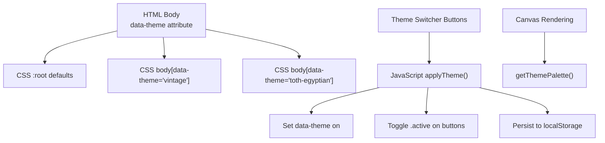
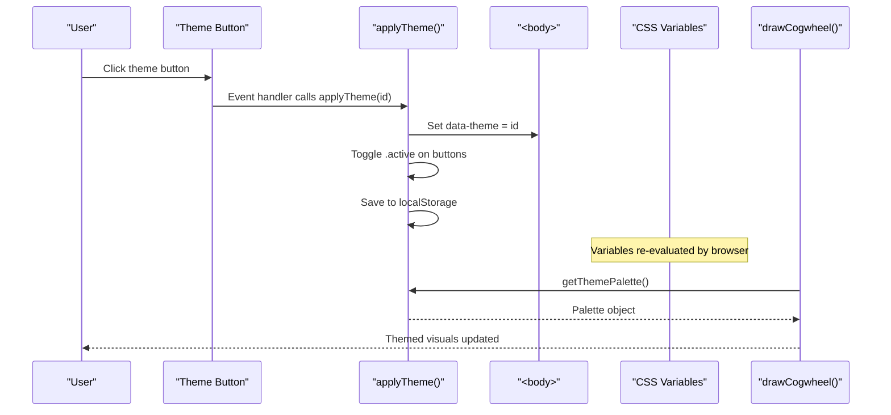
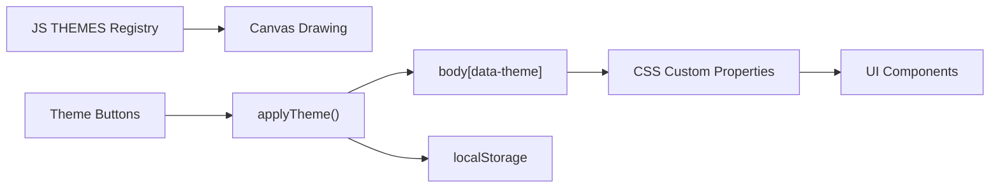

# Theme System and Visual Customization

<cite>
**Referenced Files in This Document**
- [Alg_Virt_WhLL.html](file://Alg_Virt_WhLL.html)
</cite>

## Table of Contents
1. [Introduction](#introduction)
2. [Project Structure](#project-structure)
3. [Core Components](#core-components)
4. [Architecture Overview](#architecture-overview)
5. [Detailed Component Analysis](#detailed-component-analysis)
6. [Dependency Analysis](#dependency-analysis)
7. [Performance Considerations](#performance-considerations)
8. [Troubleshooting Guide](#troubleshooting-guide)
9. [Conclusion](#conclusion)
10. [Appendices](#appendices)

## Introduction
This document explains the theme system and visual customization options for the application. It covers:
- The three built-in themes: Spaceship (futuristic blue/cyan), Vintage (warm sepia/gold), and Toth Egyptian (ancient gold/teal).
- How CSS custom properties implement theming across the UI.
- The theme switcher interface, including visual swatches and active state indicators.
- Theme-specific styling differences such as background gradients, typography, borders, and color schemes.
- How to extend the system with custom themes by modifying CSS variables.
- Theme persistence using Local Storage and browser compatibility considerations.
- Practical patterns and best practices for maintaining visual consistency.

## Project Structure
The project is a single-page HTML file that contains:
- Inline CSS defining default and theme-scoped CSS custom properties.
- A small theme switcher bar with buttons and colored swatches.
- JavaScript that applies themes, persists selections, and drives rendering.

**Diagram sources**
- [Alg_Virt_WhLL.html:8-83](file://Alg_Virt_WhLL.html#L8-L83)
- [Alg_Virt_WhLL.html:115-171](file://Alg_Virt_WhLL.html#L115-L171)
- [Alg_Virt_WhLL.html:867-918](file://Alg_Virt_WhLL.html#L867-L918)

**Section sources**
- [Alg_Virt_WhLL.html:8-83](file://Alg_Virt_WhLL.html#L8-L83)
- [Alg_Virt_WhLL.html:115-171](file://Alg_Virt_WhLL.html#L115-L171)
- [Alg_Virt_WhLL.html:867-918](file://Alg_Virt_WhLL.html#L867-L918)

## Core Components
- CSS custom properties define the global palette and layout tokens used throughout the app.
- Theme-scoped overrides adjust colors, fonts, radii, and backdrop gradients per theme.
- The theme switcher updates the body’s data-theme attribute and toggles button states.
- JavaScript maintains a theme registry and provides functions to apply and persist themes.

Key responsibilities:
- Default theme variables in :root.
- Theme overrides under body[data-theme="..."].
- Theme UI elements: label, buttons, swatches, and active state styles.
- JavaScript theme registry and switching logic.

**Section sources**
- [Alg_Virt_WhLL.html:8-83](file://Alg_Virt_WhLL.html#L8-L83)
- [Alg_Virt_WhLL.html:115-171](file://Alg_Virt_WhLL.html#L115-L171)
- [Alg_Virt_WhLL.html:867-918](file://Alg_Virt_WhLL.html#L867-L918)

## Architecture Overview
The theme system follows a simple attribute-driven model:
- CSS uses selectors like body[data-theme="vintage"] to override variables.
- JavaScript sets document.body.dataset.theme to activate a theme.
- The same variables are consumed by both CSS and Canvas rendering via getThemePalette().

**Diagram sources**
- [Alg_Virt_WhLL.html:867-918](file://Alg_Virt_WhLL.html#L867-L918)
- [Alg_Virt_WhLL.html:1142-1156](file://Alg_Virt_WhLL.html#L1142-L1156)

## Detailed Component Analysis

### Built-in Themes
The application ships with three themes. Each theme defines a cohesive set of CSS custom properties and specific design details.

- Spaceship (default)
  - Colors: Dark navy background, cyan accent glow, bright white headings.
  - Typography: Monospace UI font.
  - Borders and panels: Subtle rounded corners; panel inner glow uses accent RGB.
  - Background: Radial accents at top-left and bottom-right.

- Vintage
  - Colors: Warm dark brown backgrounds, sepia/gold accents, muted text.
  - Typography: Serif UI font.
  - Borders and panels: Tighter radius; decorative inset border overlay.
  - Background: Soft radial highlight plus subtle repeating lines.

- Toth Egyptian
  - Colors: Deep dark base, rich gold accents, teal hints in swatch.
  - Typography: Classic serif stack.
  - Borders and panels: Sharp edges; decorative repeating stripe at panel top.
  - Background: Repeating vertical stripes and radial highlight.

These differences are implemented through:
- Variable overrides in body[data-theme="..."] blocks.
- Theme-specific rules for headings, panels, headers, and overlays.
- Swatch classes that visually represent each theme’s palette.

**Section sources**
- [Alg_Virt_WhLL.html:8-83](file://Alg_Virt_WhLL.html#L8-L83)
- [Alg_Virt_WhLL.html:637-696](file://Alg_Virt_WhLL.html#L637-L696)
- [Alg_Virt_WhLL.html:169-171](file://Alg_Virt_WhLL.html#L169-L171)

### CSS Custom Properties and Theming Model
The theme engine relies on CSS custom properties defined in :root and overridden per theme.

Important variables include:
- --bg-color: Base page background.
- --panel-bg: Panel background.
- --border-color: Borders and dividers.
- --text-color: Primary text color.
- --accent-glow: Accent color used for glows and highlights.
- --accent-rgb: Numeric RGB form for shadows and fills.
- --negative-color / --negative-rgb: Negative/error states.
- --heading-color: Headings and strong labels.
- --muted-color: Secondary or disabled-like text.
- --readout-bg: Readout panel background.
- --overlay-bg: Overlay surfaces.
- --back-face-bg: Back faces in 3D stack.
- --canvas-center / --canvas-edge: Canvas radial gradient center/edge.
- --scene-center / --scene-edge: 3D scene radial gradient.
- --ui-font: UI font family.
- --panel-radius: Border radius for panels and controls.
- --body-backdrop: Page-level background image.

How they are applied:
- Body and panels use these variables for colors, backgrounds, and radii.
- Selectors and components reference variables consistently, ensuring theme changes propagate automatically.

**Section sources**
- [Alg_Virt_WhLL.html:8-83](file://Alg_Virt_WhLL.html#L8-L83)
- [Alg_Virt_WhLL.html:87-98](file://Alg_Virt_WhLL.html#L87-L98)
- [Alg_Virt_WhLL.html:181-191](file://Alg_Virt_WhLL.html#L181-L191)

### Theme Switcher Interface
The theme switcher consists of:
- A labeled row with three buttons.
- Each button includes a small circular swatch representing its palette.
- The active button receives an .active class with a glowing border and shadow.

Behavior:
- Clicking a button triggers applyTheme(themeId).
- The function sets data-theme on the body and toggles .active on buttons.
- The selection is saved to localStorage.

Visuals:
- Swatches use predefined gradient classes to preview theme colors.
- Active state uses accent-glow and accent-rgb for consistent emphasis.

**Section sources**
- [Alg_Virt_WhLL.html:115-171](file://Alg_Virt_WhLL.html#L115-L171)
- [Alg_Virt_WhLL.html:895-918](file://Alg_Virt_WhLL.html#L895-L918)

### Theme-Specific Styling Differences
Typography:
- Spaceship: Monospace UI font.
- Vintage: Serif UI font; italic subtitle; wider letter-spacing on headings.
- Toth Egyptian: Serif stack; distinct heading letter-spacing and shadow.

Backgrounds:
- Each theme defines a unique --body-backdrop combining radial gradients and optional repeating patterns.

Panels and Borders:
- Vintage adds an inset decorative border overlay.
- Toth Egyptian adds a repeating linear stripe at the top of panels.
- Radii vary: Spaceship has moderate rounding, Vintage tight, Toth Egyptian sharp.

Color Schemes:
- Accent colors differ per theme (cyan vs. gold variants).
- Negative states use theme-appropriate reds.
- Muted and heading colors adapt to maintain contrast.

**Section sources**
- [Alg_Virt_WhLL.html:8-83](file://Alg_Virt_WhLL.html#L8-L83)
- [Alg_Virt_WhLL.html:637-696](file://Alg_Virt_WhLL.html#L637-L696)

### Extending the Theme System
To add a new theme:
1. Define a new CSS block under body[data-theme="your-theme"].
2. Override all relevant CSS custom properties to match your palette and style.
3. Add a corresponding button in the theme switcher with a matching swatch class.
4. If you need canvas-specific colors, update the JavaScript theme registry to include your theme’s palette values.

Recommended variable groups to cover:
- Surface colors: --bg-color, --panel-bg, --readout-bg, --overlay-bg, --back-face-bg.
- Edge and frame: --border-color, --panel-radius.
- Text: --text-color, --heading-color, --muted-color.
- Accents: --accent-glow, --accent-rgb, --negative-color, --negative-rgb.
- Surfaces and scenes: --canvas-center, --canvas-edge, --scene-center, --scene-edge.
- Typography: --ui-font.
- Background: --body-backdrop.

For canvas rendering:
- Extend the THEMES registry with accent, accentRgb, bright, neutralRgb, and canvasFont.
- Ensure drawCogwheel uses getThemePalette(), which already reads from this registry.

**Section sources**
- [Alg_Virt_WhLL.html:8-83](file://Alg_Virt_WhLL.html#L8-L83)
- [Alg_Virt_WhLL.html:712-723](file://Alg_Virt_WhLL.html#L712-L723)
- [Alg_Virt_WhLL.html:867-890](file://Alg_Virt_WhLL.html#L867-L890)
- [Alg_Virt_WhLL.html:1142-1156](file://Alg_Virt_WhLL.html#L1142-L1156)

### Theme Persistence and Browser Compatibility
Persistence:
- On theme change, the selected theme ID is stored under a dedicated key in localStorage.
- On load, the code attempts to read the saved value and applies it if valid; otherwise, it falls back to the default theme.

Compatibility notes:
- localStorage access is wrapped in try/catch to handle environments where storage is unavailable or blocked.
- The theme switching logic gracefully degrades when storage is not available.

Best practices:
- Always wrap storage operations in try/catch.
- Validate saved values against the known theme registry before applying.
- Provide a sensible default theme when no preference exists.

**Section sources**
- [Alg_Virt_WhLL.html:895-918](file://Alg_Virt_WhLL.html#L895-L918)

### Canvas Integration with Themes
Canvas rendering consumes the theme palette via getThemePalette():
- Uses accent, accentRgb, bright, neutralRgb, and canvasFont for drawing rings, labels, and effects.
- Ensures the canvas visuals remain consistent with the current CSS theme.

When extending themes:
- Keep the canvas palette aligned with CSS variables to avoid visual mismatches between DOM and canvas.

**Section sources**
- [Alg_Virt_WhLL.html:867-890](file://Alg_Virt_WhLL.html#L867-L890)
- [Alg_Virt_WhLL.html:1142-1156](file://Alg_Virt_WhLL.html#L1142-L1156)

## Dependency Analysis
The theme system has clear boundaries and minimal coupling:
- CSS depends only on data-theme attributes and standard CSS features.
- JavaScript manages state and DOM attributes but delegates styling to CSS variables.
- Canvas rendering depends on the JavaScript theme registry, not directly on CSS variables.

**Diagram sources**
- [Alg_Virt_WhLL.html:8-83](file://Alg_Virt_WhLL.html#L8-L83)
- [Alg_Virt_WhLL.html:867-918](file://Alg_Virt_WhLL.html#L867-L918)
- [Alg_Virt_WhLL.html:1142-1156](file://Alg_Virt_WhLL.html#L1142-L1156)

**Section sources**
- [Alg_Virt_WhLL.html:8-83](file://Alg_Virt_WhLL.html#L8-L83)
- [Alg_Virt_WhLL.html:867-918](file://Alg_Virt_WhLL.html#L867-L918)
- [Alg_Virt_WhLL.html:1142-1156](file://Alg_Virt_WhLL.html#L1142-L1156)

## Performance Considerations
- Theme switching is lightweight: it updates one DOM attribute and toggles a few classes.
- CSS variable evaluation is handled by the browser; avoid excessive recomputation.
- Canvas redraws occur after theme changes to ensure visuals align with the new palette.
- Avoid heavy computations inside theme handlers; keep event handlers focused on state changes.

[No sources needed since this section provides general guidance]

## Troubleshooting Guide
Common issues and resolutions:
- Theme does not appear to change:
  - Verify that body[data-theme] matches a known theme selector in CSS.
  - Confirm that the button click handler calls applyTheme with a valid theme ID.
- localStorage errors:
  - Check for privacy modes or restricted environments; the code handles exceptions gracefully.
- Canvas colors mismatched with UI:
  - Ensure the JavaScript theme registry includes the same accent and font choices as the CSS theme.
- Active indicator not updating:
  - Confirm that .theme-btn.active styles are present and that the active toggle logic runs.

**Section sources**
- [Alg_Virt_WhLL.html:895-918](file://Alg_Virt_WhLL.html#L895-L918)
- [Alg_Virt_WhLL.html:1142-1156](file://Alg_Virt_WhLL.html#L1142-L1156)

## Conclusion
The theme system is a clean, attribute-driven approach that leverages CSS custom properties for broad visual control and a small JavaScript registry for canvas consistency. The three built-in themes provide distinct aesthetics while sharing a common structure. Extending the system involves adding CSS overrides, updating the theme switcher, and synchronizing the canvas palette. Persistence is straightforward and robust, with safe handling for environments without storage support. Following the recommended patterns ensures visual consistency and maintainability across components.

[No sources needed since this section summarizes without analyzing specific files]

## Appendices

### Quick Reference: Theme Variables
Use these variables to customize or create new themes:
- Surface and background: --bg-color, --panel-bg, --readout-bg, --overlay-bg, --back-face-bg, --body-backdrop.
- Edges and frames: --border-color, --panel-radius.
- Text: --text-color, --heading-color, --muted-color.
- Accents: --accent-glow, --accent-rgb, --negative-color, --negative-rgb.
- Scenes and canvases: --canvas-center, --canvas-edge, --scene-center, --scene-edge.
- Typography: --ui-font.

**Section sources**
- [Alg_Virt_WhLL.html:8-83](file://Alg_Virt_WhLL.html#L8-L83)

### Theme Switcher Markup Pattern
- Wrap buttons in a container with a descriptive label.
- Include a small swatch span per button to visualize the theme.
- Mark the default theme button with the .active class.

**Section sources**
- [Alg_Virt_WhLL.html:712-723](file://Alg_Virt_WhLL.html#L712-L723)