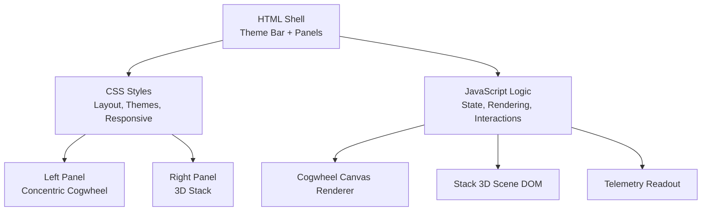
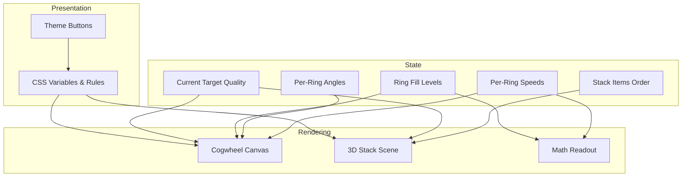
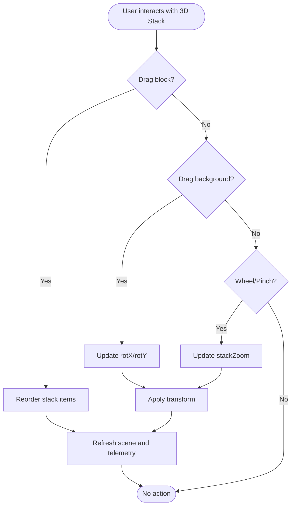
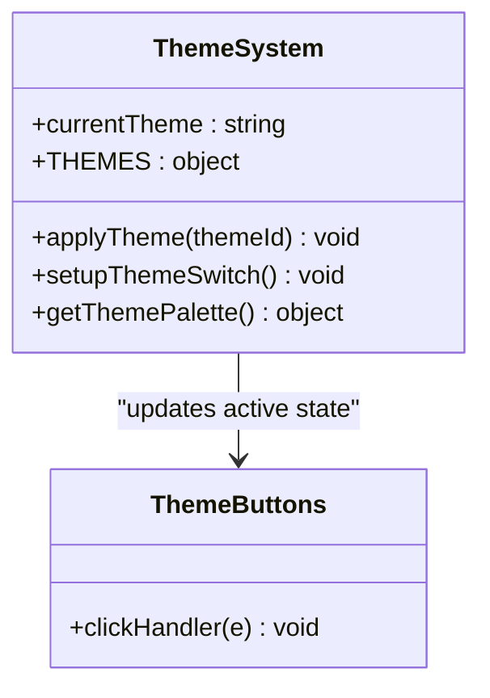
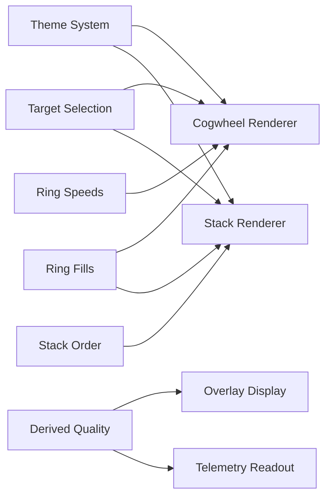

# User Interface Guide

<cite>
**Referenced Files in This Document**
- [Alg_Virt_WhLL.html](file://Alg_Virt_WhLL.html)
</cite>

## Table of Contents
1. [Introduction](#introduction)
2. [Project Structure](#project-structure)
3. [Core Components](#core-components)
4. [Architecture Overview](#architecture-overview)
5. [Detailed Component Analysis](#detailed-component-analysis)
6. [Dependency Analysis](#dependency-analysis)
7. [Performance Considerations](#performance-considerations)
8. [Troubleshooting Guide](#troubleshooting-guide)
9. [Conclusion](#conclusion)

## Introduction
This guide documents the user interface and interaction patterns for a dual-panel visualization:
- Left panel: Concentric cogwheel with drag-to-fill, per-ring rotation, zoom, and spin speed controls.
- Right panel: 3D stack visualization with draggable blocks and perspective rotation.

It also covers the theme system (Spaceship, Vintage, Toth Egyptian), fullscreen mode, responsive behavior on mobile devices, accessibility considerations, touch gestures, keyboard shortcuts, and advanced interactions such as Shift+Wheel for ring spin control.

## Project Structure
The application is implemented as a single-page HTML file containing:
- CSS styles defining layout, themes, and responsive rules.
- A DOM structure with two main panels: cogwheel and 3D stack.
- JavaScript logic for rendering, interaction handling, state management, and telemetry output.

**Diagram sources**
- [Alg_Virt_WhLL.html:1-800](file://Alg_Virt_WhLL.html#L1-L800)
- [Alg_Virt_WhLL.html:801-1600](file://Alg_Virt_WhLL.html#L801-L1600)
- [Alg_Virt_WhLL.html:1601-2033](file://Alg_Virt_WhLL.html#L1601-L2033)

**Section sources**
- [Alg_Virt_WhLL.html:1-800](file://Alg_Virt_WhLL.html#L1-L800)
- [Alg_Virt_WhLL.html:801-1600](file://Alg_Virt_WhLL.html#L801-L1600)
- [Alg_Virt_WhLL.html:1601-2033](file://Alg_Virt_WhLL.html#L1601-L2033)

## Core Components
- Dual-panel layout:
  - Left panel: Concentric cogwheel canvas with derived quality overlay and controls.
  - Right panel: 3D stack scene with draggable blocks and view controls.
- Theme system:
  - Three visual themes applied via CSS variables and data attributes.
- Interaction model:
  - Mouse and touch events for fill, rotation, zoom, and reordering.
  - Keyboard shortcuts for advanced controls.
- Telemetry readout:
  - Textual summary of target, formulas, layer fills, and combined quality.

**Section sources**
- [Alg_Virt_WhLL.html:170-223](file://Alg_Virt_WhLL.html#L170-L223)
- [Alg_Virt_WhLL.html:283-440](file://Alg_Virt_WhLL.html#L283-L440)
- [Alg_Virt_WhLL.html:450-632](file://Alg_Virt_WhLL.html#L450-L632)
- [Alg_Virt_WhLL.html:709-824](file://Alg_Virt_WhLL.html#L709-L824)

## Architecture Overview
The UI architecture separates concerns into three layers:
- Presentation: CSS defines themes, layout, and responsive breakpoints.
- State: JavaScript maintains current target, ring fills, angles, speeds, and stack order.
- Rendering: Canvas draws the cogwheel; DOM constructs the 3D stack scene.

**Diagram sources**
- [Alg_Virt_WhLL.html:864-915](file://Alg_Virt_WhLL.html#L864-L915)
- [Alg_Virt_WhLL.html:917-1126](file://Alg_Virt_WhLL.html#L917-L1126)
- [Alg_Virt_WhLL.html:1139-1351](file://Alg_Virt_WhLL.html#L1139-L1351)
- [Alg_Virt_WhLL.html:1617-1760](file://Alg_Virt_WhLL.html#L1617-L1760)
- [Alg_Virt_WhLL.html:1883-1942](file://Alg_Virt_WhLL.html#L1883-L1942)

## Detailed Component Analysis

### Dual-Panel Layout
- Grid-based two-column layout that collapses to a single column on small screens.
- Each panel has a header with actions (fullscreen toggle).
- Fullscreen mode expands the active panel to full viewport size and adjusts internal elements accordingly.

Key behaviors:
- Responsive grid switches from two columns to one at narrow widths.
- Fullscreen CSS overrides dimensions and padding for both panels.
- Derived quality overlay remains visible over the cogwheel in fullscreen.

**Section sources**
- [Alg_Virt_WhLL.html:170-223](file://Alg_Virt_WhLL.html#L170-L223)
- [Alg_Virt_WhLL.html:695-704](file://Alg_Virt_WhLL.html#L695-L704)
- [Alg_Virt_WhLL.html:1947-1980](file://Alg_Virt_WhLL.html#L1947-L1980)

### Concentric Cogwheel Interface
The cogwheel represents layered components of the selected target quality. Each ring corresponds to a layer and shows:
- Fill level (drag-to-fill).
- Per-ring rotation angle.
- Spin speed (rad/s).
- Component labels and antagonist labels when not fully filled.

Interactions:
- Drag on a ring to set its fill level by angle.
- Shift+Wheel over a ring to adjust its spin speed incrementally.
- Wheel over the canvas to zoom in/out.
- Pinch-zoom on mobile to zoom the cogwheel.
- Click Play to auto-rotate the entire wheel; individual rings can spin independently based on their speeds.
- Zoom buttons and reset button for global rotation and per-ring states.

Derived quality:
- Combines fill levels and spin speeds to compute an emergent or negative quality label.
- Displays a pulsing overlay with tag, name, and formula.

Controls:
- Ring spin selector to choose which ring’s speed to adjust.
- Increment/decrement buttons for speed.
- Clear all ring spins.

```mermaid
sequenceDiagram
participant User as "User"
participant Canvas as "Cogwheel Canvas"
participant State as "State Manager"
participant Render as "Renderer"
participant Overlay as "Derived Quality Overlay"
User->>Canvas : "Drag on ring"
Canvas->>State : "Update fill level for ring"
State-->>Render : "Trigger redraw"
Render->>Overlay : "Compute and update derived quality"
Overlay-->>User : "Show emergent/negative quality"
User->>Canvas : "Shift+Wheel on ring"
Canvas->>State : "Adjust ring speed"
State-->>Render : "Ensure animation loop if needed"
Render->>Overlay : "Recompute derived quality"
```

**Diagram sources**
- [Alg_Virt_WhLL.html:1353-1492](file://Alg_Virt_WhLL.html#L1353-L1492)
- [Alg_Virt_WhLL.html:1494-1612](file://Alg_Virt_WhLL.html#L1494-L1612)
- [Alg_Virt_WhLL.html:1016-1090](file://Alg_Virt_WhLL.html#L1016-L1090)

**Section sources**
- [Alg_Virt_WhLL.html:283-440](file://Alg_Virt_WhLL.html#L283-L440)
- [Alg_Virt_WhLL.html:771-799](file://Alg_Virt_WhLL.html#L771-L799)
- [Alg_Virt_WhLL.html:1139-1351](file://Alg_Virt_WhLL.html#L1139-L1351)
- [Alg_Virt_WhLL.html:1353-1492](file://Alg_Virt_WhLL.html#L1353-L1492)
- [Alg_Virt_WhLL.html:1494-1612](file://Alg_Virt_WhLL.html#L1494-L1612)
- [Alg_Virt_WhLL.html:1016-1090](file://Alg_Virt_WhLL.html#L1016-L1090)

### 3D Stack Visualization
The right panel displays stacked blocks representing components and their antagonists:
- Blocks are arranged by layer and can be reordered via drag-and-drop.
- Perspective rotation allows exploring depth and orientation.
- Zoom changes scale and translate along Z-axis.
- Antagonist faces can be toggled on/off.
- Auto-spin rotates the scene continuously.

Interactions:
- Drag blocks to reorder within the stack.
- Drag background to rotate perspective (X/Y axes).
- Wheel to zoom in/out.
- Touch gestures:
  - Single-finger drag to rotate.
  - Two-finger pinch to zoom.
- Buttons:
  - Reset view.
  - Toggle antagonist labels.
  - Start/stop auto-spin.

**Diagram sources**
- [Alg_Virt_WhLL.html:1617-1760](file://Alg_Virt_WhLL.html#L1617-L1760)
- [Alg_Virt_WhLL.html:1769-1878](file://Alg_Virt_WhLL.html#L1769-L1878)

**Section sources**
- [Alg_Virt_WhLL.html:450-632](file://Alg_Virt_WhLL.html#L450-L632)
- [Alg_Virt_WhLL.html:801-824](file://Alg_Virt_WhLL.html#L801-L824)
- [Alg_Virt_WhLL.html:1617-1760](file://Alg_Virt_WhLL.html#L1617-L1760)
- [Alg_Virt_WhLL.html:1769-1878](file://Alg_Virt_WhLL.html#L1769-L1878)

### Theme System
Three distinct visual themes are available:
- Spaceship: Neon cyan accents, monospace font, dark futuristic backdrop.
- Vintage: Warm gold accents, serif fonts, textured backdrop.
- Toth Egyptian: Rich gold and teal accents, classical serif fonts, striped backdrop.

Customization options:
- Theme selection via buttons in the theme bar.
- Active theme persisted in localStorage.
- CSS variables dynamically switch colors, fonts, borders, shadows, and backdrops.

**Diagram sources**
- [Alg_Virt_WhLL.html:864-915](file://Alg_Virt_WhLL.html#L864-L915)
- [Alg_Virt_WhLL.html:709-720](file://Alg_Virt_WhLL.html#L709-L720)

**Section sources**
- [Alg_Virt_WhLL.html:32-80](file://Alg_Virt_WhLL.html#L32-L80)
- [Alg_Virt_WhLL.html:112-168](file://Alg_Virt_WhLL.html#L112-L168)
- [Alg_Virt_WhLL.html:634-693](file://Alg_Virt_WhLL.html#L634-L693)
- [Alg_Virt_WhLL.html:709-720](file://Alg_Virt_WhLL.html#L709-L720)
- [Alg_Virt_WhLL.html:864-915](file://Alg_Virt_WhLL.html#L864-L915)

### Fullscreen Mode
Each panel includes a fullscreen toggle button:
- Expands the selected panel to occupy the full viewport.
- Adjusts internal element sizing and visibility.
- Re-renders canvases and scenes after entering/exiting fullscreen.

Usage:
- Click the “Fullscreen” button in either panel header.
- Exit fullscreen using the browser’s exit mechanism or clicking the button again.

**Section sources**
- [Alg_Virt_WhLL.html:190-223](file://Alg_Virt_WhLL.html#L190-L223)
- [Alg_Virt_WhLL.html:728-734](file://Alg_Virt_WhLL.html#L728-L734)
- [Alg_Virt_WhLL.html:804-809](file://Alg_Virt_WhLL.html#L804-L809)
- [Alg_Virt_WhLL.html:1947-1980](file://Alg_Virt_WhLL.html#L1947-L1980)

### Responsive Design and Mobile Gestures
Responsive behavior:
- On screens narrower than 768px, the layout switches to a single column.
- Cogwheel container max-height reduces; stack viewport height decreases.
- Block sizes shrink for better fit on smaller screens.

Touch gestures:
- Cogwheel:
  - Single-finger drag to fill rings.
  - Two-finger pinch to zoom.
- 3D Stack:
  - Single-finger drag to rotate perspective.
  - Two-finger pinch to zoom.

Accessibility considerations:
- Buttons have descriptive titles and clear hover states.
- Controls use semantic HTML elements (select, button).
- Visual feedback through color changes and overlays.
- Avoid relying solely on color; text labels and icons provide context.

Keyboard shortcuts:
- Shift+Wheel over a cogwheel ring adjusts that ring’s spin speed.
- No explicit global keyboard shortcuts beyond standard browser behaviors.

Advanced interactions:
- Shift+Wheel on cogwheel ring: increments/decrements ring speed by fixed step.
- Wheel on cogwheel canvas: zoom in/out.
- Wheel on 3D stack viewport: zoom in/out.

**Section sources**
- [Alg_Virt_WhLL.html:695-704](file://Alg_Virt_WhLL.html#L695-L704)
- [Alg_Virt_WhLL.html:1448-1492](file://Alg_Virt_WhLL.html#L1448-L1492)
- [Alg_Virt_WhLL.html:1794-1838](file://Alg_Virt_WhLL.html#L1794-L1838)

### Teleme try Readout
The telemetry panel provides:
- Timestamped header.
- Target component and its formula.
- Layer-by-layer fill bars and associated positive/negative components.
- Combined emergent/negative quality result.
- Current zoom, rotation, autoplay status, and stack rotation.

Updates occur whenever state changes (target change, fill updates, spin adjustments).

**Section sources**
- [Alg_Virt_WhLL.html:1883-1942](file://Alg_Virt_WhLL.html#L1883-L1942)
- [Alg_Virt_WhLL.html:1985-2002](file://Alg_Virt_WhLL.html#L1985-L2002)

## Dependency Analysis
Component relationships:
- Theme system affects presentation across both panels.
- Cogwheel rendering depends on current target, ring fills, angles, and speeds.
- 3D stack rendering depends on stack item order and layer fills.
- Derived quality computation depends on fills and speeds.
- Telemetry readout aggregates state for display.

**Diagram sources**
- [Alg_Virt_WhLL.html:864-915](file://Alg_Virt_WhLL.html#L864-L915)
- [Alg_Virt_WhLL.html:917-1126](file://Alg_Virt_WhLL.html#L917-L1126)
- [Alg_Virt_WhLL.html:1139-1351](file://Alg_Virt_WhLL.html#L1139-L1351)
- [Alg_Virt_WhLL.html:1617-1760](file://Alg_Virt_WhLL.html#L1617-L1760)
- [Alg_Virt_WhLL.html:1016-1090](file://Alg_Virt_WhLL.html#L1016-L1090)

**Section sources**
- [Alg_Virt_WhLL.html:864-915](file://Alg_Virt_WhLL.html#L864-L915)
- [Alg_Virt_WhLL.html:917-1126](file://Alg_Virt_WhLL.html#L917-L1126)
- [Alg_Virt_WhLL.html:1139-1351](file://Alg_Virt_WhLL.html#L1139-L1351)
- [Alg_Virt_WhLL.html:1617-1760](file://Alg_Virt_WhLL.html#L1617-L1760)
- [Alg_Virt_WhLL.html:1016-1090](file://Alg_Virt_WhLL.html#L1016-L1090)

## Performance Considerations
- Canvas rendering uses device pixel ratio scaling for crisp visuals on high-DPI displays.
- Animation loops run only when necessary (autoplay or any ring spinning).
- Resize events debounce refresh calls to avoid excessive redraws.
- CSS transitions and transforms leverage GPU acceleration where possible.
- Touch event handlers use passive flags where appropriate to improve scrolling performance.

[No sources needed since this section provides general guidance]

## Troubleshooting Guide
Common issues and resolutions:
- Cogwheel does not respond to drag:
  - Ensure pointer events are not blocked by other elements.
  - Verify hit testing returns a valid ring index.
- Ring spin speed not updating:
  - Confirm Shift+Wheel is detected and delta direction is correct.
  - Check that ring speed limits are respected.
- 3D stack not rotating:
  - Ensure mouse/touch events are bound to the viewport background, not blocks.
  - Validate transform application and bounds for rotation angles.
- Theme not applying:
  - Verify body data attribute matches theme ID.
  - Check CSS variable definitions for the selected theme.
- Fullscreen not working:
  - Confirm browser supports fullscreen API.
  - Handle vendor-prefixed methods for compatibility.

**Section sources**
- [Alg_Virt_WhLL.html:1353-1492](file://Alg_Virt_WhLL.html#L1353-L1492)
- [Alg_Virt_WhLL.html:1769-1878](file://Alg_Virt_WhLL.html#L1769-L1878)
- [Alg_Virt_WhLL.html:1947-1980](file://Alg_Virt_WhLL.html#L1947-L1980)

## Conclusion
This interface combines a rich, interactive cogwheel with a navigable 3D stack to visualize layered virtues and their antagonists. Users can manipulate fills, rotations, and spin speeds, explore perspectives, and switch between visually distinct themes. The design emphasizes clarity, responsiveness, and accessibility while supporting advanced interactions like Shift+Wheel for precise control.

[No sources needed since this section summarizes without analyzing specific files]